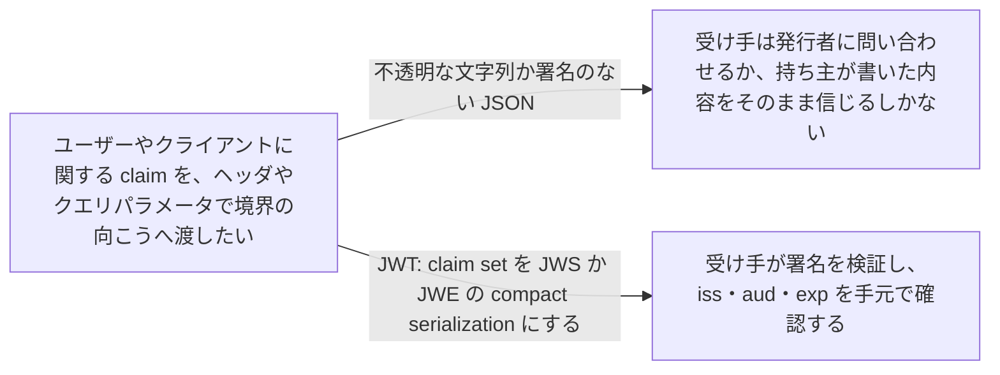
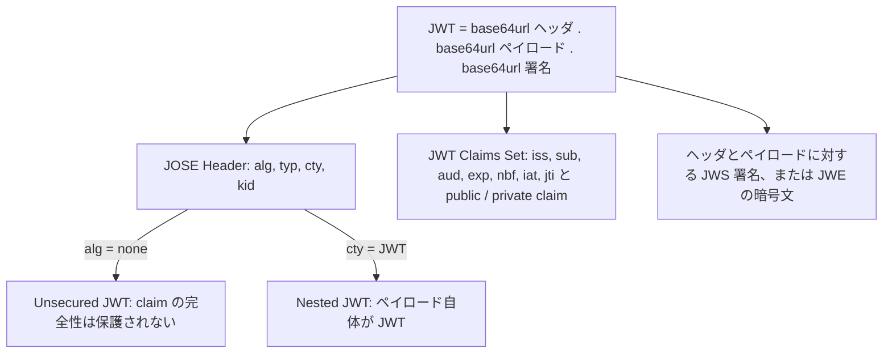

# JSON Web Token (JWT)

> 一言で言うと: claim を並べた JSON を base64url にして署名 (JWS) か暗号化 (JWE) したもの。HTTP ヘッダやクエリ文字列に収まる大きさで claim を運ぶ。

## どういうときに使うか

- **claim を HTTP の `Authorization` ヘッダや URI のクエリパラメータで運びたい**: JWT はまさにそうした容量の限られた場所向けに設計された compact な claim 形式で、`iss`、`sub`、`aud`、`exp` をトークン自身に載せて運ぶ (Section 1)。
- **2 者間で claim を渡し、受け手がそれを信頼しなければならない**: JWS で保護された JWT なら、受け手は「持ち主ではなく発行者がこの claim を作った」ことを検証できる (Section 11.1)。
- **トークンを運ぶ者にも claim を見せたくない**: JWE として表現した JWT は claim set を暗号化する。入れ子にすれば、先に署名してから結果を暗号化できる (Section 3、11.2)。
- **ベンダーの違うライブラリ同士で同じトークンを扱いたい**: 登録済みの claim 名と固定の検証手順があるので、どの実装も同じトークンを同じように読む (Section 4.1、7.2)。

## 解決する問題

クライアント、認可サーバー、リソースサーバーはどれも subject に関する主張をやり取りする必要があり、その置き場所はたいてい HTTP の `Authorization` ヘッダか URI のクエリパラメータになる。そこには冗長な封筒を入れる余裕がなく、リクエストを見た誰もが中身をコピーできる。

JWT は形を固定する。claim set の JSON を JWS の payload か JWE の plaintext として、常に compact serialization で表現する (Section 1)。受け手が受け取るのは、ピリオドで区切られた URL-safe な部品の並びだ (Section 3)。署名を検証し、誰が発行して誰宛でいつまで有効かを読み、検証できないものは拒否する。発行者と通信する必要はない。

## 仕組み

JOSE Header は claim set に施した暗号操作を記述し、`typ` パラメータを付けるなら値は `JWT` が推奨される (Section 3、5.1)。claim set には 7 つの登録済み claim 名がある。`iss` は発行者、`sub` は subject、`aud` は想定する受け手、`exp` はそれ以降受理してはならない時刻、`nbf` はそれ以前に受理してはならない時刻、`iat` は発行時刻、`jti` はリプレイ防止に使える一意な識別子だ (Section 4.1.1〜4.1.7)。新しい public claim 名は登録するか衝突しにくい名前にすべきで、private claim 名は衝突しうる (Section 4.2、4.3)。署名と暗号化を入れ子にするときは `cty` を必ず付けて値を `JWT` にし、受け手が内側のトークンも検証すべきだと分かるようにする (Section 5.2)。`alg` が `none` で署名が空の JWS は Unsecured JWT で、トークン以外の手段で内容を守る場面のためにある (Section 6)。

## 仕様が求めること

- JWT は常に JWS Compact Serialization か JWE Compact Serialization で表現する (Section 1)。
- どの登録済み claim も、すべての場面で必須なわけではない。JWT が含むべき claim の集合は文脈に依存し、実装が理解しない claim は無視しなければならない (MUST) (Section 4)。
- `aud` は大文字小文字を区別する文字列の配列で、受け手が 1 つなら単一の文字列でもよい。claim を処理する主体が、`aud` が存在するのにその値のどれにも自分を見いだせないなら、JWT を拒否しなければならない (MUST) (Section 4.1.3)。
- `exp` と `nbf` の判定では、時計のずれを見込んで、通常は数分以内の小さな猶予を設けてもよい (MAY) (Section 4.1.4、4.1.5)。
- 検証は決まった順序で行う。ピリオドが 1 つ以上あることの確認、ヘッダの base64url デコードとパース、ヘッダのすべてのパラメータを理解しサポートしていることの確認、JWS か JWE かの判定、その検証、`cty` が `JWT` なら再帰、最後に claim set のデコードとパース。どの手順でも失敗したら JWT を拒否しなければならない (MUST) (Section 7.2)。
- 準拠する実装は `HS256` と `none` を実装しなければならず (MUST)、`RS256` と `ES256` のサポートが推奨される (SHOULD)。暗号化 JWT と Nested JWT のサポートは任意 (OPTIONAL) (Section 8)。

## 注意点

- JWT の内容は、暗号的に保護され、かつ信頼判断に必要な文脈に束縛されていない限り、信頼判断の根拠にできない (Section 11.1)。
- パーサーは、claim 名が重複する JWT を拒否するか、字句的に最後の重複メンバーだけを返す JSON パーサーを使うかのどちらかでなければならない (MUST)。つまり 2 つの実装が同じトークンを違う内容として読みうる (Section 4)。
- アプリケーションは、使われているアルゴリズムが受け入れられないなら JWT を拒否すべきである。準拠する実装がすべてサポートしなければならない `none` は、完全性をまったく保護しない (Section 6、7.2、8)。
- 署名と暗号化の両方が必要なら、通常は先に署名してから結果を暗号化すべきで、これで署名自体も暗号化される (Section 11.2)。
- JWT はプライバシーに関わる情報を含みうる。その場合、意図しない相手への開示を防ぐ措置を取らなければならず (MUST)、その情報を入れないのが最も単純な措置だ (Section 12)。

## 出典

- [RFC 7519, Section 1](https://www.rfc-editor.org/rfc/rfc7519.html#section-1)
- [RFC 7519, Section 3](https://www.rfc-editor.org/rfc/rfc7519.html#section-3)
- [RFC 7519, Section 4](https://www.rfc-editor.org/rfc/rfc7519.html#section-4)
- [RFC 7519, Section 4.1](https://www.rfc-editor.org/rfc/rfc7519.html#section-4.1)
- [RFC 7519, Section 4.1.1](https://www.rfc-editor.org/rfc/rfc7519.html#section-4.1.1)
- [RFC 7519, Section 4.1.2](https://www.rfc-editor.org/rfc/rfc7519.html#section-4.1.2)
- [RFC 7519, Section 4.1.3](https://www.rfc-editor.org/rfc/rfc7519.html#section-4.1.3)
- [RFC 7519, Section 4.1.4](https://www.rfc-editor.org/rfc/rfc7519.html#section-4.1.4)
- [RFC 7519, Section 4.1.5](https://www.rfc-editor.org/rfc/rfc7519.html#section-4.1.5)
- [RFC 7519, Section 4.1.6](https://www.rfc-editor.org/rfc/rfc7519.html#section-4.1.6)
- [RFC 7519, Section 4.1.7](https://www.rfc-editor.org/rfc/rfc7519.html#section-4.1.7)
- [RFC 7519, Section 4.2](https://www.rfc-editor.org/rfc/rfc7519.html#section-4.2)
- [RFC 7519, Section 4.3](https://www.rfc-editor.org/rfc/rfc7519.html#section-4.3)
- [RFC 7519, Section 5.1](https://www.rfc-editor.org/rfc/rfc7519.html#section-5.1)
- [RFC 7519, Section 5.2](https://www.rfc-editor.org/rfc/rfc7519.html#section-5.2)
- [RFC 7519, Section 6](https://www.rfc-editor.org/rfc/rfc7519.html#section-6)
- [RFC 7519, Section 7.2](https://www.rfc-editor.org/rfc/rfc7519.html#section-7.2)
- [RFC 7519, Section 8](https://www.rfc-editor.org/rfc/rfc7519.html#section-8)
- [RFC 7519, Section 11.1](https://www.rfc-editor.org/rfc/rfc7519.html#section-11.1)
- [RFC 7519, Section 11.2](https://www.rfc-editor.org/rfc/rfc7519.html#section-11.2)
- [RFC 7519, Section 12](https://www.rfc-editor.org/rfc/rfc7519.html#section-12)
