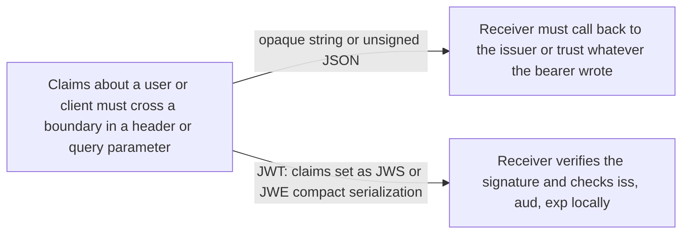
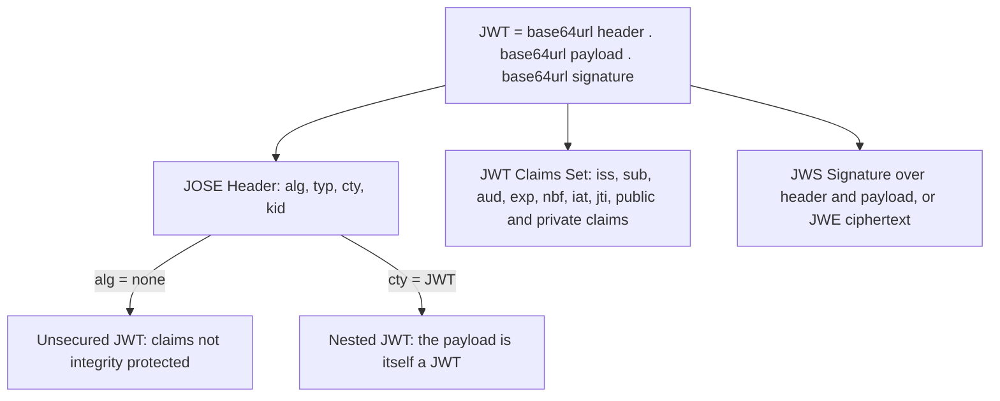

# JSON Web Token (JWT)

> In one line: a JSON object of claims, base64url-encoded and signed (JWS) or encrypted (JWE), small enough to ride in an HTTP header or a query string.

## When you reach for it

- **Claims must travel in an HTTP `Authorization` header or a URI query parameter**: JWT is a compact claims format designed for exactly those space-constrained places, so `iss`, `sub`, `aud` and `exp` ride inside the token itself (Section 1).
- **Two parties exchange claims and the receiver must trust them**: a JWS-secured JWT lets the receiver verify that the issuer, not the bearer, produced the claims (Section 11.1).
- **The claims must stay private from whoever carries the token**: a JWE-represented JWT encrypts the claims set, and nesting lets you sign first and then encrypt the result (Sections 3, 11.2).
- **The token must work with libraries from different vendors**: the registered claim names and the fixed validation steps give every implementation the same reading of the same token (Sections 4.1, 7.2).

## The problem it solves

A client, an authorization server and a resource server all need to pass statements about a subject around, and the place those statements travel is usually an HTTP `Authorization` header or a URI query parameter. Those places have no room for a verbose envelope, and whatever lands there can be copied by anyone who sees the request.

JWT fixes the shape: a JSON claims set, encoded as the payload of a JWS or the plaintext of a JWE, always in compact serialization (Section 1). The receiver gets a string of URL-safe parts separated by periods (Section 3). It can verify the signature, see who issued the token, who it is for and until when, and reject anything it cannot verify, all without talking to the issuer.

## How it works

The JOSE Header describes the cryptographic operations applied to the claims set, and the `typ` parameter, when present, is recommended to be `JWT` (Sections 3, 5.1). The claims set holds the seven registered names: `iss` identifies the issuer, `sub` the subject, `aud` the intended recipients, `exp` the time on or after which the token must not be accepted, `nbf` the time before which it must not be accepted, `iat` the issue time, and `jti` a unique identifier that can prevent replay (Sections 4.1.1 to 4.1.7). New public claim names should be registered or be collision-resistant, and private names are subject to collision (Sections 4.2, 4.3). When signing and encryption are nested, `cty` must be present with the value `JWT` so the receiver knows to validate the inner token too (Section 5.2). A JWS with `alg` set to `none` and an empty signature is an Unsecured JWT, for cases where something other than the token itself protects the content (Section 6).

## What the spec requires

- A JWT is always represented using the JWS Compact Serialization or the JWE Compact Serialization (Section 1).
- No registered claim is mandatory in all cases. The set a JWT must contain is context dependent, and claims an implementation does not understand MUST be ignored (Section 4).
- `aud` is an array of case-sensitive strings, or a single string when there is one audience. If the principal processing the claim does not identify itself with a value in `aud` when the claim is present, the JWT MUST be rejected (Section 4.1.3).
- A receiver MAY allow some small leeway, usually no more than a few minutes, for clock skew when checking `exp` and `nbf` (Sections 4.1.4, 4.1.5).
- Validation follows a fixed sequence: check for at least one period, base64url-decode and parse the header, verify every header parameter is understood and supported, determine JWS or JWE, validate it, recurse if `cty` is `JWT`, then decode and parse the claims set. If any step fails, the JWT MUST be rejected (Section 7.2).
- Conforming implementations MUST implement `HS256` and `none`, and SHOULD support `RS256` and `ES256`. Support for encrypted JWTs and for Nested JWTs is OPTIONAL (Section 8).

## Watch out

- The contents of a JWT cannot be relied upon in a trust decision unless they have been cryptographically secured and bound to the context the decision needs (Section 11.1).
- Parsers MUST either reject JWTs with duplicate claim names or use a JSON parser that returns only the lexically last duplicate, so two implementations can read the same token differently (Section 4).
- An application should reject a JWT whose algorithms are not acceptable to it. The `none` algorithm, which every conforming implementation must support, gives no integrity protection (Sections 6, 7.2, 8).
- When both signing and encryption are needed, producers should normally sign first and then encrypt the result, which also encrypts the signature (Section 11.2).
- A JWT may contain privacy-sensitive information. When it does, measures MUST be taken to prevent disclosure to unintended parties, and omitting the information is the simplest measure (Section 12).

## Sources

- [RFC 7519, Section 1](https://www.rfc-editor.org/rfc/rfc7519.html#section-1)
- [RFC 7519, Section 3](https://www.rfc-editor.org/rfc/rfc7519.html#section-3)
- [RFC 7519, Section 4](https://www.rfc-editor.org/rfc/rfc7519.html#section-4)
- [RFC 7519, Section 4.1](https://www.rfc-editor.org/rfc/rfc7519.html#section-4.1)
- [RFC 7519, Section 4.1.1](https://www.rfc-editor.org/rfc/rfc7519.html#section-4.1.1)
- [RFC 7519, Section 4.1.2](https://www.rfc-editor.org/rfc/rfc7519.html#section-4.1.2)
- [RFC 7519, Section 4.1.3](https://www.rfc-editor.org/rfc/rfc7519.html#section-4.1.3)
- [RFC 7519, Section 4.1.4](https://www.rfc-editor.org/rfc/rfc7519.html#section-4.1.4)
- [RFC 7519, Section 4.1.5](https://www.rfc-editor.org/rfc/rfc7519.html#section-4.1.5)
- [RFC 7519, Section 4.1.6](https://www.rfc-editor.org/rfc/rfc7519.html#section-4.1.6)
- [RFC 7519, Section 4.1.7](https://www.rfc-editor.org/rfc/rfc7519.html#section-4.1.7)
- [RFC 7519, Section 4.2](https://www.rfc-editor.org/rfc/rfc7519.html#section-4.2)
- [RFC 7519, Section 4.3](https://www.rfc-editor.org/rfc/rfc7519.html#section-4.3)
- [RFC 7519, Section 5.1](https://www.rfc-editor.org/rfc/rfc7519.html#section-5.1)
- [RFC 7519, Section 5.2](https://www.rfc-editor.org/rfc/rfc7519.html#section-5.2)
- [RFC 7519, Section 6](https://www.rfc-editor.org/rfc/rfc7519.html#section-6)
- [RFC 7519, Section 7.2](https://www.rfc-editor.org/rfc/rfc7519.html#section-7.2)
- [RFC 7519, Section 8](https://www.rfc-editor.org/rfc/rfc7519.html#section-8)
- [RFC 7519, Section 11.1](https://www.rfc-editor.org/rfc/rfc7519.html#section-11.1)
- [RFC 7519, Section 11.2](https://www.rfc-editor.org/rfc/rfc7519.html#section-11.2)
- [RFC 7519, Section 12](https://www.rfc-editor.org/rfc/rfc7519.html#section-12)
