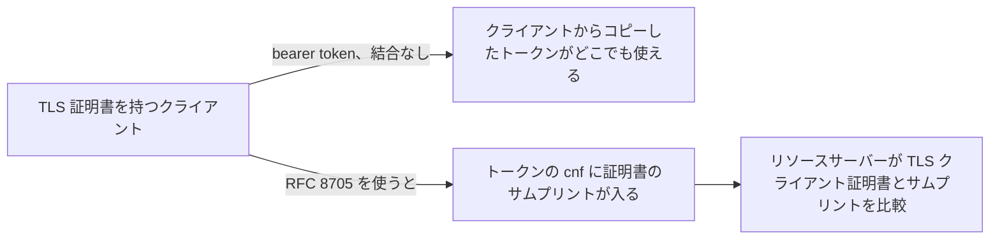
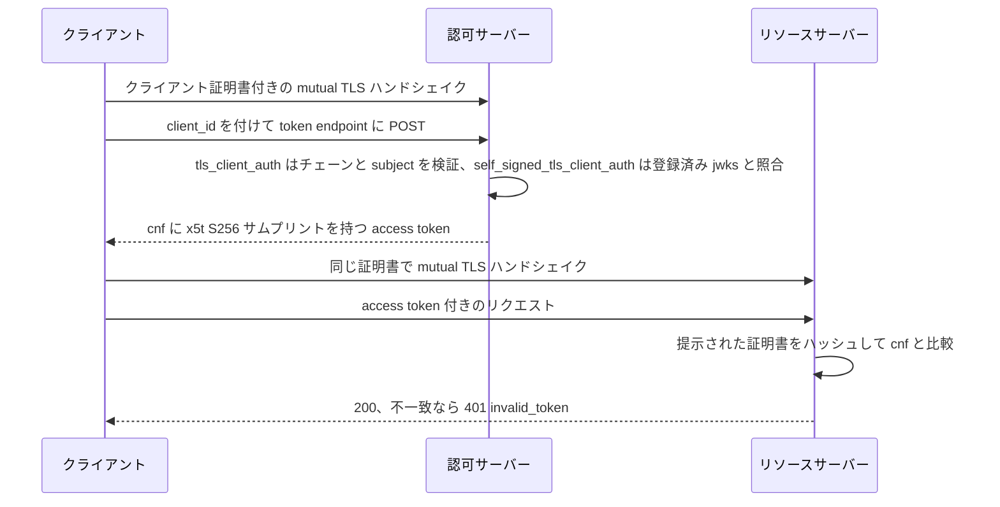

# Mutual-TLS Client Authentication and Certificate-Bound Tokens

> 一言で言うと: TLS クライアント証明書を二役で使い、token endpoint へのクライアント認証と、発行された access token をその証明書に固定することを同時にやる。

## どういうときに使うか

- **すでに証明書を持っている confidential client**: mutual TLS なら共有秘密なしで認証できる。PKI 発行の証明書でも、サーバーに登録した自己署名証明書でもよい (Section 2.1、2.2)。
- **バックエンドサービスから access token が漏れた**: 証明書結合トークンは同じクライアント証明書を提示した TLS 接続でしか使えないので、盗んだ側は秘密鍵も必要になる (Section 3)。
- **結合トークンが欲しいネイティブアプリなどの public client**: 自己署名証明書を使えば、クライアント認証なしでもトークンを結合できる (Section 4)。
- **ブラウザも相手にするサーバー**: `mtls_endpoint_aliases` で mutual TLS 用のエンドポイントを別ホストに置けるので、普通のクライアントに証明書のプロンプトが出ない (Section 5)。

## 解決する問題

OAuth クライアントは、どこかに保管しなければならない秘密で token endpoint に認証し、受け取る access token は誰でもリプレイできる bearer token だ。サービス間 TLS のために PKI を運用している組織は、もっと強いクレデンシャルを手元に持っているのに、それを使う標準の方法がなかった。

RFC 8705 は独立した 2 つの仕組みを定める。1 つ目は mutual TLS によるクライアント認証で、クライアントは TLS ハンドシェイクで提示した証明書で身元を証明する。2 つ目は証明書結合 access token で、認可サーバーがクライアント証明書のハッシュをトークンに記録し、リソースサーバーは一致する証明書を提示しない接続からのトークンを拒否する (Section 1)。

## 仕組み

`tls_client_auth` では、認可サーバーが証明書チェーンをトラストアンカーに対して検証し、クライアントメタデータに登録した 1 つの subject と照合する。登録は `tls_client_auth_subject_dn` か、`tls_client_auth_san_dns`、`tls_client_auth_san_uri`、`tls_client_auth_san_ip`、`tls_client_auth_san_email` のいずれかで行う (Section 2.1)。`self_signed_tls_client_auth` ではチェーンを検証せず、`jwks` か `jwks_uri` に `x5c` メンバーで登録した証明書と提示された証明書が一致すればクライアントは認証される (Section 2.2)。トークンが JWT なら、結合は `cnf` 配下の `x5t#S256` メンバー、つまり証明書の SHA-256 サムプリントで表す。introspection の応答も同じ `cnf` 構造を返す (Section 3.1、3.2)。サーバーは `tls_client_certificate_bound_access_tokens` で対応を公開し、クライアントは同じ名前を登録して結合トークンを期待することを示す (Section 3.3、3.4)。

## 仕様が求めること

- mutual TLS 認証を使うリクエストには `client_id` を含めなければならず、サーバーは提示された証明書がそのクライアントに登録されたものと一致することを確認し、一致しなければ `invalid_client` を返す (Section 2)。
- `tls_client_auth` は登録メタデータのちょうど 1 つの subject 値と照合し、チェーンは信頼する CA まで検証できなければならない (Section 2.1)。
- リソースサーバーは TLS 接続上の証明書がトークンに結合されたものと一致することを確認し、不一致なら 401 と `invalid_token` で拒否しなければならない (Section 3)。
- JWT の access token では、`cnf` 配下の `x5t#S256` confirmation method で結合を表すべきである (Section 3.1)。
- mutual TLS を使うつもりのクライアントは、サーバーが `mtls_endpoint_aliases` を公開しているならそのエイリアス URL を使わなければならない (Section 5)。
- リソースサーバーはクライアント証明書のトラストチェーンを検証する必要がない。必要なのは所持証明だけだ (Section 6.2)。

## 注意点

- **証明書のローテーションでトークンが無効になる**: クライアントの証明書が変わると結合済みの access token は死ぬ。クライアントは期限切れと同じ扱いで取り直す (Section 6.3)。
- **TLS 終端**: サーバーは TLS をロードバランサやリバースプロキシで終端してもよく、その場合クライアント証明書をアプリケーションサーバーまで届ける必要がある。安全に渡す方法は仕様の範囲外だ (Section 6.5)。
- **トラストアンカーが多すぎる**: subject 名の照合は、サーバーが信頼する CA の集合の強さまでしか強くならない。受け入れる CA は限られた数にする (Section 7.4)。
- **X.509 のパースは難しい**: 独自の検証コードではなく、実績のある十分にテストされたライブラリを使う (Section 7.5)。
- **TLS 1.3 より前のプライバシー**: 古い TLS ではクライアント証明書が平文で送られ、単一ユーザーのクライアントを追跡できる。TLS 1.3 を優先する (Section 8)。

## 出典

- [RFC 8705, Section 1](https://www.rfc-editor.org/rfc/rfc8705#section-1)
- [RFC 8705, Section 2](https://www.rfc-editor.org/rfc/rfc8705#section-2)
- [RFC 8705, Section 2.1](https://www.rfc-editor.org/rfc/rfc8705#section-2.1)
- [RFC 8705, Section 2.2](https://www.rfc-editor.org/rfc/rfc8705#section-2.2)
- [RFC 8705, Section 3](https://www.rfc-editor.org/rfc/rfc8705#section-3)
- [RFC 8705, Section 3.1](https://www.rfc-editor.org/rfc/rfc8705#section-3.1)
- [RFC 8705, Section 3.2](https://www.rfc-editor.org/rfc/rfc8705#section-3.2)
- [RFC 8705, Section 3.3](https://www.rfc-editor.org/rfc/rfc8705#section-3.3)
- [RFC 8705, Section 3.4](https://www.rfc-editor.org/rfc/rfc8705#section-3.4)
- [RFC 8705, Section 4](https://www.rfc-editor.org/rfc/rfc8705#section-4)
- [RFC 8705, Section 5](https://www.rfc-editor.org/rfc/rfc8705#section-5)
- [RFC 8705, Section 6.2](https://www.rfc-editor.org/rfc/rfc8705#section-6.2)
- [RFC 8705, Section 6.3](https://www.rfc-editor.org/rfc/rfc8705#section-6.3)
- [RFC 8705, Section 6.5](https://www.rfc-editor.org/rfc/rfc8705#section-6.5)
- [RFC 8705, Section 7.4](https://www.rfc-editor.org/rfc/rfc8705#section-7.4)
- [RFC 8705, Section 7.5](https://www.rfc-editor.org/rfc/rfc8705#section-7.5)
- [RFC 8705, Section 8](https://www.rfc-editor.org/rfc/rfc8705#section-8)
