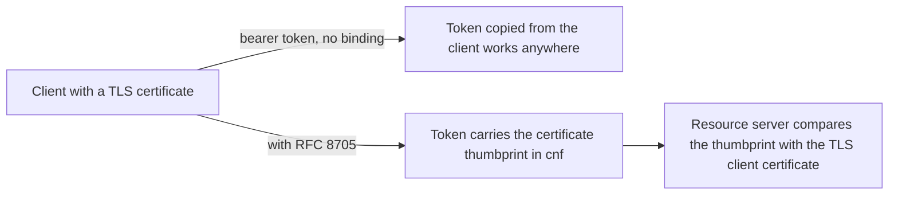
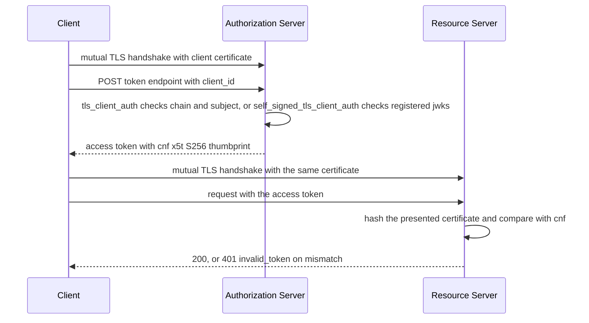

# Mutual-TLS Client Authentication and Certificate-Bound Tokens

> In one line: the TLS client certificate does double duty, authenticating the client to the token endpoint and locking the issued access token to that same certificate.

## When you reach for it

- **A confidential client that already has a certificate**: with mutual TLS the client authenticates without any shared secret, using either a PKI-issued certificate or a self-signed one registered with the server (Sections 2.1, 2.2).
- **An access token that leaks from a backend service**: a certificate-bound token only works over a TLS connection that presents the same client certificate, so the thief also needs the private key (Section 3).
- **Public clients such as native apps that want bound tokens**: a self-signed certificate gets the token bound without any client authentication at all (Section 4).
- **A server that also serves browsers**: `mtls_endpoint_aliases` lets you put the mutual-TLS endpoints on a separate host, so ordinary clients never see a certificate prompt (Section 5).

## The problem it solves

OAuth clients authenticate to the token endpoint with a secret that has to be stored somewhere, and the access token they receive is a bearer token that anyone can replay. Organizations that already run a PKI for service-to-service TLS have a stronger credential on hand and no standard way to use it.

RFC 8705 defines two independent mechanisms. The first is mutual-TLS client authentication: the client proves its identity with the certificate it presents during the TLS handshake. The second is certificate-bound access tokens: the authorization server records a hash of the client certificate in the token, and the resource server refuses the token on any connection that does not present a matching certificate (Section 1).

## How it works

For `tls_client_auth` the authorization server validates the certificate chain against its trust anchors and matches one registered subject, set in client metadata as `tls_client_auth_subject_dn` or one of the `tls_client_auth_san_dns`, `tls_client_auth_san_uri`, `tls_client_auth_san_ip` and `tls_client_auth_san_email` values (Section 2.1). For `self_signed_tls_client_auth` the chain is not validated; the client is authenticated if the presented certificate matches one registered through `jwks` or `jwks_uri` with the certificate in an `x5c` member (Section 2.2). When the token is a JWT, the binding is the `x5t#S256` member under `cnf`, the SHA-256 thumbprint of the certificate; an introspection response carries the same `cnf` structure (Sections 3.1, 3.2). The server advertises support with `tls_client_certificate_bound_access_tokens`, and a client registers the same name to say it expects bound tokens (Sections 3.3, 3.4).

## What the spec requires

- A request using mutual-TLS authentication must include `client_id`, and the server must confirm the presented certificate matches the one registered for that client or return `invalid_client` (Section 2).
- `tls_client_auth` matches exactly one subject value from the registered metadata, and the chain must validate to a trusted CA (Section 2.1).
- The resource server must check that the certificate on the TLS connection matches the one bound to the token, and reject a mismatch with 401 and `invalid_token` (Section 3).
- For JWT access tokens the binding should use the `x5t#S256` confirmation method under `cnf` (Section 3.1).
- A client that intends to use mutual TLS must use the alias URLs in `mtls_endpoint_aliases` when the server publishes them (Section 5).
- The resource server does not need to validate the trust chain of the client certificate. It only needs proof of possession (Section 6.2).

## Watch out

- **Certificate rotation invalidates tokens**: a bound access token dies when the client's certificate changes. The client handles it like an expired token and requests a new one (Section 6.3).
- **TLS termination**: a server may terminate TLS at a load balancer or reverse proxy, and then the client certificate has to reach the application server. How to do that securely is out of scope (Section 6.5).
- **Too many trust anchors**: subject-name matching is only as strong as the set of CAs the server trusts. Accept a limited number (Section 7.4).
- **X.509 parsing is hard**: use an established, well-tested library rather than custom validation code (Section 7.5).
- **Privacy before TLS 1.3**: client certificates are sent in the clear in earlier TLS versions, which enables tracking of single-user clients. Prefer TLS 1.3 (Section 8).

## Sources

- [RFC 8705, Section 1](https://www.rfc-editor.org/rfc/rfc8705#section-1)
- [RFC 8705, Section 2](https://www.rfc-editor.org/rfc/rfc8705#section-2)
- [RFC 8705, Section 2.1](https://www.rfc-editor.org/rfc/rfc8705#section-2.1)
- [RFC 8705, Section 2.2](https://www.rfc-editor.org/rfc/rfc8705#section-2.2)
- [RFC 8705, Section 3](https://www.rfc-editor.org/rfc/rfc8705#section-3)
- [RFC 8705, Section 3.1](https://www.rfc-editor.org/rfc/rfc8705#section-3.1)
- [RFC 8705, Section 3.2](https://www.rfc-editor.org/rfc/rfc8705#section-3.2)
- [RFC 8705, Section 3.3](https://www.rfc-editor.org/rfc/rfc8705#section-3.3)
- [RFC 8705, Section 3.4](https://www.rfc-editor.org/rfc/rfc8705#section-3.4)
- [RFC 8705, Section 4](https://www.rfc-editor.org/rfc/rfc8705#section-4)
- [RFC 8705, Section 5](https://www.rfc-editor.org/rfc/rfc8705#section-5)
- [RFC 8705, Section 6.2](https://www.rfc-editor.org/rfc/rfc8705#section-6.2)
- [RFC 8705, Section 6.3](https://www.rfc-editor.org/rfc/rfc8705#section-6.3)
- [RFC 8705, Section 6.5](https://www.rfc-editor.org/rfc/rfc8705#section-6.5)
- [RFC 8705, Section 7.4](https://www.rfc-editor.org/rfc/rfc8705#section-7.4)
- [RFC 8705, Section 7.5](https://www.rfc-editor.org/rfc/rfc8705#section-7.5)
- [RFC 8705, Section 8](https://www.rfc-editor.org/rfc/rfc8705#section-8)
