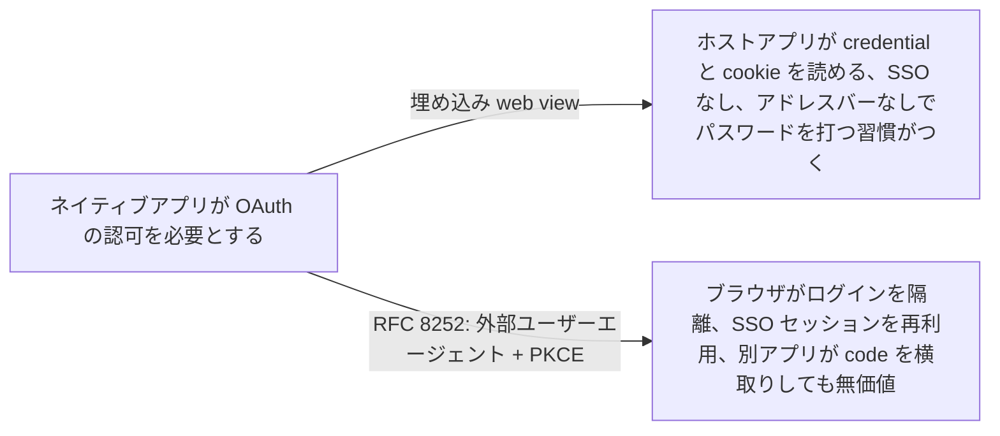
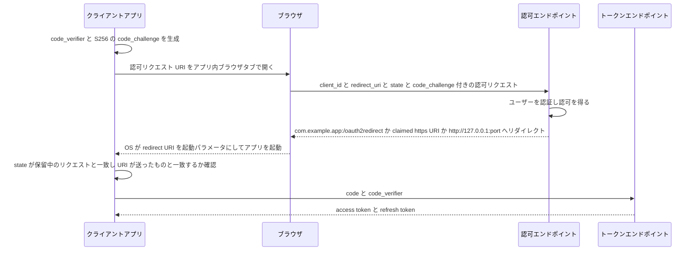

# OAuth 2.0 for Native Apps

> 一言で言うと: ネイティブアプリの認可は埋め込み web view ではなくシステムブラウザに任せる。アプリに戻ってくる経路を安全にするための 3 種類の redirect URI と PKCE 必須の規則を、この BCP が定める。

## どういうときに使うか

- **アプリ内の web view でユーザーをログインさせているモバイルアプリ**: ホストアプリはログインフォームのキー入力をすべて記録でき、同意を自動送信でき、セッション cookie もコピーできる。BCP は認可リクエストでの埋め込みユーザーエージェントを禁止する (Section 8.12)。
- **カスタムスキームを登録する手段がない macOS・Windows・Linux のデスクトップアプリ**: `http://127.0.0.1:{port}` で待ち受けられる。認可サーバーはどのポートでも受け付けなければならない (Section 7.3)。
- **複数アプリでログインを共有したいパブリッシャー**: 認証セッションはブラウザが持つので、1 つのアプリでサインインしたユーザーは、サーバーのポリシーが求めない限り次のアプリで再度求められない (Section 4)。
- **バイナリに client secret を埋め込んで配布しているアプリ**: 誰でも自分の複製を調べて secret を知れる。サーバーはそのアプリを public client として扱い、secret を身元の証明として受け入れてはならない (Section 8.5)。

## 解決する問題

RFC 6749 の Section 9 はネイティブアプリに埋め込みユーザーエージェントと外部ユーザーエージェントの両方を認めている。埋め込み web view は広く使われてきたが、認可サーバーから見て第三者であるアプリには定義上安全でない。アプリは自分向けの認可グラントだけでなくユーザーの credential そのものを見られるからだ (Section 8.12)。認証状態がブラウザや他のアプリと共有されないので、シングルサインオンも効かない (Section 4)。

ブラウザを使えば両方とも解決するが、別の問いが残る。認可レスポンスをどうやってアプリに戻すか。モバイルプラットフォームでは複数のアプリが同じ private-use URI スキームを登録できるので、デバイス上の別アプリが code を受け取るかもしれない (Section 8.1)。BCP は両方に答える。外部ユーザーエージェントを使い、3 種類の redirect URI から選び、PKCE で code をアプリのインスタンスに束縛する。

## 仕組み

アプリは RFC 6749 の Section 4.1 に従って、自分で受け取れる redirect URI を使った認可コードリクエストを組み立て、外部ユーザーエージェントで開く。プラットフォームが対応していればアプリ内ブラウザタブが望ましい (Section 6)。redirect URI は 3 種類のいずれか。`com.example.app:/oauth2redirect/example-provider` のようなドメイン名逆順の private-use スキーム (Section 7.1)、OS がアプリに振り向ける claimed `https` URI (Section 7.2)、`http://127.0.0.1:51004/oauth2redirect/example-provider` のような loopback URI (Section 7.3)。認可サーバーがリダイレクトすると OS がその URI でアプリを起動し、アプリは web client と同じようにレスポンスを処理する (Section 7.1)。code はアプリ間チャネルを通ってきたので、アプリは PKCE の `code_verifier` を添えて引き換える。code を横取りしたアプリには使えない (Section 8.1)。

## 仕様が求めること

- ネイティブアプリは OAuth の認可リクエストに外部ユーザーエージェントを使わなければならず (Section 5)、埋め込みユーザーエージェントを使ってはならない (Section 8.12)。
- public なネイティブアプリ client は PKCE を実装しなければならず、認可サーバーはそうした client 向けに PKCE に対応しなければならない (Section 6)。
- 認可サーバーは少なくとも 3 つの redirect URI 方式、private-use URI スキーム・claimed `https` スキーム・loopback インターフェースを提供しなければならない (Section 7)。
- private-use スキームはアプリが管理するドメイン名を逆順にしたもの、例えば `com.example.app` に基づかなければならない (Section 7.1)。
- loopback の redirect URI では、認可サーバーはリクエスト時に任意のポートを指定できるようにしなければならない (Section 7.3)。
- ネイティブアプリは public client であり、そのように登録しなければならない。サーバーは client type を記録し、完全な redirect URI の登録を求め、完全一致しないリクエストを拒否しなければならない。例外は loopback のポート部分だけ (Section 8.4)。
- 複数の認可サーバーを使うアプリはサーバーごとに一意の redirect URI を使い、レスポンスが保留中のリクエストと一緒に保存した URI で届いたことを検証しなければならない (Section 8.10)。

## 注意点

- 複数のアプリが同じ private-use スキームを登録できるので、どのアプリが code を受け取るかは不定。これが PKCE を必須にする理由で、サーバーは PKCE のないネイティブアプリのリクエストを拒否すべき (Section 8.1)。
- プラットフォームが対応するなら claimed `https` URI を優先すべき。OS が宛先アプリの身元を認可サーバーに保証するから (Section 7.2)。
- `http://localhost:{port}` は推奨されない。loopback の IP リテラルを使えば他のインターフェースで待ち受けてしまう事故を避けられ、クライアント側ファイアウォールやホスト名解決の問題にも強い (Section 8.3)。
- implicit grant はネイティブアプリでは推奨されない。PKCE で保護できず、token をユーザー操作なしに更新できないから (Section 8.2)。
- 静的な共有 secret をまだ要求するサーバーは、その client を public として扱い、secret を身元の証明として受け入れてはならない (Section 8.5)。
- 高エントロピーの `state` を使い、保留中のリクエストと一致しない `state` のレスポンスを拒否して、URI チャネル越しの cross-app request forgery を止める (Section 8.9)。

## 出典

- [RFC 8252, Section 4](https://www.rfc-editor.org/rfc/rfc8252#section-4)
- [RFC 8252, Section 5](https://www.rfc-editor.org/rfc/rfc8252#section-5)
- [RFC 8252, Section 6](https://www.rfc-editor.org/rfc/rfc8252#section-6)
- [RFC 8252, Section 7](https://www.rfc-editor.org/rfc/rfc8252#section-7)
- [RFC 8252, Section 7.1](https://www.rfc-editor.org/rfc/rfc8252#section-7.1)
- [RFC 8252, Section 7.2](https://www.rfc-editor.org/rfc/rfc8252#section-7.2)
- [RFC 8252, Section 7.3](https://www.rfc-editor.org/rfc/rfc8252#section-7.3)
- [RFC 8252, Section 8.1](https://www.rfc-editor.org/rfc/rfc8252#section-8.1)
- [RFC 8252, Section 8.2](https://www.rfc-editor.org/rfc/rfc8252#section-8.2)
- [RFC 8252, Section 8.3](https://www.rfc-editor.org/rfc/rfc8252#section-8.3)
- [RFC 8252, Section 8.4](https://www.rfc-editor.org/rfc/rfc8252#section-8.4)
- [RFC 8252, Section 8.5](https://www.rfc-editor.org/rfc/rfc8252#section-8.5)
- [RFC 8252, Section 8.9](https://www.rfc-editor.org/rfc/rfc8252#section-8.9)
- [RFC 8252, Section 8.10](https://www.rfc-editor.org/rfc/rfc8252#section-8.10)
- [RFC 8252, Section 8.12](https://www.rfc-editor.org/rfc/rfc8252#section-8.12)
