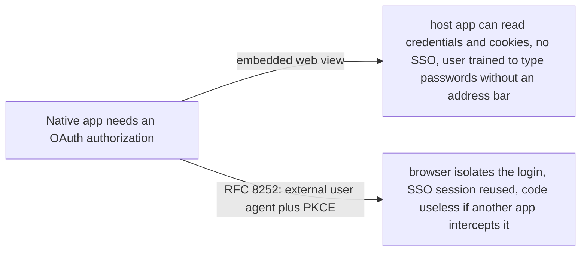
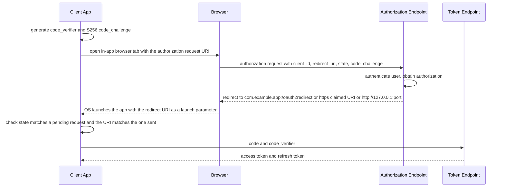

# OAuth 2.0 for Native Apps

> In one line: a native app must send the user to the system browser for authorization, never an embedded web view, and the BCP spells out the three redirect URI types and the PKCE requirement that make the round trip back to the app safe.

## When you reach for it

- **A mobile app that logs users in through a web view inside the app**: the host app can record every keystroke in the login form, auto-submit consent and copy session cookies. The BCP forbids embedded user agents for authorization requests (Section 8.12).
- **A desktop app on macOS, Windows or Linux that has no way to register a custom scheme**: it can listen on `http://127.0.0.1:{port}` and the authorization server must accept any port (Section 7.3).
- **A publisher with several apps that should share one login**: the browser keeps the authentication session, so a user who signed in for one app is not asked again by the next one unless server policy requires it (Section 4).
- **An app that ships a client secret in its binary**: anyone can inspect their copy and learn it, so the server must treat the app as a public client and not accept the secret as proof of identity (Section 8.5).

## The problem it solves

Section 9 of RFC 6749 allows a native app to use either an embedded user agent or an external one. Embedded web views were common, and they are unsafe for any app that is a third party to the authorization server: the app sees the user's full credential, not just the authorization grant meant for it (Section 8.12). They also break single sign-on, because the authentication state is not shared with the browser or other apps (Section 4).

Using the browser fixes both, but raises a second question: how does the authorization response get back into the app? On mobile platforms several apps can register the same private-use URI scheme, so a different app on the device may receive the code (Section 8.1). The BCP answers both: use an external user agent, pick one of three redirect URI types, and bind the code to the app instance with PKCE.

## How it works

The app builds an authorization code request per Section 4.1 of RFC 6749 with a redirect URI it can receive, and opens it in an external user agent, preferably an in-app browser tab where the platform supports one (Section 6). The redirect URI is one of three kinds: a private-use scheme in reverse domain order such as `com.example.app:/oauth2redirect/example-provider` (Section 7.1), a claimed `https` URI that the operating system routes to the app (Section 7.2), or a loopback URI such as `http://127.0.0.1:51004/oauth2redirect/example-provider` (Section 7.3). When the authorization server redirects, the operating system launches the app with the URI, and the app processes the response as a web client would (Section 7.1). Because the code travelled over an inter-app channel, the app redeems it with the PKCE `code_verifier`, so an app that intercepted the code cannot use it (Section 8.1).

## What the spec requires

- Native apps MUST use an external user agent to perform OAuth authorization requests (Section 5), and MUST NOT use embedded user agents for them (Section 8.12).
- Public native app clients MUST implement PKCE, and authorization servers MUST support PKCE for such clients (Section 6).
- Authorization servers MUST offer at least the three redirect URI options: private-use URI scheme, claimed `https` scheme, and loopback interface (Section 7).
- Private-use schemes MUST be based on a domain name under the app's control in reverse order, such as `com.example.app` (Section 7.1).
- For loopback redirect URIs the authorization server MUST allow any port to be specified at request time (Section 7.3).
- Native apps are public clients and MUST be registered as such; servers MUST record the client type, and MUST require registration of the complete redirect URI and reject requests that do not exactly match, except for the port of loopback redirects (Section 8.4).
- An app that uses more than one authorization server MUST use a unique redirect URI per server and MUST verify that the response arrived on the URI it stored with the pending request (Section 8.10).

## Watch out

- Multiple apps can register the same private-use scheme, so which app receives the code is indeterminate; this is why PKCE is required, and servers SHOULD reject native app requests that omit it (Section 8.1).
- Claimed `https` URIs SHOULD be preferred where the platform supports them, because the operating system guarantees the destination app's identity to the authorization server (Section 7.2).
- `http://localhost:{port}` is NOT RECOMMENDED; use the loopback IP literal to avoid listening on other interfaces and to sidestep client-side firewalls and host name resolution problems (Section 8.3).
- The implicit grant is NOT RECOMMENDED for native apps because it cannot be protected by PKCE and its tokens cannot be refreshed without user interaction (Section 8.2).
- A server that still requires a static shared secret MUST treat the client as public and not accept the secret as proof of identity (Section 8.5).
- Use a high-entropy `state` and reject responses whose `state` does not match a pending request, to stop cross-app request forgery over the URI channel (Section 8.9).

## Sources

- [RFC 8252, Section 4](https://www.rfc-editor.org/rfc/rfc8252#section-4)
- [RFC 8252, Section 5](https://www.rfc-editor.org/rfc/rfc8252#section-5)
- [RFC 8252, Section 6](https://www.rfc-editor.org/rfc/rfc8252#section-6)
- [RFC 8252, Section 7](https://www.rfc-editor.org/rfc/rfc8252#section-7)
- [RFC 8252, Section 7.1](https://www.rfc-editor.org/rfc/rfc8252#section-7.1)
- [RFC 8252, Section 7.2](https://www.rfc-editor.org/rfc/rfc8252#section-7.2)
- [RFC 8252, Section 7.3](https://www.rfc-editor.org/rfc/rfc8252#section-7.3)
- [RFC 8252, Section 8.1](https://www.rfc-editor.org/rfc/rfc8252#section-8.1)
- [RFC 8252, Section 8.2](https://www.rfc-editor.org/rfc/rfc8252#section-8.2)
- [RFC 8252, Section 8.3](https://www.rfc-editor.org/rfc/rfc8252#section-8.3)
- [RFC 8252, Section 8.4](https://www.rfc-editor.org/rfc/rfc8252#section-8.4)
- [RFC 8252, Section 8.5](https://www.rfc-editor.org/rfc/rfc8252#section-8.5)
- [RFC 8252, Section 8.9](https://www.rfc-editor.org/rfc/rfc8252#section-8.9)
- [RFC 8252, Section 8.10](https://www.rfc-editor.org/rfc/rfc8252#section-8.10)
- [RFC 8252, Section 8.12](https://www.rfc-editor.org/rfc/rfc8252#section-8.12)
