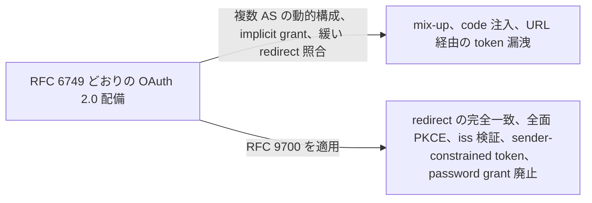
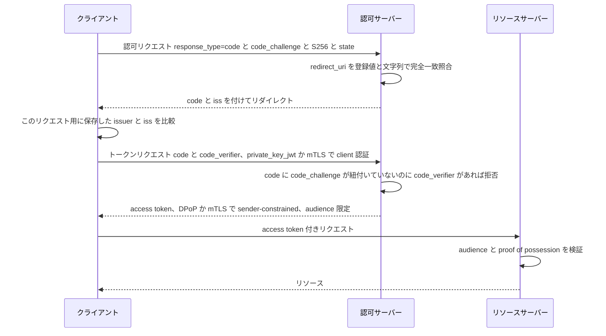

# OAuth 2.0 Security Best Current Practice

> 一言で言うと: RFC 6749 には書かれていなかったが、今の OAuth 2.0 配備なら必ずやるべきことの一覧。それぞれを必要にした攻撃とセットで書いてある。

## どういうときに使うか

- **複数の認可サーバーと話す client。マルチテナントのフロントエンドや、どのプロバイダでも使えるメールアプリなど**: 悪意ある認可サーバーが、正規サーバー向けの code や token を攻撃者に送らせることができる。BCP は mix-up 対策を必須にし、その手段として `iss` パラメータを挙げる (Section 2.1)。
- **オープンバンキング・eHealth・eGovernment での配備**: introduction が言うとおり、OAuth が当初想定していなかった高セキュリティ環境がまさにこれで、そこでの規則を厳しくするためにこの BCP がある (Section 1)。
- **PKCE に対応しているが、PKCE なしの client も受け付ける認可サーバー**: 攻撃者は自分のリクエストから `code_challenge` を外し、そうして得た code を被害者のセッションに注入できる。BCP はトークンエンドポイントでそれを拒否する方法を定める (Section 4.8)。
- **まだ implicit grant を使っている SPA**: URL に乗った access token は referer・ブラウザ履歴・open redirector から漏れ、sender-constrain もできない。BCP は認可コードグラントに切り替えろと言う (Section 2.1.2)。

## 解決する問題

RFC 6749 は静的な関係を前提にしていた。client は認可サーバーとリソースサーバーの URL を配備時に知っていて、TLS のサーバー認証が信頼の拠り所だった。同じ client が多くのプロバイダやテナントと話すようになり、OAuth が高セキュリティ環境に持ち込まれ、ブラウザのリダイレクト時のフラグメント扱いが変わったことで、その前提は崩れた (Section 1)。攻撃者は RFC 6819 が記述したものの具体的な規則にはしていなかった既知の実装上の弱点を突き続けた。

BCP はその規則を書き下す。明示的な攻撃者モデルと規範的な要件の集合で RFC 6749・6750・6819 を更新し、今では安全でないとみなされる方式を非推奨にする。それら RFC の助言を置き換えるのではなく補完する (Section 1)。

## 仕組み

認可リクエストは `response_type=code` と PKCE の `code_challenge` を `S256` で運ぶ。`S256` はリクエストを読める攻撃者に verifier を晒さない唯一のメソッドである (Section 2.1.1)。サーバーは `redirect_uri` を登録値と文字列の完全一致で照合し、例外はネイティブアプリの localhost URI のポート番号だけ (Section 2.1)。レスポンスは RFC 9207 の `iss` を運び、複数サーバーと話す client はリクエスト送信時に保存した issuer と比較する (Section 4.4.2.1)。トークンエンドポイントで client は `code_verifier` を提示し、client 認証は `private_key_jwt` や mutual TLS のような非対称方式が推奨される (Section 2.5)。サーバーは `code_challenge` のなかった code に対する `code_verifier` 付きリクエストを拒否する (Section 4.8.2)。access token は 1 つのリソースサーバーに audience 限定し、mutual TLS か DPoP で sender-constrain すべきで、リソースサーバーは自分宛でない token を拒否しなければならない (Section 2.2.1, 2.3)。

## 仕様が求めること

- 認可サーバーは redirect URI を完全一致で照合しなければならない (MUST)。例外はネイティブアプリの localhost URI のポート番号だけ。client とサーバーは open redirector を晒してはならない (Section 2.1)。
- public client は PKCE を使わなければならず (MUST)、confidential client も使うべき (SHOULD)。認可サーバーは PKCE に対応し、対応を検出する手段を提供しなければならない。メタデータの `code_challenge_methods_supported` が推奨される (Section 2.1.1)。
- 認可リクエストに `code_challenge` がなかったなら、認可サーバーは `code_verifier` 付きのトークンリクエストを拒否しなければならない (Section 4.8.2)。
- client が複数の認可サーバーと話せるなら mix-up 対策は必須 (REQUIRED)。client は RFC 9207 の `iss` パラメータか、レスポンス中の同等の `iss` 値を使うべき (Section 2.1)。
- public client のリフレッシュトークンは sender-constrained かローテーションのどちらかでなければならない。サーバーはリフレッシュトークンを発行するかをリスク評価で決め、発行するなら同意された scope とリソースサーバーに束縛しなければならない (Section 2.2.2, 4.14.2)。
- resource owner password credentials grant は使ってはならない (Section 2.4)。
- 認可レスポンスを暗号化されていない接続で送ってはならない。`http` の redirect URI はネイティブ client の loopback リダイレクト以外では許可されない (Section 2.6)。

## 注意点

- 攻撃者モデルには web 攻撃者とネットワーク攻撃者だけでなく、認可リクエストやレスポンスを読める攻撃者 (A3, A4) と access token を入手した攻撃者 (A5) が含まれる。実装者は自分の環境にいるすべての攻撃者を考慮しなければならない (Section 3)。
- implicit grant や、認可レスポンスで access token を返す response type は使うべきでない。その token は漏れやすく sender-constrain もできない (Section 2.1.2)。
- issuer ごとに別の redirect URI を使う mix-up 対策は弱い。攻撃者は client が攻撃者のサーバー用に割り当てた redirect URI で正規サーバーに新しい client を登録できる。`iss` が使えないときだけにすべき (Section 4.4.2.2)。
- ユーザーの credential を含みうるリクエストをリダイレクトする認可サーバーは HTTP 307 を使ってはならない。ユーザーエージェントが POST ボディを client に再送してしまうため。代わりに 303 を使うべき (SHOULD) (Section 4.12)。

## 出典

- [RFC 9700, Section 1](https://www.rfc-editor.org/rfc/rfc9700#section-1)
- [RFC 9700, Section 2.1](https://www.rfc-editor.org/rfc/rfc9700#section-2.1)
- [RFC 9700, Section 2.1.1](https://www.rfc-editor.org/rfc/rfc9700#section-2.1.1)
- [RFC 9700, Section 2.1.2](https://www.rfc-editor.org/rfc/rfc9700#section-2.1.2)
- [RFC 9700, Section 2.2.1](https://www.rfc-editor.org/rfc/rfc9700#section-2.2.1)
- [RFC 9700, Section 2.2.2](https://www.rfc-editor.org/rfc/rfc9700#section-2.2.2)
- [RFC 9700, Section 2.3](https://www.rfc-editor.org/rfc/rfc9700#section-2.3)
- [RFC 9700, Section 2.4](https://www.rfc-editor.org/rfc/rfc9700#section-2.4)
- [RFC 9700, Section 2.5](https://www.rfc-editor.org/rfc/rfc9700#section-2.5)
- [RFC 9700, Section 2.6](https://www.rfc-editor.org/rfc/rfc9700#section-2.6)
- [RFC 9700, Section 3](https://www.rfc-editor.org/rfc/rfc9700#section-3)
- [RFC 9700, Section 4.4.2.1](https://www.rfc-editor.org/rfc/rfc9700#section-4.4.2.1)
- [RFC 9700, Section 4.4.2.2](https://www.rfc-editor.org/rfc/rfc9700#section-4.4.2.2)
- [RFC 9700, Section 4.8](https://www.rfc-editor.org/rfc/rfc9700#section-4.8)
- [RFC 9700, Section 4.8.2](https://www.rfc-editor.org/rfc/rfc9700#section-4.8.2)
- [RFC 9700, Section 4.12](https://www.rfc-editor.org/rfc/rfc9700#section-4.12)
- [RFC 9700, Section 4.14.2](https://www.rfc-editor.org/rfc/rfc9700#section-4.14.2)
