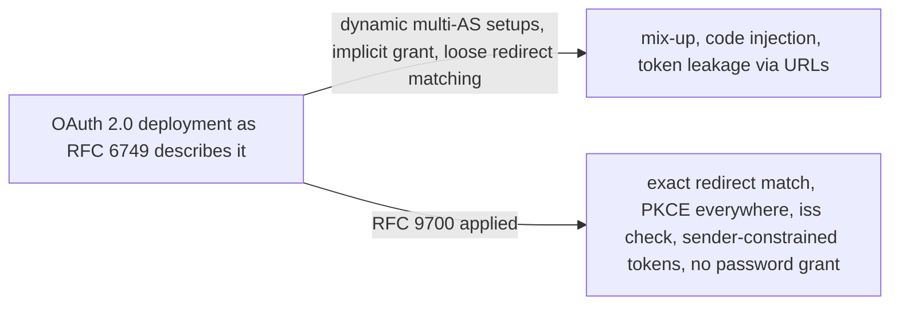
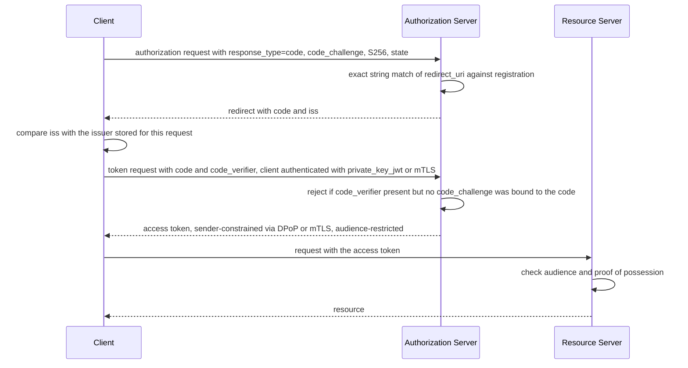

# OAuth 2.0 Security Best Current Practice

> In one line: the list of things every OAuth 2.0 deployment must do today that RFC 6749 did not say, with the attacks that made each one necessary.

## When you reach for it

- **A client that talks to more than one authorization server, such as a multi-tenant front end or a mail app that works with any provider**: a malicious authorization server can trick the client into sending a code or token for an honest server to the attacker. The BCP makes a mix-up defense required and names the `iss` parameter as the way to do it (Section 2.1).
- **A deployment in open banking, eHealth or eGovernment**: the introduction says these are exactly the higher-security settings OAuth was not designed for, and the BCP exists to tighten the rules for them (Section 1).
- **An authorization server that supports PKCE but still accepts clients without it**: an attacker can strip `code_challenge` from their own request and inject the resulting code into a victim's session. The BCP tells the server how to reject that at the token endpoint (Section 4.8).
- **A single-page app still on the implicit grant**: access tokens in URLs leak through referers, browser history and open redirectors, and cannot be sender-constrained. The BCP says to use the authorization code grant instead (Section 2.1.2).

## The problem it solves

RFC 6749 assumed static relationships: a client knew the URLs of its authorization server and resource servers at deployment time, and TLS server authentication was the anchor of trust. That model dissolved as the same client started talking to many providers and tenants, as OAuth moved into higher-security settings, and as browsers changed how they treat URL fragments on redirect (Section 1). Attackers kept exploiting well-known implementation weaknesses that RFC 6819 had described but not turned into concrete rules.

The BCP writes those rules down. It updates RFC 6749, 6750 and 6819 with an explicit attacker model and a set of normative requirements, and it deprecates modes that are now considered insecure. It complements those RFCs rather than replacing their advice (Section 1).

## How it works

The authorization request carries `response_type=code` and a PKCE `code_challenge` using `S256`, which is the only method that does not expose the verifier to someone who can read the request (Section 2.1.1). The server compares `redirect_uri` with the registered value by exact string match, except for the port of a native app's localhost URI (Section 2.1). The response carries `iss` as in RFC 9207, and a client that works with several servers compares it with the issuer it stored when it sent the request (Section 4.4.2.1). At the token endpoint the client presents `code_verifier`, preferably with asymmetric client authentication such as `private_key_jwt` or mutual TLS (Section 2.5). The server rejects a token request that carries a `code_verifier` for a code that had no `code_challenge` (Section 4.8.2). The access token should be audience-restricted to one resource server and sender-constrained with mutual TLS or DPoP, and the resource server must refuse a token not meant for it (Sections 2.2.1, 2.3).

## What the spec requires

- Authorization servers MUST use exact string matching for redirect URIs, except for port numbers in localhost URIs of native apps; clients and servers MUST NOT expose open redirectors (Section 2.1).
- Public clients MUST use PKCE; confidential clients SHOULD; authorization servers MUST support PKCE and MUST provide a way to detect that support, with `code_challenge_methods_supported` in metadata recommended (Section 2.1.1).
- Authorization servers MUST reject a token request containing `code_verifier` if the authorization request had no `code_challenge` (Section 4.8.2).
- When a client can interact with more than one authorization server, a mix-up defense is REQUIRED; clients SHOULD use the `iss` parameter of RFC 9207 or an equivalent `iss` value in the response (Section 2.1).
- Refresh tokens for public clients MUST be sender-constrained or use rotation; servers MUST determine by risk assessment whether to issue refresh tokens and MUST bind them to the consented scope and resource servers (Sections 2.2.2, 4.14.2).
- The resource owner password credentials grant MUST NOT be used (Section 2.4).
- Authorization responses MUST NOT be sent over unencrypted connections, so `http` redirect URIs are not allowed except for loopback redirection of native clients (Section 2.6).

## Watch out

- The attacker model includes attackers who can read the authorization request or response (A3, A4) and attackers who obtain an access token (A5), not just web and network attackers; implementers MUST account for every attacker type in their environment (Section 3).
- Clients SHOULD NOT use the implicit grant or any response type that returns an access token in the authorization response, because those tokens leak and cannot be sender-constrained (Section 2.1.2).
- Distinct redirect URIs per issuer are a weaker mix-up defense: an attacker can register a new client at the honest server with the redirect URI the client assigned to the attacker's server, so this SHOULD only be used when `iss` is unavailable (Section 4.4.2.2).
- An authorization server that redirects a request that may contain user credentials MUST NOT use HTTP 307, because the user agent re-sends the POST body to the client; it SHOULD use 303 instead (Section 4.12).

## Sources

- [RFC 9700, Section 1](https://www.rfc-editor.org/rfc/rfc9700#section-1)
- [RFC 9700, Section 2.1](https://www.rfc-editor.org/rfc/rfc9700#section-2.1)
- [RFC 9700, Section 2.1.1](https://www.rfc-editor.org/rfc/rfc9700#section-2.1.1)
- [RFC 9700, Section 2.1.2](https://www.rfc-editor.org/rfc/rfc9700#section-2.1.2)
- [RFC 9700, Section 2.2.1](https://www.rfc-editor.org/rfc/rfc9700#section-2.2.1)
- [RFC 9700, Section 2.2.2](https://www.rfc-editor.org/rfc/rfc9700#section-2.2.2)
- [RFC 9700, Section 2.3](https://www.rfc-editor.org/rfc/rfc9700#section-2.3)
- [RFC 9700, Section 2.4](https://www.rfc-editor.org/rfc/rfc9700#section-2.4)
- [RFC 9700, Section 2.5](https://www.rfc-editor.org/rfc/rfc9700#section-2.5)
- [RFC 9700, Section 2.6](https://www.rfc-editor.org/rfc/rfc9700#section-2.6)
- [RFC 9700, Section 3](https://www.rfc-editor.org/rfc/rfc9700#section-3)
- [RFC 9700, Section 4.4.2.1](https://www.rfc-editor.org/rfc/rfc9700#section-4.4.2.1)
- [RFC 9700, Section 4.4.2.2](https://www.rfc-editor.org/rfc/rfc9700#section-4.4.2.2)
- [RFC 9700, Section 4.8](https://www.rfc-editor.org/rfc/rfc9700#section-4.8)
- [RFC 9700, Section 4.8.2](https://www.rfc-editor.org/rfc/rfc9700#section-4.8.2)
- [RFC 9700, Section 4.12](https://www.rfc-editor.org/rfc/rfc9700#section-4.12)
- [RFC 9700, Section 4.14.2](https://www.rfc-editor.org/rfc/rfc9700#section-4.14.2)
