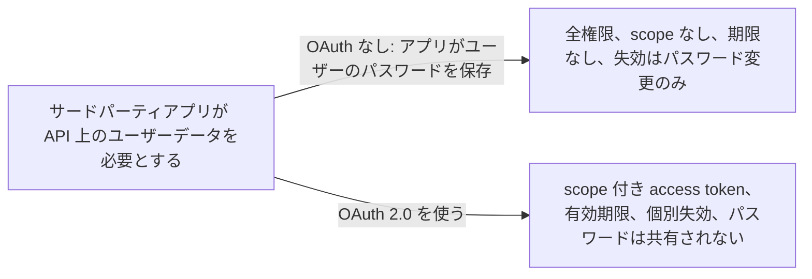
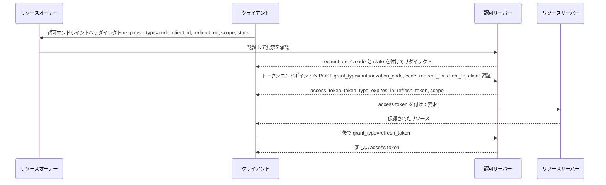

# OAuth 2.0

> 一言で言うと: client が認可サーバーから scope と有効期限付きの access token をもらい、ユーザーのパスワードを一切見ずにサードパーティアプリが API を代理で呼べるようにする仕組み。

## どういうときに使うか

- **サードパーティの Web アプリが別サービスにあるユーザーのカレンダーを読みたい**: OAuth がなければアプリはユーザーのパスワードを保存するしかなく、取り消す方法はパスワード変更だけ。OAuth ならユーザーが一度承認し、アプリは `scope` で絞られた access token を受け取り、サービス側はその token だけを失効できる。
- **多数の client が多数のユーザーのために呼ぶ公開 API**: client はリソースオーナーのものとは別の自分用のクレデンシャル、つまり access token を発行されるので、サーバーはサードパーティからのパスワード認証をサポートし続けなくてよい (Section 1)。
- **secret を保持できないネイティブアプリや SPA**: 仕様はこれを public client と分類し (Section 2.1)、リダイレクトエンドポイントの登録を要求し (Section 3.1.2.2)、認可コードグラントを使うネイティブアプリは client クレデンシャルなしで使うべきとしている (Section 9)。
- **長期間のアクセスを長期間のパスワードなしで**: client は refresh token を受け取り、リソースサーバーではなく認可サーバーでだけ新しい access token に引き換える (Section 1.5)。

## 解決する問題

古典的なモデルでは、client アプリがリソースオーナーにユーザー名とパスワードを求め、それをリソースサーバーにそのまま送る。仕様は何が困るかを列挙している。client は後で使うためにパスワードを平文で保存する、サーバーはパスワード認証をサポートし続けなければならない、client は scope も期間も制限できない過大なアクセスを得る、オーナーはパスワード変更ですべての client を同時に失効させる以外に 1 つの client だけを取り消せない (Section 1)。

OAuth 2.0 は 4 つの役割を分離する。リソースオーナーはアクセスを許可し、リソースサーバーは保護されたリソースを持って access token を受け付け、client はオーナーの代理で要求を出し、認可サーバーはオーナーを認証して認可を得た上で token を発行する (Section 1.1)。access token は特定の scope と有効期限を持つクレデンシャルなので、リソースサーバーはオーナーのクレデンシャルを見る必要がない (Section 1.4)。

## 仕組み

中心となるのは認可コードグラント。client はリソースオーナーのブラウザーを認可エンドポイントへ送る。付けるのは `response_type=code`、自分の `client_id`、任意の `redirect_uri` と `scope`、そして戻ってきたときに照合する `state` (Section 4.1.1)。オーナーが承認すると、認可サーバーは短命な `code` と同じ `state` を付けてリダイレクトで戻す (Section 4.1.2)。client はトークンエンドポイントで `grant_type=authorization_code`、`code`、送っていれば同じ `redirect_uri`、そして `client_id` または client クレデンシャルを添えて code を引き換える (Section 4.1.3)。応答には `access_token`、`token_type`、`expires_in`、任意の `refresh_token`、要求と異なる場合の `scope` が含まれる (Section 5.1)。client はその token をリソースサーバーに提示し、後で `grant_type=refresh_token` を使ってオーナーを再び巻き込まずに新しい access token を得る (Section 6)。

## 仕様が求めること

- 仕様は 4 つのグラントタイプを定義する。認可コード、implicit、リソースオーナーパスワードクレデンシャル、クライアントクレデンシャル (Section 1.3)。
- client は、クレデンシャルの機密を保てる confidential か、保てない public のどちらかに分類される (Section 2.1)。
- リダイレクトエンドポイントの URI は絶対 URI でなければならず、認可サーバーは public client と implicit グラントを使う confidential client にリダイレクトエンドポイントの登録を要求しなければならない (Section 3.1.2、3.1.2.2)。
- 認可リクエストの `response_type` は `code` でなければならず、`state` は CSRF 防止のために使うべき (Section 4.1.1)。
- client は認可コードを 2 回以上使ってはならず、コードは発行後すぐに失効しなければならない (Section 4.1.2)。
- トークンリクエストの `grant_type` は `authorization_code`、`redirect_uri` は認可リクエストに含めた場合は必須、`client_id` は client が他の方法で認証しない場合に必須 (Section 4.1.3)。
- client は `token_type` を理解できない access token を使ってはならない (Section 7.1)。

## 注意点

- access token は TLS でのみ送信しなければならず、refresh token は転送中も保存時も機密に保たなければならない (Section 10.3、10.4)。
- 認可コードは短命かつ一回限りでなければならず、認可サーバーは可能な限り client を認証しなければならない (Section 10.5、10.2)。
- 認可サーバーは、コードを取得したときのリダイレクト URI とトークンエンドポイントで提示されたものが同一であることを保証しなければならない。これがリダイレクト改ざん攻撃を塞ぐ (Section 10.6)。
- client はリダイレクト URI に CSRF 対策を実装しなければならない。`state` はそのためにある (Section 10.12)。
- 生成する token は推測確率が 2 の -128 乗以下でなければならない (Section 10.10)。
- ネイティブアプリは埋め込みブラウザーではなく外部ブラウザーを使うべきで、implicit フローでは攻撃者が応答内の token を簡単にすり替えられる (Section 10.13、10.16)。

## 出典

- [RFC 6749, Section 1](https://www.rfc-editor.org/rfc/rfc6749#section-1)
- [RFC 6749, Section 1.1](https://www.rfc-editor.org/rfc/rfc6749#section-1.1)
- [RFC 6749, Section 1.3](https://www.rfc-editor.org/rfc/rfc6749#section-1.3)
- [RFC 6749, Section 1.4](https://www.rfc-editor.org/rfc/rfc6749#section-1.4)
- [RFC 6749, Section 1.5](https://www.rfc-editor.org/rfc/rfc6749#section-1.5)
- [RFC 6749, Section 2.1](https://www.rfc-editor.org/rfc/rfc6749#section-2.1)
- [RFC 6749, Section 3.1.2](https://www.rfc-editor.org/rfc/rfc6749#section-3.1.2)
- [RFC 6749, Section 3.1.2.2](https://www.rfc-editor.org/rfc/rfc6749#section-3.1.2.2)
- [RFC 6749, Section 4.1.1](https://www.rfc-editor.org/rfc/rfc6749#section-4.1.1)
- [RFC 6749, Section 4.1.2](https://www.rfc-editor.org/rfc/rfc6749#section-4.1.2)
- [RFC 6749, Section 4.1.3](https://www.rfc-editor.org/rfc/rfc6749#section-4.1.3)
- [RFC 6749, Section 5.1](https://www.rfc-editor.org/rfc/rfc6749#section-5.1)
- [RFC 6749, Section 6](https://www.rfc-editor.org/rfc/rfc6749#section-6)
- [RFC 6749, Section 7.1](https://www.rfc-editor.org/rfc/rfc6749#section-7.1)
- [RFC 6749, Section 9](https://www.rfc-editor.org/rfc/rfc6749#section-9)
- [RFC 6749, Section 10.2](https://www.rfc-editor.org/rfc/rfc6749#section-10.2)
- [RFC 6749, Section 10.3](https://www.rfc-editor.org/rfc/rfc6749#section-10.3)
- [RFC 6749, Section 10.4](https://www.rfc-editor.org/rfc/rfc6749#section-10.4)
- [RFC 6749, Section 10.5](https://www.rfc-editor.org/rfc/rfc6749#section-10.5)
- [RFC 6749, Section 10.6](https://www.rfc-editor.org/rfc/rfc6749#section-10.6)
- [RFC 6749, Section 10.10](https://www.rfc-editor.org/rfc/rfc6749#section-10.10)
- [RFC 6749, Section 10.12](https://www.rfc-editor.org/rfc/rfc6749#section-10.12)
- [RFC 6749, Section 10.13](https://www.rfc-editor.org/rfc/rfc6749#section-10.13)
- [RFC 6749, Section 10.16](https://www.rfc-editor.org/rfc/rfc6749#section-10.16)
