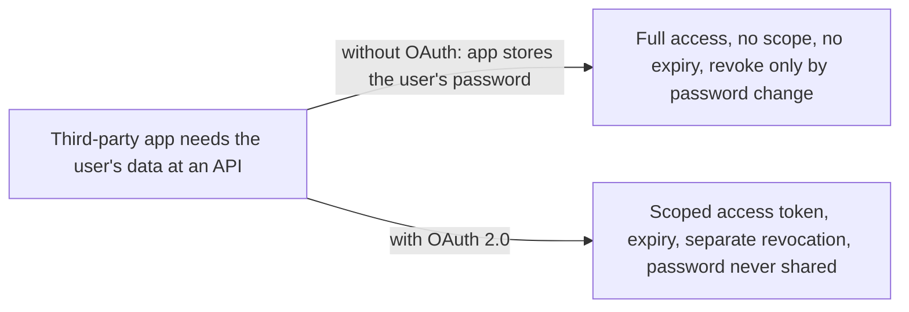
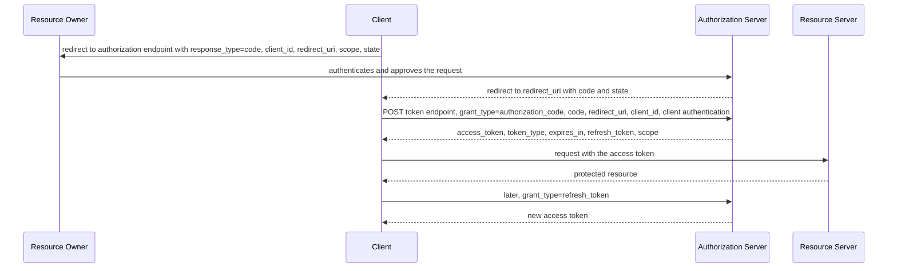

# OAuth 2.0

> In one line: a client gets a scoped, expiring access token from an authorization server, so a third-party app can call an API on the user's behalf without ever seeing the user's password.

## When you reach for it

- **A third-party web app wants to read a user's calendar at another service**: without OAuth the app has to store the user's password, and the only way to revoke it is to change it. With OAuth the user approves once, the app gets an access token limited by `scope`, and the service can revoke that token alone.
- **A public API that many clients call for many users**: the client is issued its own credentials, an access token, instead of the resource owner's, so the server no longer has to support password authentication from third parties (Section 1).
- **A native or single-page app that cannot keep a secret**: the spec classifies it as a public client (Section 2.1), requires it to register its redirection endpoint (Section 3.1.2.2), and native apps using the authorization code grant should do so without client credentials (Section 9).
- **Long-lived access without long-lived passwords**: the client receives a refresh token it can trade for new access tokens at the authorization server, never at the resource server (Section 1.5).

## The problem it solves

In the classic model a client application asks the resource owner for their username and password and replays them to the resource server. The spec lists what breaks: the client stores the password in clear text for later use, the server has to support password authentication, the client gets overly broad access with no way to limit scope or duration, and the owner cannot revoke one client without revoking all of them by changing the password (Section 1).

OAuth 2.0 separates four roles. The resource owner grants access, the resource server hosts the protected resource and accepts access tokens, the client makes requests on the owner's behalf, and the authorization server issues tokens after authenticating the owner and obtaining authorization (Section 1.1). The access token is a credential with a specific scope and lifetime, so the resource server never needs to see the owner's credentials (Section 1.4).

## How it works

The authorization code grant is the main flow. The client sends the resource owner's browser to the authorization endpoint with `response_type=code`, its `client_id`, an optional `redirect_uri` and `scope`, and a `state` value it will check on return (Section 4.1.1). After the owner approves, the authorization server redirects back with a short-lived `code` and the same `state` (Section 4.1.2). The client exchanges the code at the token endpoint with `grant_type=authorization_code`, the `code`, the same `redirect_uri` if one was sent, and its `client_id` or client credentials (Section 4.1.3). The response carries `access_token`, `token_type`, `expires_in`, an optional `refresh_token`, and `scope` when it differs from what was requested (Section 5.1). The client then presents the token to the resource server, and later uses `grant_type=refresh_token` to get a fresh access token without involving the owner again (Section 6).

## What the spec requires

- The spec defines four grant types: authorization code, implicit, resource owner password credentials, and client credentials (Section 1.3).
- Clients are either confidential, able to keep their credentials secret, or public, which cannot (Section 2.1).
- The redirection endpoint URI must be an absolute URI, and the authorization server must require public clients and confidential clients using the implicit grant to register their redirection endpoint (Sections 3.1.2 and 3.1.2.2).
- In the authorization request `response_type` must be `code`, and `state` should be used to prevent cross-site request forgery (Section 4.1.1).
- The client must not use an authorization code more than once, and the code must expire shortly after it is issued (Section 4.1.2).
- In the token request `grant_type` must be `authorization_code`, `redirect_uri` is required if it was in the authorization request, and `client_id` is required if the client is not otherwise authenticating (Section 4.1.3).
- The client must not use an access token if it does not understand the `token_type` (Section 7.1).

## Watch out

- Access token credentials must only be transmitted over TLS, and refresh tokens must be kept confidential in transit and storage (Sections 10.3 and 10.4).
- Authorization codes must be short lived and single-use, and the authorization server must authenticate the client whenever possible (Sections 10.5 and 10.2).
- The authorization server must ensure the redirection URI used to obtain the code is identical to the one provided at the token endpoint, which closes the redirect manipulation attack (Section 10.6).
- The client must implement CSRF protection for its redirection URI, which is what `state` is for (Section 10.12).
- Generated tokens must have a guessing probability of at most 2 to the power of -128 (Section 10.10).
- Native apps should use external browsers instead of embedded ones, and in the implicit flow an attacker can easily switch the token in the response (Sections 10.13 and 10.16).

## Sources

- [RFC 6749, Section 1](https://www.rfc-editor.org/rfc/rfc6749#section-1)
- [RFC 6749, Section 1.1](https://www.rfc-editor.org/rfc/rfc6749#section-1.1)
- [RFC 6749, Section 1.3](https://www.rfc-editor.org/rfc/rfc6749#section-1.3)
- [RFC 6749, Section 1.4](https://www.rfc-editor.org/rfc/rfc6749#section-1.4)
- [RFC 6749, Section 1.5](https://www.rfc-editor.org/rfc/rfc6749#section-1.5)
- [RFC 6749, Section 2.1](https://www.rfc-editor.org/rfc/rfc6749#section-2.1)
- [RFC 6749, Section 3.1.2](https://www.rfc-editor.org/rfc/rfc6749#section-3.1.2)
- [RFC 6749, Section 3.1.2.2](https://www.rfc-editor.org/rfc/rfc6749#section-3.1.2.2)
- [RFC 6749, Section 4.1.1](https://www.rfc-editor.org/rfc/rfc6749#section-4.1.1)
- [RFC 6749, Section 4.1.2](https://www.rfc-editor.org/rfc/rfc6749#section-4.1.2)
- [RFC 6749, Section 4.1.3](https://www.rfc-editor.org/rfc/rfc6749#section-4.1.3)
- [RFC 6749, Section 5.1](https://www.rfc-editor.org/rfc/rfc6749#section-5.1)
- [RFC 6749, Section 6](https://www.rfc-editor.org/rfc/rfc6749#section-6)
- [RFC 6749, Section 7.1](https://www.rfc-editor.org/rfc/rfc6749#section-7.1)
- [RFC 6749, Section 9](https://www.rfc-editor.org/rfc/rfc6749#section-9)
- [RFC 6749, Section 10.2](https://www.rfc-editor.org/rfc/rfc6749#section-10.2)
- [RFC 6749, Section 10.3](https://www.rfc-editor.org/rfc/rfc6749#section-10.3)
- [RFC 6749, Section 10.4](https://www.rfc-editor.org/rfc/rfc6749#section-10.4)
- [RFC 6749, Section 10.5](https://www.rfc-editor.org/rfc/rfc6749#section-10.5)
- [RFC 6749, Section 10.6](https://www.rfc-editor.org/rfc/rfc6749#section-10.6)
- [RFC 6749, Section 10.10](https://www.rfc-editor.org/rfc/rfc6749#section-10.10)
- [RFC 6749, Section 10.12](https://www.rfc-editor.org/rfc/rfc6749#section-10.12)
- [RFC 6749, Section 10.13](https://www.rfc-editor.org/rfc/rfc6749#section-10.13)
- [RFC 6749, Section 10.16](https://www.rfc-editor.org/rfc/rfc6749#section-10.16)
