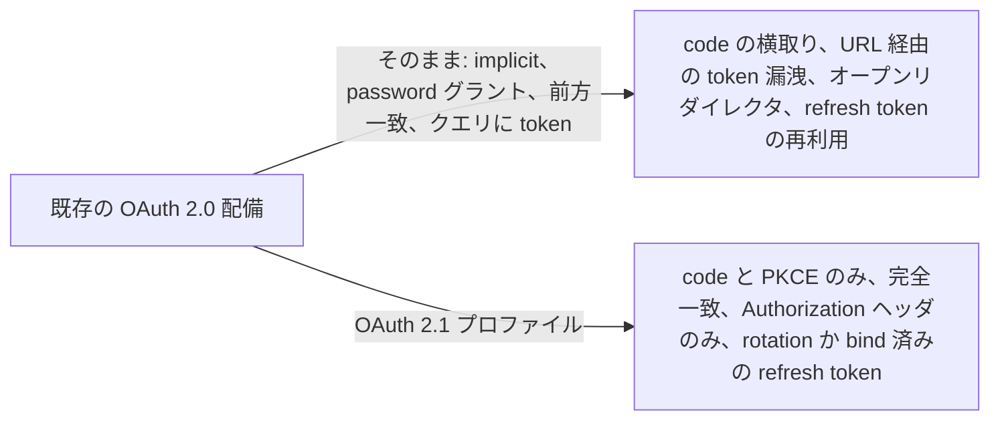
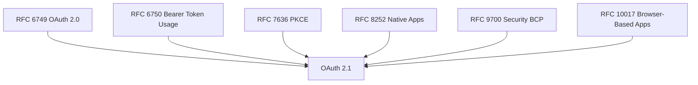
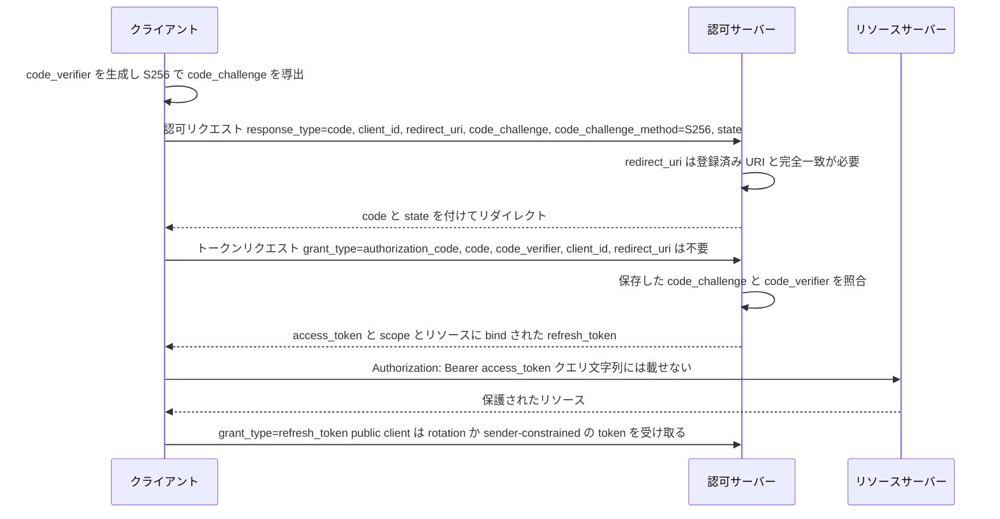

# OAuth 2.1

> 一言で言うと: OAuth 2.0 の危ない選択肢を削って 1 つの文書にまとめ直したもの。すべての認可コードフローに PKCE、implicit と password グラントは廃止、リダイレクト URI は完全一致、クエリ文字列に token を載せない。

## どういうときに使うか

- **まだ implicit グラントを使っている SPA**: OAuth 2.1 は `response_type=token` を丸ごと省いているので、アプリは PKCE 付きの認可コードグラントに移り、URL フラグメントではなくトークンエンドポイントから token を受け取る (Section 10)。
- **client secret を持てず、認可コードを横取りされうるモバイルアプリ**: client には `code_challenge` と `code_verifier` が必須で、認可サーバーはそれを強制しなければならないので、盗まれた code は verifier なしでは使えない (Section 4.1.1、7.5.1.1)。
- **リダイレクト URI を前方一致やパターンで照合していた認可サーバー**: OAuth 2.1 は文字列の完全一致を要求し、緩い照合が許していたオープンリダイレクタ系の攻撃を塞ぐ (Section 2.3.1)。
- **デバイス上で refresh token を持つ public client**: 認可サーバーはその refresh token を sender-constrained にするか rotation しなければならず、漏れた token は検知されるか使えなくなる (Section 4.3.1)。

## 解決する問題

OAuth 2.0 は、フレームワーク本体、bearer token 仕様、PKCE、ネイティブアプリとブラウザーアプリのプロファイル、Security Best Current Practice に分散している。client 開発者や認可サーバー実装者はそれを全部読んだ上で、どの古い選択肢がもう安全でないとされているかを知っていなければならない。implicit グラントは token を URL に晒し、password グラントはユーザーのクレデンシャルを client に渡し、緩いリダイレクト照合は攻撃者が認可コードを自分の URI に誘導することを許し、クエリ文字列の bearer token はログや referrer に残る。

OAuth 2.1 はそれらの文書を 1 つのテキストに統合し、security BCP がすでに禁じている選択肢を落とす (Section 10)。PKCE のように拡張だったものは必須になり、implicit やリソースオーナーパスワードクレデンシャルのように OAuth 2.0 が定義していたグラントは仕様から消える (Section 1.8)。

## 仕組み

リダイレクトを使うグラントとして残るのは認可コードグラントだけ。client は `code_verifier` を作り、認可リクエストに `code_challenge` を載せ、認可サーバーは `redirect_uri` を登録値と単純な文字列比較で照合する (Section 4.1.1、2.3.1)。トークンエンドポイントで client は `code_verifier` を提示する。これは `code_challenge` を送った場合は必ず必要になる (Section 4.1.3)。認可コードを含むトークンエンドポイントへのリクエストには `redirect_uri` パラメータはもう含まれない (Section 10)。refresh token を発行する場合は、元のグラントの scope とリソースサーバーに bind される (Section 3.2.3)。client は access token を `Authorization` ヘッダかフォームボディで送り、URI のクエリパラメータには決して載せない (Section 5.1)。

## 仕様が求めること

- 認可サーバーは、登録済みのリダイレクト URI と完全一致しないリダイレクト URI を指定した認可リクエストを拒否しなければならない (Section 2.3.1)。
- client は `code_challenge` と `code_verifier` を使わなければならず、認可サーバーはその使用を強制しなければならない。`code_challenge` は Section 7.5.1 の狭い例外を満たさない限り必須 (Section 4.1.1、7.5.1.1)。
- `code_verifier` は、認可リクエストに `code_challenge` があった場合はトークンエンドポイントで必須で、それ以外では使ってはならない (Section 4.1.3)。
- public client に対して、認可サーバーは再利用を検知するために sender-constrained な refresh token か refresh token rotation を使わなければならない (Section 4.3.1)。
- client は access token を URI のクエリパラメータで送ってはならない (Section 5.1)。
- implicit グラントとリソースオーナーパスワードクレデンシャルグラントは省かれ、PKCE の `plain` メソッドは削除された (Section 10)。

## 注意点

- PKCE の例外は Section 7.5.1.1 に列挙された条件をすべて満たす confidential client にしか適用されないので、PKCE は既定で必須と考える。
- 認可サーバーとリソースサーバーは、access token を sender-constrain する仕組みを使うべき。素の bearer token は再利用できる (Section 1.4.3)。
- client はオープンリダイレクタを晒してはならず、認可サーバーはフィッシングのリダイレクタとして使われないよう対策しなければならない (Section 7.13.1、7.13.2)。
- 複数の認可サーバーと話す client は mix-up 攻撃を防がなければならない (Section 7.15)。
- bearer token をページの URL に渡してはならず、client は常に TLS を使わなければならない (Section 7.1.3.7、7.1.3.3)。

## 出典

- [draft-ietf-oauth-v2-1, Section 1.4.3](https://datatracker.ietf.org/doc/html/draft-ietf-oauth-v2-1#section-1.4.3)
- [draft-ietf-oauth-v2-1, Section 1.8](https://datatracker.ietf.org/doc/html/draft-ietf-oauth-v2-1#section-1.8)
- [draft-ietf-oauth-v2-1, Section 2.3.1](https://datatracker.ietf.org/doc/html/draft-ietf-oauth-v2-1#section-2.3.1)
- [draft-ietf-oauth-v2-1, Section 3.2.3](https://datatracker.ietf.org/doc/html/draft-ietf-oauth-v2-1#section-3.2.3)
- [draft-ietf-oauth-v2-1, Section 4.1.1](https://datatracker.ietf.org/doc/html/draft-ietf-oauth-v2-1#section-4.1.1)
- [draft-ietf-oauth-v2-1, Section 4.1.3](https://datatracker.ietf.org/doc/html/draft-ietf-oauth-v2-1#section-4.1.3)
- [draft-ietf-oauth-v2-1, Section 4.3.1](https://datatracker.ietf.org/doc/html/draft-ietf-oauth-v2-1#section-4.3.1)
- [draft-ietf-oauth-v2-1, Section 5.1](https://datatracker.ietf.org/doc/html/draft-ietf-oauth-v2-1#section-5.1)
- [draft-ietf-oauth-v2-1, Section 7.1.3.3](https://datatracker.ietf.org/doc/html/draft-ietf-oauth-v2-1#section-7.1.3.3)
- [draft-ietf-oauth-v2-1, Section 7.1.3.7](https://datatracker.ietf.org/doc/html/draft-ietf-oauth-v2-1#section-7.1.3.7)
- [draft-ietf-oauth-v2-1, Section 7.5.1.1](https://datatracker.ietf.org/doc/html/draft-ietf-oauth-v2-1#section-7.5.1.1)
- [draft-ietf-oauth-v2-1, Section 7.13.1](https://datatracker.ietf.org/doc/html/draft-ietf-oauth-v2-1#section-7.13.1)
- [draft-ietf-oauth-v2-1, Section 7.13.2](https://datatracker.ietf.org/doc/html/draft-ietf-oauth-v2-1#section-7.13.2)
- [draft-ietf-oauth-v2-1, Section 7.15](https://datatracker.ietf.org/doc/html/draft-ietf-oauth-v2-1#section-7.15)
- [draft-ietf-oauth-v2-1, Section 10](https://datatracker.ietf.org/doc/html/draft-ietf-oauth-v2-1#section-10)
