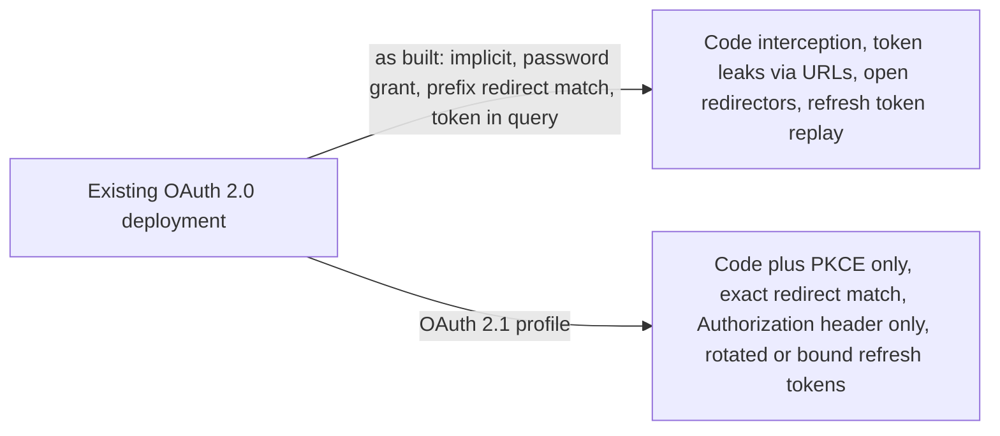
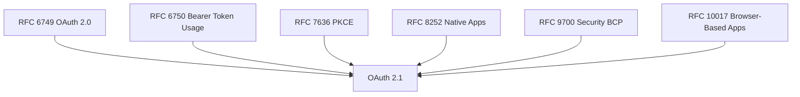
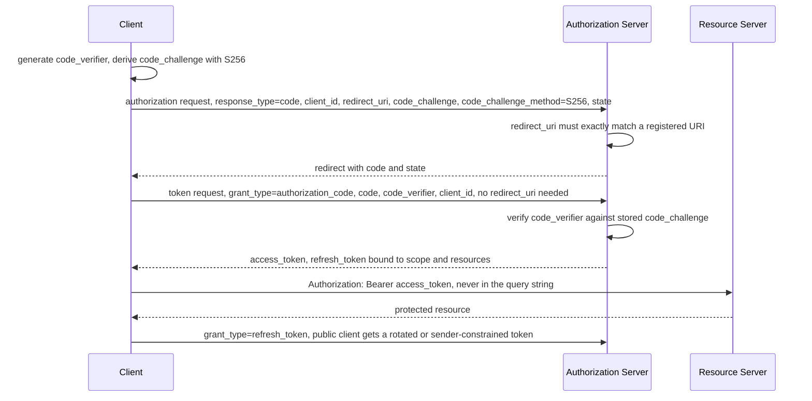

# OAuth 2.1

> In one line: OAuth 2.0 with the sharp edges filed off, folded into one document: PKCE on every code flow, no implicit or password grant, exact redirect URI matching, no tokens in query strings.

## When you reach for it

- **A single-page app still on the implicit grant**: OAuth 2.1 omits `response_type=token` entirely, so the app moves to the authorization code grant with PKCE and gets tokens from the token endpoint instead of the URL fragment (Section 10).
- **A mobile app with no client secret, whose authorization code can be intercepted**: `code_challenge` and `code_verifier` are required for clients, and the authorization server must enforce them, so a stolen code is useless without the verifier (Sections 4.1.1 and 7.5.1.1).
- **An authorization server that matched redirect URIs by prefix or pattern**: OAuth 2.1 requires exact string matching, which closes the open redirector style attacks that loose matching allowed (Section 2.3.1).
- **A public client holding a refresh token on a device**: the authorization server must either sender-constrain that refresh token or rotate it, so a leaked token is detected or unusable (Section 4.3.1).

## The problem it solves

OAuth 2.0 is spread across the framework, the bearer token spec, PKCE, the native app and browser app profiles, and the Security Best Current Practice. A client developer or authorization server implementer has to read all of them and know which old options are now considered unsafe. The implicit grant exposes tokens in the URL, the password grant hands user credentials to the client, loose redirect matching lets an attacker steer the authorization code to a URI they control, and bearer tokens in query strings end up in logs and referrers.

OAuth 2.1 consolidates those documents into one text and drops the options the security BCP already forbids (Section 10). Features that were extensions, such as PKCE, are required, and grants that OAuth 2.0 defined, such as implicit and resource owner password credentials, are not specified at all (Section 1.8).

## How it works

The authorization code grant is the only redirect-based grant left. The client creates a `code_verifier`, sends its `code_challenge` in the authorization request, and the authorization server compares the `redirect_uri` with the registered value using simple string comparison (Sections 4.1.1 and 2.3.1). At the token endpoint the client presents the `code_verifier`, which is required whenever a `code_challenge` was sent (Section 4.1.3). The token endpoint request containing an authorization code no longer carries the `redirect_uri` parameter (Section 10). Refresh tokens, if issued, are bound to the scope and resource servers of the original grant (Section 3.2.3). The client sends the access token in the `Authorization` header or the form body, never in a URI query parameter (Section 5.1).

## What the spec requires

- Authorization servers must reject authorization requests whose redirect URI does not exactly match a registered redirect URI (Section 2.3.1).
- Clients must use `code_challenge` and `code_verifier`, and authorization servers must enforce their use, with `code_challenge` required unless the narrow exemption in Section 7.5.1 is met (Sections 4.1.1 and 7.5.1.1).
- `code_verifier` is required at the token endpoint if `code_challenge` was in the authorization request and must not be used otherwise (Section 4.1.3).
- For public clients the authorization server must use sender-constrained refresh tokens or refresh token rotation to detect replay (Section 4.3.1).
- Clients must not send the access token in a URI query parameter (Section 5.1).
- The implicit grant and the resource owner password credentials grant are omitted, and the PKCE `plain` method is removed (Section 10).

## Watch out

- The PKCE exemption applies only to confidential clients that meet every condition listed in Section 7.5.1.1, so treat PKCE as mandatory by default.
- Authorization and resource servers should use mechanisms for sender-constraining access tokens, because a plain bearer token is replayable (Section 1.4.3).
- Clients must not expose open redirectors, and the authorization server must take precautions against being used as a phishing redirector (Sections 7.13.1 and 7.13.2).
- Clients that talk to more than one authorization server must prevent mix-up attacks (Section 7.15).
- Bearer tokens must not be passed in page URLs, and clients must always use TLS (Sections 7.1.3.7 and 7.1.3.3).

## Sources

- [draft-ietf-oauth-v2-1, Section 1.4.3](https://datatracker.ietf.org/doc/html/draft-ietf-oauth-v2-1#section-1.4.3)
- [draft-ietf-oauth-v2-1, Section 1.8](https://datatracker.ietf.org/doc/html/draft-ietf-oauth-v2-1#section-1.8)
- [draft-ietf-oauth-v2-1, Section 2.3.1](https://datatracker.ietf.org/doc/html/draft-ietf-oauth-v2-1#section-2.3.1)
- [draft-ietf-oauth-v2-1, Section 3.2.3](https://datatracker.ietf.org/doc/html/draft-ietf-oauth-v2-1#section-3.2.3)
- [draft-ietf-oauth-v2-1, Section 4.1.1](https://datatracker.ietf.org/doc/html/draft-ietf-oauth-v2-1#section-4.1.1)
- [draft-ietf-oauth-v2-1, Section 4.1.3](https://datatracker.ietf.org/doc/html/draft-ietf-oauth-v2-1#section-4.1.3)
- [draft-ietf-oauth-v2-1, Section 4.3.1](https://datatracker.ietf.org/doc/html/draft-ietf-oauth-v2-1#section-4.3.1)
- [draft-ietf-oauth-v2-1, Section 5.1](https://datatracker.ietf.org/doc/html/draft-ietf-oauth-v2-1#section-5.1)
- [draft-ietf-oauth-v2-1, Section 7.1.3.3](https://datatracker.ietf.org/doc/html/draft-ietf-oauth-v2-1#section-7.1.3.3)
- [draft-ietf-oauth-v2-1, Section 7.1.3.7](https://datatracker.ietf.org/doc/html/draft-ietf-oauth-v2-1#section-7.1.3.7)
- [draft-ietf-oauth-v2-1, Section 7.5.1.1](https://datatracker.ietf.org/doc/html/draft-ietf-oauth-v2-1#section-7.5.1.1)
- [draft-ietf-oauth-v2-1, Section 7.13.1](https://datatracker.ietf.org/doc/html/draft-ietf-oauth-v2-1#section-7.13.1)
- [draft-ietf-oauth-v2-1, Section 7.13.2](https://datatracker.ietf.org/doc/html/draft-ietf-oauth-v2-1#section-7.13.2)
- [draft-ietf-oauth-v2-1, Section 7.15](https://datatracker.ietf.org/doc/html/draft-ietf-oauth-v2-1#section-7.15)
- [draft-ietf-oauth-v2-1, Section 10](https://datatracker.ietf.org/doc/html/draft-ietf-oauth-v2-1#section-10)
