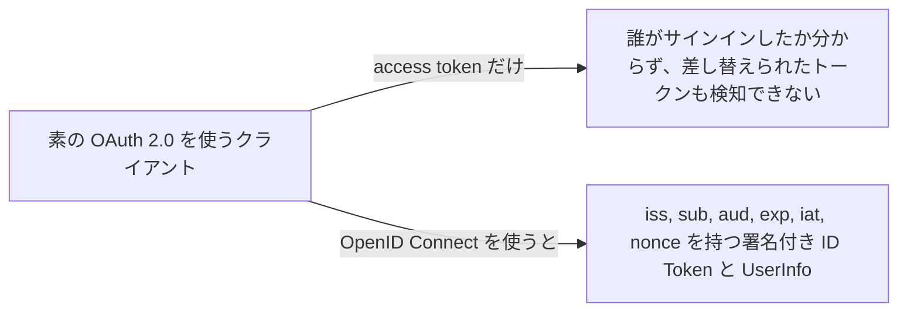
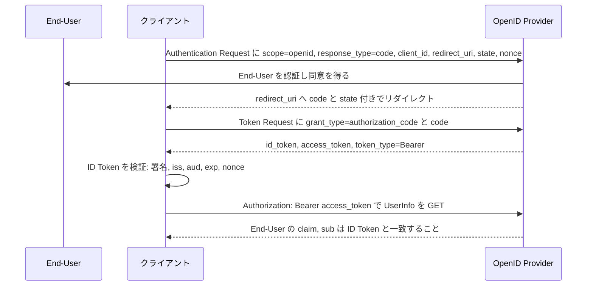

# OpenID Connect Core 1.0

> 一言で言うと: OAuth 2.0 の上に identity 層を載せ、誰がサインインしたかを access token からの推測ではなく、署名付きの ID Token でクライアントに伝える仕様。

## どういうときに使うか

- **API を呼ぶだけでなく、ユーザーが誰かを知りたい Web / モバイルアプリ**: OAuth 2.0 単体では End-User について何も語らない access token しか得られない。OpenID Connect は `iss`、`sub`、`aud`、`exp`、`iat` を持ち Provider が署名した ID Token を返すので、クライアントは Authorization Server が行った認証に基づいて End-User の identity を検証できる (Section 1、Section 2)。
- **ログイン後にプロフィール情報を取りたい**: UserInfo Endpoint は access token を Bearer token として提示したクライアントに End-User の claim を返し、クライアントは `sub` を ID Token と突き合わせる (Section 5.3)。
- **攻撃者が code や access token を別セッションに差し替える**: ID Token は `c_hash` と `at_hash` を運ぶので、クライアントは authorization code と access token の substitution を検知できる (Section 16.11)。
- **ログイン応答のリプレイ**: クライアントは `nonce` でセッションと応答を結び付け、Provider はそれを ID Token にそのまま書き込む (Section 3.1.2.1)。

## 解決する問題

OAuth 2.0 は API アクセスを認可する仕様で、認可した本人について信頼できる情報をクライアントに渡さない。access token をログインの証拠として扱うクライアントは token substitution に弱い。攻撃者が別のユーザーや別のクライアント向けに発行されたトークンを渡しても、クライアントには区別がつかない (Section 16.11)。End-User の識別子やプロフィールを求める標準的な手段もない。

OpenID Connect は ID Token という 1 つの新しい成果物でこれを解決する。OpenID Provider が署名した JWT で、クライアントは中身を信用する前に必ず検証する (Section 2、Section 3.1.3.7)。同じフローでプロフィール claim 用の UserInfo Endpoint も提供される (Section 5.3)。

## 仕組み

Authorization Code Flow は Section 3.1.1 が番号付きで示す手順で進む。クライアントが Authentication Request を用意し、Authorization Server が End-User を認証して同意を得て、Authorization Code を付けて End-User をクライアントに戻し、クライアントが Token Endpoint で code を ID Token と Access Token を含む応答に交換する (Section 3.1.1)。リクエストは `scope` に `openid` を含む OAuth 2.0 の authorization request で、`nonce`、`prompt`、`max_age` を付けられる (Section 3.1.2.1)。その後クライアントは ID Token を検証し (Section 3.1.3.7)、プロフィール claim が要るなら Access Token を UserInfo Endpoint に提示する (Section 5.3.1)。

## 仕様が求めること

- Authentication Request は `openid` scope を含まなければならず (MUST)、Authorization Code Flow では `response_type` は `code`、`redirect_uri` は事前登録した Redirection URI と完全一致しなければならない (Section 3.1.2.1)。
- ID Token は `iss`、`sub`、`aud`、`exp`、`iat` を含まなければならず、JWS で署名されなければならない (Section 2)。
- クライアントは `iss` が Issuer Identifier と完全一致すること、`aud` に自分の `client_id` が含まれること、issuer の鍵で署名が検証できること、現在時刻が `exp` より前であることを確認しなければならない (Section 3.1.3.7)。
- Authentication Request で `nonce` を送った場合、`nonce` claim が存在しなければならず、クライアントは送った値と等しいことを検証しなければならない (Section 2、Section 3.1.3.7)。
- Implicit Flow では `nonce` は REQUIRED で、ID Token と一緒に Access Token が返るときは `at_hash` も REQUIRED (Section 3.2.2.1、Section 3.2.2.10)。
- Access Token は UserInfo Endpoint に Bearer Token として送らなければならず、UserInfo Response の `sub` は ID Token の `sub` と完全一致することを検証しなければならない。一致しなければその応答の値を使ってはならない (Section 5.3.1、Section 5.3.2)。

## 注意点

- `nonce` はセッションごとの状態を含み、推測不能でなければならない。そうでないとリプレイを防げない (Section 15.5.2)。
- discovery が返す issuer は ID Token の `iss` と完全一致しなければならない。path 部分も Issuer Identifier の一部 (Section 16.15)。
- TLS を使うときは必ずサーバー証明書の検証を行わなければならない。テスト用クライアントで無効化したまま本番に持ち込まないこと (Section 16.17)。
- Redirection URI へのリダイレクトに HTTP 307 を使ってはならない。End-User の credential がクライアントに転送されうるため、303 が望ましい (Section 16.22)。
- Access Token の lifetime は single use か非常に短くすべきで、End-User が失効できる仕組みを用意すべき (Section 16.18)。

## 出典

- [OpenID Connect Core 1.0, Section 1](https://openid.net/specs/openid-connect-core-1_0.html#Introduction)
- [OpenID Connect Core 1.0, Section 2](https://openid.net/specs/openid-connect-core-1_0.html#IDToken)
- [OpenID Connect Core 1.0, Section 3.1.1](https://openid.net/specs/openid-connect-core-1_0.html#CodeFlowSteps)
- [OpenID Connect Core 1.0, Section 3.1.2.1](https://openid.net/specs/openid-connect-core-1_0.html#AuthRequest)
- [OpenID Connect Core 1.0, Section 3.1.3.7](https://openid.net/specs/openid-connect-core-1_0.html#IDTokenValidation)
- [OpenID Connect Core 1.0, Section 3.2.2.1](https://openid.net/specs/openid-connect-core-1_0.html#ImplicitAuthRequest)
- [OpenID Connect Core 1.0, Section 3.2.2.10](https://openid.net/specs/openid-connect-core-1_0.html#ImplicitIDToken)
- [OpenID Connect Core 1.0, Section 5.3](https://openid.net/specs/openid-connect-core-1_0.html#UserInfo)
- [OpenID Connect Core 1.0, Section 5.3.1](https://openid.net/specs/openid-connect-core-1_0.html#UserInfoRequest)
- [OpenID Connect Core 1.0, Section 5.3.2](https://openid.net/specs/openid-connect-core-1_0.html#UserInfoResponse)
- [OpenID Connect Core 1.0, Section 15.5.2](https://openid.net/specs/openid-connect-core-1_0.html#NonceNotes)
- [OpenID Connect Core 1.0, Section 16.11](https://openid.net/specs/openid-connect-core-1_0.html#TokenSubstitution)
- [OpenID Connect Core 1.0, Section 16.15](https://openid.net/specs/openid-connect-core-1_0.html#IssuerIdentifier)
- [OpenID Connect Core 1.0, Section 16.17](https://openid.net/specs/openid-connect-core-1_0.html#TLSRequirements)
- [OpenID Connect Core 1.0, Section 16.18](https://openid.net/specs/openid-connect-core-1_0.html#TokenLifetime)
- [OpenID Connect Core 1.0, Section 16.22](https://openid.net/specs/openid-connect-core-1_0.html#HTTP307Redirects)
