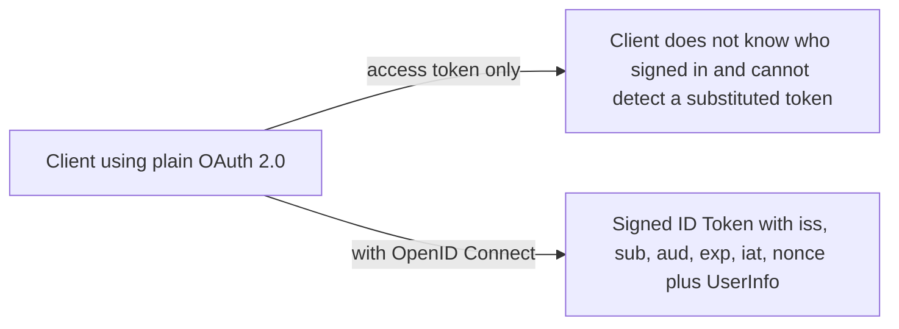
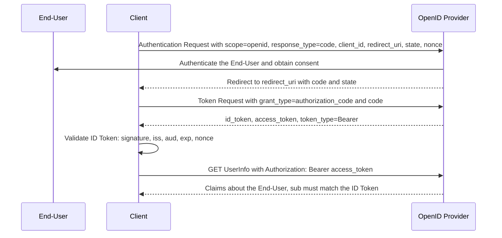

# OpenID Connect Core 1.0

> In one line: OpenID Connect puts an identity layer on top of OAuth 2.0, so the client learns who signed in through a signed ID Token instead of guessing from an access token.

## When you reach for it

- **A web or mobile app that needs to know who the user is, not just call an API**: OAuth 2.0 gives you an access token with no statement about the End-User. OpenID Connect returns an ID Token with `iss`, `sub`, `aud`, `exp` and `iat`, signed by the provider, so the client can verify the identity of the End-User based on the authentication performed by the Authorization Server (Section 1, Section 2).
- **Fetching profile data after login**: the UserInfo Endpoint returns claims about the End-User to a client that presents the access token as a Bearer token, and the client checks the `sub` against the ID Token (Section 5.3).
- **An attacker swaps a code or access token into another session**: the ID Token carries `c_hash` and `at_hash`, so the client can detect authorization code and access token substitution (Section 16.11).
- **Replay of a login response**: the client ties the session to the response with `nonce`, which the provider copies into the ID Token unmodified (Section 3.1.2.1).

## The problem it solves

OAuth 2.0 authorizes API access. It does not tell the client anything reliable about the person who authorized it. A client that treats an access token as proof of login is open to token substitution: an attacker can hand it a token issued for a different user or a different client and the client cannot tell (Section 16.11). It also has no standard way to ask for the End-User's identifier or profile.

OpenID Connect fixes this with one new artifact, the ID Token: a JWT that the OpenID Provider signs and that the client validates before trusting anything in it (Section 2, Section 3.1.3.7). The same flow also exposes a UserInfo Endpoint for profile claims (Section 5.3).

## How it works

The Authorization Code Flow runs in the steps the spec numbers in Section 3.1.1: the client prepares an Authentication Request, the Authorization Server authenticates the End-User and obtains consent, sends the End-User back with an Authorization Code, and the client exchanges the code at the Token Endpoint for a response containing an ID Token and an Access Token (Section 3.1.1). The request is an OAuth 2.0 authorization request whose `scope` contains `openid` and which may carry `nonce`, `prompt` and `max_age` (Section 3.1.2.1). The client then validates the ID Token (Section 3.1.3.7) and, if it wants profile claims, presents the Access Token to the UserInfo Endpoint (Section 5.3.1).

## What the spec requires

- The Authentication Request MUST contain the `openid` scope value, `response_type` is `code` for the Authorization Code Flow, and `redirect_uri` MUST exactly match a pre-registered Redirection URI (Section 3.1.2.1).
- The ID Token MUST contain `iss`, `sub`, `aud`, `exp` and `iat`, and ID Tokens MUST be signed using JWS (Section 2).
- The client MUST check that `iss` exactly matches the Issuer Identifier, that `aud` contains its `client_id`, that the signature verifies with the issuer's keys, and that the current time is before `exp` (Section 3.1.3.7).
- If a `nonce` was sent in the Authentication Request, a `nonce` claim MUST be present and the client MUST verify it equals the value it sent (Section 2, Section 3.1.3.7).
- In the Implicit Flow `nonce` is REQUIRED, and `at_hash` is REQUIRED when an Access Token is returned with the ID Token (Section 3.2.2.1, Section 3.2.2.10).
- The Access Token MUST be sent to the UserInfo Endpoint as a Bearer Token, and the `sub` in the UserInfo Response MUST be verified to exactly match the `sub` in the ID Token, otherwise the response values MUST NOT be used (Section 5.3.1, Section 5.3.2).

## Watch out

- The `nonce` must include per-session state and be unguessable, otherwise it does not stop replay (Section 15.5.2).
- The issuer returned by discovery MUST exactly match the `iss` in the ID Token; the path component is part of the Issuer Identifier (Section 16.15).
- Whenever TLS is used a server certificate check MUST be performed, so do not disable it in test clients that leak into production (Section 16.17).
- HTTP 307 redirects MUST NOT be used when redirecting to the Redirection URI, because they can forward the End-User's credentials to the client; 303 is preferred (Section 16.22).
- Access Token lifetimes SHOULD be single use or very short, with a way for the End-User to revoke them (Section 16.18).

## Sources

- [OpenID Connect Core 1.0, Section 1](https://openid.net/specs/openid-connect-core-1_0.html#Introduction)
- [OpenID Connect Core 1.0, Section 2](https://openid.net/specs/openid-connect-core-1_0.html#IDToken)
- [OpenID Connect Core 1.0, Section 3.1.1](https://openid.net/specs/openid-connect-core-1_0.html#CodeFlowSteps)
- [OpenID Connect Core 1.0, Section 3.1.2.1](https://openid.net/specs/openid-connect-core-1_0.html#AuthRequest)
- [OpenID Connect Core 1.0, Section 3.1.3.7](https://openid.net/specs/openid-connect-core-1_0.html#IDTokenValidation)
- [OpenID Connect Core 1.0, Section 3.2.2.1](https://openid.net/specs/openid-connect-core-1_0.html#ImplicitAuthRequest)
- [OpenID Connect Core 1.0, Section 3.2.2.10](https://openid.net/specs/openid-connect-core-1_0.html#ImplicitIDToken)
- [OpenID Connect Core 1.0, Section 5.3](https://openid.net/specs/openid-connect-core-1_0.html#UserInfo)
- [OpenID Connect Core 1.0, Section 5.3.1](https://openid.net/specs/openid-connect-core-1_0.html#UserInfoRequest)
- [OpenID Connect Core 1.0, Section 5.3.2](https://openid.net/specs/openid-connect-core-1_0.html#UserInfoResponse)
- [OpenID Connect Core 1.0, Section 15.5.2](https://openid.net/specs/openid-connect-core-1_0.html#NonceNotes)
- [OpenID Connect Core 1.0, Section 16.11](https://openid.net/specs/openid-connect-core-1_0.html#TokenSubstitution)
- [OpenID Connect Core 1.0, Section 16.15](https://openid.net/specs/openid-connect-core-1_0.html#IssuerIdentifier)
- [OpenID Connect Core 1.0, Section 16.17](https://openid.net/specs/openid-connect-core-1_0.html#TLSRequirements)
- [OpenID Connect Core 1.0, Section 16.18](https://openid.net/specs/openid-connect-core-1_0.html#TokenLifetime)
- [OpenID Connect Core 1.0, Section 16.22](https://openid.net/specs/openid-connect-core-1_0.html#HTTP307Redirects)
