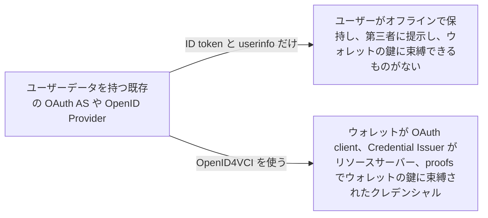
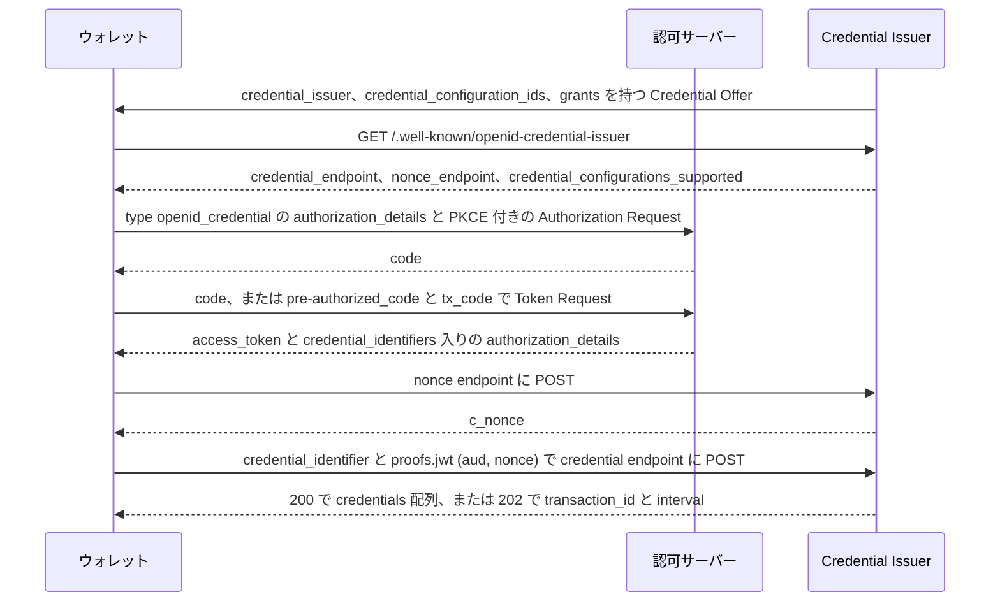

# OpenID for Verifiable Credential Issuance

> 一言で言うと: ウォレットが client、Credential Issuer がリソースサーバーになる OAuth 保護の API。access token で Credential Endpoint を開き、ウォレットが所持を証明した鍵に束縛されたクレデンシャルが返ってくる。

## どういうときに使うか

- **大学がサイトに「デジタル学位証を請求する」リンクを置く**: リンクは Credential Offer で、ウォレットは大学の authorization code flow を回し、同じ端末のウォレットに学位証が入る (Section 3.4、Appendix H.1)。
- **雇用主が QR コードをメールし、ワンタイムコードを SMS で送る**: pre-authorized code flow なら発行者は先に本人確認を終えられ、`tx_code` があるので QR を撮影した第三者は引き換えられない (Section 3.5、Appendix H.2)。
- **身元調査に数日かかる犯罪経歴証明**: Credential Endpoint は `transaction_id` 付きで 202 を返し、ウォレットは後で Deferred Credential Endpoint から受け取る (Section 8.3、Section 9、Appendix H.3)。
- **検証者がウォレットにまだない運転免許を求める**: ウォレット自身が発行者を選んで発行を始め、終わったら検証者に戻る (Appendix H.4)。
- **提示を紐付けられたくない**: 1 回のリクエストで同じデータ・別の鍵のクレデンシャルをバッチ発行できるので、保有者はそれぞれを 1 回ずつ提示できる (Section 3.3.2)。

## 解決する問題

OpenID Provider はユーザーについての claim を主張できるが、相手は直接話す relying party だけで、形式もそのセッションに紐づく ID token だけだ。ウォレットが必要とするのは、保持しておいて発行者と面識のない検証者へ後で提示でき、できればウォレットだけが制御する鍵に束縛されたクレデンシャルである (Section 1)。

OpenID4VCI は OAuth を再利用する。ウォレットは発行者の認可サーバーから access token を得て、発行者の Credential Endpoint を呼ぶ。リクエストはクレデンシャル構成を名指しし鍵の proof を運び、レスポンスは SD-JWT VC、mdoc、W3C VCDM など任意の形式のクレデンシャルを 1 つ以上運ぶ (Section 3.1、Section 3.2、Section 8)。

## 仕組み

発行者は Credential Offer で開始できる。`credential_issuer`、`credential_configuration_ids`、任意の `grants` を持つ JSON オブジェクトで、`credential_offer` に値で、または `credential_offer_uri` で参照として渡す (Section 4.1、Section 4.1.1)。ウォレットは `/.well-known/openid-credential-issuer` の発行者メタデータでエンドポイントと構成を知り (Section 12.2.2)、type `openid_credential` と `credential_configuration_id` を持つ `authorization_details` か `scope` でアクセスを求める (Section 5.1.1)。pre-authorized flow では認可エンドポイントを飛ばし、`pre-authorized_code` と `tx_code` をトークンエンドポイントに送る (Section 6.1)。トークンレスポンスには次に使う `credential_identifiers` が含まれることがある (Section 6.2)。ウォレットは `c_nonce` を取り、`typ: openid4vci-proof+jwt`、発行者識別子を `aud`、`c_nonce` を `nonce` に入れた `jwt` proof を作って Credential Endpoint に POST し (Section 7、Section 8.2、Appendix F.1)、クレデンシャルか、後で受け取るための `transaction_id` が返る (Section 8.3)。

## 仕様が求めること

- Credential Endpoint は必須で TLS を使わなければならない。発行者は OAuth のリソースサーバー、ウォレットは OAuth client として振る舞う (Section 3.2、Section 8)。
- Credential Offer は `credential_issuer` と空でない `credential_configuration_ids` を持たなければならない。`pre-authorized_code` は短命かつ一回限りでなければならず、offer に `tx_code` があればウォレットはトークンリクエストで transaction code を送らなければならない (Section 4.1.1、Section 6.1)。
- proof は Credential Issuer Identifier を audience として、発行者に Nonce Endpoint があれば `c_nonce` も含めなければならない。構成に `proof_types_supported` があるなら `proofs` パラメータは必須 (Section 8.2)。
- `jwt` proof は `typ: openid4vci-proof+jwt`、Credential Issuer Identifier と等しい `aud`、`iat`、Nonce Endpoint がある場合は `nonce` を持たなければならず、発行者は `kid`、`jwk`、`x5c` のいずれかで示された鍵で署名を検証しなければならない (Appendix F.1)。
- `c_nonce` を要求する発行者は Nonce Endpoint を提供しなければならず、その応答は `Cache-Control: no-store` でキャッシュ不可にしなければならない (Section 7、Section 7.2)。
- 即時発行は `credentials` 配列付きの 200 を、遅延発行は `transaction_id` と `interval` 付きの 202 を返さなければならない (Section 8.3)。
- 発行者メタデータは well-known パスで未署名の `application/json` として提供しなければならず、署名付きの `application/jwt` を追加で提供してもよい (Section 12.2.2)。

## 注意点

- **Credential Offer は信用できない入力**: 送信元は認証されず完全性も保護されていないので、ウォレットはウォレット起点のフローと同じ発行者検証を行わなければならず、offer が来たというだけでクレデンシャルを受け入れてはならない (Section 13.5)。
- **pre-authorized code のリプレイ**: ユーザーの肩越しに QR を読んだ者が引き換えられる。別経路で送る transaction code が仕様の挙げる対策。別サービスの transaction code をフィッシングされないよう、ウォレットは信頼できる発行者とだけやり取りすることが推奨される (Section 13.6.1、Section 13.6.2)。
- **proof のリプレイ**: 奪われた鍵 proof は複製クレデンシャルの取得に再利用できる。Nonce Endpoint による `c_nonce` の鮮度が主な防御で、発行者は key attestation でウォレットの鍵保護を確認することが推奨される (Section 13.8)。
- **access token の寿命**: 5 分を超えるトークンは長命とみなされ、送信者制約がなければ発行してはならない。送信者制約には DPoP が推奨される (Section 13.2、Section 13.10)。
- **分割アーキテクチャのウォレット**: サーバー側コンポーネントを完全には信頼できないなら、authorization code、pre-authorized code、proof をそこに通してはならない (Section 13.4)。

## 出典

- [OpenID4VCI 1.0, Section 1](https://openid.net/specs/openid-4-verifiable-credential-issuance-1_0.html#name-introduction)
- [OpenID4VCI 1.0, Section 3.1](https://openid.net/specs/openid-4-verifiable-credential-issuance-1_0.html#name-credential-issuer)
- [OpenID4VCI 1.0, Section 3.2](https://openid.net/specs/openid-4-verifiable-credential-issuance-1_0.html#name-oauth-20)
- [OpenID4VCI 1.0, Section 3.3.2](https://openid.net/specs/openid-4-verifiable-credential-issuance-1_0.html#name-batch-credential-issuance)
- [OpenID4VCI 1.0, Section 3.4](https://openid.net/specs/openid-4-verifiable-credential-issuance-1_0.html#name-authorization-code-flow)
- [OpenID4VCI 1.0, Section 3.5](https://openid.net/specs/openid-4-verifiable-credential-issuance-1_0.html#name-pre-authorized-code-flow)
- [OpenID4VCI 1.0, Section 4.1](https://openid.net/specs/openid-4-verifiable-credential-issuance-1_0.html#name-credential-offer)
- [OpenID4VCI 1.0, Section 4.1.1](https://openid.net/specs/openid-4-verifiable-credential-issuance-1_0.html#name-credential-offer-parameters)
- [OpenID4VCI 1.0, Section 5.1.1](https://openid.net/specs/openid-4-verifiable-credential-issuance-1_0.html#name-using-authorization-details)
- [OpenID4VCI 1.0, Section 6.1](https://openid.net/specs/openid-4-verifiable-credential-issuance-1_0.html#name-token-request)
- [OpenID4VCI 1.0, Section 6.2](https://openid.net/specs/openid-4-verifiable-credential-issuance-1_0.html#name-successful-token-response)
- [OpenID4VCI 1.0, Section 7](https://openid.net/specs/openid-4-verifiable-credential-issuance-1_0.html#name-nonce-endpoint)
- [OpenID4VCI 1.0, Section 7.2](https://openid.net/specs/openid-4-verifiable-credential-issuance-1_0.html#name-nonce-response)
- [OpenID4VCI 1.0, Section 8](https://openid.net/specs/openid-4-verifiable-credential-issuance-1_0.html#name-credential-endpoint)
- [OpenID4VCI 1.0, Section 8.2](https://openid.net/specs/openid-4-verifiable-credential-issuance-1_0.html#name-credential-request)
- [OpenID4VCI 1.0, Section 8.3](https://openid.net/specs/openid-4-verifiable-credential-issuance-1_0.html#name-credential-response)
- [OpenID4VCI 1.0, Section 9](https://openid.net/specs/openid-4-verifiable-credential-issuance-1_0.html#name-deferred-credential-endpoin)
- [OpenID4VCI 1.0, Section 12.2.2](https://openid.net/specs/openid-4-verifiable-credential-issuance-1_0.html#name-credential-issuer-metadata-)
- [OpenID4VCI 1.0, Section 13.2](https://openid.net/specs/openid-4-verifiable-credential-issuance-1_0.html#name-best-current-practice-for-o)
- [OpenID4VCI 1.0, Section 13.4](https://openid.net/specs/openid-4-verifiable-credential-issuance-1_0.html#name-split-architecture-wallets)
- [OpenID4VCI 1.0, Section 13.5](https://openid.net/specs/openid-4-verifiable-credential-issuance-1_0.html#name-credential-offer-2)
- [OpenID4VCI 1.0, Section 13.6.1](https://openid.net/specs/openid-4-verifiable-credential-issuance-1_0.html#name-replay-prevention)
- [OpenID4VCI 1.0, Section 13.6.2](https://openid.net/specs/openid-4-verifiable-credential-issuance-1_0.html#name-transaction-code-phishing)
- [OpenID4VCI 1.0, Section 13.8](https://openid.net/specs/openid-4-verifiable-credential-issuance-1_0.html#name-proof-replay)
- [OpenID4VCI 1.0, Section 13.10](https://openid.net/specs/openid-4-verifiable-credential-issuance-1_0.html#name-protecting-the-access-token)
- [OpenID4VCI 1.0, Appendix F.1](https://openid.net/specs/openid-4-verifiable-credential-issuance-1_0.html#name-jwt-proof-type)
- [OpenID4VCI 1.0, Appendix H.1](https://openid.net/specs/openid-4-verifiable-credential-issuance-1_0.html#name-credential-offer-same-devic)
- [OpenID4VCI 1.0, Appendix H.2](https://openid.net/specs/openid-4-verifiable-credential-issuance-1_0.html#name-credential-offer-cross-devi)
- [OpenID4VCI 1.0, Appendix H.3](https://openid.net/specs/openid-4-verifiable-credential-issuance-1_0.html#name-credential-offer-cross-devic)
- [OpenID4VCI 1.0, Appendix H.4](https://openid.net/specs/openid-4-verifiable-credential-issuance-1_0.html#name-wallet-initiated-issuance-d)
