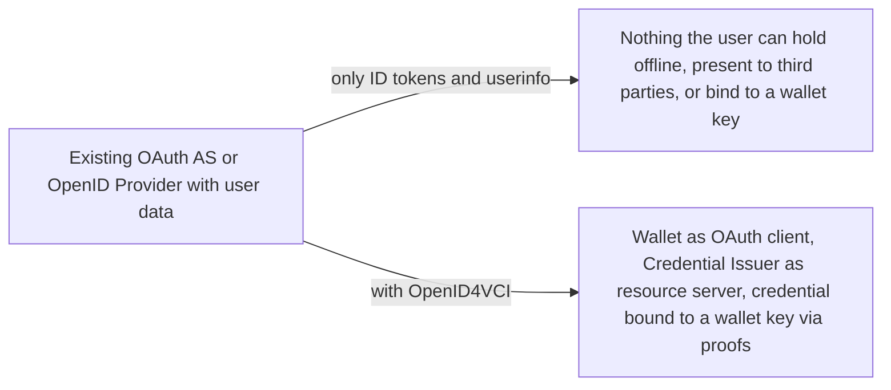
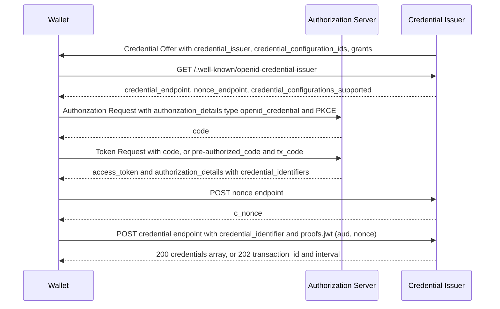

# OpenID for Verifiable Credential Issuance

> In one line: An OAuth-protected API in which the wallet is the client, the Credential Issuer is the resource server, and the access token unlocks a Credential Endpoint that returns a credential bound to a key the wallet proves it holds.

## When you reach for it

- **A university puts a "request your digital diploma" link on its site**: the link is a Credential Offer, the wallet runs the authorization code flow at the university, and the diploma lands in the wallet on the same device (Section 3.4, Appendix H.1).
- **An employer emails a QR code and texts a one-time code**: the pre-authorized code flow lets the issuer finish identity checks first, and the `tx_code` stops anyone who photographed the QR from redeeming it (Section 3.5, Appendix H.2).
- **A criminal-record credential that needs days of background checks**: the Credential Endpoint answers 202 with a `transaction_id`, and the wallet collects the credential later from the Deferred Credential Endpoint (Section 8.3, Section 9, Appendix H.3).
- **A verifier asks for a driving licence the wallet does not have yet**: the wallet picks an issuer and starts issuance itself, then returns to the verifier (Appendix H.4).
- **Unlinkable presentations**: one request can issue a batch of credentials with the same data but different keys, so the holder can show each one once (Section 3.3.2).

## The problem it solves

An OpenID Provider asserts claims only to a relying party it talks to directly, as an ID token tied to that session. A wallet needs a credential it can keep and later present to verifiers the issuer never meets, bound to a key only the wallet controls (Section 1).

OpenID4VCI reuses OAuth: the wallet obtains an access token from the issuer's authorization server, then calls the Credential Endpoint, naming the credential configuration and carrying key proofs; the response holds one or more credentials in any format, such as SD-JWT VC, mdoc or W3C VCDM (Section 3.1, Section 3.2, Section 8).

## How it works

The issuer can start with a Credential Offer: a JSON object with `credential_issuer`, `credential_configuration_ids` and optional `grants`, passed by value in `credential_offer` or by reference in `credential_offer_uri` (Section 4.1, Section 4.1.1). The wallet reads the issuer metadata at `/.well-known/openid-credential-issuer` to find the endpoints and configurations (Section 12.2.2), then requests access with `authorization_details` of type `openid_credential` naming a `credential_configuration_id`, or with a `scope` (Section 5.1.1). In the pre-authorized flow it skips the authorization endpoint and sends `pre-authorized_code` and `tx_code` to the token endpoint (Section 6.1); the token response may return `credential_identifiers` to use next (Section 6.2). The wallet fetches a `c_nonce`, builds a `jwt` proof with `typ: openid4vci-proof+jwt`, `aud` set to the issuer identifier and `nonce` set to the `c_nonce`, and posts it to the Credential Endpoint (Section 7, Section 8.2, Appendix F.1), which returns the credentials or a `transaction_id` for deferred pickup (Section 8.3).

## What the spec requires

- The Credential Endpoint is REQUIRED and MUST use TLS; the issuer acts as an OAuth resource server and the wallet as an OAuth client (Section 3.2, Section 8).
- A Credential Offer MUST carry `credential_issuer` and a non-empty `credential_configuration_ids`; a `pre-authorized_code` MUST be short lived and single use, and when `tx_code` is present in the offer the wallet MUST send the transaction code in the token request (Section 4.1.1, Section 6.1).
- Proofs MUST incorporate the Credential Issuer Identifier as audience and, when the issuer has a Nonce Endpoint, the `c_nonce`; the `proofs` parameter MUST be present if the configuration lists `proof_types_supported` (Section 8.2).
- A `jwt` proof MUST have `typ: openid4vci-proof+jwt`, `aud` equal to the Credential Issuer Identifier, `iat`, and `nonce` when a Nonce Endpoint exists; the issuer MUST verify the signature against the key in `kid`, `jwk` or `x5c` (Appendix F.1).
- An issuer that requires `c_nonce` MUST offer a Nonce Endpoint, and its response MUST be uncacheable with `Cache-Control: no-store` (Section 7, Section 7.2).
- Immediate issuance MUST return 200 with a `credentials` array; deferred issuance MUST return 202 with `transaction_id` and `interval` (Section 8.3).
- Issuer metadata MUST be served at the well-known path as unsigned `application/json`, and MAY additionally be served as a signed `application/jwt` (Section 12.2.2).

## Watch out

- **Credential Offers are untrusted input**: their origin is not authenticated and integrity is not protected, so the wallet MUST validate the issuer exactly as it would for a wallet-initiated flow and MUST NOT accept credentials just because an offer arrived (Section 13.5).
- **Pre-authorized code replay**: anyone who scans the QR code over the user's shoulder can redeem it; a transaction code sent on a second channel is the mitigation the spec describes. Wallets are RECOMMENDED to talk only to trusted issuers so an attacker cannot phish a code meant for another service (Section 13.6.1, Section 13.6.2).
- **Proof replay**: a captured key proof can be replayed for duplicate credentials; `c_nonce` freshness via the Nonce Endpoint is the main defense, and issuers are RECOMMENDED to check how the wallet protects keys through key attestation (Section 13.8).
- **Access token lifetime**: tokens valid longer than five minutes count as long lived and MUST NOT be issued unless sender-constrained, and DPoP is RECOMMENDED for sender-constraining (Section 13.2, Section 13.10).
- **Split wallets**: if a server component is not fully trusted, authorization codes, pre-authorized codes and proofs MUST NOT be routed through it (Section 13.4).

## Sources

- [OpenID4VCI 1.0, Section 1](https://openid.net/specs/openid-4-verifiable-credential-issuance-1_0.html#name-introduction)
- [OpenID4VCI 1.0, Section 3.1](https://openid.net/specs/openid-4-verifiable-credential-issuance-1_0.html#name-credential-issuer)
- [OpenID4VCI 1.0, Section 3.2](https://openid.net/specs/openid-4-verifiable-credential-issuance-1_0.html#name-oauth-20)
- [OpenID4VCI 1.0, Section 3.3.2](https://openid.net/specs/openid-4-verifiable-credential-issuance-1_0.html#name-batch-credential-issuance)
- [OpenID4VCI 1.0, Section 3.4](https://openid.net/specs/openid-4-verifiable-credential-issuance-1_0.html#name-authorization-code-flow)
- [OpenID4VCI 1.0, Section 3.5](https://openid.net/specs/openid-4-verifiable-credential-issuance-1_0.html#name-pre-authorized-code-flow)
- [OpenID4VCI 1.0, Section 4.1](https://openid.net/specs/openid-4-verifiable-credential-issuance-1_0.html#name-credential-offer)
- [OpenID4VCI 1.0, Section 4.1.1](https://openid.net/specs/openid-4-verifiable-credential-issuance-1_0.html#name-credential-offer-parameters)
- [OpenID4VCI 1.0, Section 5.1.1](https://openid.net/specs/openid-4-verifiable-credential-issuance-1_0.html#name-using-authorization-details)
- [OpenID4VCI 1.0, Section 6.1](https://openid.net/specs/openid-4-verifiable-credential-issuance-1_0.html#name-token-request)
- [OpenID4VCI 1.0, Section 6.2](https://openid.net/specs/openid-4-verifiable-credential-issuance-1_0.html#name-successful-token-response)
- [OpenID4VCI 1.0, Section 7](https://openid.net/specs/openid-4-verifiable-credential-issuance-1_0.html#name-nonce-endpoint)
- [OpenID4VCI 1.0, Section 7.2](https://openid.net/specs/openid-4-verifiable-credential-issuance-1_0.html#name-nonce-response)
- [OpenID4VCI 1.0, Section 8](https://openid.net/specs/openid-4-verifiable-credential-issuance-1_0.html#name-credential-endpoint)
- [OpenID4VCI 1.0, Section 8.2](https://openid.net/specs/openid-4-verifiable-credential-issuance-1_0.html#name-credential-request)
- [OpenID4VCI 1.0, Section 8.3](https://openid.net/specs/openid-4-verifiable-credential-issuance-1_0.html#name-credential-response)
- [OpenID4VCI 1.0, Section 9](https://openid.net/specs/openid-4-verifiable-credential-issuance-1_0.html#name-deferred-credential-endpoin)
- [OpenID4VCI 1.0, Section 12.2.2](https://openid.net/specs/openid-4-verifiable-credential-issuance-1_0.html#name-credential-issuer-metadata-)
- [OpenID4VCI 1.0, Section 13.2](https://openid.net/specs/openid-4-verifiable-credential-issuance-1_0.html#name-best-current-practice-for-o)
- [OpenID4VCI 1.0, Section 13.4](https://openid.net/specs/openid-4-verifiable-credential-issuance-1_0.html#name-split-architecture-wallets)
- [OpenID4VCI 1.0, Section 13.5](https://openid.net/specs/openid-4-verifiable-credential-issuance-1_0.html#name-credential-offer-2)
- [OpenID4VCI 1.0, Section 13.6.1](https://openid.net/specs/openid-4-verifiable-credential-issuance-1_0.html#name-replay-prevention)
- [OpenID4VCI 1.0, Section 13.6.2](https://openid.net/specs/openid-4-verifiable-credential-issuance-1_0.html#name-transaction-code-phishing)
- [OpenID4VCI 1.0, Section 13.8](https://openid.net/specs/openid-4-verifiable-credential-issuance-1_0.html#name-proof-replay)
- [OpenID4VCI 1.0, Section 13.10](https://openid.net/specs/openid-4-verifiable-credential-issuance-1_0.html#name-protecting-the-access-token)
- [OpenID4VCI 1.0, Appendix F.1](https://openid.net/specs/openid-4-verifiable-credential-issuance-1_0.html#name-jwt-proof-type)
- [OpenID4VCI 1.0, Appendix H.1](https://openid.net/specs/openid-4-verifiable-credential-issuance-1_0.html#name-credential-offer-same-devic)
- [OpenID4VCI 1.0, Appendix H.2](https://openid.net/specs/openid-4-verifiable-credential-issuance-1_0.html#name-credential-offer-cross-devi)
- [OpenID4VCI 1.0, Appendix H.3](https://openid.net/specs/openid-4-verifiable-credential-issuance-1_0.html#name-credential-offer-cross-devic)
- [OpenID4VCI 1.0, Appendix H.4](https://openid.net/specs/openid-4-verifiable-credential-issuance-1_0.html#name-wallet-initiated-issuance-d)
