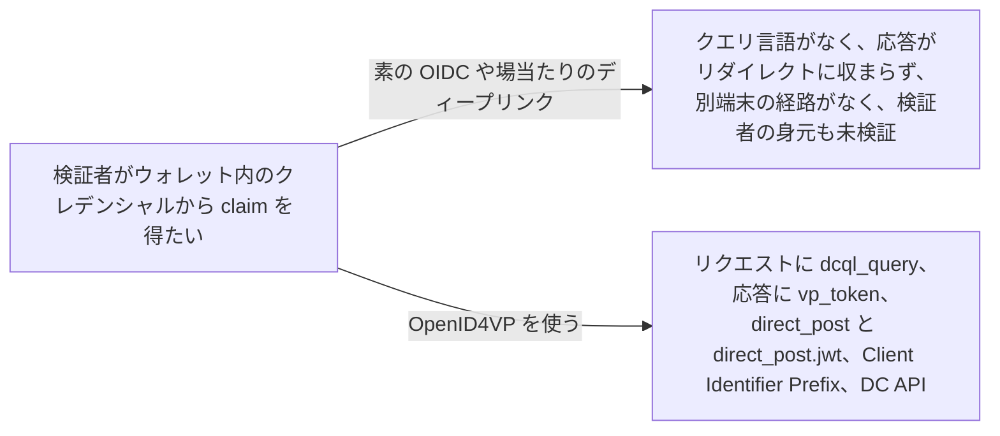
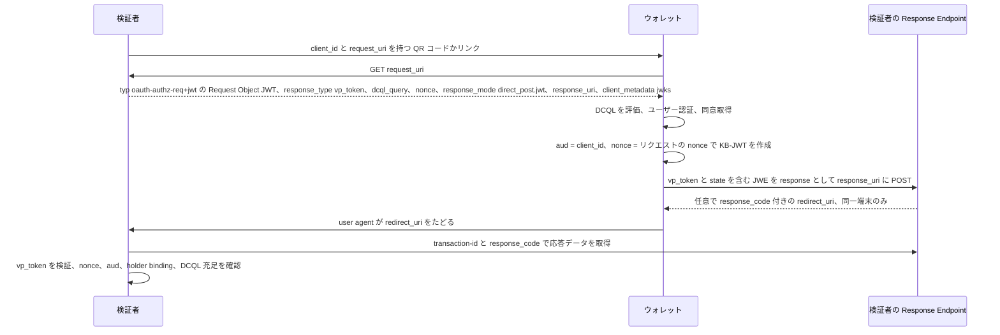

# OpenID for Verifiable Presentations

> 一言で言うと: 検証者が DCQL クエリを載せた OAuth 風の authorization request を送り、ウォレットが提示をまとめた `vp_token` で答える。同一端末ならリダイレクト、別端末なら HTTP POST、ブラウザなら Digital Credentials API 経由で。

## どういうときに使うか

- **同じスマホのウォレットに年齢証明を求める Web サイト**: `response_type=vp_token` と既定の fragment response mode で、検証者へのリダイレクトに提示が載って返る (Section 3.1、Section 5.6)。
- **デスクトップの検証者が QR を表示し、ウォレットはスマホにある**: QR には `client_id` と `request_uri` だけを入れ、ウォレットが Request Object を取得し、response mode `direct_post` で `response_uri` に応答を POST する (Section 3.2、Section 5.7、Section 8.2)。
- **PID を出す前に検証者が本当に誰かをウォレットが知る必要がある**: `x509_san_dns`、`x509_hash`、`verifier_attestation` などの Client Identifier Prefix が、署名付きリクエストをどう認証するかをウォレットに伝える (Section 5.9、Section 5.9.3)。
- **クレデンシャルで決済や文書署名を認可する**: `transaction_data` のハッシュを Key Binding JWT に入れるので、提示がその取引そのものの認可にもなる (Section 8.4、Appendix B.3.3)。
- **カスタム URL スキームなしで Web ページからウォレットを呼ぶ**: Digital Credentials API 経由の OpenID4VP では、ブラウザが認証した検証者の origin がウォレットに渡る (Appendix A)。

## 解決する問題

検証者は、どのクレデンシャルのどの claim が欲しいかを正確に伝え、別端末にあるかもしれないウォレットからそれを受け取り、その提示がリプレイではなく自分とこのセッションのために作られたと確信する必要がある。OAuth と OpenID Connect はリクエストとレスポンスのレールは与えるが、クエリ言語、別端末への応答経路、検証者の認証モデルは与えない (Section 1、Section 4)。

OpenID4VP は `dcql_query` リクエストパラメータ、`vp_token` のレスポンスタイプとパラメータ、`direct_post` response mode、応答の暗号化、Client Identifier Prefix、DC API バインディングを足す。これはフレームワークであり、配備側がどのオプションを使うかをプロファイルしなければならない (Section 3、Section 4)。

## 仕組み

検証者は Authorization Request を組み立てる。通常は `request_uri` から取得される署名付き Request Object だ (Section 5)。`client_id` が検証者を名乗り、`x509_hash:` のような prefix で署名の検証方法をウォレットに伝えることがある (Section 5.9.1)。リクエストは新しい `nonce`、`response_mode`、そして `id`・`format`・`meta`・`claims` を持つ Credential Query を `credentials` 配列に並べた `dcql_query` を運ぶ (Section 5.2、Section 6.1)。ウォレットはクエリを評価し、ユーザーに確認し、マッチしたクエリごとに提示を作る。SD-JWT VC なら Key Binding JWT にリクエストの `nonce` と Client Identifier の `aud` を入れた SD-JWT+KB になる (Appendix B.3.6)。`direct_post.jwt` ではウォレットは `client_metadata.jwks` の鍵に向けて応答を暗号化し、`response_uri` に POST する (Section 8.2、Section 8.3.1)。response endpoint は `response_code` 付きの `redirect_uri` を返してフロントエンドが元のセッションで結果を取得できるようにし (Section 13.3)、検証者は VP Token を検証する (Section 8.6)。

## 仕様が求めること

- Request Object は `typ: oauth-authz-req+jwt` を持たなければならず、ウォレットはそれがない Request Object を処理してはならない (Section 5)。
- `dcql_query` か DCQL クエリを表す `scope` のどちらか一方だけが存在しなければならない。`nonce` は必須で、リクエストごとに新しい、暗号学的に安全な乱数でなければならない。`response_mode` と `client_id` は必須。DC API 以外で Holder Binding なしの提示を求める場合は `state` が必須 (Section 5.1、Section 5.2、Section 5.3)。
- コロンを含む `client_id` は Client Identifier Prefix に従って解釈し、コロンがなければ事前登録済み client を指す (Section 5.9.1、Section 5.9.2)。
- DCQL クエリは空でない `credentials` 配列を持たなければならず、各 Credential Query は `id`、`format`、`meta` を持ち、`claims` の各要素は claims path pointer の `path` を持たなければならない (Section 6、Section 6.1、Section 6.3)。
- 応答の `vp_token` は必須で、Credential Query の `id` をキーとし、値は提示の配列、`multiple` が true でなければ 1 要素 (Section 8.1)。
- `direct_post` では `response_uri` が必須で `redirect_uri` があってはならない。暗号化応答は未署名の暗号化 JWT で、`alg` は選んだ JWK と一致しなければならない (Section 8.2、Section 8.3)。
- 検証者は VP Token を検証しなければならない。形式、各提示の完全性、クエリ条件、免除されていない限り Holder Binding、そして検証者自身の信頼チェック (Section 8.6)。
- `dc+sd-jwt` では KB-JWT の `nonce` はリクエストの `nonce` と、`aud` は Client Identifier (DC API では `origin:` に origin を続けたもの) と等しくなければならない (Appendix B.3.1、Appendix B.3.6)。

## 注意点

- **リプレイ**: すべての Verifiable Presentation は検証者の `client_id` とリクエストの `nonce` に束縛されなければならず、間違った nonce の提示を含む応答は拒否しなければならない。Holder Binding のない提示にはリプレイ対策がまったくない (Section 14.1.1、Section 14.1.2)。
- **`direct_post` のセッション固定**: 攻撃者は奪ったリクエストを被害者に中継し、後で応答を回収できる。response endpoint は `redirect_uri` に新しい `response_code` を含め、フロントエンドが応答を取得するときにそれを要求しなければならない。別端末では効かない (Section 14.2)。
- **response endpoint の衛生**: 応答データを検証者の他の部分に渡す内部インターフェースは保護しなければならず、暗号化されているが未署名の応答は検証者の公開鍵を持つ誰でも丸ごと差し替えられる。完全性が守られるのは VP Token の中身だけ (Section 14.3.3、Section 14.5)。
- **prefix を含む完全な Client Identifier をどこでも使う**こと。クエリ制約の強制をウォレットに頼らず、発行者署名と保有者鍵が検証者をまたいで提示同士を結びつけることを忘れず、バッチ発行した使い捨てのクレデンシャルインスタンスを使う (Section 14.8、Section 14.9、Section 15.5)。

## 出典

- [OpenID4VP 1.0, Section 1](https://openid.net/specs/openid-4-verifiable-presentations-1_0.html#name-introduction)
- [OpenID4VP 1.0, Section 3](https://openid.net/specs/openid-4-verifiable-presentations-1_0.html#name-overview)
- [OpenID4VP 1.0, Section 3.1](https://openid.net/specs/openid-4-verifiable-presentations-1_0.html#name-same-device-flow)
- [OpenID4VP 1.0, Section 3.2](https://openid.net/specs/openid-4-verifiable-presentations-1_0.html#name-cross-device-flow)
- [OpenID4VP 1.0, Section 4](https://openid.net/specs/openid-4-verifiable-presentations-1_0.html#name-scope)
- [OpenID4VP 1.0, Section 5](https://openid.net/specs/openid-4-verifiable-presentations-1_0.html#name-authorization-request)
- [OpenID4VP 1.0, Section 5.1](https://openid.net/specs/openid-4-verifiable-presentations-1_0.html#name-new-parameters)
- [OpenID4VP 1.0, Section 5.2](https://openid.net/specs/openid-4-verifiable-presentations-1_0.html#name-existing-parameters)
- [OpenID4VP 1.0, Section 5.3](https://openid.net/specs/openid-4-verifiable-presentations-1_0.html#name-requesting-presentations-wi)
- [OpenID4VP 1.0, Section 5.6](https://openid.net/specs/openid-4-verifiable-presentations-1_0.html#name-response-type-vp_token)
- [OpenID4VP 1.0, Section 5.7](https://openid.net/specs/openid-4-verifiable-presentations-1_0.html#name-passing-authorization-reque)
- [OpenID4VP 1.0, Section 5.9](https://openid.net/specs/openid-4-verifiable-presentations-1_0.html#name-client-identifier-prefix-an)
- [OpenID4VP 1.0, Section 5.9.1](https://openid.net/specs/openid-4-verifiable-presentations-1_0.html#name-syntax)
- [OpenID4VP 1.0, Section 5.9.2](https://openid.net/specs/openid-4-verifiable-presentations-1_0.html#name-fallback)
- [OpenID4VP 1.0, Section 5.9.3](https://openid.net/specs/openid-4-verifiable-presentations-1_0.html#name-defined-client-identifier-p)
- [OpenID4VP 1.0, Section 6](https://openid.net/specs/openid-4-verifiable-presentations-1_0.html#name-digital-credentials-query-l)
- [OpenID4VP 1.0, Section 6.1](https://openid.net/specs/openid-4-verifiable-presentations-1_0.html#name-credential-query)
- [OpenID4VP 1.0, Section 6.3](https://openid.net/specs/openid-4-verifiable-presentations-1_0.html#name-claims-query)
- [OpenID4VP 1.0, Section 8.1](https://openid.net/specs/openid-4-verifiable-presentations-1_0.html#name-response-parameters)
- [OpenID4VP 1.0, Section 8.2](https://openid.net/specs/openid-4-verifiable-presentations-1_0.html#name-response-mode-direct_post)
- [OpenID4VP 1.0, Section 8.3](https://openid.net/specs/openid-4-verifiable-presentations-1_0.html#name-encrypted-responses)
- [OpenID4VP 1.0, Section 8.3.1](https://openid.net/specs/openid-4-verifiable-presentations-1_0.html#name-response-mode-direct_postjw)
- [OpenID4VP 1.0, Section 8.4](https://openid.net/specs/openid-4-verifiable-presentations-1_0.html#name-transaction-data)
- [OpenID4VP 1.0, Section 8.6](https://openid.net/specs/openid-4-verifiable-presentations-1_0.html#name-vp-token-validation)
- [OpenID4VP 1.0, Section 13.3](https://openid.net/specs/openid-4-verifiable-presentations-1_0.html#name-response-mode-direct_post-2)
- [OpenID4VP 1.0, Section 14.1.1](https://openid.net/specs/openid-4-verifiable-presentations-1_0.html#name-presentations-without-holde)
- [OpenID4VP 1.0, Section 14.1.2](https://openid.net/specs/openid-4-verifiable-presentations-1_0.html#name-verifiable-presentations)
- [OpenID4VP 1.0, Section 14.2](https://openid.net/specs/openid-4-verifiable-presentations-1_0.html#name-session-fixation)
- [OpenID4VP 1.0, Section 14.3.3](https://openid.net/specs/openid-4-verifiable-presentations-1_0.html#name-protection-of-the-authoriza)
- [OpenID4VP 1.0, Section 14.5](https://openid.net/specs/openid-4-verifiable-presentations-1_0.html#name-encrypting-an-unsigned-resp)
- [OpenID4VP 1.0, Section 14.8](https://openid.net/specs/openid-4-verifiable-presentations-1_0.html#name-always-use-the-full-client-)
- [OpenID4VP 1.0, Section 14.9](https://openid.net/specs/openid-4-verifiable-presentations-1_0.html#name-security-checks-on-the-retu)
- [OpenID4VP 1.0, Section 15.5](https://openid.net/specs/openid-4-verifiable-presentations-1_0.html#name-verifier-to-verifier-unlink)
- [OpenID4VP 1.0, Appendix A](https://openid.net/specs/openid-4-verifiable-presentations-1_0.html#name-openid4vp-over-the-digital-)
- [OpenID4VP 1.0, Appendix B.3.1](https://openid.net/specs/openid-4-verifiable-presentations-1_0.html#name-format-identifier)
- [OpenID4VP 1.0, Appendix B.3.3](https://openid.net/specs/openid-4-verifiable-presentations-1_0.html#name-transaction-data-3)
- [OpenID4VP 1.0, Appendix B.3.6](https://openid.net/specs/openid-4-verifiable-presentations-1_0.html#name-presentation-response-4)
