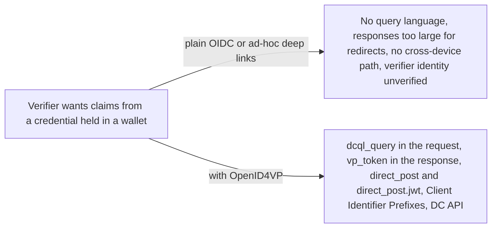
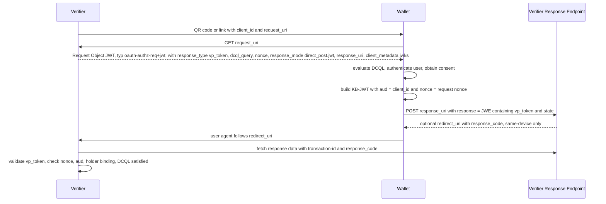

# OpenID for Verifiable Presentations

> In one line: A verifier sends an OAuth-style authorization request with a DCQL query, and the wallet answers with a `vp_token` of presentations: by redirect on the same device, by HTTP POST across devices, or through the Digital Credentials API.

## When you reach for it

- **A website asks for proof of age from a wallet on the same phone**: `response_type=vp_token` with the default fragment response mode returns the presentation in the redirect back (Section 3.1, Section 5.6).
- **A desktop verifier shows a QR code and the wallet is on a phone**: the QR holds only `client_id` and `request_uri`; the wallet fetches the Request Object and posts the response to `response_uri` via `direct_post` (Section 3.2, Section 5.7, Section 8.2).
- **The wallet must know who the verifier is before releasing a PID**: a Client Identifier Prefix such as `x509_san_dns`, `x509_hash` or `verifier_attestation` says how to authenticate the signed request (Section 5.9, Section 5.9.3).
- **Authorizing a payment or document signature with a credential**: `transaction_data` is hashed into the Key Binding JWT, so the presentation also authorizes that transaction (Section 8.4, Appendix B.3.3).
- **Invoking the wallet from a web page without custom URL schemes**: OpenID4VP over the Digital Credentials API gives the wallet the verifier's origin as authenticated by the browser (Appendix A).

## The problem it solves

A verifier needs to say which credentials and claims it wants, receive them from a wallet possibly on another device, and be sure the presentation was made for it and this session, not replayed. OAuth gives the request and response rails but not the query language, the cross-device response path, or the verifier authentication model (Section 1, Section 4).

OpenID4VP adds `dcql_query`, the `vp_token` response type and parameter, the `direct_post` response mode, response encryption, Client Identifier Prefixes, and a DC API binding. It is a framework: a deployment still has to profile which options it uses (Section 3, Section 4).

## How it works

The verifier builds an Authorization Request, usually a signed Request Object fetched from `request_uri` (Section 5). `client_id` may carry a prefix such as `x509_hash:` that says how to validate the signature (Section 5.9.1). The request carries a fresh `nonce`, a `response_mode`, and a `dcql_query` whose `credentials` array lists Credential Queries with `id`, `format`, `meta` and `claims` (Section 5.2, Section 6.1). The wallet evaluates the query, asks the user, and builds one presentation per matched query; for SD-JWT VC that is an SD-JWT+KB whose Key Binding JWT carries the request `nonce` and the Client Identifier as `aud` (Appendix B.3.6). With `direct_post.jwt` the wallet encrypts the response to a key from `client_metadata.jwks` and posts it to `response_uri` (Section 8.2, Section 8.3.1). The response endpoint may return a `redirect_uri` with a `response_code` so the frontend fetches the result in the original session (Section 13.3), and the verifier validates the VP Token (Section 8.6).

## What the spec requires

- Request Objects MUST carry `typ: oauth-authz-req+jwt`, and wallets MUST NOT process Request Objects without it (Section 5).
- Exactly one of `dcql_query` or a `scope` standing for a DCQL query MUST be present; `nonce` is REQUIRED and MUST be fresh and random per request; `response_mode` and `client_id` are REQUIRED; `state` is REQUIRED for presentations without Holder Binding outside the DC API (Section 5.1, Section 5.2, Section 5.3).
- A `client_id` with a colon is interpreted by its Client Identifier Prefix; without a colon it refers to a pre-registered client (Section 5.9.1, Section 5.9.2).
- A DCQL query MUST have a non-empty `credentials` array; each Credential Query MUST have `id`, `format` and `meta`, and each `claims` entry MUST have a `path` (Section 6, Section 6.1, Section 6.3).
- `vp_token` is REQUIRED: a JSON object keyed by Credential Query `id`, each value an array of presentations with one entry unless `multiple` was true (Section 8.1).
- With `direct_post`, `response_uri` is REQUIRED and `redirect_uri` MUST NOT be present; encrypted responses MUST be unsigned encrypted JWTs whose `alg` matches the chosen JWK (Section 8.2, Section 8.3).
- Verifiers MUST validate the VP Token: format, integrity of each presentation, query criteria, Holder Binding unless waived, and their own trust checks (Section 8.6).
- For `dc+sd-jwt`, the KB-JWT `nonce` MUST equal the request `nonce` and `aud` MUST equal the Client Identifier, or `origin:` plus the origin over the DC API (Appendix B.3.1, Appendix B.3.6).

## Watch out

- **Replay**: every Verifiable Presentation MUST be bound to the verifier's `client_id` and the request `nonce`, and a response with the wrong nonce MUST be rejected. Presentations without Holder Binding have no replay protection (Section 14.1.1, Section 14.1.2).
- **Session fixation with `direct_post`**: an attacker relays a captured request to a victim and later collects the response. The response endpoint MUST put a fresh `response_code` in the `redirect_uri` and require it when the frontend fetches the response; this does not work cross-device (Section 14.2).
- **Response endpoint hygiene**: the internal interface that hands response data to the verifier MUST be protected, and an encrypted but unsigned response can be swapped by anyone holding the verifier's public key; only the VP Token contents are integrity protected (Section 14.3.3, Section 14.5).
- **Use the full Client Identifier including the prefix** everywhere, never rely on the wallet to enforce query constraints, and remember that issuer signatures and holder keys link presentations across verifiers, so use batch-issued single-use credential instances (Section 14.8, Section 14.9, Section 15.5).

## Sources

- [OpenID4VP 1.0, Section 1](https://openid.net/specs/openid-4-verifiable-presentations-1_0.html#name-introduction)
- [OpenID4VP 1.0, Section 3](https://openid.net/specs/openid-4-verifiable-presentations-1_0.html#name-overview)
- [OpenID4VP 1.0, Section 3.1](https://openid.net/specs/openid-4-verifiable-presentations-1_0.html#name-same-device-flow)
- [OpenID4VP 1.0, Section 3.2](https://openid.net/specs/openid-4-verifiable-presentations-1_0.html#name-cross-device-flow)
- [OpenID4VP 1.0, Section 4](https://openid.net/specs/openid-4-verifiable-presentations-1_0.html#name-scope)
- [OpenID4VP 1.0, Section 5](https://openid.net/specs/openid-4-verifiable-presentations-1_0.html#name-authorization-request)
- [OpenID4VP 1.0, Section 5.1](https://openid.net/specs/openid-4-verifiable-presentations-1_0.html#name-new-parameters)
- [OpenID4VP 1.0, Section 5.2](https://openid.net/specs/openid-4-verifiable-presentations-1_0.html#name-existing-parameters)
- [OpenID4VP 1.0, Section 5.3](https://openid.net/specs/openid-4-verifiable-presentations-1_0.html#name-requesting-presentations-wi)
- [OpenID4VP 1.0, Section 5.6](https://openid.net/specs/openid-4-verifiable-presentations-1_0.html#name-response-type-vp_token)
- [OpenID4VP 1.0, Section 5.7](https://openid.net/specs/openid-4-verifiable-presentations-1_0.html#name-passing-authorization-reque)
- [OpenID4VP 1.0, Section 5.9](https://openid.net/specs/openid-4-verifiable-presentations-1_0.html#name-client-identifier-prefix-an)
- [OpenID4VP 1.0, Section 5.9.1](https://openid.net/specs/openid-4-verifiable-presentations-1_0.html#name-syntax)
- [OpenID4VP 1.0, Section 5.9.2](https://openid.net/specs/openid-4-verifiable-presentations-1_0.html#name-fallback)
- [OpenID4VP 1.0, Section 5.9.3](https://openid.net/specs/openid-4-verifiable-presentations-1_0.html#name-defined-client-identifier-p)
- [OpenID4VP 1.0, Section 6](https://openid.net/specs/openid-4-verifiable-presentations-1_0.html#name-digital-credentials-query-l)
- [OpenID4VP 1.0, Section 6.1](https://openid.net/specs/openid-4-verifiable-presentations-1_0.html#name-credential-query)
- [OpenID4VP 1.0, Section 6.3](https://openid.net/specs/openid-4-verifiable-presentations-1_0.html#name-claims-query)
- [OpenID4VP 1.0, Section 8.1](https://openid.net/specs/openid-4-verifiable-presentations-1_0.html#name-response-parameters)
- [OpenID4VP 1.0, Section 8.2](https://openid.net/specs/openid-4-verifiable-presentations-1_0.html#name-response-mode-direct_post)
- [OpenID4VP 1.0, Section 8.3](https://openid.net/specs/openid-4-verifiable-presentations-1_0.html#name-encrypted-responses)
- [OpenID4VP 1.0, Section 8.3.1](https://openid.net/specs/openid-4-verifiable-presentations-1_0.html#name-response-mode-direct_postjw)
- [OpenID4VP 1.0, Section 8.4](https://openid.net/specs/openid-4-verifiable-presentations-1_0.html#name-transaction-data)
- [OpenID4VP 1.0, Section 8.6](https://openid.net/specs/openid-4-verifiable-presentations-1_0.html#name-vp-token-validation)
- [OpenID4VP 1.0, Section 13.3](https://openid.net/specs/openid-4-verifiable-presentations-1_0.html#name-response-mode-direct_post-2)
- [OpenID4VP 1.0, Section 14.1.1](https://openid.net/specs/openid-4-verifiable-presentations-1_0.html#name-presentations-without-holde)
- [OpenID4VP 1.0, Section 14.1.2](https://openid.net/specs/openid-4-verifiable-presentations-1_0.html#name-verifiable-presentations)
- [OpenID4VP 1.0, Section 14.2](https://openid.net/specs/openid-4-verifiable-presentations-1_0.html#name-session-fixation)
- [OpenID4VP 1.0, Section 14.3.3](https://openid.net/specs/openid-4-verifiable-presentations-1_0.html#name-protection-of-the-authoriza)
- [OpenID4VP 1.0, Section 14.5](https://openid.net/specs/openid-4-verifiable-presentations-1_0.html#name-encrypting-an-unsigned-resp)
- [OpenID4VP 1.0, Section 14.8](https://openid.net/specs/openid-4-verifiable-presentations-1_0.html#name-always-use-the-full-client-)
- [OpenID4VP 1.0, Section 14.9](https://openid.net/specs/openid-4-verifiable-presentations-1_0.html#name-security-checks-on-the-retu)
- [OpenID4VP 1.0, Section 15.5](https://openid.net/specs/openid-4-verifiable-presentations-1_0.html#name-verifier-to-verifier-unlink)
- [OpenID4VP 1.0, Appendix A](https://openid.net/specs/openid-4-verifiable-presentations-1_0.html#name-openid4vp-over-the-digital-)
- [OpenID4VP 1.0, Appendix B.3.1](https://openid.net/specs/openid-4-verifiable-presentations-1_0.html#name-format-identifier)
- [OpenID4VP 1.0, Appendix B.3.3](https://openid.net/specs/openid-4-verifiable-presentations-1_0.html#name-transaction-data-3)
- [OpenID4VP 1.0, Appendix B.3.6](https://openid.net/specs/openid-4-verifiable-presentations-1_0.html#name-presentation-response-4)
