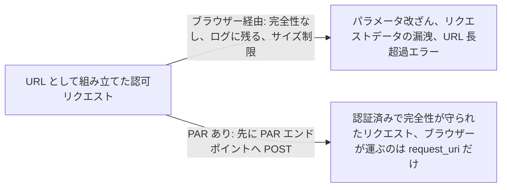
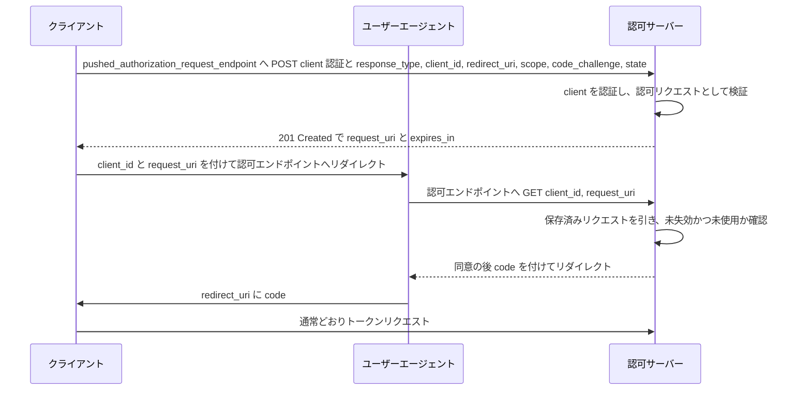

# Pushed Authorization Requests (PAR)

> 一言で言うと: client は認可リクエスト全体を先に認可サーバーへ直接 POST し、短い `request_uri` を受け取って、ブラウザーにはそれだけを渡す。

## どういうときに使うか

- **認可リクエストを改ざんされては困る金融グレードの API**: ブラウザー経由のクエリ文字列には完全性も真正性の保護もない。PAR はパラメータをサーバー間の POST に移す (Section 1)。
- **ユーザーに同意画面を見せる前に認証されたい confidential client**: PAR なら認可サーバーはユーザー操作が始まる前に client を認証できるので、偽の `client_id` は入口で弾かれる (Section 1)。
- **URL に収まらなくなったリクエスト**: 細粒度の認可データを載せると認可リクエストの URL はかなり大きくなり、リクエスト処理でエラーを起こしうる。PAR はそれを 1 つの短い参照に置き換える (Section 1)。
- **その場で新しい redirect URI を登録したい client**: 認可サーバーは未登録の redirect URI を受け付けてよいが、認証済み client からの pushed request に限られる (Section 7.2)。

## 解決する問題

素の OAuth では認可リクエストはリソースオーナーのユーザーエージェントを経由するリダイレクトになる。仕様はその代償を列挙する。暗号学的な完全性と真正性の保護がないので途中でパラメータを書き換えられる、リクエストデータは平文でユーザーエージェントを通りログや referrer に漏れうる、認可リクエストの URL はかなり大きくなってリクエスト処理の制限に引っかかる (Section 1)。JWT-Secured Authorization Request はパラメータを署名付き request object に包むことでセキュリティ上の課題に答えており、PAR はそのペイロードをサーバーへ直接 push して `request_uri` と引き換える相互運用可能な方法でそれを補完する (Section 1)。

PAR は client に直接のチャネルを与える。パラメータを HTTPS で認可サーバーに push し、サーバーが検証して保存し、ブラウザーは参照だけを運ぶ。サーバーはユーザーに何かを見せる前に client を認証できる (Section 1)。

## 仕組み

pushed authorization request エンドポイントは認可サーバー上の HTTP API で、通常の認可パラメータを `application/x-www-form-urlencoded` で載せた `POST` を受け付ける。トークンエンドポイント向けに定義された client 認証のルールがここにも適用される (Section 2)。client は URL に載せるはずだったすべてのパラメータを送る。例外は 1 つで、`request_uri` は含めてはならない。`client_id` は通常の認可リクエストと同様に必須 (Section 2.1)。サーバーは pushed request を認可エンドポイントに送られた認可リクエストと同じように検証する (Section 2.1)。成功したら request URI を生成して `201` で返さなければならず、request URI の寿命を秒で表す `expires_in` を添える (Section 2.2)。値は `urn:ietf:params:oauth:request_uri:` に参照値を続けた形で作ってよく、その参照値には暗号学的に強い擬似乱数で生成した部分を含めなければならない (Section 2.2)。client はブラウザーを `request_uri` 付きで認可エンドポイントへリダイレクトし、あとは通常の認可コードグラントとして進む。

## 仕様が求めること

- PAR エンドポイントは `POST` を受け付け、トークンエンドポイントの client 認証ルールが適用される (Section 2)。
- pushed request に `request_uri` を含めてはならず、サーバーは pushed request を認可エンドポイントに送られたものと同じように検証する (Section 2.1)。
- 成功応答は `201` で `request_uri` と `expires_in` を返し、`request_uri` には暗号学的に強い乱数部分を含めなければならない (Section 2.2)。
- エラーはトークンエンドポイントのエラー形式を使い、既定は `invalid_request`。エンドポイントは `405`、`413`、`429` を返すこともある (Section 2.3)。
- client は `request_uri` の値を一度しか使ってはならず、失効した `request_uri` は無効として拒否しなければならない (Section 4)。
- サーバーメタデータに `pushed_authorization_request_endpoint` と、既定が `false` の `require_pushed_authorization_requests` が加わり、client も `require_pushed_authorization_requests` 付きで登録できる (Section 5、6)。

## 注意点

- 認可サーバーは、pushed request 内の新しい redirect URI を認証済み client からのものに限って受け付けなければならない。さもないと PAR がオープンリダイレクタになる (Section 7.2)。
- request URI は一回限りにすべき。捕まえた参照でリクエストを再生できなくなる (Section 7.3)。
- `request_uri` は攻撃者がセッション間で差し替えられるので、client は PKCE、一意な `state`、または OpenID Connect の `nonce` で検知すべき (Section 7.5)。
- ユーザーエージェントを経由せず直接の安全な接続でリクエストを push することはプライバシー面の利点でもある。リクエストパラメータが URL に現れない (Section 8)。

## 出典

- [RFC 9126, Section 1](https://www.rfc-editor.org/rfc/rfc9126#section-1)
- [RFC 9126, Section 2](https://www.rfc-editor.org/rfc/rfc9126#section-2)
- [RFC 9126, Section 2.1](https://www.rfc-editor.org/rfc/rfc9126#section-2.1)
- [RFC 9126, Section 2.2](https://www.rfc-editor.org/rfc/rfc9126#section-2.2)
- [RFC 9126, Section 2.3](https://www.rfc-editor.org/rfc/rfc9126#section-2.3)
- [RFC 9126, Section 4](https://www.rfc-editor.org/rfc/rfc9126#section-4)
- [RFC 9126, Section 5](https://www.rfc-editor.org/rfc/rfc9126#section-5)
- [RFC 9126, Section 6](https://www.rfc-editor.org/rfc/rfc9126#section-6)
- [RFC 9126, Section 7.2](https://www.rfc-editor.org/rfc/rfc9126#section-7.2)
- [RFC 9126, Section 7.3](https://www.rfc-editor.org/rfc/rfc9126#section-7.3)
- [RFC 9126, Section 7.5](https://www.rfc-editor.org/rfc/rfc9126#section-7.5)
- [RFC 9126, Section 8](https://www.rfc-editor.org/rfc/rfc9126#section-8)
