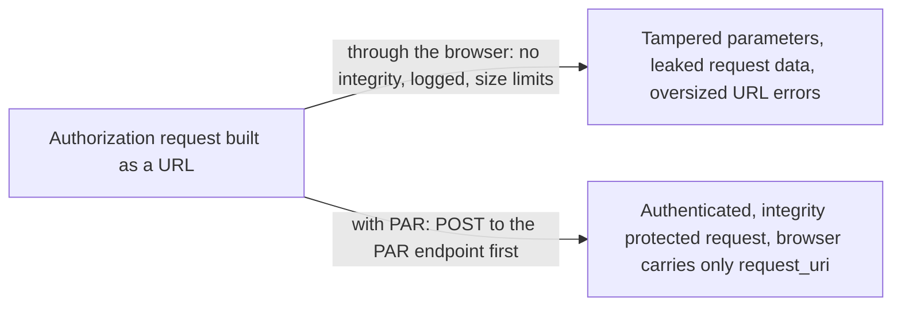
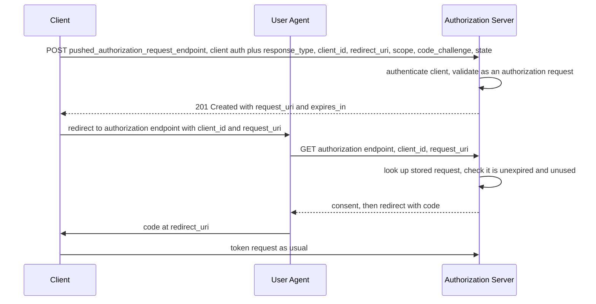

# Pushed Authorization Requests (PAR)

> In one line: the client POSTs the whole authorization request directly to the authorization server first, gets back a short `request_uri`, and sends only that through the browser.

## When you reach for it

- **A financial-grade API where the authorization request must not be tampered with**: a query string through the browser has no integrity or authenticity protection, PAR moves the parameters into a server-to-server POST (Section 1).
- **A confidential client that wants to be authenticated before the user sees a consent screen**: PAR allows the authorization server to authenticate the client before any user interaction happens, so a bogus `client_id` is rejected up front (Section 1).
- **Requests that have outgrown the URL**: with fine-grained authorization data, authorization request URLs can become quite large and cause errors in request processing, PAR replaces them with one short reference (Section 1).
- **Clients that want to register a new redirect URI on the fly**: the authorization server may accept redirect URIs it has not seen before, but only in a pushed request from an authenticated client (Section 7.2).

## The problem it solves

In plain OAuth the authorization request is a redirect through the resource owner's user agent. The spec lists what that costs: there is no cryptographic integrity and authenticity protection, so the parameters can be modified on the way, the request data passes through the user agent in the clear where it can leak into logs and referrers, and authorization request URLs can become quite large and trip request-processing limits (Section 1). JWT-Secured Authorization Request addresses the security challenges by wrapping the parameters in a signed request object, and PAR complements it with an interoperable way to push that payload directly to the server in exchange for a `request_uri` (Section 1).

PAR gives the client a direct channel. It pushes the parameters to the authorization server over HTTPS, the server validates and stores them, and the browser only carries a reference. The server also gets to authenticate the client before showing anything to the user (Section 1).

## How it works

The pushed authorization request endpoint is an HTTP API at the authorization server that accepts `POST` requests with the usual `application/x-www-form-urlencoded` authorization parameters, and the rules for client authentication defined for the token endpoint apply to it as well (Section 2). The client sends every parameter it would have put in the URL, with one exception: `request_uri` must not be provided, and `client_id` is required just as in a normal authorization request (Section 2.1). The server validates the pushed request as it would an authorization request sent to the authorization endpoint (Section 2.1). On success it must generate a request URI and return it with a `201` status, along with `expires_in`, the lifetime of the request URI in seconds (Section 2.2). The server may construct the value as `urn:ietf:params:oauth:request_uri:` followed by a reference, and that reference must contain a part generated with a cryptographically strong pseudorandom algorithm (Section 2.2). The client then redirects the browser to the authorization endpoint with `request_uri`, and the flow continues as a normal authorization code grant.

## What the spec requires

- The PAR endpoint accepts `POST` requests, and the token endpoint's client authentication rules apply to it (Section 2).
- `request_uri` must not be provided in the pushed request, and the server validates the pushed request as it would one sent to the authorization endpoint (Section 2.1).
- A successful response carries `request_uri` and `expires_in` with a `201` status, and the `request_uri` must contain a cryptographically strong random part (Section 2.2).
- Errors use the token endpoint error format, defaulting to `invalid_request`, and the endpoint may also answer `405`, `413` or `429` (Section 2.3).
- The client must only use a `request_uri` value once, and an expired `request_uri` must be rejected as invalid (Section 4).
- Server metadata adds `pushed_authorization_request_endpoint` and `require_pushed_authorization_requests`, which defaults to `false`, and clients can be registered with `require_pushed_authorization_requests` (Sections 5 and 6).

## Watch out

- The authorization server must only accept new redirect URIs in a pushed request from authenticated clients, otherwise PAR turns into an open redirector (Section 7.2).
- Request URIs should be one-time use so a captured reference cannot replay the request (Section 7.3).
- A `request_uri` can be swapped between sessions by an attacker, so clients should use PKCE, a unique `state`, or the OpenID Connect `nonce` to detect it (Section 7.5).
- Pushing the request over a direct secure connection, rather than through the user agent, is also a privacy gain, because the request parameters never appear in a URL (Section 8).

## Sources

- [RFC 9126, Section 1](https://www.rfc-editor.org/rfc/rfc9126#section-1)
- [RFC 9126, Section 2](https://www.rfc-editor.org/rfc/rfc9126#section-2)
- [RFC 9126, Section 2.1](https://www.rfc-editor.org/rfc/rfc9126#section-2.1)
- [RFC 9126, Section 2.2](https://www.rfc-editor.org/rfc/rfc9126#section-2.2)
- [RFC 9126, Section 2.3](https://www.rfc-editor.org/rfc/rfc9126#section-2.3)
- [RFC 9126, Section 4](https://www.rfc-editor.org/rfc/rfc9126#section-4)
- [RFC 9126, Section 5](https://www.rfc-editor.org/rfc/rfc9126#section-5)
- [RFC 9126, Section 6](https://www.rfc-editor.org/rfc/rfc9126#section-6)
- [RFC 9126, Section 7.2](https://www.rfc-editor.org/rfc/rfc9126#section-7.2)
- [RFC 9126, Section 7.3](https://www.rfc-editor.org/rfc/rfc9126#section-7.3)
- [RFC 9126, Section 7.5](https://www.rfc-editor.org/rfc/rfc9126#section-7.5)
- [RFC 9126, Section 8](https://www.rfc-editor.org/rfc/rfc9126#section-8)
