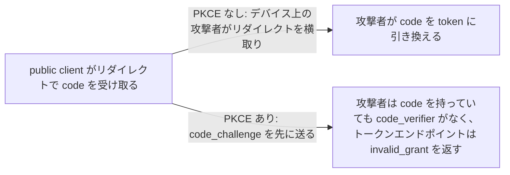
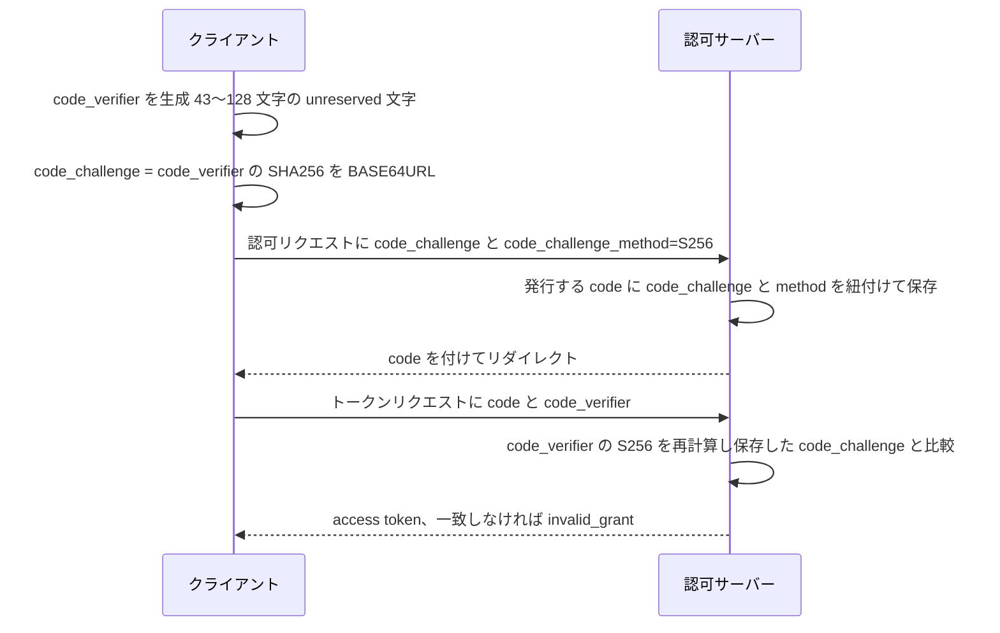

# PKCE

> 一言で言うと: client が使い捨ての秘密値を作り、そのハッシュを認可リクエストに添え、code を引き換えるときに元の値を知っていることを証明する。リダイレクトから盗まれた code は役に立たなくなる。

## どういうときに使うか

- **別のアプリが同じカスタム URI スキームを登録しているスマートフォン上のネイティブアプリ**: 悪意あるアプリがリダイレクトと認可コードを受け取っても、`code_verifier` を見ていないのでトークンエンドポイントは引き換えを拒否する (Section 1)。
- **バイナリに client secret を埋め込んで配るネイティブアプリ**: 仕様が挙げる攻撃の前提条件がまさにこれで、全インスタンスが同じ `client_id` を使い、バイナリ内の secret は機密ではないので、攻撃者がトークンエンドポイントを呼べる (Section 1)。
- **HTTP ログが漏れる OS で、攻撃者が認可レスポンスだけでなくリクエストも見られる場合**: `plain` ではリクエスト内の challenge が verifier そのものなので、このケースを緩和するには `code_challenge_method` を `S256` か別の暗号学的に安全なメソッドにしなければならない (Section 1)。
- **古い client を受け付け続けなければならないサーバー**: サーバーは PKCE パラメータを送らない OAuth 2.0 client を引き続き受け付けてよいので、段階的に展開できる (Section 5)。

## 解決する問題

認可コードグラントでは、code はユーザーエージェントを経由して client に戻る。デバイス上では、それを運ぶリダイレクトを別のアプリケーションが観察したり乗っ取ったりできる。仕様は前提条件を挙げている。デバイス上の悪意あるアプリが同じカスタム URI スキームを登録して認可レスポンスを観察できること、認可コードグラントが使われていること、攻撃者が `client_id` と (あれば) `client_secret` を持っていること。ネイティブアプリのバイナリに埋め込んだ secret は機密とは言えない (Section 1)。素の OAuth 2.0 には code をリクエストを始めたアプリケーションに結び付けるものがないので、code を持っている者なら誰でも引き換えられる。

PKCE はその結び付きを足す。フローを始めた client だけが `code_verifier` を知っているので、その client だけがフローを終えられる。

## 仕組み

client は 43〜128 文字の `code_verifier` を生成し (Section 4.1)、`S256` メソッドなら `BASE64URL-ENCODE(SHA256(ASCII(code_verifier)))` として `code_challenge` を導出する。`plain` なら verifier そのものを使う (Section 4.2)。認可リクエストに `code_challenge` と `code_challenge_method` を添えて送り、method を省略すると `plain` 扱いになる (Section 4.3)。認可サーバーは両方の値を発行する認可コードに紐付ける (Section 4.4)。トークンエンドポイントで client は `code_verifier` を加え (Section 4.5)、サーバーは code に紐付いた method で変換して保存した challenge と比較する (Section 4.6)。

## 仕様が求めること

- `code_verifier` は高エントロピーのランダム文字列で、最小 43 文字、最大 128 文字 (Section 4.1)。
- client が `S256` を使えるなら `S256` を使わなければならない。`S256` はサーバー側で実装必須 (Section 4.2)。
- 認可リクエストの `code_challenge` は必須で、`code_challenge_method` は省略時に `plain` になる (Section 4.3)。
- サーバーは `code_challenge` と `code_challenge_method` を認可コードに紐付けなければならず (Section 4.4)、PKCE を要求しているのに `code_challenge` が送られてこない場合や、要求されたメソッドをサポートしない場合は `invalid_request` を返さなければならない (Section 4.4.1)。
- トークンリクエストの `code_verifier` は必須で、method は code 発行時に code に束縛される (Section 4.5)。
- 変換した verifier が保存した challenge と等しければトークンエンドポイントは通常どおり処理を続け、等しくなければ `invalid_grant` を返す (Section 4.6)。

## 注意点

- client は `code_verifier` を最低 256 ビットのエントロピーで作るべき (Section 7.1)。
- `plain` は使うべきでなく、配備済み実装との互換のためだけに存在する。`S256` を試した後に `plain` へダウングレードしてはならない (Section 7.2)。
- `code_challenge_method` が `plain` のときは Section 1 の横取り攻撃しか緩和されず、リクエストの盗聴者には効かない (Section 1)。
- code challenge の生成に salt は使わないので、verifier 自身のエントロピーだけが防御になる (Section 7.3)。
- サーバーは PKCE を実装しない client を受け付けてよい (Section 5)。強制するかどうかは配備側の判断で、RFC が勝手に与えてくれるものではない。

## 出典

- [RFC 7636, Section 1](https://www.rfc-editor.org/rfc/rfc7636#section-1)
- [RFC 7636, Section 4.1](https://www.rfc-editor.org/rfc/rfc7636#section-4.1)
- [RFC 7636, Section 4.2](https://www.rfc-editor.org/rfc/rfc7636#section-4.2)
- [RFC 7636, Section 4.3](https://www.rfc-editor.org/rfc/rfc7636#section-4.3)
- [RFC 7636, Section 4.4](https://www.rfc-editor.org/rfc/rfc7636#section-4.4)
- [RFC 7636, Section 4.4.1](https://www.rfc-editor.org/rfc/rfc7636#section-4.4.1)
- [RFC 7636, Section 4.5](https://www.rfc-editor.org/rfc/rfc7636#section-4.5)
- [RFC 7636, Section 4.6](https://www.rfc-editor.org/rfc/rfc7636#section-4.6)
- [RFC 7636, Section 5](https://www.rfc-editor.org/rfc/rfc7636#section-5)
- [RFC 7636, Section 7.1](https://www.rfc-editor.org/rfc/rfc7636#section-7.1)
- [RFC 7636, Section 7.2](https://www.rfc-editor.org/rfc/rfc7636#section-7.2)
- [RFC 7636, Section 7.3](https://www.rfc-editor.org/rfc/rfc7636#section-7.3)
