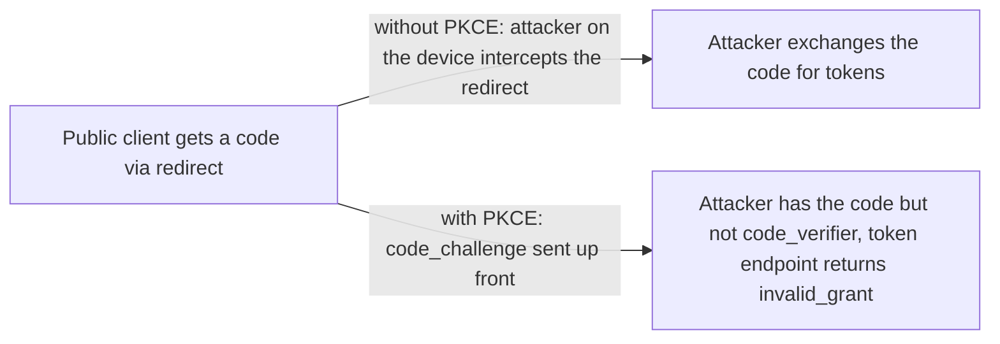
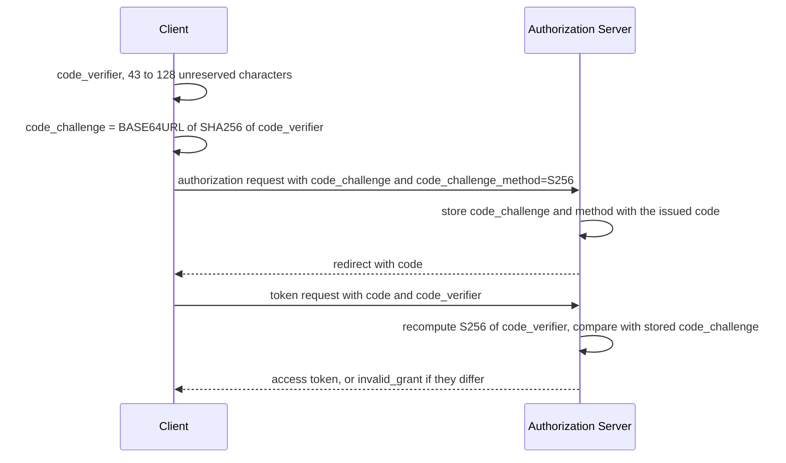

# PKCE

> In one line: the client invents a one-time secret, sends its hash with the authorization request, and proves it knows the original when redeeming the code, so a code stolen from the redirect is worthless.

## When you reach for it

- **A native app on a phone where another app registered the same custom URI scheme**: the malicious app receives the redirect and the authorization code, but it never saw the `code_verifier`, so the token endpoint rejects the exchange (Section 1).
- **Any native app that ships a client secret in its binary**: the spec's attack precondition is exactly this, all instances share the same `client_id` and a secret in the binary is not confidential, so the attacker can call the token endpoint (Section 1).
- **An OS that leaks HTTP logs, so the attacker sees the authorization request as well as the response**: with `plain` the challenge in the request is the verifier itself, so `code_challenge_method` must be `S256` or another cryptographically secure method to mitigate this case (Section 1).
- **A server that must keep accepting older clients**: the server may still accept OAuth 2.0 clients that do not send PKCE parameters, so rollout can be gradual (Section 5).

## The problem it solves

In the authorization code grant the code travels back to the client through the user agent. On a device, the redirect that carries it can be observed or hijacked by another application. The spec names the preconditions: a malicious app on the device registered the same custom URI scheme and can observe the authorization response, the authorization code grant is used, and the attacker has the `client_id` and any `client_secret`, because a secret shipped in a native app binary is not confidential (Section 1). Nothing in plain OAuth 2.0 ties the code to the application that started the request, so whoever has the code can redeem it.

PKCE adds that binding. The client that starts the flow is the only one that knows `code_verifier`, so only that client can finish it.

## How it works

The client generates a `code_verifier` of 43 to 128 characters (Section 4.1) and derives `code_challenge` as `BASE64URL-ENCODE(SHA256(ASCII(code_verifier)))` for the `S256` method, or uses the verifier itself for `plain` (Section 4.2). It sends `code_challenge` and `code_challenge_method` with the authorization request, and the method defaults to `plain` when absent (Section 4.3). The authorization server associates both values with the authorization code it issues (Section 4.4). At the token endpoint the client adds `code_verifier` (Section 4.5), and the server transforms it with the method bound to the code and compares the result with the stored challenge (Section 4.6).

## What the spec requires

- `code_verifier` is a high-entropy random string with a minimum length of 43 characters and a maximum of 128 (Section 4.1).
- If the client is capable of using `S256`, it must use `S256`, which is mandatory to implement on the server (Section 4.2).
- `code_challenge` is required in the authorization request, and `code_challenge_method` defaults to `plain` if not present (Section 4.3).
- The server must associate `code_challenge` and `code_challenge_method` with the authorization code (Section 4.4), and if it requires PKCE and no `code_challenge` is sent, or it does not support the requested method, it must return `invalid_request` (Section 4.4.1).
- `code_verifier` is required in the token request, and the method is bound to the code when the code is issued (Section 4.5).
- If the transformed verifier equals the stored challenge the token endpoint continues normally, otherwise it returns `invalid_grant` (Section 4.6).

## Watch out

- The client should create `code_verifier` with at least 256 bits of entropy (Section 7.1).
- `plain` should not be used and exists only for compatibility with deployed implementations, and clients must not downgrade to `plain` after trying `S256` (Section 7.2).
- With `code_challenge_method` set to `plain`, only the interception attack in Section 1 is mitigated, not an eavesdropper on the request (Section 1).
- Salting is not used in the production of the code challenge, so the verifier's own entropy is the only defense (Section 7.3).
- Servers may accept clients that do not implement PKCE (Section 5), so enforcement is a deployment decision, not something the RFC gives you for free.

## Sources

- [RFC 7636, Section 1](https://www.rfc-editor.org/rfc/rfc7636#section-1)
- [RFC 7636, Section 4.1](https://www.rfc-editor.org/rfc/rfc7636#section-4.1)
- [RFC 7636, Section 4.2](https://www.rfc-editor.org/rfc/rfc7636#section-4.2)
- [RFC 7636, Section 4.3](https://www.rfc-editor.org/rfc/rfc7636#section-4.3)
- [RFC 7636, Section 4.4](https://www.rfc-editor.org/rfc/rfc7636#section-4.4)
- [RFC 7636, Section 4.4.1](https://www.rfc-editor.org/rfc/rfc7636#section-4.4.1)
- [RFC 7636, Section 4.5](https://www.rfc-editor.org/rfc/rfc7636#section-4.5)
- [RFC 7636, Section 4.6](https://www.rfc-editor.org/rfc/rfc7636#section-4.6)
- [RFC 7636, Section 5](https://www.rfc-editor.org/rfc/rfc7636#section-5)
- [RFC 7636, Section 7.1](https://www.rfc-editor.org/rfc/rfc7636#section-7.1)
- [RFC 7636, Section 7.2](https://www.rfc-editor.org/rfc/rfc7636#section-7.2)
- [RFC 7636, Section 7.3](https://www.rfc-editor.org/rfc/rfc7636#section-7.3)
