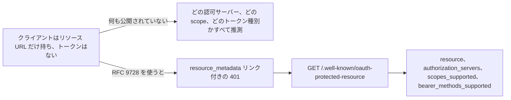
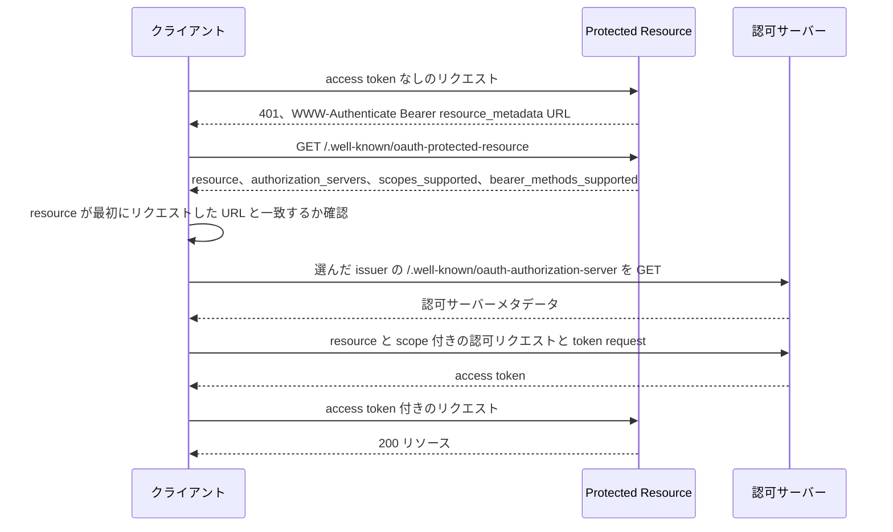

# Protected Resource Metadata

> 一言で言うと: リソースサーバーが自分の well-known JSON 文書で、信頼する認可サーバーと呼び出し方を公開し、401 からクライアントをそこへ誘導する。

## どういうときに使うか

- **API の URL しか知らないクライアント**: メールサーバーでも他のどんな API でも、 `WWW-Authenticate: Bearer resource_metadata=...` 付きの 401 を返せば、クライアントはそのリンクをたどって認可サーバーと必要な scope を知る。帯域外の設定は要らない (Section 5)。
- **認可サーバーを切り替えたいリソース**: リソースはメタデータの `authorization_servers` を変えて新しい challenge を返し、クライアントは 1 つずつ再設定される代わりに再取得する (Section 5.2)。
- **トークンの audience の間違い**: メタデータはリソース識別子を示し、複数のリソースとやり取りするクライアントは RFC 8707 の Resource Indicators で audience 制限付きトークンを要求すべきなので、あるリソース向けのトークンは別のリソースで使えない (Section 2、7.4)。
- **sender-constraint の要件を公開する**: `dpop_bound_access_tokens_required` と `tls_client_certificate_bound_access_tokens` が、リソースが受け付けるトークンの種類を前もってクライアントに伝える (Section 2)。

## 解決する問題

OAuth はクライアントと認可サーバーの会話を定め、RFC 8414 はその認可サーバーの発見を可能にしたが、ある protected resource がどの認可サーバーを信頼するかをクライアントに教えるものはなかった。それは設定で補われてきたが、リソースと動的に出会うクライアントには通用しない。

RFC 9728 は protected resource に自分のメタデータ文書を与える。RFC 7591 のクライアントメタデータと RFC 8414 のサーバーメタデータを手本にしたものだ。文書は自己主張でも署名付きでもよく、リソースは `WWW-Authenticate` の challenge の中でその場所をクライアントに渡せる (Section 1)。

## 仕組み

メタデータは、リソース識別子のホストとパスの間に `/.well-known/oauth-protected-resource` を挿入した場所に置く (Section 3)。文書の `resource` は識別子そのもので必須。`authorization_servers` は使える認可サーバーの issuer 識別子を列挙する。`scopes_supported` は推奨。`bearer_methods_supported` はトークンをヘッダ・ボディ・query のどこに入れるかを示す。`jwks_uri` と `resource_signing_alg_values_supported` はリソース自身の鍵を、`tls_client_certificate_bound_access_tokens` と `dpop_bound_access_tokens_required` は受け付けるトークン結合を、`resource_name` と `resource_documentation` は人間向けの情報を表す (Section 2)。認可サーバー側は `protected_resources` に自分のリソースを列挙できる (Section 4)。challenge フローではリソースが `WWW-Authenticate` に `resource_metadata` パラメータを足し、Bearer だけでなく DPoP などの他のスキームでも使える (Section 5.1)。

## 仕様が求めること

- `resource` は必須で、fragment のない `https` URL でなければならない (Section 1.2、2)。
- リクエストは HTTP GET で、well-known の接尾辞を挿入する前にホスト直後の末尾スラッシュを取り除く (Section 3.1)。
- 成功応答は `application/json` の 200 OK。未知のパラメータは無視し、値のないパラメータは省略する (Section 3.2)。
- 返された `resource` 値はリクエストを組み立てるのに使ったリソース識別子と同一でなければならない。メタデータ URL を `WWW-Authenticate` の challenge で受け取った場合は、`resource` がリソースサーバーにリクエストした URL と同一でなければならない。一致しなければそのデータは使ってはならない。署名付きメタデータは発行者の鍵で検証しなければならない (Section 3.3)。
- 新しい `WWW-Authenticate` challenge を受けたら、クライアントはメタデータを再取得して再検証すべきで、これがリソースが認可サーバーを変える手段になる (Section 5.2)。
- 実装は TLS に対応し、BCP 195 に従わなければならない (Section 7.1)。

## 注意点

- **`scopes_supported` は買い物リストではない**: クライアントは公開された全部ではなく、必要最小限の scope を要求すべきである (Section 7.2)。
- **なりすまし**: クライアントは RFC 9525 に従って TLS 証明書を検証し、`resource` が要求したものと一致することを確認しなければならない (Section 7.3)。
- **列挙された認可サーバーの信頼**: リソースに対してどの認可サーバーを使うべきかの安全な決定は範囲外。クライアントは自分の信頼ポリシーを持つ必要がある (Section 7.6)。
- **SSRF**: クライアントは事前に知らないリソースが示す issuer から認可サーバーメタデータを取りに行くので、悪意あるリソースがそのリクエスト先を操れる。クライアントは内部 IP 帯域のブロックなどの対策を取るべきである (Section 7.7)。
- **audience 制限付きトークンを使う**: RFC 8707 の Resource Indicators が推奨され、悪意あるリソースがトークンを別の場所でリプレイできなくなる (Section 7.4)。

## 出典

- [RFC 9728, Section 1](https://www.rfc-editor.org/rfc/rfc9728#section-1)
- [RFC 9728, Section 1.2](https://www.rfc-editor.org/rfc/rfc9728#section-1.2)
- [RFC 9728, Section 2](https://www.rfc-editor.org/rfc/rfc9728#section-2)
- [RFC 9728, Section 3](https://www.rfc-editor.org/rfc/rfc9728#section-3)
- [RFC 9728, Section 3.1](https://www.rfc-editor.org/rfc/rfc9728#section-3.1)
- [RFC 9728, Section 3.2](https://www.rfc-editor.org/rfc/rfc9728#section-3.2)
- [RFC 9728, Section 3.3](https://www.rfc-editor.org/rfc/rfc9728#section-3.3)
- [RFC 9728, Section 4](https://www.rfc-editor.org/rfc/rfc9728#section-4)
- [RFC 9728, Section 5](https://www.rfc-editor.org/rfc/rfc9728#section-5)
- [RFC 9728, Section 5.1](https://www.rfc-editor.org/rfc/rfc9728#section-5.1)
- [RFC 9728, Section 5.2](https://www.rfc-editor.org/rfc/rfc9728#section-5.2)
- [RFC 9728, Section 7.1](https://www.rfc-editor.org/rfc/rfc9728#section-7.1)
- [RFC 9728, Section 7.2](https://www.rfc-editor.org/rfc/rfc9728#section-7.2)
- [RFC 9728, Section 7.3](https://www.rfc-editor.org/rfc/rfc9728#section-7.3)
- [RFC 9728, Section 7.4](https://www.rfc-editor.org/rfc/rfc9728#section-7.4)
- [RFC 9728, Section 7.6](https://www.rfc-editor.org/rfc/rfc9728#section-7.6)
- [RFC 9728, Section 7.7](https://www.rfc-editor.org/rfc/rfc9728#section-7.7)
