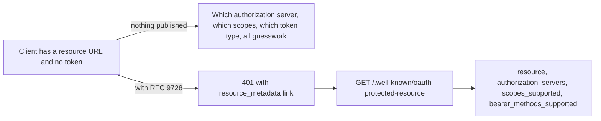
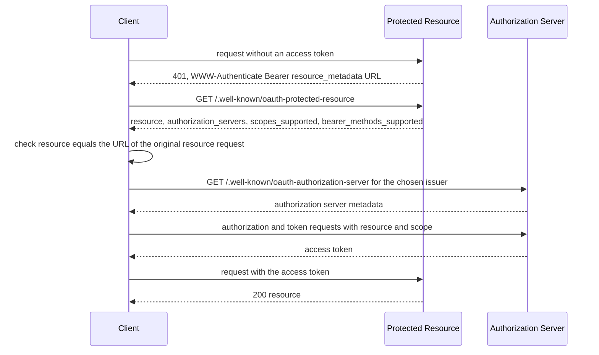

# Protected Resource Metadata

> In one line: a resource server publishes its own well-known JSON document saying which authorization servers it trusts and how to call it, and points clients at it from a 401.

## When you reach for it

- **A client that only knows an API URL**: a mail server or any other API returns 401 with `WWW-Authenticate: Bearer resource_metadata=...`, and the client follows that link to find the authorization server and the scopes it needs, with no out-of-band setup (Section 5).
- **A resource that wants to switch authorization servers**: the resource changes `authorization_servers` in its metadata and sends a fresh challenge, and clients refetch instead of being reconfigured one by one (Section 5.2).
- **Token audience mistakes**: the metadata names the resource identifier, and a client talking to several resources should request audience-restricted tokens with RFC 8707 Resource Indicators, so a token for one resource is useless at another (Sections 2, 7.4).
- **Advertising sender-constraint requirements**: `dpop_bound_access_tokens_required` and `tls_client_certificate_bound_access_tokens` tell clients up front what kind of token the resource accepts (Section 2).

## The problem it solves

OAuth defines how a client talks to an authorization server, and RFC 8414 lets the client discover that server, but nothing told the client which authorization server a given protected resource trusts. That was fixed by configuration, which does not scale to clients that meet resources dynamically.

RFC 9728 gives the protected resource its own metadata document, modeled on RFC 7591 client metadata and RFC 8414 server metadata. The document can be self-asserted or signed, and the resource can hand its location to a client inside a `WWW-Authenticate` challenge (Section 1).

## How it works

The metadata lives at the resource identifier with `/.well-known/oauth-protected-resource` inserted between host and path (Section 3). The document's `resource` is the identifier itself and is required. `authorization_servers` lists the issuer identifiers of usable authorization servers. `scopes_supported` is recommended. `bearer_methods_supported` says whether tokens go in the header, body or query. `jwks_uri` and `resource_signing_alg_values_supported` describe the resource's own keys, `tls_client_certificate_bound_access_tokens` and `dpop_bound_access_tokens_required` describe accepted token binding, and `resource_name` and `resource_documentation` are for humans (Section 2). The authorization server can list its resources in `protected_resources` (Section 4). In the challenge flow the resource adds a `resource_metadata` parameter to `WWW-Authenticate`, and it works with other schemes such as DPoP as well as Bearer (Section 5.1).

## What the spec requires

- `resource` is required and must be an `https` URL with no fragment (Sections 1.2, 2).
- The request is an HTTP GET; a trailing slash after the host is removed before the well-known suffix is inserted (Section 3.1).
- A successful response is 200 OK with `application/json`. Unknown parameters are ignored and zero-value parameters are omitted (Section 3.2).
- The `resource` value returned must be identical to the resource identifier used to build the request. When the metadata URL came from a `WWW-Authenticate` challenge, `resource` must be identical to the URL the client requested at the resource server. Otherwise the data must not be used. Signed metadata must be verified against a key belonging to its issuer (Section 3.3).
- After a new `WWW-Authenticate` challenge, the client should refetch and revalidate the metadata, which is how a resource changes its authorization servers (Section 5.2).
- Implementations must support TLS and follow BCP 195 (Section 7.1).

## Watch out

- **`scopes_supported` is not a shopping list**: the client should request the narrowest scope it needs, not everything advertised (Section 7.2).
- **Impersonation**: the client must perform TLS certificate checking per RFC 9525 and confirm that `resource` matches what it asked for (Section 7.3).
- **Trusting the listed authorization servers**: secure determination of which authorization servers to use with a resource is out of scope. The client needs its own trust policy (Section 7.6).
- **SSRF**: the client fetches authorization server metadata from issuers named by a resource it has no prior knowledge of, so a malicious resource can steer those requests. Clients should take precautions such as blocking internal IP ranges (Section 7.7).
- **Use audience-restricted tokens**: Resource Indicators per RFC 8707 are recommended so a malicious resource cannot replay a token elsewhere (Section 7.4).

## Sources

- [RFC 9728, Section 1](https://www.rfc-editor.org/rfc/rfc9728#section-1)
- [RFC 9728, Section 1.2](https://www.rfc-editor.org/rfc/rfc9728#section-1.2)
- [RFC 9728, Section 2](https://www.rfc-editor.org/rfc/rfc9728#section-2)
- [RFC 9728, Section 3](https://www.rfc-editor.org/rfc/rfc9728#section-3)
- [RFC 9728, Section 3.1](https://www.rfc-editor.org/rfc/rfc9728#section-3.1)
- [RFC 9728, Section 3.2](https://www.rfc-editor.org/rfc/rfc9728#section-3.2)
- [RFC 9728, Section 3.3](https://www.rfc-editor.org/rfc/rfc9728#section-3.3)
- [RFC 9728, Section 4](https://www.rfc-editor.org/rfc/rfc9728#section-4)
- [RFC 9728, Section 5](https://www.rfc-editor.org/rfc/rfc9728#section-5)
- [RFC 9728, Section 5.1](https://www.rfc-editor.org/rfc/rfc9728#section-5.1)
- [RFC 9728, Section 5.2](https://www.rfc-editor.org/rfc/rfc9728#section-5.2)
- [RFC 9728, Section 7.1](https://www.rfc-editor.org/rfc/rfc9728#section-7.1)
- [RFC 9728, Section 7.2](https://www.rfc-editor.org/rfc/rfc9728#section-7.2)
- [RFC 9728, Section 7.3](https://www.rfc-editor.org/rfc/rfc9728#section-7.3)
- [RFC 9728, Section 7.4](https://www.rfc-editor.org/rfc/rfc9728#section-7.4)
- [RFC 9728, Section 7.6](https://www.rfc-editor.org/rfc/rfc9728#section-7.6)
- [RFC 9728, Section 7.7](https://www.rfc-editor.org/rfc/rfc9728#section-7.7)
