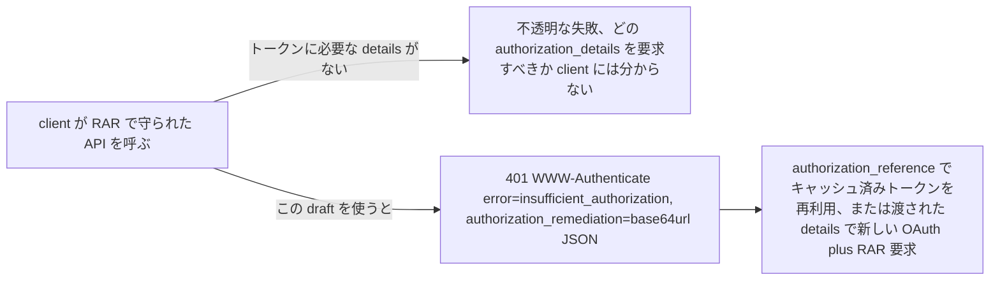
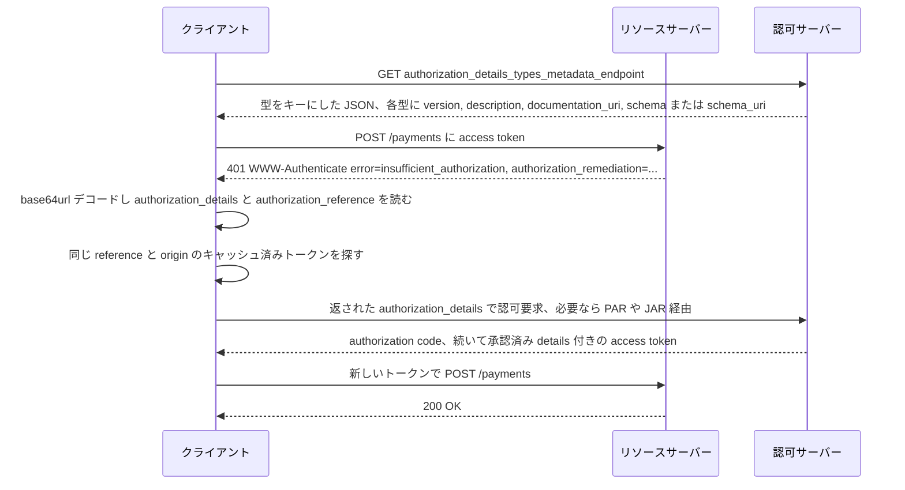

# RAR Metadata and Error Remediation

> 一言で言うと: 認可サーバーは対応する `authorization_details` の型を全て記述する metadata endpoint を公開し、authorization details 不足で呼び出しを拒否したリソースサーバーは、次に取りに行くべき RAR オブジェクトそのものを client に渡す。

## どういうときに使うか

- **mandate が小さすぎるトークンで口座振替 API を呼ぶ client**: 今の API は「ダメ」としか言えない。この draft なら `insufficient_authorization` と、次に要求すべき `authorization_details` オブジェクトを返せる (Section 1, 4)。
- **知らないサーバー向けに RAR オブジェクトを組み立てる client**: `authorization_details_types_metadata_endpoint` が型ごとに JSON Schema、説明、ドキュメント URI を返す。帯域外の取り決めが要らない (Section 1, 5)。
- **呼び出しごとの一時的なデータで同意を形作りたいリソースサーバー**: remediation のペイロードにはリスクプロファイルのような interaction 固有の情報を載せられ、認証強度や同意画面に反映できる (Section 1)。
- **細かいグラントをたくさん持ってトークンをキャッシュする client**: `authorization_reference` を使えば、details を解釈せずに不透明な文字列の比較だけで、要求をすでにカバーしているトークンを見つけられる (Section 4, 7.1.2, 7.3.5)。

## 解決する問題

RFC 9396 は client が `authorization_details` を送る方法とサーバーが処理する方法を定めるが、どの型が存在しどんな形なのかを client が知る方法は定めない。その知識は帯域外で合意される。リソースサーバー側にも同じ穴がある。トークンの authorization details が無い、または狭すぎて要求が失敗したとき、何を要求し直せばよいかの相互運用可能な信号が client に届かない (Section 1)。

draft は両方の穴を埋める。認可サーバーは型の metadata endpoint を公開する。リソースサーバーは専用のエラーコードと、呼び出しを満たす RAR オブジェクト (任意で安定した参照) を運ぶ `authorization_remediation` パラメータを返す (Section 1, 3, 4)。

## 仕組み

metadata endpoint は RFC 8414 metadata の `authorization_details_types_metadata_endpoint` で告知され、GET に対して型識別子をキーにした `application/json` オブジェクトを返す。各エントリは任意の `version`、`description`、`documentation_uri`、`examples` と、`schema` にインラインの JSON Schema か `schema_uri` のどちらかを持つ。schema はちょうど 1 つの authorization details オブジェクトを記述し、`type` をその識別子に固定する (Section 5)。呼び出しが失敗したとき、リソースサーバーはトークンを検証し、JWT か introspection から得た details を確認し、無いか不足なら `insufficient_authorization` と `authorization_remediation` を返す。これは base64url エンコードされた JSON オブジェクトで、`authorization_details` 配列はそのまま新しい RAR 要求に使え、`authorization_reference` はハッシュ由来の不透明なハンドル (Section 4, 7.2)。client はデコードし、同じ reference と同じリソースサーバー origin のキャッシュ済みトークンを試し、なければ新しい OAuth plus RAR フローを始め、得たトークンを reference に紐づけて保存し、再試行する (Section 7.1)。

## 仕様が求めること

- リソースサーバーは authorization details の欠落や不足でアクセスを拒否するとき `insufficient_authorization` を返すべき (SHOULD)。scope 不足は `insufficient_scope` のまま、認証コンテキスト不足は `insufficient_user_authentication` のまま (Section 4, 7.2.3)。
- client は `authorization_reference` を不透明として扱い、解釈してはならない。reference は機微な情報を漏らしてはならない。トークンが単回使用ならリソースサーバーは reference を含めてはならない (SHALL NOT) (Section 4)。
- 各 metadata エントリは `schema` か `schema_uri` のどちらかを持ち、両方は持たない。schema はちょうど 1 つの authorization details オブジェクトを検証し、`type` を対応する識別子に制限しなければならない。client は `description` を認可や検証の判断に使ってはならない (Section 5)。
- 認可サーバーは承認済みの RAR オブジェクトをリソースサーバーに提供しなければならない。JWT access token や introspection 応答に入れてよく (MAY)、サイズやプライバシーの観点で introspection が適切なら JWT からは省くべき (SHOULD) (Section 6)。
- キャッシュ済みトークンで再試行してなお `insufficient_authorization` を受けた client は、同じ reference に対してそのトークンで再度試みてはならない。トークンの保存はエンドユーザーのセッション単位に分けなければならない (Section 7.1.2, 7.1.5)。
- client は再試行回数に上限を設けなければならない。推奨はキャッシュで 1 回、新規取得で 1 回、それで失敗。新しいトークンが同じ reference で拒否されたら止めて報告する (Section 7.3.3)。

## 注意点

- **再利用は日和見的で、保証ではない**: 同意が取り消された、リスクが変わった、キャッシュ済みトークンが details の一部しかカバーしていない、といった理由で reference が一致しても拒否されうる (Section 7.3.1)。
- **reference はリソースサーバーをまたがない**: reference は発行したサーバーに閉じており、別のサーバーに使ってはならない (Section 7.3.4)。
- **remediation のペイロードは client から見える**: リソースサーバーは返す `authorization_details` に機微なデータを入れるべきでない。IBAN の代わりに `account_1a` のような不透明なハンドルを使い、残りは認可サーバーがユーザーから集める (Section 8.1)。
- **JWT access token は膨らむし漏れる**: サイズやプライバシーの観点で introspection が適切なら、認可サーバーは `authorization_details` を JWT から省くべき (SHOULD) (Section 6)。

## 出典

- [draft-ietf-oauth-rar-metadata-remediation, Section 1](https://datatracker.ietf.org/doc/html/draft-ietf-oauth-rar-metadata-remediation#section-1)
- [draft-ietf-oauth-rar-metadata-remediation, Section 3](https://datatracker.ietf.org/doc/html/draft-ietf-oauth-rar-metadata-remediation#section-3)
- [draft-ietf-oauth-rar-metadata-remediation, Section 4](https://datatracker.ietf.org/doc/html/draft-ietf-oauth-rar-metadata-remediation#section-4)
- [draft-ietf-oauth-rar-metadata-remediation, Section 5](https://datatracker.ietf.org/doc/html/draft-ietf-oauth-rar-metadata-remediation#section-5)
- [draft-ietf-oauth-rar-metadata-remediation, Section 6](https://datatracker.ietf.org/doc/html/draft-ietf-oauth-rar-metadata-remediation#section-6)
- [draft-ietf-oauth-rar-metadata-remediation, Section 7.1](https://datatracker.ietf.org/doc/html/draft-ietf-oauth-rar-metadata-remediation#section-7.1)
- [draft-ietf-oauth-rar-metadata-remediation, Section 7.1.2](https://datatracker.ietf.org/doc/html/draft-ietf-oauth-rar-metadata-remediation#section-7.1.2)
- [draft-ietf-oauth-rar-metadata-remediation, Section 7.1.5](https://datatracker.ietf.org/doc/html/draft-ietf-oauth-rar-metadata-remediation#section-7.1.5)
- [draft-ietf-oauth-rar-metadata-remediation, Section 7.2](https://datatracker.ietf.org/doc/html/draft-ietf-oauth-rar-metadata-remediation#section-7.2)
- [draft-ietf-oauth-rar-metadata-remediation, Section 7.2.3](https://datatracker.ietf.org/doc/html/draft-ietf-oauth-rar-metadata-remediation#section-7.2.3)
- [draft-ietf-oauth-rar-metadata-remediation, Section 7.3.1](https://datatracker.ietf.org/doc/html/draft-ietf-oauth-rar-metadata-remediation#section-7.3.1)
- [draft-ietf-oauth-rar-metadata-remediation, Section 7.3.3](https://datatracker.ietf.org/doc/html/draft-ietf-oauth-rar-metadata-remediation#section-7.3.3)
- [draft-ietf-oauth-rar-metadata-remediation, Section 7.3.4](https://datatracker.ietf.org/doc/html/draft-ietf-oauth-rar-metadata-remediation#section-7.3.4)
- [draft-ietf-oauth-rar-metadata-remediation, Section 7.3.5](https://datatracker.ietf.org/doc/html/draft-ietf-oauth-rar-metadata-remediation#section-7.3.5)
- [draft-ietf-oauth-rar-metadata-remediation, Section 8.1](https://datatracker.ietf.org/doc/html/draft-ietf-oauth-rar-metadata-remediation#section-8.1)
