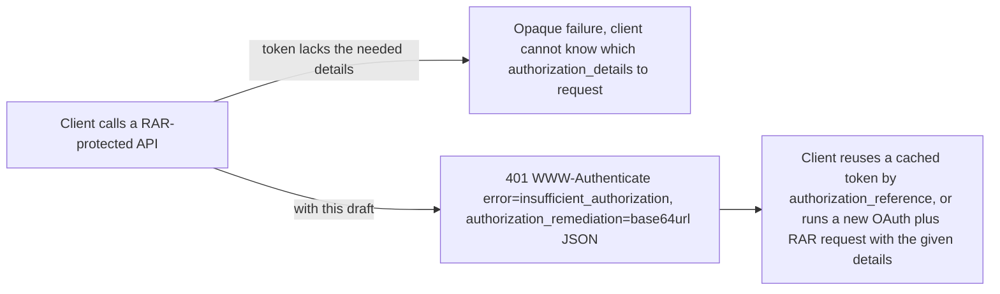
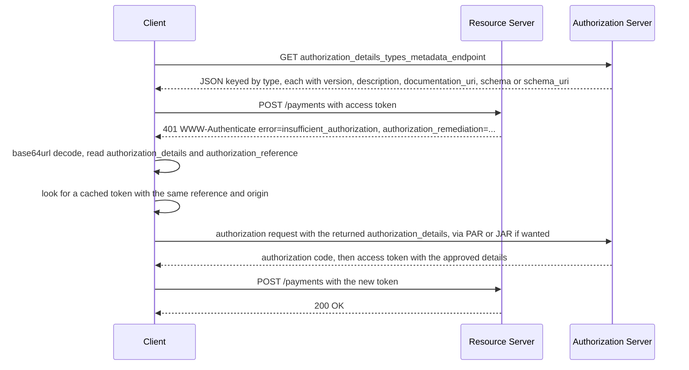

# RAR Metadata and Error Remediation

> In one line: an authorization server publishes a metadata endpoint describing every `authorization_details` type it supports, and a resource server that rejects a call for insufficient authorization details hands the client the exact RAR object to go and get.

## When you reach for it

- **A client calling a direct-debit API with a token whose mandate is too small**: today the API can only say no. With this draft it answers `insufficient_authorization` and the `authorization_details` object the client should request next (Sections 1, 4).
- **A client that must build RAR objects for an unfamiliar server**: `authorization_details_types_metadata_endpoint` returns a JSON Schema, description and documentation URI per type, instead of an out-of-band agreement (Sections 1, 5).
- **A resource server that wants ephemeral, call-specific data to shape consent**: the remediation payload can carry interaction-specific details such as a risk profile that influence authentication strength and the consent screen (Section 1).
- **A client that caches tokens across many fine-grained grants**: `authorization_reference` lets it find an existing token that already covers a request by comparing opaque strings, without parsing the details (Sections 4, 7.1.2, 7.3.5).

## The problem it solves

RFC 9396 defines how a client sends `authorization_details` and how the server processes them, but not how the client learns which types exist and what shape they take. That knowledge is agreed out of band. The same gap exists at the resource server: when a request fails because the token's authorization details are missing or too narrow, the client gets no interoperable signal about what it should ask for (Section 1).

The draft fills both gaps. The authorization server advertises a metadata endpoint for its types. The resource server returns a dedicated error code and an `authorization_remediation` parameter carrying the RAR objects, and optionally a stable reference, that would satisfy the call (Sections 1, 3, 4).

## How it works

The metadata endpoint, advertised in RFC 8414 metadata as `authorization_details_types_metadata_endpoint`, answers a GET with an `application/json` object keyed by type identifier. Each entry carries an optional `version`, `description`, `documentation_uri` and `examples`, plus either an inline JSON Schema in `schema` or a `schema_uri`. The schema describes exactly one authorization details object and pins `type` to that identifier (Section 5). On a failed call the resource server validates the token, checks the details from the JWT or from introspection, and if they are missing or insufficient returns `insufficient_authorization` with `authorization_remediation`, a base64url-encoded JSON object whose `authorization_details` array can be sent as-is in a new RAR request and whose `authorization_reference` is an opaque hash-derived handle (Sections 4, 7.2). The client decodes it, tries a cached token with the same reference and resource server origin, and otherwise starts a new OAuth plus RAR flow, stores the resulting token against the reference, and retries (Section 7.1).

## What the spec requires

- A resource server SHOULD return `insufficient_authorization` when it denies access because authorization details are missing or insufficient. Insufficient scope stays `insufficient_scope`, and insufficient authentication context stays `insufficient_user_authentication` (Sections 4, 7.2.3).
- Clients MUST treat `authorization_reference` as opaque and MUST NOT interpret it, and it MUST NOT reveal sensitive information. The resource server SHALL NOT include it when tokens are single-use (Section 4).
- Each metadata entry MUST have `schema` or `schema_uri` but not both. The schema MUST validate exactly one authorization details object and MUST restrict `type` to the matching identifier. Clients MUST NOT use `description` for authorization or validation decisions (Section 5).
- The authorization server MUST provide approved RAR objects to the resource server. It MAY place them in JWT access tokens or introspection responses, and SHOULD omit them from JWTs where size or privacy argues for introspection (Section 6).
- A client that retried with a cached token and still got `insufficient_authorization` MUST NOT retry with that token for the same reference again. Token storage MUST be scoped per end-user session (Sections 7.1.2, 7.1.5).
- Clients MUST cap retries: the recommended limit is one cached retry, then one fresh attempt, then failure. A fresh token rejected with the same reference means stop and report (Section 7.3.3).

## Watch out

- **Reuse is opportunistic, not guaranteed**: consent may have been revoked, risk may have changed, or the cached token may cover only part of the details, so a matching reference can still be rejected (Section 7.3.1).
- **References do not cross resource servers**: a reference is scoped to the server that issued it and MUST NOT be used with another (Section 7.3.4).
- **The remediation payload is visible to the client**: resource servers SHOULD NOT put sensitive data in the returned `authorization_details`. Use opaque handles such as `account_1a` instead of an IBAN and let the authorization server collect the rest from the user (Section 8.1).
- **JWT access tokens can bloat or leak**: the authorization server SHOULD omit `authorization_details` from JWTs where size or privacy makes introspection the better carrier (Section 6).

## Sources

- [draft-ietf-oauth-rar-metadata-remediation, Section 1](https://datatracker.ietf.org/doc/html/draft-ietf-oauth-rar-metadata-remediation#section-1)
- [draft-ietf-oauth-rar-metadata-remediation, Section 3](https://datatracker.ietf.org/doc/html/draft-ietf-oauth-rar-metadata-remediation#section-3)
- [draft-ietf-oauth-rar-metadata-remediation, Section 4](https://datatracker.ietf.org/doc/html/draft-ietf-oauth-rar-metadata-remediation#section-4)
- [draft-ietf-oauth-rar-metadata-remediation, Section 5](https://datatracker.ietf.org/doc/html/draft-ietf-oauth-rar-metadata-remediation#section-5)
- [draft-ietf-oauth-rar-metadata-remediation, Section 6](https://datatracker.ietf.org/doc/html/draft-ietf-oauth-rar-metadata-remediation#section-6)
- [draft-ietf-oauth-rar-metadata-remediation, Section 7.1](https://datatracker.ietf.org/doc/html/draft-ietf-oauth-rar-metadata-remediation#section-7.1)
- [draft-ietf-oauth-rar-metadata-remediation, Section 7.1.2](https://datatracker.ietf.org/doc/html/draft-ietf-oauth-rar-metadata-remediation#section-7.1.2)
- [draft-ietf-oauth-rar-metadata-remediation, Section 7.1.5](https://datatracker.ietf.org/doc/html/draft-ietf-oauth-rar-metadata-remediation#section-7.1.5)
- [draft-ietf-oauth-rar-metadata-remediation, Section 7.2](https://datatracker.ietf.org/doc/html/draft-ietf-oauth-rar-metadata-remediation#section-7.2)
- [draft-ietf-oauth-rar-metadata-remediation, Section 7.2.3](https://datatracker.ietf.org/doc/html/draft-ietf-oauth-rar-metadata-remediation#section-7.2.3)
- [draft-ietf-oauth-rar-metadata-remediation, Section 7.3.1](https://datatracker.ietf.org/doc/html/draft-ietf-oauth-rar-metadata-remediation#section-7.3.1)
- [draft-ietf-oauth-rar-metadata-remediation, Section 7.3.3](https://datatracker.ietf.org/doc/html/draft-ietf-oauth-rar-metadata-remediation#section-7.3.3)
- [draft-ietf-oauth-rar-metadata-remediation, Section 7.3.4](https://datatracker.ietf.org/doc/html/draft-ietf-oauth-rar-metadata-remediation#section-7.3.4)
- [draft-ietf-oauth-rar-metadata-remediation, Section 7.3.5](https://datatracker.ietf.org/doc/html/draft-ietf-oauth-rar-metadata-remediation#section-7.3.5)
- [draft-ietf-oauth-rar-metadata-remediation, Section 8.1](https://datatracker.ietf.org/doc/html/draft-ietf-oauth-rar-metadata-remediation#section-8.1)
