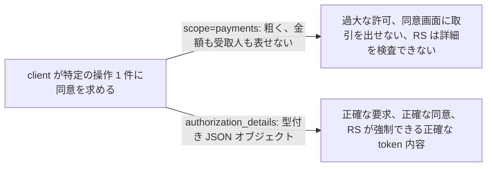
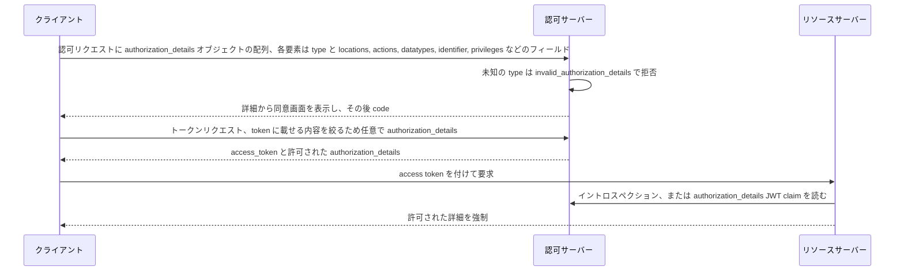

# Rich Authorization Requests (RAR)

> 一言で言うと: 平坦な `scope` 文字列の代わりに、client は `authorization_details` という型付き JSON オブジェクトの配列を送り、ある口座への特定金額の支払い 1 件のように、欲しいものを正確に伝える。

## どういうときに使うか

- **支払い開始 API**: ユーザーは金額、通貨、受取人を含む特定の送金に同意しなければならず、`payments` のような scope ではそれを運べない。`authorization_details` は取引そのものを運ぶので、同意画面も access token もその取引に結び付く (Section 1)。
- **カテゴリではなくリソース単位でアクセスを決める API**: `locations`、`actions`、`datatypes` で、どのリソースサーバー、どの操作、どの種類のデータかを伝えられる。組み合わせごとに scope 文字列を発明しなくてよい (Section 2.2)。
- **scope の一覧ではなく許可された詳細が必要なリソースサーバー**: 認可サーバーは許可した `authorization_details` を JWT claim かイントロスペクションでリソースサーバーに渡さなければならない (Section 9、9.1、9.2)。
- **`scope` だけでは client が何を求めているか分からない配備**: トークンレスポンスはリソースオーナーが許可した `authorization_details` を返すので、client は実際に何を得たかを知れる (Section 7)。

## 解決する問題

`scope` は文字列の一覧でしかない。client がどの種類のアクセスを求めているかは言えても、どのリソース、いくら、誰宛てかは言えない。支払いでは、認可サーバーは意味のある同意を得るために実際の取引をユーザーに見せなければならず、リソースサーバーは後でまさにその取引を強制しなければならない。どちらも、client とサーバーが事前に合意した文字列には収まらない。

RAR は `authorization_details` パラメータを導入し、client が JSON データ構造の表現力を使って細粒度の認可要件を指定できるようにする (Section 1)。各 `type` の解釈は認可サーバーが握り (Section 2.1)、許可された内容は token へ、そしてリソースサーバーへ流れる。

## 仕組み

`authorization_details` は JSON 表記でオブジェクトの配列を含み、各オブジェクトには認可詳細の型を文字列で識別する必須の `type` がある (Section 2)。仕様は API をまたいで使える共通フィールドとして `locations`、`actions`、`datatypes`、`identifier`、`privileges` を定義する (Section 2.2)。client はこのパラメータを `scope` と同じ場所、つまり認可リクエストで送る (Section 3)。認可サーバーは未知の type を拒否し、`invalid_authorization_details` で応答しなければならない (Section 5)。トークンエンドポイントで client は、この access token にどの詳細を割り当てたいかを伝えるために `authorization_details` を再び送ってよく (Section 6)、トークンレスポンスはリソースオーナーが許可した `authorization_details` を返さなければならない (Section 7)。リソースサーバー向けには、JWT access token は audience で絞った詳細をトップレベルの `authorization_details` claim として持つべきで (Section 9.1)、イントロスペクション応答は同じ構造を含まなければならない (Section 9.2)。

## 仕様が求めること

- リクエストパラメータ `authorization_details` はオブジェクトの JSON 配列で、各要素に `type` が必須 (Section 2)。
- `type` の値の解釈は認可サーバーが制御する (Section 2.1)。
- ある API は `scope` と `authorization_details` のどちらか一方だけを使うことが推奨される (Section 3.1)。
- 認可サーバーは未知の認可詳細型の処理を拒否し、列挙された場合に `invalid_authorization_details` を返さなければならない (Section 5)。
- トークンレスポンスはリソースオーナーが許可した `authorization_details` も返さなければならず、添えられる詳細は client の要求と異なってよい (Section 7、7.1)。
- 認可サーバーは許可したデータをリソースサーバーに渡さなければならない。トップレベルの JWT claim か、同じ構造のイントロスペクション応答で (Section 9、9.1、9.2)。
- サーバーメタデータは `authorization_details_types_supported` を公開し、client メタデータは `authorization_details_types` を使う (Section 10)。

## 注意点

- `authorization_details` はユーザーエージェントを経由するので、完全性が問題になるなら client は署名付き request object か pushed な `request_uri` で改ざんと差し替えから守らなければならない (Section 12)。
- トークンリクエストの詳細が許可済みの部分集合かを判断するとき、認可サーバーは単純なオブジェクト比較に頼るべきでない。フィールドの積集合には副作用がありうる (Section 6.1)。
- 型は 1 つごとに配備作業になる。型を定義し、サーバーメタデータで公開し、同意画面でどう見せるかを決め、リソースサーバーがどう処理するかを決める (Section 11.1)。
- 大きな `authorization_details` は認可 URL を大きくするので、pushed authorization request と `request_uri` を使う (Section 11.4)。
- 認可詳細はプライバシーを保つ形で設計し使うことがとりわけ重要 (Section 13)。

## 出典

- [RFC 9396, Section 1](https://www.rfc-editor.org/rfc/rfc9396#section-1)
- [RFC 9396, Section 2](https://www.rfc-editor.org/rfc/rfc9396#section-2)
- [RFC 9396, Section 2.1](https://www.rfc-editor.org/rfc/rfc9396#section-2.1)
- [RFC 9396, Section 2.2](https://www.rfc-editor.org/rfc/rfc9396#section-2.2)
- [RFC 9396, Section 3](https://www.rfc-editor.org/rfc/rfc9396#section-3)
- [RFC 9396, Section 3.1](https://www.rfc-editor.org/rfc/rfc9396#section-3.1)
- [RFC 9396, Section 5](https://www.rfc-editor.org/rfc/rfc9396#section-5)
- [RFC 9396, Section 6](https://www.rfc-editor.org/rfc/rfc9396#section-6)
- [RFC 9396, Section 6.1](https://www.rfc-editor.org/rfc/rfc9396#section-6.1)
- [RFC 9396, Section 7](https://www.rfc-editor.org/rfc/rfc9396#section-7)
- [RFC 9396, Section 7.1](https://www.rfc-editor.org/rfc/rfc9396#section-7.1)
- [RFC 9396, Section 9](https://www.rfc-editor.org/rfc/rfc9396#section-9)
- [RFC 9396, Section 9.1](https://www.rfc-editor.org/rfc/rfc9396#section-9.1)
- [RFC 9396, Section 9.2](https://www.rfc-editor.org/rfc/rfc9396#section-9.2)
- [RFC 9396, Section 10](https://www.rfc-editor.org/rfc/rfc9396#section-10)
- [RFC 9396, Section 11.1](https://www.rfc-editor.org/rfc/rfc9396#section-11.1)
- [RFC 9396, Section 11.4](https://www.rfc-editor.org/rfc/rfc9396#section-11.4)
- [RFC 9396, Section 12](https://www.rfc-editor.org/rfc/rfc9396#section-12)
- [RFC 9396, Section 13](https://www.rfc-editor.org/rfc/rfc9396#section-13)
