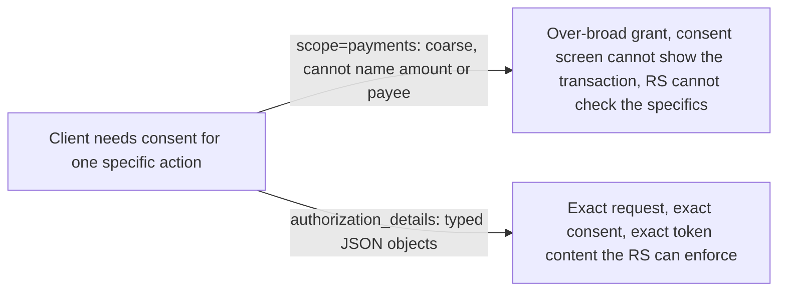
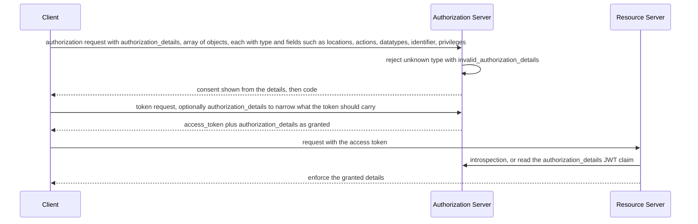

# Rich Authorization Requests (RAR)

> In one line: instead of a flat `scope` string, the client sends `authorization_details`, a JSON array of typed objects that say exactly what it wants, such as one payment of a given amount to a given account.

## When you reach for it

- **A payment initiation API**: the user must consent to a specific transfer, with amount, currency and creditor, and a scope like `payments` cannot carry that. `authorization_details` carries the transaction itself, so the consent screen and the access token are both tied to it (Section 1).
- **An API where access is per resource, not per category**: `locations`, `actions` and `datatypes` let the client say which resource server, which operations and which kinds of data, instead of inventing a scope string per combination (Section 2.2).
- **A resource server that needs the granted details, not just a scope list**: the authorization server must make the granted `authorization_details` available to the resource server, as a JWT claim or through introspection (Sections 9, 9.1 and 9.2).
- **A deployment that cannot tell what a client is asking for from `scope` alone**: the token response echoes `authorization_details` as granted by the resource owner, so the client knows what it actually got (Section 7).

## The problem it solves

`scope` is a list of strings. It can say what kind of access a client wants, but not which resource, which amount or which recipient. For a payment the authorization server has to show the user the actual transaction to obtain meaningful consent, and the resource server later has to enforce exactly that transaction. Neither fits in a string the client and server had to agree on in advance.

RAR introduces the `authorization_details` parameter, which lets clients specify their fine-grained authorization requirements using the expressiveness of JSON data structures (Section 1). The authorization server controls how each `type` is interpreted (Section 2.1), and whatever was granted flows to the token and on to the resource server.

## How it works

`authorization_details` contains, in JSON notation, an array of objects, and each object has a required `type` that identifies the authorization details type as a string (Section 2). The spec defines common fields usable across APIs: `locations`, `actions`, `datatypes`, `identifier` and `privileges` (Section 2.2). The client sends the parameter in the authorization request in the same places `scope` is used (Section 3). The authorization server must refuse any unknown type and answer with `invalid_authorization_details` (Section 5). At the token endpoint the client may send `authorization_details` again to say which details it wants assigned to this access token (Section 6), and the token response must return the `authorization_details` as granted by the resource owner (Section 7). For resource servers, a JWT access token should carry the details as a top-level `authorization_details` claim filtered to the audience (Section 9.1), and an introspection response must contain the same structure (Section 9.2).

## What the spec requires

- The request parameter `authorization_details` is a JSON array of objects, and `type` is required in each (Section 2).
- The authorization server controls the interpretation of the `type` value (Section 2.1).
- It is recommended that a given API use only one of `scope` and `authorization_details` (Section 3.1).
- The authorization server must refuse to process any unknown authorization details type and return `invalid_authorization_details` in the listed cases (Section 5).
- The token response must also return the `authorization_details` as granted by the resource owner, and the attached details may differ from what the client requested (Sections 7 and 7.1).
- The authorization server must make the granted data available to the resource server, as a top-level JWT claim or in the introspection response with the same structure (Sections 9, 9.1 and 9.2).
- Server metadata advertises `authorization_details_types_supported`, and client metadata uses `authorization_details_types` (Section 10).

## Watch out

- `authorization_details` passes through the user agent, so if its integrity matters, clients must protect it against tampering and swapping with a signed request object or a pushed `request_uri` (Section 12).
- An authorization server should not rely on simple object comparison when deciding whether a token request's details are a subset of what was granted, because intersections of fields can have side effects (Section 6.1).
- Each type is a deployment of its own: define it, publish it in server metadata, decide how it is shown in the consent prompt, and decide how the resource server processes it (Section 11.1).
- Large `authorization_details` make the authorization URL large, so use pushed authorization requests with `request_uri` (Section 11.4).
- It is especially important to design and use authorization details in a privacy-preserving manner (Section 13).

## Sources

- [RFC 9396, Section 1](https://www.rfc-editor.org/rfc/rfc9396#section-1)
- [RFC 9396, Section 2](https://www.rfc-editor.org/rfc/rfc9396#section-2)
- [RFC 9396, Section 2.1](https://www.rfc-editor.org/rfc/rfc9396#section-2.1)
- [RFC 9396, Section 2.2](https://www.rfc-editor.org/rfc/rfc9396#section-2.2)
- [RFC 9396, Section 3](https://www.rfc-editor.org/rfc/rfc9396#section-3)
- [RFC 9396, Section 3.1](https://www.rfc-editor.org/rfc/rfc9396#section-3.1)
- [RFC 9396, Section 5](https://www.rfc-editor.org/rfc/rfc9396#section-5)
- [RFC 9396, Section 6](https://www.rfc-editor.org/rfc/rfc9396#section-6)
- [RFC 9396, Section 6.1](https://www.rfc-editor.org/rfc/rfc9396#section-6.1)
- [RFC 9396, Section 7](https://www.rfc-editor.org/rfc/rfc9396#section-7)
- [RFC 9396, Section 7.1](https://www.rfc-editor.org/rfc/rfc9396#section-7.1)
- [RFC 9396, Section 9](https://www.rfc-editor.org/rfc/rfc9396#section-9)
- [RFC 9396, Section 9.1](https://www.rfc-editor.org/rfc/rfc9396#section-9.1)
- [RFC 9396, Section 9.2](https://www.rfc-editor.org/rfc/rfc9396#section-9.2)
- [RFC 9396, Section 10](https://www.rfc-editor.org/rfc/rfc9396#section-10)
- [RFC 9396, Section 11.1](https://www.rfc-editor.org/rfc/rfc9396#section-11.1)
- [RFC 9396, Section 11.4](https://www.rfc-editor.org/rfc/rfc9396#section-11.4)
- [RFC 9396, Section 12](https://www.rfc-editor.org/rfc/rfc9396#section-12)
- [RFC 9396, Section 13](https://www.rfc-editor.org/rfc/rfc9396#section-13)
