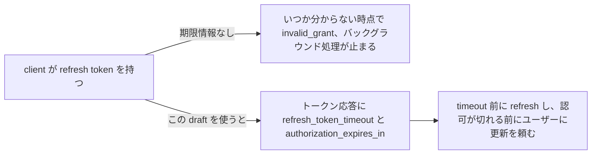
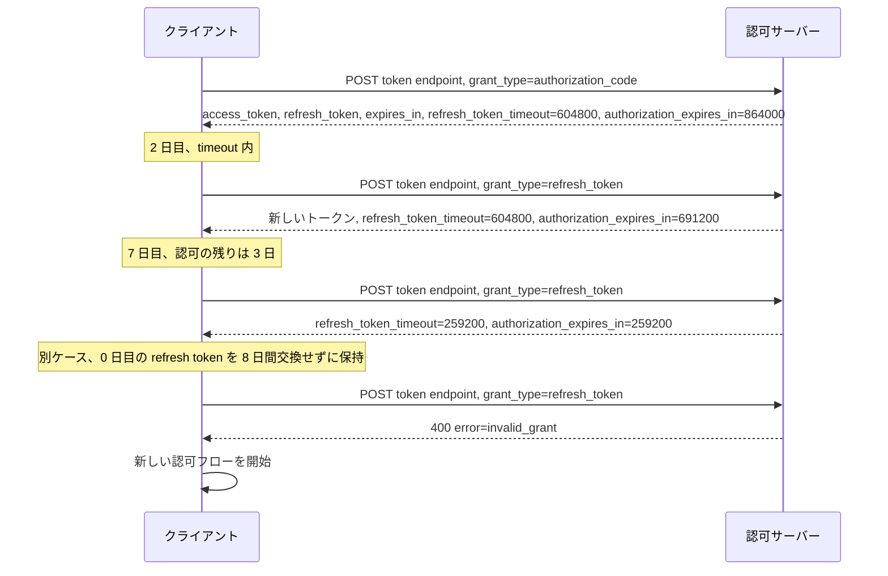

# Refresh Token and Authorization Expiration

> 一言で言うと: トークン応答の新しいパラメータ `refresh_token_timeout` と `authorization_expires_in` で、refresh token をどれだけ寝かせておけるか、そしてユーザーの認可そのものがいつ切れるかを client に伝える。

## どういうときに使うか

- **機微なデータ向けに短命な refresh token を出すサーバー**: メールや医療の scope は無期限アクセスには重すぎる。今の client は refresh が失敗して初めて期限切れを知る (Section 1)。
- **最大の未使用期間を強制するサーバー**: refresh token を N 日に 1 回は交換しなければならないなら、`refresh_token_timeout` でその締切を client に伝えられる。ドキュメントから推測させなくて済む (Section 4.2, 10)。
- **黙って壊れてはいけないバックグラウンドアプリ**: タスク管理や旅行管理のアプリは、夜中に失敗する代わりに、期限前に `prompt=consent` などでユーザーに再認可を促せる (Section 9)。
- **アイドル上限付きの refresh token rotation**: 使用のたびに rotation し、未 rotation で保持できる期間を制限するサーバーは、その制限を API で伝えられる (Section 10)。

## 解決する問題

RFC 6749 は refresh token を「通常は長命」と書くだけで、いつ切れるかについて規範的なことは何も言わない。それでも認可サーバーは、アクセスが機微だから、あるいは未使用期間に上限を設けるから、という理由で寿命を短くしてきた。client はどちらの制限も見る手段がない (Section 1)。

draft は 2 つの概念を分ける。ユーザーが設定するかサーバーが課す認可の期限と、client が交換せずに token を保持できる最大時間である refresh token timeout (Section 4.1, 4.2)。そして両者を結びつける。refresh token は認可より長生きしない (Section 5)。

## 仕組み

どちらのパラメータも秒単位の時間。`refresh_token_timeout` は client が交換せずに refresh token を保持できる時間。`authorization_expires_in` はトークンが対象とする scope に対するユーザー認可の残り時間で、個々のトークンではなく認可の属性 (Section 6.1, 6.1.1)。サーバーは片方だけ返してもよい。timeout だけなら認可は無期限だがトークンは定期的に使う必要があり、期限だけなら認可は固定長でアイドル制限はない (Section 6.1)。上の例は draft 自身のシナリオ、7 日のアイドル制限と 10 日の認可に沿っている。3 回目の refresh で両方の値が揃うのは、トークンが認可より長生きできないから (Section 6.3)。期限切れのトークンは既存の `invalid_grant` エラーになり、client は新しいグラントを始めるべき (Section 6.2)。

## 仕様が求めること

- refresh token はユーザー認可より後に切れてはならない (MUST NOT)。サーバーが最大アイドル期間を強制するなら先に切れてよい (MAY)。サーバーは期限切れの refresh token をいかなる目的にも受け入れてはならない (Section 5)。
- access token もユーザー認可より後に切れてはならず、リソースサーバーは期限切れの access token を受け入れてはならない (Section 5)。
- `refresh_token_timeout` は `authorization_expires_in` を超えてはならない (SHALL NOT)。値が有限なら、応答に `refresh_token` を含めるたびにサーバーはそれらを返さなければならない (Section 6.1)。
- scope ごとに寿命が違う場合、サーバーは付与されたアクセスのうち最も短い残り時間を返すことが推奨される (RECOMMENDED) (Section 6.1.1)。
- client は、ある応答での省略が以後の応答でも省略されるとは仮定してはならず、大きな値を「無期限の印」と推測せず文字どおりの寿命として扱わなければならない (Section 6.1.2)。
- refresh token の introspection に対応するサーバーは両パラメータをそこでも返すべきで (SHOULD)、introspection が timeout をリセットしてはならない (Section 7)。
- サーバーは metadata の `refresh_token_expiration_types_supported` に `authorization` と `token_timeout` の値で対応を宣言すべきで、無期限を示すためにフィールドを省略するなら宣言しなければならない (Section 8)。

## 注意点

- **metadata で対応を宣言していないと、省略は曖昧**: 宣言がなければ client は「無期限」と「未対応」を区別できない (Section 6.1.2, 8)。
- **refresh token を認可より長生きさせるのはバグの温床**: サーバーが両方のタイムスタンプを検査する場合にしか成り立たず、draft はそれを危険だと言う。だからトークンが先に切れることが要求される (Section 10)。
- **最短寿命ルールは再認可を早める**: scope の期限がばらばらだと、最小値を返すことで、一部の scope がまだ必要としない時点で client がユーザーに頼むことになる (Section 6.1.1)。
- **client ごとに複数の refresh token は摩擦を生む**: 短命な金融 scope と長命なプロフィール scope で token を分けると、token 管理と同意画面が増える (Section 10)。

## 出典

- [draft-ietf-oauth-refresh-token-expiration, Section 1](https://datatracker.ietf.org/doc/html/draft-ietf-oauth-refresh-token-expiration#section-1)
- [draft-ietf-oauth-refresh-token-expiration, Section 4.1](https://datatracker.ietf.org/doc/html/draft-ietf-oauth-refresh-token-expiration#section-4.1)
- [draft-ietf-oauth-refresh-token-expiration, Section 4.2](https://datatracker.ietf.org/doc/html/draft-ietf-oauth-refresh-token-expiration#section-4.2)
- [draft-ietf-oauth-refresh-token-expiration, Section 5](https://datatracker.ietf.org/doc/html/draft-ietf-oauth-refresh-token-expiration#section-5)
- [draft-ietf-oauth-refresh-token-expiration, Section 6.1](https://datatracker.ietf.org/doc/html/draft-ietf-oauth-refresh-token-expiration#section-6.1)
- [draft-ietf-oauth-refresh-token-expiration, Section 6.1.1](https://datatracker.ietf.org/doc/html/draft-ietf-oauth-refresh-token-expiration#section-6.1.1)
- [draft-ietf-oauth-refresh-token-expiration, Section 6.1.2](https://datatracker.ietf.org/doc/html/draft-ietf-oauth-refresh-token-expiration#section-6.1.2)
- [draft-ietf-oauth-refresh-token-expiration, Section 6.2](https://datatracker.ietf.org/doc/html/draft-ietf-oauth-refresh-token-expiration#section-6.2)
- [draft-ietf-oauth-refresh-token-expiration, Section 6.3](https://datatracker.ietf.org/doc/html/draft-ietf-oauth-refresh-token-expiration#section-6.3)
- [draft-ietf-oauth-refresh-token-expiration, Section 7](https://datatracker.ietf.org/doc/html/draft-ietf-oauth-refresh-token-expiration#section-7)
- [draft-ietf-oauth-refresh-token-expiration, Section 8](https://datatracker.ietf.org/doc/html/draft-ietf-oauth-refresh-token-expiration#section-8)
- [draft-ietf-oauth-refresh-token-expiration, Section 9](https://datatracker.ietf.org/doc/html/draft-ietf-oauth-refresh-token-expiration#section-9)
- [draft-ietf-oauth-refresh-token-expiration, Section 10](https://datatracker.ietf.org/doc/html/draft-ietf-oauth-refresh-token-expiration#section-10)
