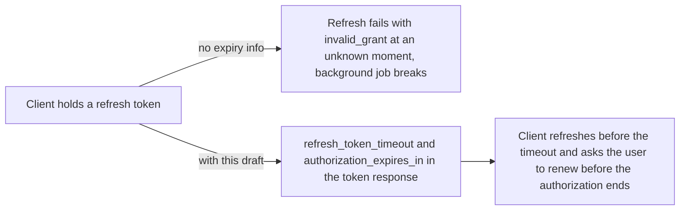
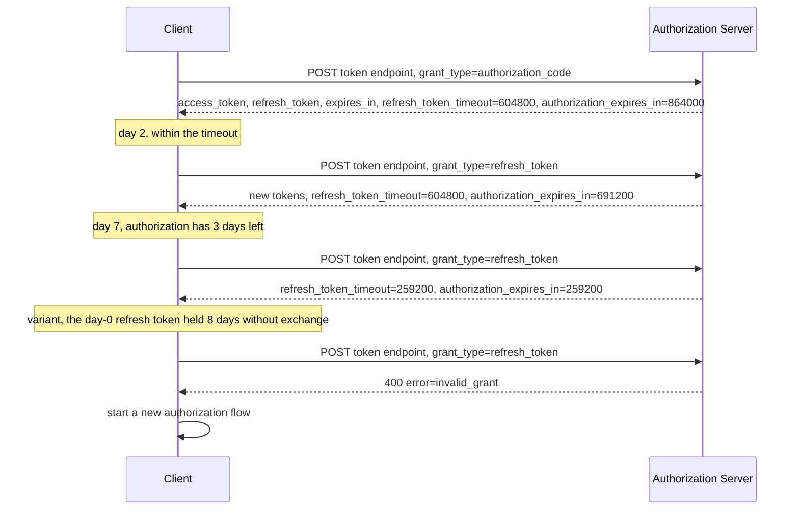

# Refresh Token and Authorization Expiration

> In one line: two new token response parameters, `refresh_token_timeout` and `authorization_expires_in`, tell the client how long it can sit on a refresh token and when the user's authorization itself runs out.

## When you reach for it

- **A server that issues short-lived refresh tokens for sensitive data**: mail or health scopes are too sensitive for indefinite access, and today the client learns the token has expired only when the refresh fails (Section 1).
- **A server that enforces a maximum idle period**: if a refresh token must be exchanged at least every N days, `refresh_token_timeout` lets the client know the deadline instead of guessing from documentation (Sections 4.2, 10).
- **A background app that must not break silently**: a task or travel management app can prompt the user to reauthorize before expiry, for example with `prompt=consent`, rather than failing in the night (Section 9).
- **Refresh token rotation with an idle cap**: servers that rotate on every use and limit how long a token may be held unrotated can communicate that limit in the API (Section 10).

## The problem it solves

RFC 6749 describes refresh tokens as typically long-lasting and says nothing normative about when they expire. Authorization servers have moved to shorter lifetimes anyway, either because the access is sensitive or because they cap how long a token may go unused. The client has no way to see either limit (Section 1).

The draft separates two concepts: the expiration of the user's authorization, set by the user or imposed by the server, and the refresh token timeout, the maximum time the client may hold the token without exchanging it (Sections 4.1, 4.2). It then ties them together: a refresh token never outlives the authorization (Section 5).

## How it works

Both parameters are times in seconds. `refresh_token_timeout` is how long the client may hold the refresh token without exchanging it. `authorization_expires_in` is the remaining lifetime of the user's authorization for the scopes the token covers, and it is a property of the authorization, not of an individual token (Sections 6.1, 6.1.1). The server may return only one of them: timeout alone means the authorization is indefinite but the token must be used regularly; expiration alone means a fixed authorization with no idle limit (Section 6.1). The example above follows the draft's own scenario of a 7-day idle limit and a 10-day authorization; on the third refresh both values converge because the token cannot outlive the authorization (Section 6.3). An expired token produces the existing `invalid_grant` error, after which the client should start a new grant (Section 6.2).

## What the spec requires

- The refresh token MUST NOT expire later than the user authorization; it MAY expire earlier when the server enforces a maximum idle period. The server MUST NOT accept an expired refresh token for any purpose (Section 5).
- Access tokens MUST NOT expire later than the user authorization, and resource servers MUST NOT accept expired access tokens (Section 5).
- `refresh_token_timeout` SHALL NOT exceed `authorization_expires_in`. When the values are finite, the server MUST return them whenever the response includes a `refresh_token` (Section 6.1).
- When different scopes have different lifetimes, the server is RECOMMENDED to return the shortest remaining time of any granted access (Section 6.1.1).
- Clients MUST NOT assume that an omission in one response means omission in later ones, and MUST treat large values literally rather than guessing which ones mean indefinite (Section 6.1.2).
- Servers that support introspection of refresh tokens SHOULD return both parameters there, and introspection MUST NOT reset the timeout (Section 7).
- The server SHOULD advertise `refresh_token_expiration_types_supported` with values `authorization` and `token_timeout` in its metadata, and MUST do so if it omits fields to signal indefinite validity (Section 8).

## Watch out

- **Omitted fields are ambiguous unless metadata says the server implements this spec**: without the metadata declaration, a client cannot tell "indefinite" from "not supported" (Sections 6.1.2, 8).
- **Letting the refresh token outlive the authorization is a bug source**: it only works if the server checks both timestamps, which the draft calls dangerous. That is why the token is required to expire first (Section 10).
- **The shortest-lifetime rule can prompt reauthorization early**: when scopes expire at different times, returning the minimum may push the client to ask the user before some scopes actually need it (Section 6.1.1).
- **Multiple refresh tokens per client add friction**: separate tokens for short-lived financial scopes and long-lived profile scopes mean more token management and more consent prompts (Section 10).

## Sources

- [draft-ietf-oauth-refresh-token-expiration, Section 1](https://datatracker.ietf.org/doc/html/draft-ietf-oauth-refresh-token-expiration#section-1)
- [draft-ietf-oauth-refresh-token-expiration, Section 4.1](https://datatracker.ietf.org/doc/html/draft-ietf-oauth-refresh-token-expiration#section-4.1)
- [draft-ietf-oauth-refresh-token-expiration, Section 4.2](https://datatracker.ietf.org/doc/html/draft-ietf-oauth-refresh-token-expiration#section-4.2)
- [draft-ietf-oauth-refresh-token-expiration, Section 5](https://datatracker.ietf.org/doc/html/draft-ietf-oauth-refresh-token-expiration#section-5)
- [draft-ietf-oauth-refresh-token-expiration, Section 6.1](https://datatracker.ietf.org/doc/html/draft-ietf-oauth-refresh-token-expiration#section-6.1)
- [draft-ietf-oauth-refresh-token-expiration, Section 6.1.1](https://datatracker.ietf.org/doc/html/draft-ietf-oauth-refresh-token-expiration#section-6.1.1)
- [draft-ietf-oauth-refresh-token-expiration, Section 6.1.2](https://datatracker.ietf.org/doc/html/draft-ietf-oauth-refresh-token-expiration#section-6.1.2)
- [draft-ietf-oauth-refresh-token-expiration, Section 6.2](https://datatracker.ietf.org/doc/html/draft-ietf-oauth-refresh-token-expiration#section-6.2)
- [draft-ietf-oauth-refresh-token-expiration, Section 6.3](https://datatracker.ietf.org/doc/html/draft-ietf-oauth-refresh-token-expiration#section-6.3)
- [draft-ietf-oauth-refresh-token-expiration, Section 7](https://datatracker.ietf.org/doc/html/draft-ietf-oauth-refresh-token-expiration#section-7)
- [draft-ietf-oauth-refresh-token-expiration, Section 8](https://datatracker.ietf.org/doc/html/draft-ietf-oauth-refresh-token-expiration#section-8)
- [draft-ietf-oauth-refresh-token-expiration, Section 9](https://datatracker.ietf.org/doc/html/draft-ietf-oauth-refresh-token-expiration#section-9)
- [draft-ietf-oauth-refresh-token-expiration, Section 10](https://datatracker.ietf.org/doc/html/draft-ietf-oauth-refresh-token-expiration#section-10)
