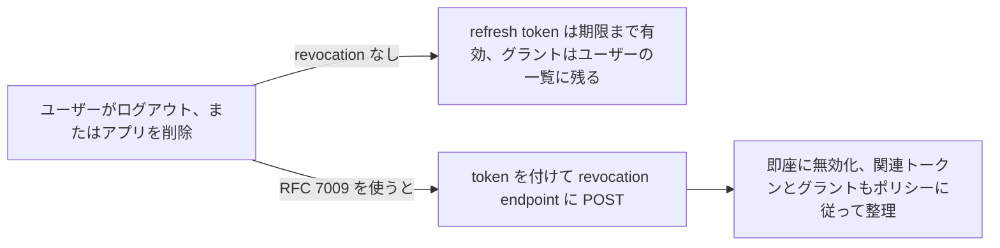
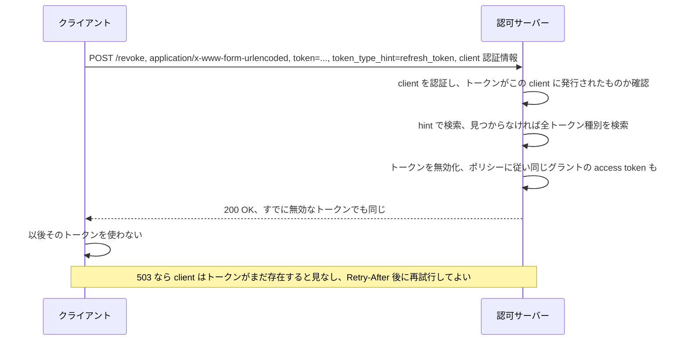

# Token Revocation

> 一言で言うと: client が不要になったトークンを認可サーバーの revocation endpoint に POST すると、サーバーがそれを無効化し、ポリシー次第で同じグラントの他のトークンも無効化する。

## どういうときに使うか

- **ユーザーがログアウトした、別の identity に切り替えた、アプリをアンインストールした**: client がサーバーに伝えれば、refresh token がユーザーの忘れた有効なグラントとして残らない (Section 1)。
- **グラントの裏にあるサーバー側の状態を片付けたい**: revocation によってサーバーはセッションデータや元のグラントを捨てられ、放置されたトークンの悪用を防ぎ、死んだグラントをユーザーに見せる認可一覧から消せる (Section 1)。
- **refresh token 1 つでグラント全体を止めたい**: サーバーが access token の revocation に対応していれば、refresh token の失効時に同じグラントの access token も全て無効化すべき (SHOULD) (Section 2.1)。
- **ブラウザ上の client**: endpoint は user agent ベースのアプリ向けに CORS に対応してもよい (Section 2.3)。

## 解決する問題

RFC 6749 はトークンの発行は定めるが、client がそれを返す手段を持たない。ユーザーが削除済みのアプリに出した refresh token は期限まで使えるままで、認可サーバーにはグラントが死んだという信号が届かない。RFC 7009 は revocation endpoint を足す。client がトークンを送り、サーバーはそれがその client に発行されたものか確かめて即座に無効化する。関連トークンやグラントそのものまで無効化するかはサーバーのポリシー次第だが、仕組みはどの client でも同じ (Section 1, 2.1)。

## 仕組み

要求は form エンコードの POST で、必須の `token` と任意の `token_type_hint` (`access_token` または `refresh_token`) を持つ。client は RFC 6749 Section 2.3 のとおり認証する。confidential client は credentials を、public client は `client_id` を出す。サーバーは所有者を確認してトークンを無効化する。hint でトークンが見つからなければ、サーバーは対応する全てのトークン種別に検索を広げる。hint を無視してもよい (Section 2.1)。200 はトークンが今無効であることを意味し、今失効させたのか元から無効だったのかは区別しない。body は無視される (Section 2.2)。エラーは RFC 6749 Section 5.2 の形式で、`unsupported_token_type` が 1 つ追加される (Section 2.2.1)。

## 仕様が求めること

- サーバーは refresh token の revocation に対応しなければならず (MUST)、access token の revocation に対応すべき (SHOULD)。endpoint は TLS を使わなければならず、client は URL が HTTPS であることを確認しなければならない (Section 2)。
- `token` は必須。`token_type_hint` は任意で、それでトークンが見つからなければサーバーは対応する全トークン種別に検索を広げなければならない (Section 2.1)。
- 無効化は即座に効き、そのトークンは二度と使えない。client は HTTP 200 を受けた後にそのトークンを使おうとしてはならない。RFC 上は小文字の must (Section 2.1)。
- refresh token を失効させた際、サーバーが access token の revocation に対応していれば、同じグラントに基づく access token も全て無効化すべき。access token の失効時に refresh token も失効させてよい (MAY) (Section 2.1)。
- サーバーは失効させたトークンにも無効なトークンにも 200 を返す。無効なトークンはエラーにならない (Section 2.2)。
- HTTP 503 のとき client はトークンがまだ存在すると見なし、適当な間隔の後に再試行してよい。サーバーは `Retry-After` を送ってもよい。いずれも RFC 上は小文字で、BCP 14 のキーワードではない (Section 2.2.1)。

## 注意点

- **自己完結型の access token は失効しても消えない**: JWT をローカルで検証するリソースサーバーは、標準外のバックエンド連携がなければ失効を知れない。短命な access token と refresh token の組み合わせで露出を抑える (Section 3)。
- **access token の revocation がないと、refresh token を失効させても access token は有効なまま**: 配備側はそれをリスク分析に織り込む (Section 5)。
- **endpoint は DoS の標的**: token endpoint で使う対策をここにも適用しなければならず、悪意ある client がこの機能を DoS に使えないよう注意しなければならない (MUST)。無効な `token_type_hint` は余計な DB 検索を招きうる (Section 5)。
- **偽の endpoint は有効なトークンを集める**: client は endpoint の場所を信頼できる情報源から得て、証明書検証などで endpoint を認証しなければならない (Section 2, 5)。
- **JSONP は危険**: `callback` パラメータを使う client には、悪意ある revocation endpoint がコードを注入できる (Section 2.3)。

## 出典

- [RFC 7009, Section 1](https://www.rfc-editor.org/rfc/rfc7009#section-1)
- [RFC 7009, Section 2](https://www.rfc-editor.org/rfc/rfc7009#section-2)
- [RFC 7009, Section 2.1](https://www.rfc-editor.org/rfc/rfc7009#section-2.1)
- [RFC 7009, Section 2.2](https://www.rfc-editor.org/rfc/rfc7009#section-2.2)
- [RFC 7009, Section 2.2.1](https://www.rfc-editor.org/rfc/rfc7009#section-2.2.1)
- [RFC 7009, Section 2.3](https://www.rfc-editor.org/rfc/rfc7009#section-2.3)
- [RFC 7009, Section 3](https://www.rfc-editor.org/rfc/rfc7009#section-3)
- [RFC 7009, Section 5](https://www.rfc-editor.org/rfc/rfc7009#section-5)
