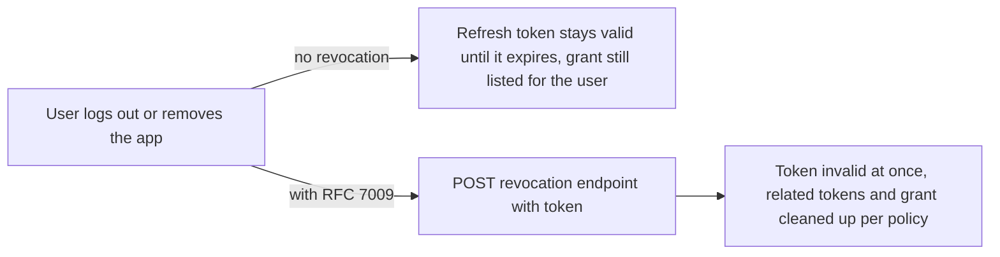
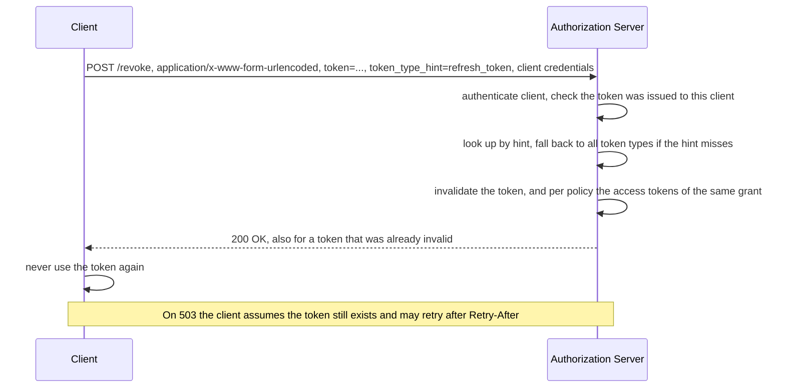

# Token Revocation

> In one line: a client POSTs a token it no longer needs to the authorization server's revocation endpoint, and the server invalidates it, and depending on policy the other tokens from the same grant.

## When you reach for it

- **The user logs out, switches identity or uninstalls the app**: the client should tell the server so the refresh token stops working instead of lingering as a valid grant the user forgot about (Section 1).
- **Cleaning up server-side state behind a grant**: revocation lets the server drop session data and the underlying grant, keeps abandoned tokens from being abused, and removes dead grants from the list of authorizations the user sees (Section 1).
- **Killing a whole grant from one refresh token**: when the server supports access token revocation, revoking the refresh token SHOULD invalidate all access tokens issued for the same grant (Section 2.1).
- **Browser-based clients**: the endpoint MAY support CORS for user-agent-based applications (Section 2.3).

## The problem it solves

RFC 6749 defines how tokens are issued but gives the client no way to hand one back. A refresh token issued to an app the user has since deleted stays usable until it expires, and the authorization server has no signal that the grant is dead. RFC 7009 adds a revocation endpoint. The client sends the token, the server checks it was issued to that client, and invalidates it immediately. Whether related tokens and the grant itself are also invalidated is up to server policy, but the mechanism is the same for every client (Sections 1, 2.1).

## How it works

The request is a form-encoded POST with a required `token` and an optional `token_type_hint` of `access_token` or `refresh_token`. The client authenticates as in RFC 6749 Section 2.3: a confidential client presents its credentials, a public client its `client_id`. The server verifies ownership and invalidates the token. If the hint does not find the token, the server extends the search to all supported token types; it may also ignore the hint entirely (Section 2.1). A 200 status means the token is now invalid, whether it was revoked just now or was never valid; the body is ignored (Section 2.2). Errors use the RFC 6749 Section 5.2 format and add one code, `unsupported_token_type` (Section 2.2.1).

## What the spec requires

- The server MUST support revocation of refresh tokens and SHOULD support revocation of access tokens. The endpoint MUST use TLS, and clients MUST verify that its URL is an HTTPS URL (Section 2).
- `token` is REQUIRED. `token_type_hint` is OPTIONAL; if it does not locate the token, the server MUST extend its search across all supported token types (Section 2.1).
- Invalidation takes effect immediately and the token cannot be used again. Clients must not try to use the token after an HTTP 200, a lowercase must in the RFC (Section 2.1).
- When a refresh token is revoked and the server supports access token revocation, it SHOULD also invalidate all access tokens based on the same grant. Revoking an access token MAY also revoke the refresh token (Section 2.1).
- The server responds 200 both for a revoked token and for an invalid one; invalid tokens do not cause an error (Section 2.2).
- On HTTP 503 the client must assume the token still exists and may retry after a reasonable delay; the server may send `Retry-After`. These are lowercase in the RFC, not BCP 14 keywords (Section 2.2.1).

## Watch out

- **Self-contained access tokens do not vanish on revocation**: a resource server validating a JWT locally will not see the revocation unless there is non-standard backend interaction. Short-lived access tokens with refresh tokens limit the exposure (Section 3).
- **Without access token revocation, revoking the refresh token leaves access tokens valid**: deployments must weigh that in their risk analysis (Section 5).
- **The endpoint is a denial-of-service target**: the countermeasures used on the token endpoint MUST be applied here too. Care MUST be taken that malicious clients cannot turn the feature into DoS, since invalid `token_type_hint` values can trigger extra database lookups (Section 5).
- **A counterfeit endpoint collects valid tokens**: the client must get the endpoint location from a trustworthy source and MUST authenticate the endpoint, for example through certificate validation (Sections 2, 5).
- **JSONP is risky**: a malicious revocation endpoint could inject code into a client that uses the `callback` parameter (Section 2.3).

## Sources

- [RFC 7009, Section 1](https://www.rfc-editor.org/rfc/rfc7009#section-1)
- [RFC 7009, Section 2](https://www.rfc-editor.org/rfc/rfc7009#section-2)
- [RFC 7009, Section 2.1](https://www.rfc-editor.org/rfc/rfc7009#section-2.1)
- [RFC 7009, Section 2.2](https://www.rfc-editor.org/rfc/rfc7009#section-2.2)
- [RFC 7009, Section 2.2.1](https://www.rfc-editor.org/rfc/rfc7009#section-2.2.1)
- [RFC 7009, Section 2.3](https://www.rfc-editor.org/rfc/rfc7009#section-2.3)
- [RFC 7009, Section 3](https://www.rfc-editor.org/rfc/rfc7009#section-3)
- [RFC 7009, Section 5](https://www.rfc-editor.org/rfc/rfc7009#section-5)
