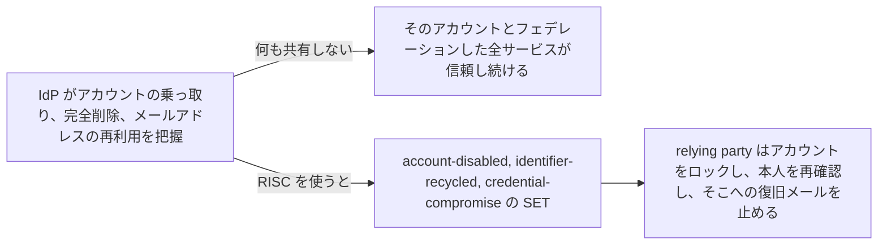
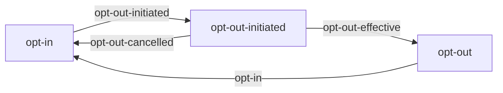
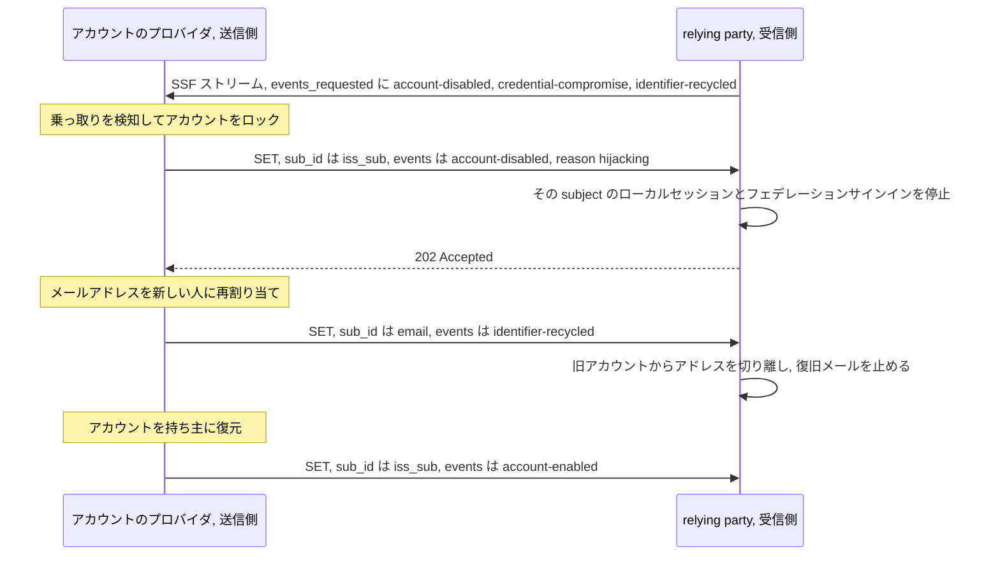

# Risk Incident Sharing and Coordination (RISC)

> 一言で言うと: RISC はアカウントそのものについての SSF イベント型の集まりで、無効化・完全削除・資格情報の漏洩・識別子の再利用・復旧情報の変更を伝え、そのアカウントを信頼するすべてのプロバイダが、攻撃者が横に動く前に反応できるようにする。

## どういうときに使うか

- **IdP が乗っ取りを理由にアカウントを無効化した**: `reason` が `hijacking` の `account-disabled` で、relying party はアカウントが無効化されたことと、その理由を知る。後で `account-enabled` が再び有効になったことを伝える (Section 2.3, 2.4)。
- **メールプロバイダが休眠アドレスを新しい人に割り当てた**: `email` subject の `identifier-recycled` は、その識別子が今は別のユーザーのものだと伝え、そのアドレスをキーにしているサービスは持ち主を以前の顧客として扱うのをやめられる (Section 2.6)。
- **パスワードが漏洩データに現れた**: `credential_type` が `password` の `credential-compromise` で、そのパスワードを受け入れていた他のプロバイダが変更を強制できる (Section 2.7)。
- **ユーザーがドメインを持つプロバイダでメールボックス名を変えた**: `new-value` 付きの `identifier-changed` を送るのは権威あるプロバイダだけ。そのアドレスが単なるユーザー名や復旧手段でしかないサービスは、代わりに `recovery-information-changed` を送る (Section 2.5, 2.10)。
- **ユーザーが RISC 共有の停止を求めたが、乗っ取り犯に即座に黙らせられては困る**: `opt-out-initiated` 状態の間はイベントが流れ続け、その後で `opt-out-effective` になる (Section 2.8)。

## 解決する問題

アカウントは鎖になっている。コンシューマ IdP のアカウントはメールの復旧経路であり、数十の relying party のログインであり、他のサービスがユーザー名に使うメールアドレスの持ち主でもある。そのアカウントが侵害され、消され、別人に割り当てられたとき、依存する各サービスはそれぞれのタイミングで、たいてい手遅れになってから気づく。RISC は Shared Signals Framework に基づき、Risk Incident Sharing and Coordination の実現に必要なイベント型とその内容を定義する (Section 1)。アカウントのプロバイダが何が起きたかを述べ、依存する側が何をするかを決める。

RISC のイベントは SSF の SET だ。CAEP がセッション・トークン・資格情報・デバイスを扱うのに対し、RISC はアカウントとその識別子のライフサイクルを扱い、両者は subject identifier と `credential_type` の語彙を共有する (Section 2, 2.7)。

## 仕組み

送信側はアカウントや識別子に対して権威を持つプロバイダだ。各イベントは SET で、`events` のメンバーは `https://schemas.openid.net/secevent/risc/event-type/` 配下の RISC イベント型 URI、`sub_id` は `iss_sub` subject でアカウントを、あるいは `email` や `phone` subject で識別子そのものを指す (Section 2, 2.3, 2.5, 2.6)。多くのイベントは属性を持たない。`account-disabled` は `reason` (`hijacking` か `bulk-account`) を、`identifier-changed` は `new-value` を持てて、`credential-compromise` は `credential_type` に加えて任意の `event_timestamp`・`reason_admin`・`reason_user` を持つ (Section 2.3, 2.5, 2.7)。opt-out は状態として扱われ、`opt-in`・`opt-out-initiated`・`opt-out-cancelled`・`opt-out-effective` の各イベントが遷移を知らせる (Section 2.8)。

## 仕様が求めること

- RISC イベント型のベース URI は `https://schemas.openid.net/secevent/risc/event-type/` (Section 2)。
- `identifier-changed` は旧い値を持つ `email` か `phone` の subject を使わなければならず、その識別子に権威を持つプロバイダだけが発行すべきで、`new-value` を持ってもよい (Section 2.5)。
- `identifier-recycled` は `email` か `phone` の subject を使わなければならない (Section 2.6)。
- `credential-compromise` は `credential_type` が必須で、値は CAEP の `credential-change` イベントで定義されたもののいずれか (Section 2.7)。
- ユーザーは自分のアカウントの RISC イベントについて opt in / opt out できるべきで、送信側と受信側の双方が opt-out 状態を管理すべき。送信側は状態が変わったときに opt-out 系のイベントを送る (Section 2.8)。
- `sessions-revoked` は非推奨で、新しい実装は CAEP の `session-revoked` イベントを使わなければならない (Section 2.11)。
- フィールド名 `subject_type` は非推奨で、新しいサービスはそれを使ってはならない。フィールド名は `format` (Section 3.1)。
- 実装は Shared Signals Framework に準拠すべき (Section 4)。

## 注意点

- **Google の RISC 送信側はいまだに `format` ではなく `subject_type` を使う**。Google のイベントを受けたい受信側には回避コードが要り、Google が仕様に追従したときに壊れないように書く (Section 3.1)。
- **`opt-out-initiated` は意図的な遅延**: 実務上のセキュリティ上の理由で、ユーザーが停止を求めてからも一定期間イベントが流れ続ける。乗っ取り犯が被害者を即座に RISC から外せないようにするためだ (Section 2.8)。
- **`account-disabled` は終わりではない**: 仕様はアカウントが将来再び有効化されうると書いており、それは `account-enabled` で伝えられる (Section 2.3, 2.4)。
- **識別子イベントの選び方**: 権威のないプロバイダでのユーザー名や復旧アドレスの変更は `identifier-changed` ではなく `recovery-information-changed` (Section 2.5, 2.10)。
- **SSF なしでは安全でない**: SSF に準拠せずにこれらのイベントを交換するとセキュリティ上の問題を招きうる (Section 4)。

## 出典

- [OpenID RISC 1.0, Section 1](https://openid.net/specs/openid-risc-1_0-final.html#section-1)
- [OpenID RISC 1.0, Section 2](https://openid.net/specs/openid-risc-1_0-final.html#section-2)
- [OpenID RISC 1.0, Section 2.3](https://openid.net/specs/openid-risc-1_0-final.html#section-2.3)
- [OpenID RISC 1.0, Section 2.4](https://openid.net/specs/openid-risc-1_0-final.html#section-2.4)
- [OpenID RISC 1.0, Section 2.5](https://openid.net/specs/openid-risc-1_0-final.html#section-2.5)
- [OpenID RISC 1.0, Section 2.6](https://openid.net/specs/openid-risc-1_0-final.html#section-2.6)
- [OpenID RISC 1.0, Section 2.7](https://openid.net/specs/openid-risc-1_0-final.html#section-2.7)
- [OpenID RISC 1.0, Section 2.8](https://openid.net/specs/openid-risc-1_0-final.html#section-2.8)
- [OpenID RISC 1.0, Section 2.10](https://openid.net/specs/openid-risc-1_0-final.html#section-2.10)
- [OpenID RISC 1.0, Section 2.11](https://openid.net/specs/openid-risc-1_0-final.html#section-2.11)
- [OpenID RISC 1.0, Section 3.1](https://openid.net/specs/openid-risc-1_0-final.html#section-3.1)
- [OpenID RISC 1.0, Section 4](https://openid.net/specs/openid-risc-1_0-final.html#section-4)
