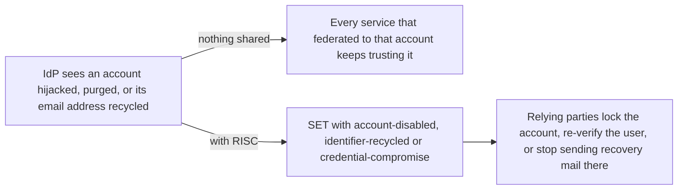
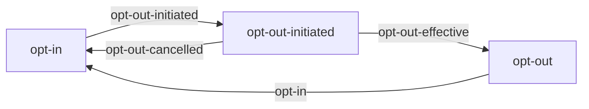
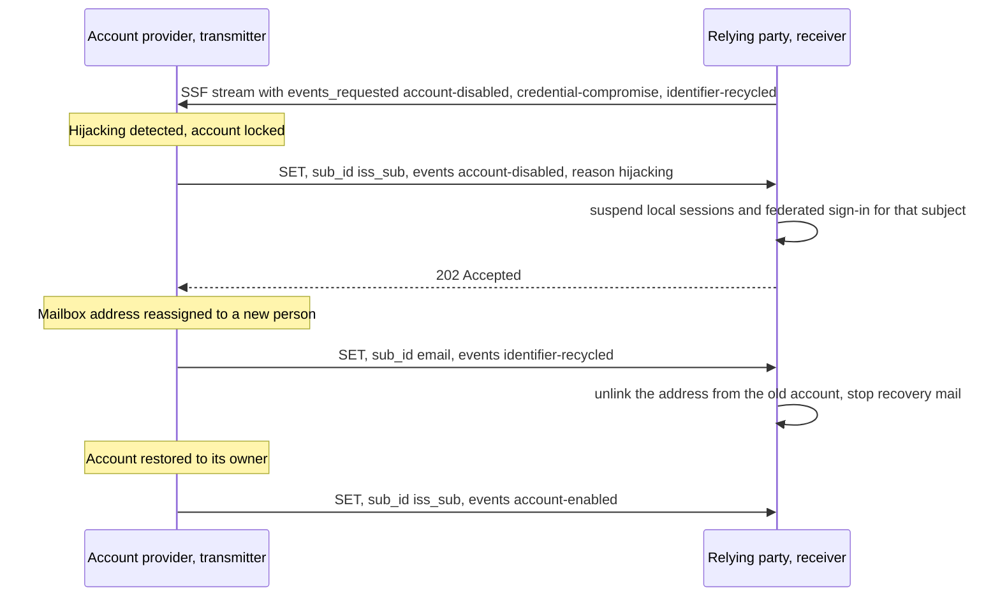

# Risk Incident Sharing and Coordination (RISC)

> In one line: RISC is the set of SSF event types about the account itself, disabled, purged, credential compromised, identifier recycled, recovery changed, so every provider that trusts that account can react before an attacker moves sideways.

## When you reach for it

- **An identity provider disables an account because it was hijacked**: `account-disabled` with `reason` `hijacking` tells relying parties the account was disabled and why; `account-enabled` later says it is enabled again (Sections 2.3 and 2.4).
- **An email provider hands a dormant address to a new person**: `identifier-recycled` with an `email` subject says the identifier now belongs to a new user, so services keyed on that address stop treating its owner as the previous customer (Section 2.6).
- **A password turns up in a breach dump**: `credential-compromise` with `credential_type` `password` lets other providers that accepted that password force a change (Section 2.7).
- **A user renames their mailbox at the provider that owns the domain**: only the authoritative provider sends `identifier-changed` with `new-value`; a service where that address is merely a username or recovery option sends `recovery-information-changed` instead (Sections 2.5 and 2.10).
- **A user asks to stop RISC sharing, but a hijacker must not be able to silence it instantly**: the `opt-out-initiated` state keeps events flowing for a period before `opt-out-effective` (Section 2.8).

## The problem it solves

Accounts are chained. A consumer identity provider account is the recovery path for mail, the login for dozens of relying parties, and the owner of an email address that other services use as a username. When that account is compromised, purged or re-assigned, each dependent service finds out on its own schedule, usually too late. RISC defines event types and their contents based on the Shared Signals Framework that are required to implement Risk Incident Sharing and Coordination (Section 1): the account's provider states what happened, and dependents decide what to do.

RISC events are SSF SETs. CAEP covers sessions, tokens, credentials and devices; RISC covers the lifecycle of the account and its identifiers, and the two share subject identifiers and the `credential_type` vocabulary (Sections 2 and 2.7).

## How it works

The transmitter is the provider that is authoritative for the account or identifier. Each event is a SET whose `events` member is a RISC event type URI under `https://schemas.openid.net/secevent/risc/event-type/` and whose `sub_id` identifies the account with an `iss_sub` subject, or the identifier itself with an `email` or `phone` subject (Sections 2, 2.3, 2.5 and 2.6). Most events carry no attributes at all; `account-disabled` may carry `reason` (`hijacking` or `bulk-account`), `identifier-changed` may carry `new-value`, and `credential-compromise` carries `credential_type` plus optional `event_timestamp`, `reason_admin` and `reason_user` (Sections 2.3, 2.5 and 2.7). Opt-out is modelled as state: `opt-in`, `opt-out-initiated`, `opt-out-cancelled` and `opt-out-effective` events announce each transition (Section 2.8).

## What the spec requires

- The base URI for RISC event types is `https://schemas.openid.net/secevent/risc/event-type/` (Section 2).
- `identifier-changed` MUST use an `email` or `phone` subject that carries the old value, SHOULD be issued only by the provider authoritative over that identifier, and MAY carry `new-value` (Section 2.5).
- `identifier-recycled` MUST use an `email` or `phone` subject (Section 2.6).
- `credential-compromise` REQUIRES `credential_type`, whose value must be one of those defined for the CAEP `credential-change` event (Section 2.7).
- Users SHOULD be allowed to opt in and out of RISC events for their accounts, both transmitters and receivers SHOULD manage opt-out state, and transmitters send the opt-out events when the state changes (Section 2.8).
- `sessions-revoked` is deprecated; new implementations MUST use the CAEP `session-revoked` event (Section 2.11).
- The field name `subject_type` is deprecated; new services MUST NOT use it, and the field name is `format` (Section 3.1).
- Implementations SHOULD comply with the Shared Signals Framework (Section 4).

## Watch out

- **Google's RISC transmitter still uses `subject_type`** instead of `format`; a receiver that wants Google's events needs a workaround written so that it does not break when Google conforms (Section 3.1).
- **`opt-out-initiated` is deliberate delay**: for practical security reasons events keep flowing for a period after the user asks out, so a hijacker cannot immediately opt the victim out of RISC (Section 2.8).
- **`account-disabled` is not final**: the spec notes the account may be enabled in the future, which `account-enabled` signals (Sections 2.3 and 2.4).
- **Pick the right identifier event**: a changed username or recovery address at a non-authoritative provider is `recovery-information-changed`, not `identifier-changed` (Sections 2.5 and 2.10).
- **Without SSF the events are unsafe**: exchanging these events without complying with SSF may result in security issues (Section 4).

## Sources

- [OpenID RISC 1.0, Section 1](https://openid.net/specs/openid-risc-1_0-final.html#section-1)
- [OpenID RISC 1.0, Section 2](https://openid.net/specs/openid-risc-1_0-final.html#section-2)
- [OpenID RISC 1.0, Section 2.3](https://openid.net/specs/openid-risc-1_0-final.html#section-2.3)
- [OpenID RISC 1.0, Section 2.4](https://openid.net/specs/openid-risc-1_0-final.html#section-2.4)
- [OpenID RISC 1.0, Section 2.5](https://openid.net/specs/openid-risc-1_0-final.html#section-2.5)
- [OpenID RISC 1.0, Section 2.6](https://openid.net/specs/openid-risc-1_0-final.html#section-2.6)
- [OpenID RISC 1.0, Section 2.7](https://openid.net/specs/openid-risc-1_0-final.html#section-2.7)
- [OpenID RISC 1.0, Section 2.8](https://openid.net/specs/openid-risc-1_0-final.html#section-2.8)
- [OpenID RISC 1.0, Section 2.10](https://openid.net/specs/openid-risc-1_0-final.html#section-2.10)
- [OpenID RISC 1.0, Section 2.11](https://openid.net/specs/openid-risc-1_0-final.html#section-2.11)
- [OpenID RISC 1.0, Section 3.1](https://openid.net/specs/openid-risc-1_0-final.html#section-3.1)
- [OpenID RISC 1.0, Section 4](https://openid.net/specs/openid-risc-1_0-final.html#section-4)
