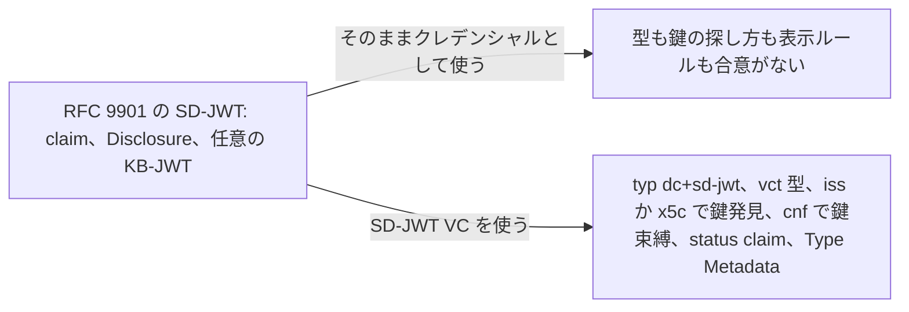
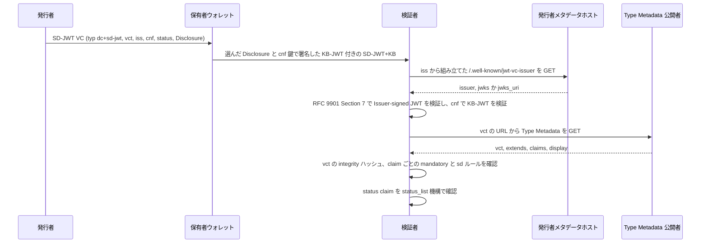

# SD-JWT-based Verifiable Credentials (SD-JWT VC)

> 一言で言うと: RFC 9901 の SD-JWT をクレデンシャルにする仕様。「何のクレデンシャルか」を表す `vct`、`iss`・`cnf`・`status` の扱いの固定、そして検証者が発行者の鍵を見つける 2 つの方法を足す。

## どういうときに使うか

- **政府や大学がモバイルウォレットにクレデンシャルを発行する**: 保有者は後で一部の claim だけを開示するが、検証者は `vct` が型とそのルールを名指ししているので、それが何のクレデンシャルかを判別できる (Section 1.2、Section 2.2.2.1)。
- **提示している人物が発行先本人だと検証者が確認したい**: 発行者が保有者の鍵を `cnf` に入れ、保有者は提示時にその鍵で KB-JWT に署名する (Section 1.1、Section 2.2.2.3)。
- **発行者の設定を事前共有していない検証者**: `iss` が HTTPS URL なら `/.well-known/jwt-vc-issuer` から鍵を取り、ヘッダに `x5c` があれば検証者が既に信頼するトラストアンカーまでチェーンを検証する (Section 2.5、Section 4)。
- **型の定義主体が発行者ではなく標準化団体**: `vct` の URL から取得する Type Metadata が、必須 claim、選択的開示の要否、表示方法を定め、`vct#integrity` でその文書のハッシュを固定する (Section 5、Section 6)。

## 解決する問題

RFC 9901 は JWT の claim を隠したり開示したりする方法を定めるが、クレデンシャルが持つべき claim、検証者が発行者の公開鍵を知る方法、そのクレデンシャルが何を意味するかは定めない (Section 1.2)。これがないと、ウォレット・発行者・検証者の組み合わせごとに帯域外で合意するしかなく、未知の発行者から SD-JWT を受け取った検証者はまったく検証できない。

SD-JWT VC はヘッダ (`typ: dc+sd-jwt`)、隠してはいけない claim (`iss`、`nbf`、`exp`、`cnf`、`vct`、`status`)、鍵発見の仕組み、そして初見の型でも保有者が表示でき検証者が検証できる任意の Type Metadata 文書を固定する (Section 2.2、Section 2.5、Section 5)。

## 仕組み

発行者はヘッダ `typ: dc+sd-jwt`、ペイロードに `vct` と必要に応じて `iss`・`cnf`・`exp`・`status` を持つ SD-JWT に署名する (Section 2.2.1、Section 2.2.2.3)。保有者は開示する Disclosure を選んで SD-JWT+KB として提示する。検証者は RFC 9901 に従って検証し、発行者鍵のチェックはポリシーが許す仕組みで満たす。`iss` から組み立てた well-known パスの JWT VC Issuer Metadata から `jwks` か `jwks_uri` の鍵を取るか (Section 4)、`x5c` の末端証明書をトラストアンカーまで検証するか (Section 2.5) のどちらかだ。`cnf` があり鍵束縛が必要なら、その鍵で KB-JWT を検証する (Section 2.4)。その後、検証者は `vct` の URL から Type Metadata を取得し、`extends` をたどり、`vct#integrity` を確認し、`claims` のルールを適用できる (Section 5.3、Section 5.4、Section 5.7、Section 6)。

## 仕様が求めること

- ヘッダ `typ` は `dc+sd-jwt` でなければならず、メディアタイプを使う場合は `application/dc+sd-jwt` でなければならない (Section 2.1、Section 2.2.1)。
- `vct` は必須で、大文字小文字を区別する Collision-Resistant Name でなければならない。`iss`、`nbf`、`exp`、`cnf`、`vct`、`vct#integrity`、`aka_vcts`、`status` は選択的開示にしてはならず、`sub` と `iat` は選択的開示にしてよい (Section 2.2.2.1、Section 2.2.2.3)。
- 暗号学的な鍵束縛をサポートするなら `cnf` は必須で、KB-JWT はその鍵で保護されなければならない (Section 2.2.2.3、Section 2.4)。
- 受信者は許可された鍵発見の仕組みで発行者の鍵を決定・検証しなければならない。仕様が定めるのは JWT VC Issuer Metadata (HTTPS の `iss`) と inline X.509 (トラストアンカーに対して検証する `x5c`) の 2 つ。どの仕組みでも鍵を検証できなければ SD-JWT VC を拒否しなければならない (Section 2.5)。
- JWT VC Issuer Metadata は `jwks_uri` か `jwks` のどちらか一方だけを含まなければならず、`issuer` は JWT の `iss` と同一でなければならない。不一致なら応答を使ってはならない (Section 4.2、Section 4.3)。
- 取得した Type Metadata の `vct` は取得に使った参照と同一でなければならない。Type Metadata を処理するなら親から順に完全に処理しなければならず、claim metadata の検証に失敗したら拒否しなければならない (Section 5.3、Section 5.4、Section 5.7)。
- `#integrity` の値は W3C SRI の integrity 文字列で、ダイジェスト不一致なら文書を拒否しなければならない。参照解決する URL はすべて `https:` でなければならず、取得は時間と容量を制限しなければならない (Section 3、Section 6)。

## 注意点

- **SSRF**: `iss` や `vct` から組み立てる URL は攻撃者が制御できる。消費者はリダイレクト先を含むすべての URL を検証しなければならず、内部アドレスやグローバルに到達できないアドレスに接続してはならない (Section 7.1)。
- **鍵発見の取り違え**: ある発行者に対してどの検証手順を使うかを攻撃者が選べてはならない。各仕組みは自分の入力しか認証しない。`x5c` 経由なら `iss` claim は認証されておらず、Issuer Metadata 経由なら `x5c` ヘッダは発行者を識別しない (Section 7.3)。
- **型の継承は発行権限ではない**: 型が `urn:example:eudi:pid` を extends していても、`aka_vcts` に列挙していても、その発行者がその型を発行してよいかは分からない。検証者は型階層とは独立に発行者の権限を確認しなければならない (Section 7.7)。
- **循環する `extends`** は検出してクレデンシャルを拒否しなければならない。オフライン利用やメタデータサーバー障害に備えて、消費者はローカルキャッシュを持つべきである (Section 7.4、Section 7.5)。
- **プライバシー**: `vct` と `aka_vcts` は選択的開示できないので、居住国や国籍のような属性が漏れない型識別子を選ぶ。保有者ごとに固有の `iss` を使えば悪意ある発行者は検証のたびに phone home でき、鍵を遠隔取得する `cnf` 方式 (`jku`、`x5u`) も同じ (Section 8.2、Section 8.3)。

## 出典

- [draft-ietf-oauth-sd-jwt-vc, Section 1.1](https://datatracker.ietf.org/doc/html/draft-ietf-oauth-sd-jwt-vc#section-1.1)
- [draft-ietf-oauth-sd-jwt-vc, Section 1.2](https://datatracker.ietf.org/doc/html/draft-ietf-oauth-sd-jwt-vc#section-1.2)
- [draft-ietf-oauth-sd-jwt-vc, Section 2.1](https://datatracker.ietf.org/doc/html/draft-ietf-oauth-sd-jwt-vc#section-2.1)
- [draft-ietf-oauth-sd-jwt-vc, Section 2.2](https://datatracker.ietf.org/doc/html/draft-ietf-oauth-sd-jwt-vc#section-2.2)
- [draft-ietf-oauth-sd-jwt-vc, Section 2.2.1](https://datatracker.ietf.org/doc/html/draft-ietf-oauth-sd-jwt-vc#section-2.2.1)
- [draft-ietf-oauth-sd-jwt-vc, Section 2.2.2.1](https://datatracker.ietf.org/doc/html/draft-ietf-oauth-sd-jwt-vc#section-2.2.2.1)
- [draft-ietf-oauth-sd-jwt-vc, Section 2.2.2.3](https://datatracker.ietf.org/doc/html/draft-ietf-oauth-sd-jwt-vc#section-2.2.2.3)
- [draft-ietf-oauth-sd-jwt-vc, Section 2.4](https://datatracker.ietf.org/doc/html/draft-ietf-oauth-sd-jwt-vc#section-2.4)
- [draft-ietf-oauth-sd-jwt-vc, Section 2.5](https://datatracker.ietf.org/doc/html/draft-ietf-oauth-sd-jwt-vc#section-2.5)
- [draft-ietf-oauth-sd-jwt-vc, Section 3](https://datatracker.ietf.org/doc/html/draft-ietf-oauth-sd-jwt-vc#section-3)
- [draft-ietf-oauth-sd-jwt-vc, Section 4](https://datatracker.ietf.org/doc/html/draft-ietf-oauth-sd-jwt-vc#section-4)
- [draft-ietf-oauth-sd-jwt-vc, Section 4.2](https://datatracker.ietf.org/doc/html/draft-ietf-oauth-sd-jwt-vc#section-4.2)
- [draft-ietf-oauth-sd-jwt-vc, Section 4.3](https://datatracker.ietf.org/doc/html/draft-ietf-oauth-sd-jwt-vc#section-4.3)
- [draft-ietf-oauth-sd-jwt-vc, Section 5](https://datatracker.ietf.org/doc/html/draft-ietf-oauth-sd-jwt-vc#section-5)
- [draft-ietf-oauth-sd-jwt-vc, Section 5.3](https://datatracker.ietf.org/doc/html/draft-ietf-oauth-sd-jwt-vc#section-5.3)
- [draft-ietf-oauth-sd-jwt-vc, Section 5.4](https://datatracker.ietf.org/doc/html/draft-ietf-oauth-sd-jwt-vc#section-5.4)
- [draft-ietf-oauth-sd-jwt-vc, Section 5.7](https://datatracker.ietf.org/doc/html/draft-ietf-oauth-sd-jwt-vc#section-5.7)
- [draft-ietf-oauth-sd-jwt-vc, Section 6](https://datatracker.ietf.org/doc/html/draft-ietf-oauth-sd-jwt-vc#section-6)
- [draft-ietf-oauth-sd-jwt-vc, Section 7.1](https://datatracker.ietf.org/doc/html/draft-ietf-oauth-sd-jwt-vc#section-7.1)
- [draft-ietf-oauth-sd-jwt-vc, Section 7.3](https://datatracker.ietf.org/doc/html/draft-ietf-oauth-sd-jwt-vc#section-7.3)
- [draft-ietf-oauth-sd-jwt-vc, Section 7.4](https://datatracker.ietf.org/doc/html/draft-ietf-oauth-sd-jwt-vc#section-7.4)
- [draft-ietf-oauth-sd-jwt-vc, Section 7.5](https://datatracker.ietf.org/doc/html/draft-ietf-oauth-sd-jwt-vc#section-7.5)
- [draft-ietf-oauth-sd-jwt-vc, Section 7.7](https://datatracker.ietf.org/doc/html/draft-ietf-oauth-sd-jwt-vc#section-7.7)
- [draft-ietf-oauth-sd-jwt-vc, Section 8.2](https://datatracker.ietf.org/doc/html/draft-ietf-oauth-sd-jwt-vc#section-8.2)
- [draft-ietf-oauth-sd-jwt-vc, Section 8.3](https://datatracker.ietf.org/doc/html/draft-ietf-oauth-sd-jwt-vc#section-8.3)
