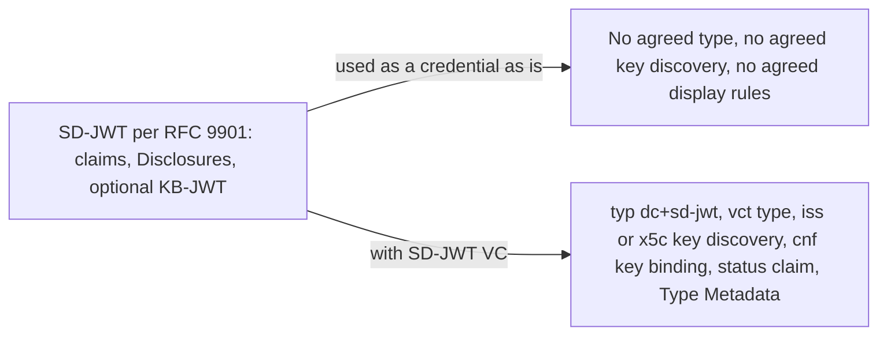
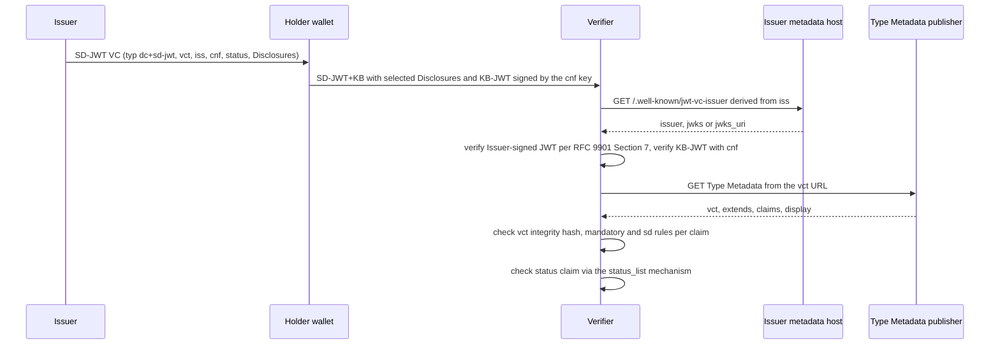

# SD-JWT-based Verifiable Credentials (SD-JWT VC)

> In one line: Takes an RFC 9901 SD-JWT and turns it into a credential: a `vct` type that says what the credential means, fixed rules for `iss`, `cnf` and `status`, and two ways for a verifier to find the issuer's key.

## When you reach for it

- **A government or university issuing a credential into a mobile wallet**: the holder later shows only some claims, and the verifier still knows what kind of credential it is because `vct` names the type and its rules (Section 1.2, Section 2.2.2.1).
- **A verifier that must know the presenter is the person the credential was issued to**: the issuer puts the holder's key in `cnf`, and the holder signs a KB-JWT with it at presentation time (Section 1.1, Section 2.2.2.3).
- **A verifier with no pre-shared issuer configuration**: if `iss` is an HTTPS URL, the key comes from `/.well-known/jwt-vc-issuer`; if the header carries `x5c`, the chain is validated to a trust anchor the verifier trusts (Section 2.5, Section 4).
- **A credential type defined by a standards body rather than the issuer**: Type Metadata fetched from the `vct` URL says which claims are mandatory or selectively disclosable and how to render the credential, and `vct#integrity` pins its hash (Section 5, Section 6).

## The problem it solves

RFC 9901 defines how to hide and reveal claims in a JWT, but not which claims a credential must carry, how a verifier learns the issuer's public key, or what the credential means (Section 1.2). Without that, every pair of parties has to agree out of band, and an SD-JWT from an unknown issuer cannot be validated at all.

SD-JWT VC fixes the header (`typ: dc+sd-jwt`), the claims that may not be hidden (`iss`, `nbf`, `exp`, `cnf`, `vct`, `status`), the key discovery mechanisms, and an optional Type Metadata document for displaying and validating a type the consumer has never seen (Section 2.2, Section 2.5, Section 5).

## How it works

The issuer signs an SD-JWT with header `typ: dc+sd-jwt` and a payload carrying `vct` plus, as needed, `iss`, `cnf`, `exp` and `status` (Section 2.2.1, Section 2.2.2.3). The holder presents it as an SD-JWT+KB with the Disclosures it chooses. The verifier validates it per RFC 9901 and satisfies the issuer-key check through a mechanism its policy permits: JWT VC Issuer Metadata at the well-known path built from `iss`, taking the key from `jwks` or `jwks_uri` (Section 4), or the end-entity certificate in `x5c` validated to a trust anchor (Section 2.5). With `cnf` present and key binding required, the KB-JWT is verified with that key (Section 2.4). The verifier may then fetch Type Metadata from the `vct` URL, follow `extends`, check `vct#integrity`, and apply the `claims` rules (Section 5.3, Section 5.4, Section 5.7, Section 6).

## What the spec requires

- The `typ` header MUST be `dc+sd-jwt`, and the media type, where used, MUST be `application/dc+sd-jwt` (Section 2.1, Section 2.2.1).
- `vct` is REQUIRED and MUST be a case-sensitive Collision-Resistant Name; `iss`, `nbf`, `exp`, `cnf`, `vct`, `vct#integrity`, `aka_vcts` and `status` MUST NOT be selectively disclosed, while `sub` and `iat` MAY be (Section 2.2.2.1, Section 2.2.2.3).
- `cnf` is REQUIRED when cryptographic key binding is supported, and the KB-JWT MUST be secured by the key it identifies (Section 2.2.2.3, Section 2.4).
- The recipient MUST validate the issuer's key through a permitted key discovery mechanism, either JWT VC Issuer Metadata (HTTPS `iss`) or inline X.509 (`x5c` validated against a trust anchor); otherwise the SD-JWT VC MUST be rejected (Section 2.5).
- JWT VC Issuer Metadata MUST include either `jwks_uri` or `jwks`, not both, and its `issuer` MUST equal the JWT's `iss`; on mismatch the response MUST NOT be used (Section 4.2, Section 4.3).
- A retrieved Type Metadata document's `vct` MUST equal the reference used to fetch it; if processed at all, Type Metadata MUST be fully processed, parents first, and a claim metadata validation failure MUST cause rejection (Section 5.3, Section 5.4, Section 5.7).
- Every `#integrity` value is a W3C SRI integrity string; a digest mismatch means the document MUST be rejected. All dereferenced URLs MUST use `https:` and retrievals MUST be time- and size-bound (Section 3, Section 6).

## Watch out

- **SSRF**: URLs built from `iss` and `vct` are attacker-controlled. The consumer MUST validate every URL, including each redirect target, and MUST NOT reach internal or non-globally-reachable addresses (Section 7.1).
- **Key discovery confusion**: an attacker must not be able to choose which verification process the verifier uses for an issuer. Each mechanism authenticates only its own input: under `x5c` the `iss` claim is unauthenticated, and under Issuer Metadata an `x5c` header does not identify the issuer (Section 7.3).
- **Type extension is not authorization**: a credential whose type extends `urn:example:eudi:pid`, or lists it in `aka_vcts`, says nothing about whether the issuer may issue that type. Verifiers MUST check issuer authority independently of the type hierarchy (Section 7.7).
- **Circular `extends` chains** MUST be detected and the credential rejected; consumers SHOULD keep a local metadata cache so offline use and metadata outages do not break verification (Section 7.4, Section 7.5).
- **Privacy**: `vct` and `aka_vcts` are never selectively disclosable, so pick type identifiers that do not leak attributes such as country of residency or citizenship. A holder-specific `iss`, or a `cnf` method that fetches keys remotely (`jku`, `x5u`), lets a malicious issuer phone home on every verification (Section 8.2, Section 8.3).

## Sources

- [draft-ietf-oauth-sd-jwt-vc, Section 1.1](https://datatracker.ietf.org/doc/html/draft-ietf-oauth-sd-jwt-vc#section-1.1)
- [draft-ietf-oauth-sd-jwt-vc, Section 1.2](https://datatracker.ietf.org/doc/html/draft-ietf-oauth-sd-jwt-vc#section-1.2)
- [draft-ietf-oauth-sd-jwt-vc, Section 2.1](https://datatracker.ietf.org/doc/html/draft-ietf-oauth-sd-jwt-vc#section-2.1)
- [draft-ietf-oauth-sd-jwt-vc, Section 2.2](https://datatracker.ietf.org/doc/html/draft-ietf-oauth-sd-jwt-vc#section-2.2)
- [draft-ietf-oauth-sd-jwt-vc, Section 2.2.1](https://datatracker.ietf.org/doc/html/draft-ietf-oauth-sd-jwt-vc#section-2.2.1)
- [draft-ietf-oauth-sd-jwt-vc, Section 2.2.2.1](https://datatracker.ietf.org/doc/html/draft-ietf-oauth-sd-jwt-vc#section-2.2.2.1)
- [draft-ietf-oauth-sd-jwt-vc, Section 2.2.2.3](https://datatracker.ietf.org/doc/html/draft-ietf-oauth-sd-jwt-vc#section-2.2.2.3)
- [draft-ietf-oauth-sd-jwt-vc, Section 2.4](https://datatracker.ietf.org/doc/html/draft-ietf-oauth-sd-jwt-vc#section-2.4)
- [draft-ietf-oauth-sd-jwt-vc, Section 2.5](https://datatracker.ietf.org/doc/html/draft-ietf-oauth-sd-jwt-vc#section-2.5)
- [draft-ietf-oauth-sd-jwt-vc, Section 3](https://datatracker.ietf.org/doc/html/draft-ietf-oauth-sd-jwt-vc#section-3)
- [draft-ietf-oauth-sd-jwt-vc, Section 4](https://datatracker.ietf.org/doc/html/draft-ietf-oauth-sd-jwt-vc#section-4)
- [draft-ietf-oauth-sd-jwt-vc, Section 4.2](https://datatracker.ietf.org/doc/html/draft-ietf-oauth-sd-jwt-vc#section-4.2)
- [draft-ietf-oauth-sd-jwt-vc, Section 4.3](https://datatracker.ietf.org/doc/html/draft-ietf-oauth-sd-jwt-vc#section-4.3)
- [draft-ietf-oauth-sd-jwt-vc, Section 5](https://datatracker.ietf.org/doc/html/draft-ietf-oauth-sd-jwt-vc#section-5)
- [draft-ietf-oauth-sd-jwt-vc, Section 5.3](https://datatracker.ietf.org/doc/html/draft-ietf-oauth-sd-jwt-vc#section-5.3)
- [draft-ietf-oauth-sd-jwt-vc, Section 5.4](https://datatracker.ietf.org/doc/html/draft-ietf-oauth-sd-jwt-vc#section-5.4)
- [draft-ietf-oauth-sd-jwt-vc, Section 5.7](https://datatracker.ietf.org/doc/html/draft-ietf-oauth-sd-jwt-vc#section-5.7)
- [draft-ietf-oauth-sd-jwt-vc, Section 6](https://datatracker.ietf.org/doc/html/draft-ietf-oauth-sd-jwt-vc#section-6)
- [draft-ietf-oauth-sd-jwt-vc, Section 7.1](https://datatracker.ietf.org/doc/html/draft-ietf-oauth-sd-jwt-vc#section-7.1)
- [draft-ietf-oauth-sd-jwt-vc, Section 7.3](https://datatracker.ietf.org/doc/html/draft-ietf-oauth-sd-jwt-vc#section-7.3)
- [draft-ietf-oauth-sd-jwt-vc, Section 7.4](https://datatracker.ietf.org/doc/html/draft-ietf-oauth-sd-jwt-vc#section-7.4)
- [draft-ietf-oauth-sd-jwt-vc, Section 7.5](https://datatracker.ietf.org/doc/html/draft-ietf-oauth-sd-jwt-vc#section-7.5)
- [draft-ietf-oauth-sd-jwt-vc, Section 7.7](https://datatracker.ietf.org/doc/html/draft-ietf-oauth-sd-jwt-vc#section-7.7)
- [draft-ietf-oauth-sd-jwt-vc, Section 8.2](https://datatracker.ietf.org/doc/html/draft-ietf-oauth-sd-jwt-vc#section-8.2)
- [draft-ietf-oauth-sd-jwt-vc, Section 8.3](https://datatracker.ietf.org/doc/html/draft-ietf-oauth-sd-jwt-vc#section-8.3)
