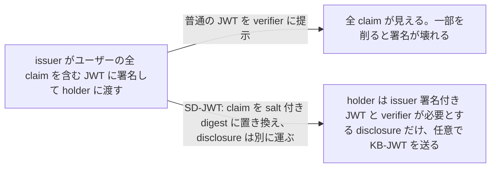
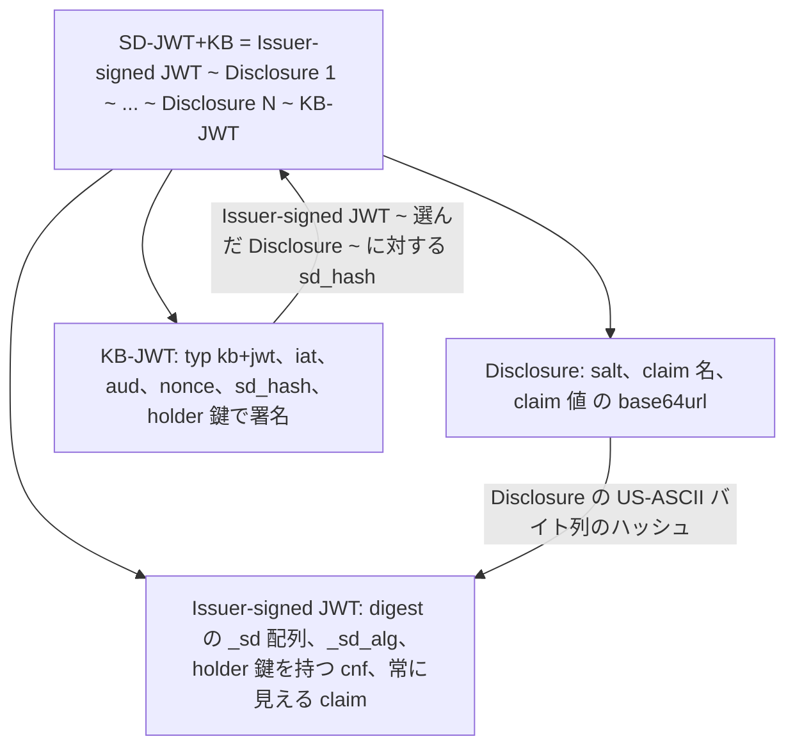

# Selective Disclosure for JWTs (SD-JWT)

> 一言で言うと: issuer が claim を salt 付きハッシュに置き換えた JWT に署名し、holder は後で verifier が必要とする claim だけを開示する。任意で、束縛された鍵を持っていることも証明できる。

## どういうときに使うか

- **credential を一度発行して何度も提示する**: 多くの claim を持つ JWT が holder に渡り、各 verifier は求めた disclosure だけを受け取る。issuer の署名はそのまま検証できる (Section 1、3.1、3.2)。
- **提示者が正当な holder であることを verifier が確かめたい**: issuer が holder の公開鍵を `cnf` に入れ、holder は `nonce` と verifier を指す `aud` を含む Key Binding JWT で提示に署名する (Section 3.3、4.1.2、4.3)。
- **credential が隠している claim の数を verifier に知られたくない**: decoy digest で `_sd` 配列を水増しし、本物の claim の数を見えなくする (Section 4.2.5、10.4)。
- **credential が verifier をまたぐ追跡トークンになってはいけない**: unlinkability は credential ごとの新しい salt と Key Binding 鍵にかかっており、batch issuance で holder は verifier ごとに別の credential を使える (Section 10.1)。

## 解決する問題

JWT は全体に署名されるので、名前と住所も入った credential から生年月日だけを verifier に見せたい holder には、悪い選択肢が 2 つしかない。全部見せるか、issuer に新しいトークンをもらいに戻るかだ。SD-JWT は salted hash の上に作られている。issuer は選択的に開示できる各 claim の digest を署名付きペイロードに入れ、claim の実際の salt・名前・値は別の Disclosure で運ぶ (Section 1、3.1)。Disclosure は署名を壊さずに省略でき、改変は検出できる (Section 3.1)。

仕様は 2 つの形式を定める。SD-JWT は Issuer-signed JWT と 0 個以上の Disclosure。SD-JWT+KB はそれに Key Binding JWT を足したもので、verifier は提示者が issuer が credential に束縛した鍵を制御していることを確かめられる (Section 1.1)。

## 仕組み

Issuer-signed JWT は issuer の秘密鍵で署名しなければならない (Section 4.1)。選択的に開示できる object property ごとに issuer は Disclosure を作る。salt・claim 名・claim 値の JSON 配列を base64url にしたもので、配列要素の場合は salt と値の 2 要素配列になる (Section 4.2.1、4.2.2)。digest は base64url 化した Disclosure の US-ASCII バイト列に対して計算し (Section 4.2.3)、`_sd` 配列に入れる。issuer はその順序を隠さなければならない (Section 4.2.4.1)。`_sd_alg` は Named Information Hash Algorithm Registry のハッシュアルゴリズム名で、既定は `sha-256` (Section 4.1.1)。holder の公開鍵かその参照は `cnf` に入る (Section 4.1.2)。compact 形式はすべてを `~` で連結し、素の SD-JWT は末尾の `~` で終わる。これで 2 つの形式を見分ける (Section 4)。KB-JWT は `typ` に `kb+jwt` を持ち、必須 claim は `iat`、`aud`、`nonce`、`sd_hash`。`sd_hash` は Disclosure と同じアルゴリズムで、Issuer-signed JWT と選んだ Disclosure に対して計算した digest だ (Section 4.3、4.3.1)。

## 仕様が求めること

- salt は選択的に開示する claim ごとに一意でなければならず (MUST)、claim 名は `_sd`、`...`、または同じ object に常時開示の claim として既にある名前であってはならない (MUST NOT) (Section 4.2.1)。
- トップレベルに `_sd_alg` がなければ `sha-256` を使わなければならない (MUST) (Section 4.1.1)。
- SD-JWT を処理する holder と verifier は、同じ digest 値が 2 回以上現れたら、あるいは digest から参照されない Disclosure があったら、拒否しなければならない (MUST)。対応する Disclosure のない digest は無視しなければならない (MUST)。処理後のペイロードで `nbf`、`exp`、`aud` を確認する (Section 7.1)。
- holder は SD-JWT+KB を受け取ったら拒否しなければならない (MUST) (Section 7.2)。
- verifier は検証の前に Key Binding が必要かを決めなければならず (MUST)、その判断は holder が KB-JWT を出したかどうかに依存してはならない (MUST NOT)。必要なのに無ければ提示を拒否しなければならない (MUST)。KB-JWT は holder の鍵で検証し、`none` は受け付けてはならず (MUST NOT)、`typ` が `kb+jwt`、`iat` が許容範囲内、`nonce` と `aud` が妥当、`sd_hash` を再計算して一致することを確認する (Section 7.3、9.5)。
- JWS JSON Serialization 形式のサポートは任意 (OPTIONAL) (Section 8)。

## 注意点

- JWT は issuer が署名しなければならず (MUST)、verifier は Disclosure を検査して claim の値が正しいことを確かめなければならない (MUST) (Section 9.1、9.2)。
- 各 salt は暗号学的に乱数で十分長くなければならない (MUST)。推奨される最小値は乱数部分 128 bit で、ハッシュ関数は第二原像計算困難でなければならない (MUST) (Section 9.3、9.4)。
- issuer は、credential の有効性評価に不可欠な内容を選択的開示の対象にしてはならない (MUST NOT) (Section 9.7)。
- Key Binding がなければ、SD-JWT を持つ誰でも Key Binding を強制しない第三者に転送でき、Disclosure の追加や削除で SD-JWT を改変しても有効なままになる (Section 9.9、9.10)。
- application profile は、Issuer-signed JWT に `application/example+sd-jwt` 形式の media type で明示的な `typ` を設定することが推奨される (RECOMMENDED) (Section 9.11)。
- 仕様は機密性を提供しない。ユーザーデータのプライバシーや受動的な観測者による相関が懸念されるなら、実装者はトランスポートが機密性を提供することを保証しなければならない (MUST)。batch の各 credential には新しい Key Binding 鍵と salt を使わなければならない (MUST) (Section 10.1、10.3)。

## 出典

- [RFC 9901, Section 1](https://www.rfc-editor.org/rfc/rfc9901.html#section-1)
- [RFC 9901, Section 1.1](https://www.rfc-editor.org/rfc/rfc9901.html#section-1.1)
- [RFC 9901, Section 3.1](https://www.rfc-editor.org/rfc/rfc9901.html#section-3.1)
- [RFC 9901, Section 3.2](https://www.rfc-editor.org/rfc/rfc9901.html#section-3.2)
- [RFC 9901, Section 3.3](https://www.rfc-editor.org/rfc/rfc9901.html#section-3.3)
- [RFC 9901, Section 4](https://www.rfc-editor.org/rfc/rfc9901.html#section-4)
- [RFC 9901, Section 4.1](https://www.rfc-editor.org/rfc/rfc9901.html#section-4.1)
- [RFC 9901, Section 4.1.1](https://www.rfc-editor.org/rfc/rfc9901.html#section-4.1.1)
- [RFC 9901, Section 4.1.2](https://www.rfc-editor.org/rfc/rfc9901.html#section-4.1.2)
- [RFC 9901, Section 4.2.1](https://www.rfc-editor.org/rfc/rfc9901.html#section-4.2.1)
- [RFC 9901, Section 4.2.2](https://www.rfc-editor.org/rfc/rfc9901.html#section-4.2.2)
- [RFC 9901, Section 4.2.3](https://www.rfc-editor.org/rfc/rfc9901.html#section-4.2.3)
- [RFC 9901, Section 4.2.4.1](https://www.rfc-editor.org/rfc/rfc9901.html#section-4.2.4.1)
- [RFC 9901, Section 4.2.5](https://www.rfc-editor.org/rfc/rfc9901.html#section-4.2.5)
- [RFC 9901, Section 4.3](https://www.rfc-editor.org/rfc/rfc9901.html#section-4.3)
- [RFC 9901, Section 4.3.1](https://www.rfc-editor.org/rfc/rfc9901.html#section-4.3.1)
- [RFC 9901, Section 7.1](https://www.rfc-editor.org/rfc/rfc9901.html#section-7.1)
- [RFC 9901, Section 7.2](https://www.rfc-editor.org/rfc/rfc9901.html#section-7.2)
- [RFC 9901, Section 7.3](https://www.rfc-editor.org/rfc/rfc9901.html#section-7.3)
- [RFC 9901, Section 8](https://www.rfc-editor.org/rfc/rfc9901.html#section-8)
- [RFC 9901, Section 9.1](https://www.rfc-editor.org/rfc/rfc9901.html#section-9.1)
- [RFC 9901, Section 9.2](https://www.rfc-editor.org/rfc/rfc9901.html#section-9.2)
- [RFC 9901, Section 9.3](https://www.rfc-editor.org/rfc/rfc9901.html#section-9.3)
- [RFC 9901, Section 9.4](https://www.rfc-editor.org/rfc/rfc9901.html#section-9.4)
- [RFC 9901, Section 9.5](https://www.rfc-editor.org/rfc/rfc9901.html#section-9.5)
- [RFC 9901, Section 9.7](https://www.rfc-editor.org/rfc/rfc9901.html#section-9.7)
- [RFC 9901, Section 9.9](https://www.rfc-editor.org/rfc/rfc9901.html#section-9.9)
- [RFC 9901, Section 9.10](https://www.rfc-editor.org/rfc/rfc9901.html#section-9.10)
- [RFC 9901, Section 9.11](https://www.rfc-editor.org/rfc/rfc9901.html#section-9.11)
- [RFC 9901, Section 10.1](https://www.rfc-editor.org/rfc/rfc9901.html#section-10.1)
- [RFC 9901, Section 10.3](https://www.rfc-editor.org/rfc/rfc9901.html#section-10.3)
- [RFC 9901, Section 10.4](https://www.rfc-editor.org/rfc/rfc9901.html#section-10.4)
