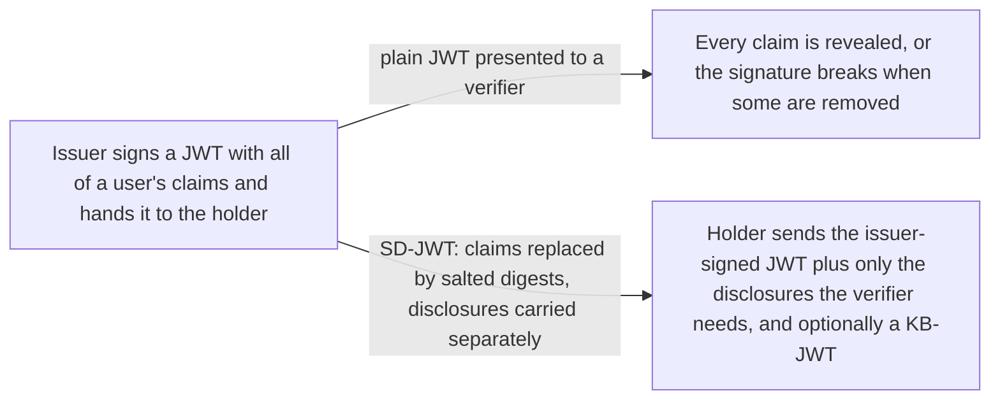
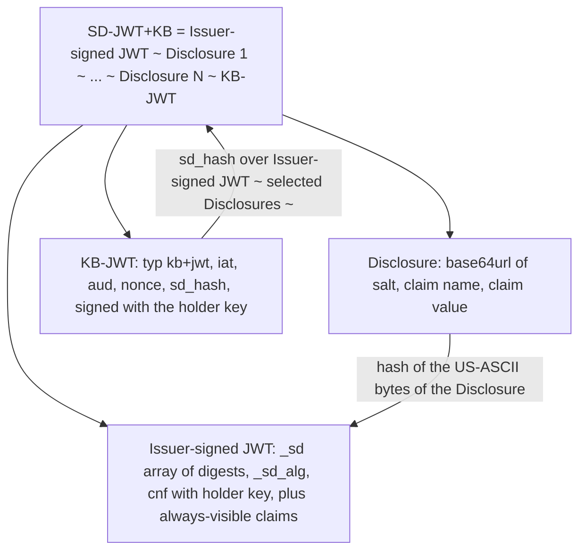

# Selective Disclosure for JWTs (SD-JWT)

> In one line: an issuer signs a JWT whose claims are replaced by salted hashes, so the holder can later reveal only the claims a verifier needs, optionally proving it holds the bound key.

## When you reach for it

- **A credential is issued once and presented many times**: a JWT with many claims goes to a holder, and each verifier gets only the disclosures it asks for while the issuer's signature still verifies (Sections 1, 3.1, 3.2).
- **A verifier must know the presenter is the legitimate holder**: the issuer puts the holder's public key in `cnf`, and the holder signs a Key Binding JWT over the presentation that carries a `nonce` and the verifier's `aud` (Sections 3.3, 4.1.2, 4.3).
- **Verifiers must not learn how many claims the credential hides**: decoy digests pad the `_sd` array so the count of real claims is not visible (Sections 4.2.5, 10.4).
- **A credential must not become a tracking token across verifiers**: unlinkability depends on fresh salts and Key Binding keys per credential, with batch issuance so the holder can use a different credential per verifier (Section 10.1).

## The problem it solves

A JWT is signed as a whole, so a holder who wants to show a verifier only a date of birth from a credential that also carries name and address has two bad options: show everything, or go back to the issuer for a new token. SD-JWT is built on salted hashes: the issuer puts a digest of each selectively disclosable claim into the signed payload, and the claim's actual salt, name and value travel in a separate Disclosure (Sections 1, 3.1). Disclosures can be omitted without breaking the signature, and modifications to them can be detected (Section 3.1).

The spec defines two formats. An SD-JWT is the Issuer-signed JWT plus zero or more Disclosures. An SD-JWT+KB adds a Key Binding JWT so the verifier can check that the presenter controls the key the issuer bound to the credential (Section 1.1).

## How it works

The Issuer-signed JWT must be signed with the issuer's private key (Section 4.1). For each selectively disclosable object property the issuer creates a Disclosure, a base64url-encoded JSON array of a salt, the claim name and the claim value; array elements use a two-element array of salt and value (Sections 4.2.1, 4.2.2). The digest is computed over the US-ASCII bytes of the base64url-encoded Disclosure (Section 4.2.3) and placed in an `_sd` array whose order the issuer must hide (Section 4.2.4.1). `_sd_alg` names the hash algorithm from the Named Information Hash Algorithm Registry, defaulting to `sha-256` (Section 4.1.1). The holder's public key, or a reference to it, sits in `cnf` (Section 4.1.2). The compact format joins everything with `~`, and a bare SD-JWT ends with a trailing `~`, which is how the two formats are told apart (Section 4). The KB-JWT carries `typ` of `kb+jwt` and the required claims `iat`, `aud`, `nonce` and `sd_hash`, where `sd_hash` is the digest, using the same algorithm as the Disclosures, over the Issuer-signed JWT and the selected Disclosures (Sections 4.3, 4.3.1).

## What the spec requires

- The salt MUST be unique for each selectively disclosed claim, and the claim name MUST NOT be `_sd`, `...`, or a name already present as a permanently disclosed claim in the same object (Section 4.2.1).
- If `_sd_alg` is absent at the top level, `sha-256` MUST be used (Section 4.1.1).
- Any holder or verifier processing an SD-JWT MUST reject it if any digest value is encountered more than once, or if any Disclosure was not referenced by a digest; a digest with no matching Disclosure MUST be ignored; `nbf`, `exp` and `aud` are checked on the processed payload (Section 7.1).
- A holder that receives an SD-JWT+KB MUST reject it (Section 7.2).
- A verifier MUST decide whether Key Binding is required before verifying, and that decision MUST NOT depend on whether the holder provided a KB-JWT. If required and missing, the verifier MUST reject the presentation; the KB-JWT must then verify with the holder key, `none` MUST NOT be accepted, `typ` must be `kb+jwt`, `iat` within an acceptable window, `nonce` and `aud` validated, and `sd_hash` recomputed and matched (Sections 7.3, 9.5).
- The JWS JSON Serialization form is OPTIONAL to support (Section 8).

## Watch out

- The JWT MUST be signed by the issuer; the verifier MUST check the Disclosures to ensure the claim values are correct (Sections 9.1, 9.2).
- Each salt MUST be cryptographically random and sufficiently long. The RECOMMENDED minimum is 128 bits of randomness, and the hash function MUST be second-preimage resistant (Sections 9.3, 9.4).
- An issuer MUST NOT make any claim selectively disclosable that is critical for evaluating the credential's validity (Section 9.7).
- Without Key Binding, anyone holding an SD-JWT can forward it to any third party that does not enforce Key Binding, and the SD-JWT can be modified by adding or removing Disclosures while staying valid (Sections 9.9, 9.10).
- Application profiles are RECOMMENDED to set an explicit `typ` on the Issuer-signed JWT with a media type of the form `application/example+sd-jwt` (Section 9.11).
- The spec provides no confidentiality: when user privacy or correlation by passive observers is a concern, implementers MUST ensure the transport protocol provides it. New Key Binding keys and salts MUST be used for each credential in a batch (Sections 10.1, 10.3).

## Sources

- [RFC 9901, Section 1](https://www.rfc-editor.org/rfc/rfc9901.html#section-1)
- [RFC 9901, Section 1.1](https://www.rfc-editor.org/rfc/rfc9901.html#section-1.1)
- [RFC 9901, Section 3.1](https://www.rfc-editor.org/rfc/rfc9901.html#section-3.1)
- [RFC 9901, Section 3.2](https://www.rfc-editor.org/rfc/rfc9901.html#section-3.2)
- [RFC 9901, Section 3.3](https://www.rfc-editor.org/rfc/rfc9901.html#section-3.3)
- [RFC 9901, Section 4](https://www.rfc-editor.org/rfc/rfc9901.html#section-4)
- [RFC 9901, Section 4.1](https://www.rfc-editor.org/rfc/rfc9901.html#section-4.1)
- [RFC 9901, Section 4.1.1](https://www.rfc-editor.org/rfc/rfc9901.html#section-4.1.1)
- [RFC 9901, Section 4.1.2](https://www.rfc-editor.org/rfc/rfc9901.html#section-4.1.2)
- [RFC 9901, Section 4.2.1](https://www.rfc-editor.org/rfc/rfc9901.html#section-4.2.1)
- [RFC 9901, Section 4.2.2](https://www.rfc-editor.org/rfc/rfc9901.html#section-4.2.2)
- [RFC 9901, Section 4.2.3](https://www.rfc-editor.org/rfc/rfc9901.html#section-4.2.3)
- [RFC 9901, Section 4.2.4.1](https://www.rfc-editor.org/rfc/rfc9901.html#section-4.2.4.1)
- [RFC 9901, Section 4.2.5](https://www.rfc-editor.org/rfc/rfc9901.html#section-4.2.5)
- [RFC 9901, Section 4.3](https://www.rfc-editor.org/rfc/rfc9901.html#section-4.3)
- [RFC 9901, Section 4.3.1](https://www.rfc-editor.org/rfc/rfc9901.html#section-4.3.1)
- [RFC 9901, Section 7.1](https://www.rfc-editor.org/rfc/rfc9901.html#section-7.1)
- [RFC 9901, Section 7.2](https://www.rfc-editor.org/rfc/rfc9901.html#section-7.2)
- [RFC 9901, Section 7.3](https://www.rfc-editor.org/rfc/rfc9901.html#section-7.3)
- [RFC 9901, Section 8](https://www.rfc-editor.org/rfc/rfc9901.html#section-8)
- [RFC 9901, Section 9.1](https://www.rfc-editor.org/rfc/rfc9901.html#section-9.1)
- [RFC 9901, Section 9.2](https://www.rfc-editor.org/rfc/rfc9901.html#section-9.2)
- [RFC 9901, Section 9.3](https://www.rfc-editor.org/rfc/rfc9901.html#section-9.3)
- [RFC 9901, Section 9.4](https://www.rfc-editor.org/rfc/rfc9901.html#section-9.4)
- [RFC 9901, Section 9.5](https://www.rfc-editor.org/rfc/rfc9901.html#section-9.5)
- [RFC 9901, Section 9.7](https://www.rfc-editor.org/rfc/rfc9901.html#section-9.7)
- [RFC 9901, Section 9.9](https://www.rfc-editor.org/rfc/rfc9901.html#section-9.9)
- [RFC 9901, Section 9.10](https://www.rfc-editor.org/rfc/rfc9901.html#section-9.10)
- [RFC 9901, Section 9.11](https://www.rfc-editor.org/rfc/rfc9901.html#section-9.11)
- [RFC 9901, Section 10.1](https://www.rfc-editor.org/rfc/rfc9901.html#section-10.1)
- [RFC 9901, Section 10.3](https://www.rfc-editor.org/rfc/rfc9901.html#section-10.3)
- [RFC 9901, Section 10.4](https://www.rfc-editor.org/rfc/rfc9901.html#section-10.4)
