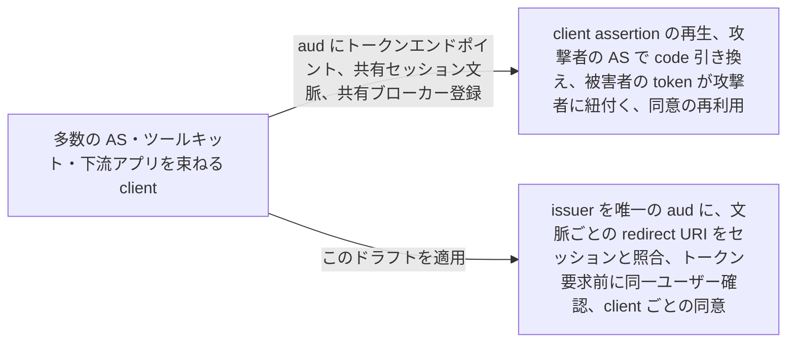
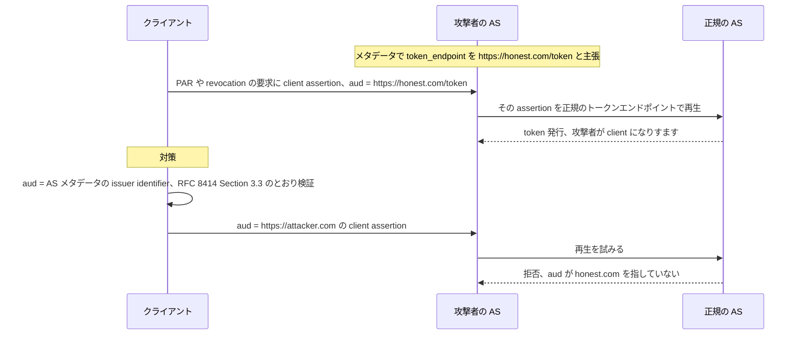

# Updates to OAuth 2.0 Security BCP

> 一言で言うと: RFC 9700 の公開後に見つかった 4 つの攻撃。どれも多数の認可サーバーや多数の下流アプリを束ねる client を狙うもので、それぞれの client 側での対策をまとめる。

## どういうときに使うか

- **1 つの鍵ペアで複数の認可サーバーに `private_key_jwt` 認証する client**: 悪意あるサーバーが正規サーバーのトークンエンドポイントを自分のものとして公開し、`aud` にそのエンドポイントが入った client assertion を集め、正規サーバーでその client になりすませる (Section 2.1.1.1)。
- **誰でもツールのコネクタを提供できるエージェント型 AI サービスや統合プラットフォーム**: 悪意あるツールキットの認可サーバーが被害者のブラウザを正規サーバーへリダイレクトし、得られた code を client に攻撃者のトークンエンドポイントで引き換えさせられる (Section 2.2.1)。
- **バックエンドが OAuth フローを担い、認可 URI にセッション識別子を埋め込むネイティブアプリ**: 攻撃者がフローを始めてその URI を被害者に送ると、被害者の token が攻撃者のセッションに紐付く (Section 2.3.1)。
- **上流サーバーごとに 1 回登録し、その登録をすべての下流アプリで使い回すブローカー**: あるアプリに与えた同意が、ブローカー配下の別のアプリに黙って再利用される (Section 2.4)。

## 解決する問題

RFC 9700 は複数の認可サーバーと話せる client をモデル化し、2 つのサーバー間の混同である mix-up を防いだ。配備はさらに先へ進んだ。1 つの集中 client が第三者提供のツールキットを束ね、OAuth-as-a-service 事業者が多数のテナントのフローを預かり、ブローカーが下流アプリと上流サーバーの間に立ち、ネイティブアプリがフローをバックエンドに委ねる。それぞれが、レスポンスがどのサーバー・どの文脈・どのユーザーのものかを client が見失う場所を増やす。

このドラフトはそこから生じる脅威について RFC 9700 を拡張するもので、RFC 9700 と併せて読む。どのケースでも対策は client かブローカーの側にある (Section 2.1.2, 2.2.2, 2.3.2, 2.4.2)。

## 仕組み

audience injection 攻撃では、client が両方のサーバーに登録し、攻撃者のメタデータが正規サーバーのトークンエンドポイントを載せ、client の `private_key_jwt` や RFC 7523 の assertion の `aud` に正規のトークンエンドポイントが入る。攻撃者がそれを入手できるのは、client がトークンエンドポイント以外、つまり pushed authorization・revocation・CIBA backchannel・device authorization の各エンドポイントで認証するときだけである (Section 2.1.1.1, 2.1.1.3)。対策は一意な audience を 1 つだけ使うこと。RFC 8414 か OpenID Discovery で取得・検証した認可サーバーの issuer identifier、さもなければ assertion を送る先の正確なエンドポイント URI (Section 2.1.2.1, 2.1.2.2)。残り 3 つの攻撃も、client が文脈を固定し損ねるという同じ形をしている。cross-toolkit account takeover に対しては、client は connection context identifier を作り、文脈ごとの redirect URI に埋め込み、ユーザーのセッションに保存し、不一致なら中止する (Section 2.2.2)。session fixation に対しては、fixate された認可セッションがフローを始めたユーザーセッションに束縛されていることを、token を要求する前に検証する (Section 2.3.2)。ブローカー経由の同意に対しては、ブローカーが下流 client ごとに上流サーバーへ登録するか、自前の client ごとの同意画面を出す (Section 2.4.2.1, 2.4.2.2)。

## 仕様が求めること

- 複数の認可サーバーと話し、署名ベースの client 認証を使う client は、サーバーごとに別の鍵素材を使うなど他の手段で緩和していない限り、audience 対策のいずれかを採らなければならない (MUST)。issuer identifier が推奨 (Section 2.1.2)。
- client は RFC 8414 Section 3.3 か OpenID Discovery Section 4.3 のとおり取得・検証した認可サーバーの issuer identifier を client assertion の唯一の `aud` 値として使わなければならない (Section 2.1.2.1)。あるいは assertion を送る先の正確なエンドポイント URI を唯一の `aud` にしなければならない (Section 2.1.2.2)。
- client はサポートする OAuth connection context のすべての変数から connection context identifier を作り、それを埋め込んだ文脈ごとに異なる redirect URI を発行し、リクエスト開始時にユーザーのセッションへ保存し、redirect URI 由来の識別子がセッションと一致しなければ中止しなければならない (Section 2.2.2)。
- client は、あるユーザーが始めた OAuth フローを同じユーザーが完了することを保証しなければならず、fixate された認可セッションと既存のユーザーセッションの束縛を access token 要求の前に検証しなければならない (Section 2.3.2)。
- ブローカーは上流認可サーバーへの client ごとの登録か、下流 client を特定し、別の下流 client への同意を根拠に省略しないブローカー側の同意画面のどちらかを採らなければならない (Section 2.4.2, 2.4.2.1, 2.4.2.2)。

## 注意点

- ツールキットごとに別の redirect URI を発行するだけでは cross-toolkit takeover は防げない。redirect URI の文脈とセッションに記録した文脈の照合も必要 (Section 2.2.1)。
- RFC 9700 の mix-up 対策で connection context 確認を代替できるのは、implicit を完全に捨て、プロバイダを抽象的な issuer で識別し、issuer を実行時にエンドポイントへ解決する場合だけ。discovery でエンドポイント欄を埋めるだけで issuer と結び付けない実装は脆弱なまま (Section 2.2.2)。
- PKCE は cross-user session fixation を止めない。認可リクエストとリダイレクトの両方を同じ被害者が完了するので、PKCE の束縛は保たれる (Section 2.3)。

## 出典

- [draft-ietf-oauth-security-topics-update, Section 2.1.1.1](https://datatracker.ietf.org/doc/html/draft-ietf-oauth-security-topics-update#section-2.1.1.1)
- [draft-ietf-oauth-security-topics-update, Section 2.1.1.3](https://datatracker.ietf.org/doc/html/draft-ietf-oauth-security-topics-update#section-2.1.1.3)
- [draft-ietf-oauth-security-topics-update, Section 2.1.2](https://datatracker.ietf.org/doc/html/draft-ietf-oauth-security-topics-update#section-2.1.2)
- [draft-ietf-oauth-security-topics-update, Section 2.1.2.1](https://datatracker.ietf.org/doc/html/draft-ietf-oauth-security-topics-update#section-2.1.2.1)
- [draft-ietf-oauth-security-topics-update, Section 2.1.2.2](https://datatracker.ietf.org/doc/html/draft-ietf-oauth-security-topics-update#section-2.1.2.2)
- [draft-ietf-oauth-security-topics-update, Section 2.2.1](https://datatracker.ietf.org/doc/html/draft-ietf-oauth-security-topics-update#section-2.2.1)
- [draft-ietf-oauth-security-topics-update, Section 2.2.2](https://datatracker.ietf.org/doc/html/draft-ietf-oauth-security-topics-update#section-2.2.2)
- [draft-ietf-oauth-security-topics-update, Section 2.3](https://datatracker.ietf.org/doc/html/draft-ietf-oauth-security-topics-update#section-2.3)
- [draft-ietf-oauth-security-topics-update, Section 2.3.1](https://datatracker.ietf.org/doc/html/draft-ietf-oauth-security-topics-update#section-2.3.1)
- [draft-ietf-oauth-security-topics-update, Section 2.3.2](https://datatracker.ietf.org/doc/html/draft-ietf-oauth-security-topics-update#section-2.3.2)
- [draft-ietf-oauth-security-topics-update, Section 2.4](https://datatracker.ietf.org/doc/html/draft-ietf-oauth-security-topics-update#section-2.4)
- [draft-ietf-oauth-security-topics-update, Section 2.4.2](https://datatracker.ietf.org/doc/html/draft-ietf-oauth-security-topics-update#section-2.4.2)
- [draft-ietf-oauth-security-topics-update, Section 2.4.2.1](https://datatracker.ietf.org/doc/html/draft-ietf-oauth-security-topics-update#section-2.4.2.1)
- [draft-ietf-oauth-security-topics-update, Section 2.4.2.2](https://datatracker.ietf.org/doc/html/draft-ietf-oauth-security-topics-update#section-2.4.2.2)
