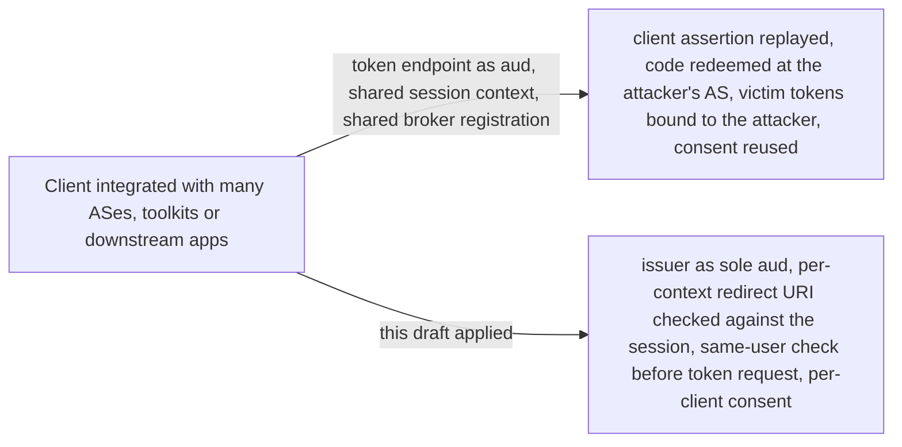
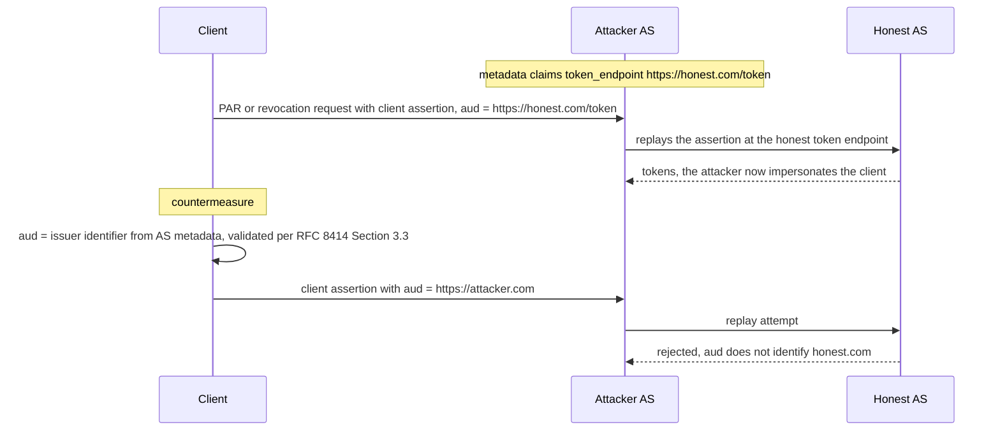

# Updates to OAuth 2.0 Security BCP

> In one line: four attacks found after RFC 9700 shipped, all aimed at clients that integrate many authorization servers or many downstream apps, with the client-side fixes for each.

## When you reach for it

- **A client that authenticates with `private_key_jwt` at several authorization servers using one key pair**: a malicious server can publish the honest server's token endpoint as its own, collect a client assertion whose `aud` names that endpoint, and replay it to impersonate the client at the honest server (Section 2.1.1.1).
- **An agentic AI service or integration platform where the public can contribute tool connectors**: a malicious toolkit's authorization server can redirect the victim's browser to an honest server and have the client redeem the resulting code at the attacker's token endpoint (Section 2.2.1).
- **A native app whose backend does the OAuth flow and encodes a session identifier into the authorization URI**: an attacker starts a flow, sends the URI to a victim, and the victim's tokens land in the attacker's session (Section 2.3.1).
- **A broker that registers once at each upstream server and reuses that registration for every downstream app**: consent granted to one app is silently reused for any other app behind the broker (Section 2.4).

## The problem it solves

RFC 9700 modelled a client that could talk to several authorization servers and defended against mix-up, where the confusion is between two servers. Deployments have moved further: one centralized client now orchestrates toolkits contributed by third parties, OAuth-as-a-service providers host flows for many tenants, brokers sit between downstream apps and upstream servers, and native apps delegate their flows to a backend. Each of those adds a place where the client can lose track of which server, which context or which user a response belongs to.

This draft extends RFC 9700 for the threats that follow, and is to be read together with it. In every case the fix is on the client or broker side (Sections 2.1.2, 2.2.2, 2.3.2, 2.4.2).

## How it works

In an audience injection attack the client registers at both servers, the attacker's metadata lists the honest server's token endpoint, and the client's `private_key_jwt` or RFC 7523 assertion ends up with the honest token endpoint in `aud`; the attacker obtains it only because the client authenticates at an endpoint other than the token endpoint, such as the pushed authorization, revocation, CIBA backchannel or device authorization endpoint (Sections 2.1.1.1, 2.1.1.3). The fix is a single unambiguous audience: the authorization server's issuer identifier, retrieved and validated per RFC 8414 or OpenID Discovery, or else the exact endpoint URI the assertion is sent to (Sections 2.1.2.1, 2.1.2.2). The other three attacks follow the same shape of a context the client failed to pin down. For cross-toolkit account takeover the client forms a connection context identifier, puts it into a per-context redirect URI, stores it in the user's session, and aborts on mismatch (Section 2.2.2). For session fixation the client validates that the fixated authorization session is bound to the user session that started the flow before requesting a token (Section 2.3.2). For brokered consent the broker registers each downstream client separately at the upstream server or shows its own per-client consent screen (Sections 2.4.2.1, 2.4.2.2).

## What the spec requires

- Clients that interact with more than one authorization server and use signature-based client authentication MUST employ one of the audience countermeasures unless mitigated by other means such as fresh key material per server; the issuer identifier is the recommended one (Section 2.1.2).
- Clients MUST use the authorization server's issuer identifier as the sole `aud` value in client assertions, retrieved and validated per RFC 8414 Section 3.3 or OpenID Discovery Section 4.3 (Section 2.1.2.1), or MUST use the exact endpoint URI the assertion is sent to as the sole `aud` (Section 2.1.2.2).
- The client MUST form a connection context identifier from all variables in its supported OAuth connection context, MUST issue a per-context distinct redirect URI incorporating it, MUST store it in the user's session when initiating a request, and MUST abort if the identifier from the redirect URI does not match the session (Section 2.2.2).
- The client MUST ensure that an OAuth flow initiated by one user is completed by the same user, and MUST validate the binding of any fixated authorization session to the existing user session before proceeding with the access token request (Section 2.3.2).
- Brokers MUST employ per-client registration at the upstream authorization server, or a broker-side consent screen that identifies the downstream client and is never skipped based on consent granted to a different downstream client (Sections 2.4.2, 2.4.2.1, 2.4.2.2).

## Watch out

- Issuing distinct redirect URIs per toolkit does not by itself prevent cross-toolkit takeover; the client must also check the context in the redirect URI against the context recorded in the session (Section 2.2.1).
- RFC 9700's mix-up defenses can replace the connection context check only if implicit is dropped entirely, the provider is identified by an abstract issuer, and the issuer is resolved at runtime to endpoints; pre-populating endpoint fields from discovery without coupling to the issuer stays vulnerable (Section 2.2.2).
- PKCE does not stop cross-user session fixation, because the same victim completes both the authorization request and the redirect, so the PKCE binding is preserved (Section 2.3).

## Sources

- [draft-ietf-oauth-security-topics-update, Section 2.1.1.1](https://datatracker.ietf.org/doc/html/draft-ietf-oauth-security-topics-update#section-2.1.1.1)
- [draft-ietf-oauth-security-topics-update, Section 2.1.1.3](https://datatracker.ietf.org/doc/html/draft-ietf-oauth-security-topics-update#section-2.1.1.3)
- [draft-ietf-oauth-security-topics-update, Section 2.1.2](https://datatracker.ietf.org/doc/html/draft-ietf-oauth-security-topics-update#section-2.1.2)
- [draft-ietf-oauth-security-topics-update, Section 2.1.2.1](https://datatracker.ietf.org/doc/html/draft-ietf-oauth-security-topics-update#section-2.1.2.1)
- [draft-ietf-oauth-security-topics-update, Section 2.1.2.2](https://datatracker.ietf.org/doc/html/draft-ietf-oauth-security-topics-update#section-2.1.2.2)
- [draft-ietf-oauth-security-topics-update, Section 2.2.1](https://datatracker.ietf.org/doc/html/draft-ietf-oauth-security-topics-update#section-2.2.1)
- [draft-ietf-oauth-security-topics-update, Section 2.2.2](https://datatracker.ietf.org/doc/html/draft-ietf-oauth-security-topics-update#section-2.2.2)
- [draft-ietf-oauth-security-topics-update, Section 2.3](https://datatracker.ietf.org/doc/html/draft-ietf-oauth-security-topics-update#section-2.3)
- [draft-ietf-oauth-security-topics-update, Section 2.3.1](https://datatracker.ietf.org/doc/html/draft-ietf-oauth-security-topics-update#section-2.3.1)
- [draft-ietf-oauth-security-topics-update, Section 2.3.2](https://datatracker.ietf.org/doc/html/draft-ietf-oauth-security-topics-update#section-2.3.2)
- [draft-ietf-oauth-security-topics-update, Section 2.4](https://datatracker.ietf.org/doc/html/draft-ietf-oauth-security-topics-update#section-2.4)
- [draft-ietf-oauth-security-topics-update, Section 2.4.2](https://datatracker.ietf.org/doc/html/draft-ietf-oauth-security-topics-update#section-2.4.2)
- [draft-ietf-oauth-security-topics-update, Section 2.4.2.1](https://datatracker.ietf.org/doc/html/draft-ietf-oauth-security-topics-update#section-2.4.2.1)
- [draft-ietf-oauth-security-topics-update, Section 2.4.2.2](https://datatracker.ietf.org/doc/html/draft-ietf-oauth-security-topics-update#section-2.4.2.2)
