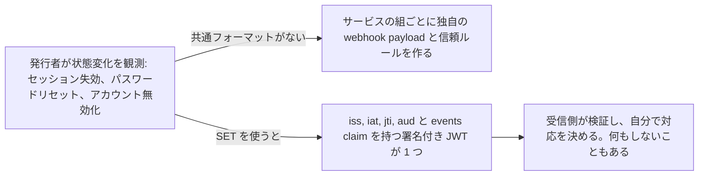
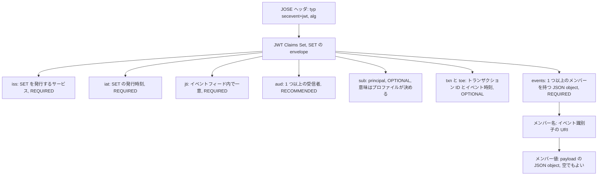
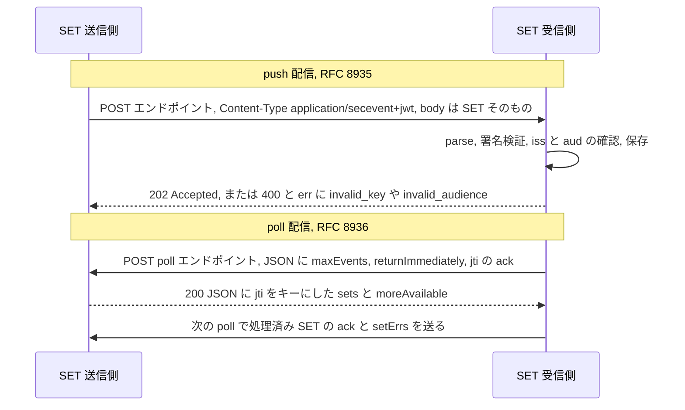

# Security Event Token (SET)

> 一言で言うと: SET は、あるサービスが「このセッションは失効した」「このアカウントは無効化された」といった subject についての事実を述べる署名付き JWT で、受け取った側はそれを見て自分で対応を決める。

## どういうときに使うか

- **OpenID Provider が relying party にユーザーのログアウトを伝えたい**: OpenID Back-Channel Logout の logout token は SET そのもので、ログアウトのイベント URI と空の payload に加えて、`sub` と `sid` が何がログアウトされたかを示す (Section 2.1.2)。
- **SCIM サーバーがパスワードをリセットし、下流のアプリにそのユーザーのセッションを捨てさせたい**: パスワードリセットの SET は SCIM のイベント URI と、影響を受けたリソースを `sub` で運び、受信側はそれをきっかけに有効なユーザーエージェントのセッションをリセットする (Section 2.1.1)。
- **あるユーザーの識別子だったメールアドレスが別人のものになった**: それを SET で知らされた受信側は、新しいユーザーに前のユーザーのリソースへのアクセスを与えないようにできる (Section 1)。
- **IdP が乗っ取りを理由にアカウントを無効化した**: RISC の account-disabled SET は subject をイベント payload に持ち、`reason` に `hijacking` を入れる (Section 2.1.4)。

## 解決する問題

セキュリティに関わる状態変化は 1 つのサービスで起き、他のサービスにとって重要になる。IdP がセッションを失効させ、プロビジョニングシステムがアカウントを削除し、メールプロバイダがアドレスを再利用する。共通フォーマットがなければ、連携ごとに payload・署名・検証を独自に作ることになる。

SET は命令ではない。発行者は subject についての事実を述べ、受信側はそれを自分の目的で解釈し、必要なら独自に行動する (Section 1)。RFC 8417 は JWT をプロファイルする。必須の envelope claim を定め、`events`・`txn`・`toe` claim を追加し、`application/secevent+jwt` メディアタイプを登録し、プロファイル仕様が何を定義すべきかを示す。配信は範囲外で (Section 5.2)、RFC 8935 (push) と RFC 8936 (poll) がそれを担い、SSF は両方をプロファイルする。

## 仕組み

トップレベルの claim が envelope を作る。`iss`・`iat`・`jti` は必須、`aud` は推奨、`sub` は任意で、一部のプロファイルは subject をイベント payload の中で識別する (Section 2.2)。`events` claim は JSON object で、メンバー名はイベントを識別する URI、値はプロファイル仕様が定義する payload object。payload のないイベントは `{}` で表す (Section 2)。`txn` は関連する JWT 同士を結び付け、`toe` は SET を作った時刻である `iat` とは別に、イベントが起きた時刻を示す (Section 2.2)。JOSE ヘッダの `typ` には `secevent+jwt` を入れられ、他の種類の JWT と混同されうる場合は入れなければならない (Section 2.3)。

push では送信側が SET をリクエスト body として POST し、受信側は検証して保存したら 202 を、問題があれば登録済みのエラーコードを添えて 400 を返す (RFC 8935, Section 2〜2.4)。poll では受信側が JSON を POST して最大 `maxEvents` 件を要求しつつ前回分を `jti` で ack し、送信側は `jti` をキーにした `sets` を返す (RFC 8936, Section 2.2, 2.3)。

## 仕様が求めること

- `iss`・`iat`・`jti` は REQUIRED。`jti` は特定のイベントフィード内で一意でなければならない。`aud` は RECOMMENDED。`sub` は OPTIONAL で、使うならプロファイルがその内容と意味を定義しなければならない (Section 2.2)。
- `events` の値は 1 つ以上のメンバーを持つ JSON object でなければならない。メンバー名は URI、値は JSON object。同じ識別子を 2 回使ってはならず、独立した複数のイベントを表すのに使ってはならない (Section 2, 2.2)。
- `exp` は NOT RECOMMENDED。SET はすでに起きたことを表すからだ (Section 2.2)。
- 他の JWT と混同されうる文脈で使われる可能性がある SET は、`typ` に `secevent+jwt` を含めなければならない。`application/` 接頭辞は省くべき (Section 2.3)。
- 他の手段で完全性が保証されない限り、SET はそのユースケースで信頼される発行者が JWS で署名しなければならない。個人識別情報を含む SET や第三者を経由する SET は JWE で暗号化するか、他の手段で機密性を守らなければならない。各当事者は TLS 1.2 以上をサポートしなければならない (Section 5.1)。
- プロファイル仕様は、subject の識別方法と、subject の発行者を SET の発行者と区別する方法を定義し、受信側が行う検証手順を明記しなければならない (Section 3)。

## 注意点

- **ID Token との混同**: SET がそのまま有効な ID Token として通ってしまいうるなら、プロファイルは `exp` を含めないことを要求しなければならない。ID Token の検証は `typ` を見ないので、明示的な型付けでは防げない (Section 4.1)。
- **JWT access token との混同**: `exp` を禁じ、別の `aud` を使い、access token の検証で `events` claim の有無を見て SET を検出し、`typ` を検査する (Section 4.2)。
- **順序は定義されない**: SET 同士の順序は仕様にない。clock skew があるので `iat` で順序を決めるのは危うく、順序が重要ならプロファイルが順序の仕組みを定義すべき。たとえば `txn` にカウンタを入れる (Section 5.3)。
- **タイミングの競合**: 「token revoked」の SET が、同じユーザーの再ログインと同時に届き、新しいセッションを誤って消すことがある。プロファイルは SET の表現とタイミングの両方に注意すべきで、たとえばユーザー全体のログアウトを述べるのではなく特定のセッションや ID Token を失効させる (Section 5.4)。
- **相関**: 精密な `iat` や `toe` があると、発行者が結び付けるつもりのなかったイベント同士を受信側が結び付けられる。発行者はこれを抑える手を打つべきで、たとえば `toe` を概算値にする、発行を遅らせる。また発行者と受信側は、可能なら subject 識別子をそのまま流さない方法を考えるべきで、たとえば salt 付きハッシュを渡す (Section 6)。

## 出典

- [RFC 8417, Section 1](https://www.rfc-editor.org/rfc/rfc8417#section-1)
- [RFC 8417, Section 2](https://www.rfc-editor.org/rfc/rfc8417#section-2)
- [RFC 8417, Section 2.1.1](https://www.rfc-editor.org/rfc/rfc8417#section-2.1.1)
- [RFC 8417, Section 2.1.2](https://www.rfc-editor.org/rfc/rfc8417#section-2.1.2)
- [RFC 8417, Section 2.1.4](https://www.rfc-editor.org/rfc/rfc8417#section-2.1.4)
- [RFC 8417, Section 2.2](https://www.rfc-editor.org/rfc/rfc8417#section-2.2)
- [RFC 8417, Section 2.3](https://www.rfc-editor.org/rfc/rfc8417#section-2.3)
- [RFC 8417, Section 3](https://www.rfc-editor.org/rfc/rfc8417#section-3)
- [RFC 8417, Section 4.1](https://www.rfc-editor.org/rfc/rfc8417#section-4.1)
- [RFC 8417, Section 4.2](https://www.rfc-editor.org/rfc/rfc8417#section-4.2)
- [RFC 8417, Section 5.1](https://www.rfc-editor.org/rfc/rfc8417#section-5.1)
- [RFC 8417, Section 5.2](https://www.rfc-editor.org/rfc/rfc8417#section-5.2)
- [RFC 8417, Section 5.3](https://www.rfc-editor.org/rfc/rfc8417#section-5.3)
- [RFC 8417, Section 5.4](https://www.rfc-editor.org/rfc/rfc8417#section-5.4)
- [RFC 8417, Section 6](https://www.rfc-editor.org/rfc/rfc8417#section-6)
- [RFC 8935, Section 2](https://www.rfc-editor.org/rfc/rfc8935#section-2)
- [RFC 8935, Section 2.1](https://www.rfc-editor.org/rfc/rfc8935#section-2.1)
- [RFC 8935, Section 2.2](https://www.rfc-editor.org/rfc/rfc8935#section-2.2)
- [RFC 8935, Section 2.3](https://www.rfc-editor.org/rfc/rfc8935#section-2.3)
- [RFC 8935, Section 2.4](https://www.rfc-editor.org/rfc/rfc8935#section-2.4)
- [RFC 8936, Section 2.2](https://www.rfc-editor.org/rfc/rfc8936#section-2.2)
- [RFC 8936, Section 2.3](https://www.rfc-editor.org/rfc/rfc8936#section-2.3)
