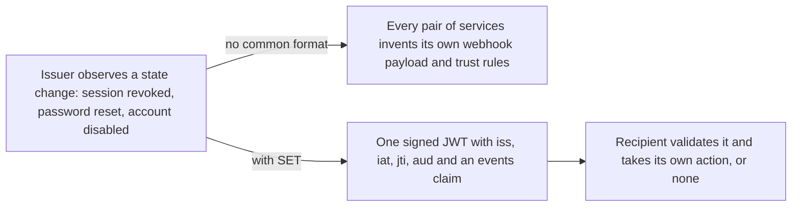
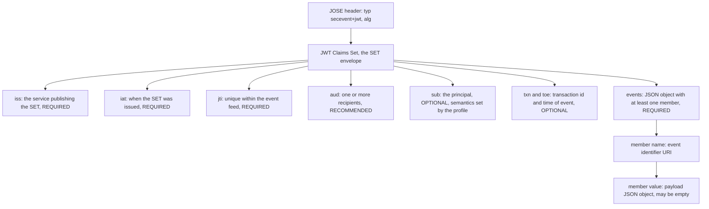
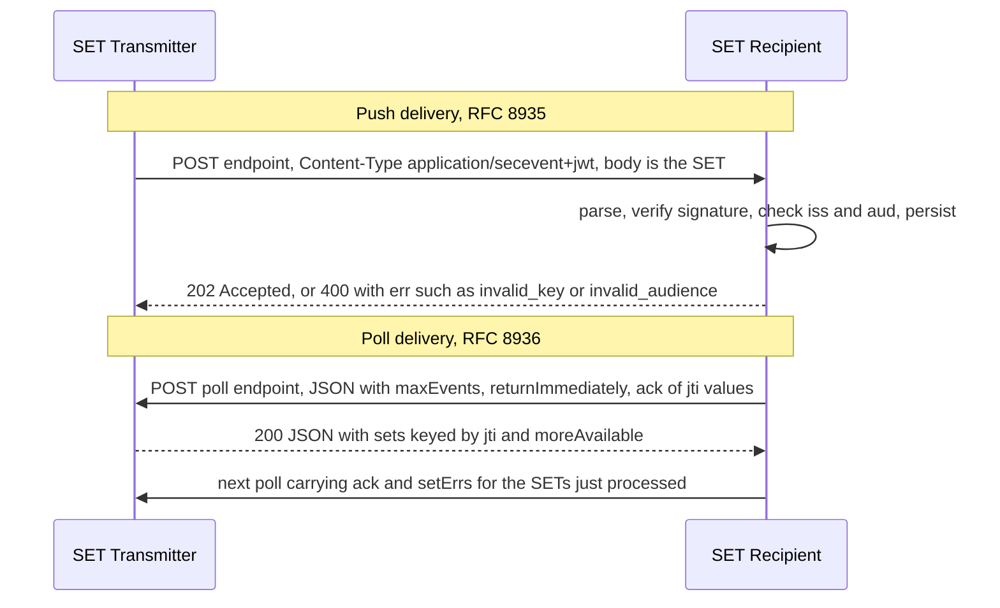

# Security Event Token (SET)

> In one line: a SET is a signed JWT in which one service states a fact about a subject, such as "this session was revoked" or "this account was disabled", so another service can decide what to do about it.

## When you reach for it

- **An OpenID Provider wants to tell its relying parties that a user logged out**: the OpenID Back-Channel Logout logout token is a SET: the logout event URI with an empty payload, plus `sub` and `sid` naming what was logged out (Section 2.1.2).
- **A SCIM server resets a password and downstream apps should drop that user's sessions**: a password reset SET carries the SCIM event URI and the affected resource in `sub`, and the receiver uses it as a trigger to reset active user-agent sessions (Section 2.1.1).
- **An email address that was one user's identifier now belongs to someone else**: the recipient, told about it in a SET, can make sure the new user is not granted access to the previous user's resources (Section 1).
- **An identity provider disables an account after a hijacking**: a RISC account-disabled SET carries the subject in the event payload and `reason` set to `hijacking` (Section 2.1.4).

## The problem it solves

Security-relevant state changes happen in one service and matter to others: an identity provider revokes a session, a provisioning system deletes an account, a mail provider recycles an address. Without a shared format each integration invents its own payload, signing and validation.

A SET is not a command. The issuer states a fact about a subject, and the recipient interprets it for its own purposes and takes its own independent action, if any (Section 1). RFC 8417 profiles JWT: it fixes which envelope claims are required, adds the `events`, `txn` and `toe` claims, registers the `application/secevent+jwt` media type, and tells profiling specifications what they must define. Delivery is out of scope (Section 5.2); RFC 8935 (push) and RFC 8936 (poll) supply it, and SSF profiles both.

## How it works

The top-level claims form the envelope. `iss`, `iat` and `jti` are required, `aud` is recommended, and `sub` is optional because some profiles identify the subject inside the event payload instead (Section 2.2). The `events` claim is a JSON object whose member names are URIs identifying the event and whose values are payload objects defined by the profiling specification; an event with no payload is `{}` (Section 2). `txn` correlates related JWTs and `toe` gives the time the event occurred, as opposed to `iat`, the time the SET was minted (Section 2.2). The JOSE header can carry `typ` set to `secevent+jwt`, and must when the SET could be confused with other kinds of JWTs (Section 2.3).

Push: the transmitter POSTs the SET as the request body, and the recipient answers 202 after validating and storing it, or 400 with a registered error code (RFC 8935, Sections 2 to 2.4). Poll: the recipient POSTs JSON asking for up to `maxEvents` tokens and acknowledging earlier ones by `jti`, and the transmitter returns `sets` keyed by `jti` (RFC 8936, Sections 2.2 and 2.3).

## What the spec requires

- `iss`, `iat` and `jti` are REQUIRED; `jti` MUST be unique within a particular event feed; `aud` is RECOMMENDED; `sub` is OPTIONAL and, if used, the profile MUST define its content and semantics (Section 2.2).
- The `events` value MUST be a JSON object with at least one member; each member name is a URI and each value MUST be a JSON object; the same identifier MUST NOT appear twice; the claim MUST NOT be used to express multiple independent logical events (Sections 2 and 2.2).
- `exp` is NOT RECOMMENDED, because a SET describes something that already happened (Section 2.2).
- `typ` of `secevent+jwt` MUST be included whenever the SET could be used in a context where it might be confused with other JWTs; the `application/` prefix SHOULD be omitted (Section 2.3).
- Unless integrity is ensured by other means, a SET MUST be signed with JWS by an issuer trusted for the use case; SETs that carry personally identifiable information or pass through third parties MUST be encrypted with JWE or otherwise kept confidential; parties MUST support TLS 1.2 or higher (Section 5.1).
- Profiling specifications MUST define how the subject is identified and how to tell the subject's issuer from the SET issuer, and MUST specify the validation steps a recipient performs (Section 3).

## Watch out

- **Confusion with ID Tokens**: if a SET could otherwise pass as a valid ID Token, the profile MUST require that `exp` be absent; explicit typing does not help here because ID Token validation ignores `typ` (Section 4.1).
- **Confusion with JWT access tokens**: prohibit `exp`, use a distinct `aud`, have access token validators check for an `events` claim to detect SETs, and check `typ` (Section 4.2).
- **No ordering**: the spec defines no sequence between SETs; `iat` is unreliable for ordering because of clock skew, so a profile SHOULD define an ordering mechanism when order matters, for example a counter in `txn` (Section 5.3).
- **Timing races**: a "token revoked" SET can arrive while the same user is logging in again and wrongly kill the new session; profiles SHOULD consider both SET expression and timing, for example by revoking a specific session or ID Token rather than stating a general logout for a user (Section 5.4).
- **Correlation**: precise `iat` or `toe` values let a recipient link events the issuer did not mean to link; issuers SHOULD take steps to minimize that, for example approximate `toe` values or delayed issuance, and issuers and recipients SHOULD avoid propagating subject identifiers where possible, for example by passing a salted hash (Section 6).

## Sources

- [RFC 8417, Section 1](https://www.rfc-editor.org/rfc/rfc8417#section-1)
- [RFC 8417, Section 2](https://www.rfc-editor.org/rfc/rfc8417#section-2)
- [RFC 8417, Section 2.1.1](https://www.rfc-editor.org/rfc/rfc8417#section-2.1.1)
- [RFC 8417, Section 2.1.2](https://www.rfc-editor.org/rfc/rfc8417#section-2.1.2)
- [RFC 8417, Section 2.1.4](https://www.rfc-editor.org/rfc/rfc8417#section-2.1.4)
- [RFC 8417, Section 2.2](https://www.rfc-editor.org/rfc/rfc8417#section-2.2)
- [RFC 8417, Section 2.3](https://www.rfc-editor.org/rfc/rfc8417#section-2.3)
- [RFC 8417, Section 3](https://www.rfc-editor.org/rfc/rfc8417#section-3)
- [RFC 8417, Section 4.1](https://www.rfc-editor.org/rfc/rfc8417#section-4.1)
- [RFC 8417, Section 4.2](https://www.rfc-editor.org/rfc/rfc8417#section-4.2)
- [RFC 8417, Section 5.1](https://www.rfc-editor.org/rfc/rfc8417#section-5.1)
- [RFC 8417, Section 5.2](https://www.rfc-editor.org/rfc/rfc8417#section-5.2)
- [RFC 8417, Section 5.3](https://www.rfc-editor.org/rfc/rfc8417#section-5.3)
- [RFC 8417, Section 5.4](https://www.rfc-editor.org/rfc/rfc8417#section-5.4)
- [RFC 8417, Section 6](https://www.rfc-editor.org/rfc/rfc8417#section-6)
- [RFC 8935, Section 2](https://www.rfc-editor.org/rfc/rfc8935#section-2)
- [RFC 8935, Section 2.1](https://www.rfc-editor.org/rfc/rfc8935#section-2.1)
- [RFC 8935, Section 2.2](https://www.rfc-editor.org/rfc/rfc8935#section-2.2)
- [RFC 8935, Section 2.3](https://www.rfc-editor.org/rfc/rfc8935#section-2.3)
- [RFC 8935, Section 2.4](https://www.rfc-editor.org/rfc/rfc8935#section-2.4)
- [RFC 8936, Section 2.2](https://www.rfc-editor.org/rfc/rfc8936#section-2.2)
- [RFC 8936, Section 2.3](https://www.rfc-editor.org/rfc/rfc8936#section-2.3)
