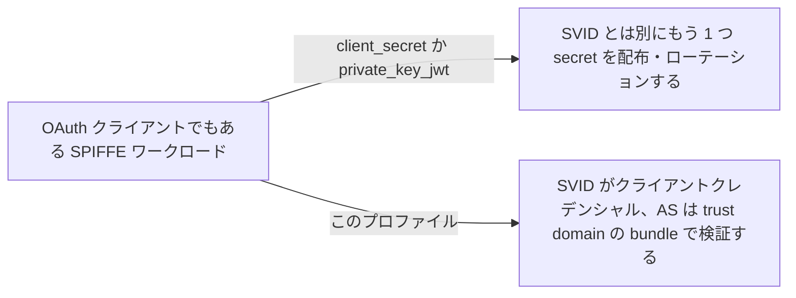
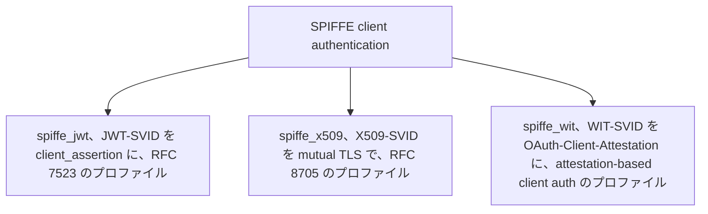
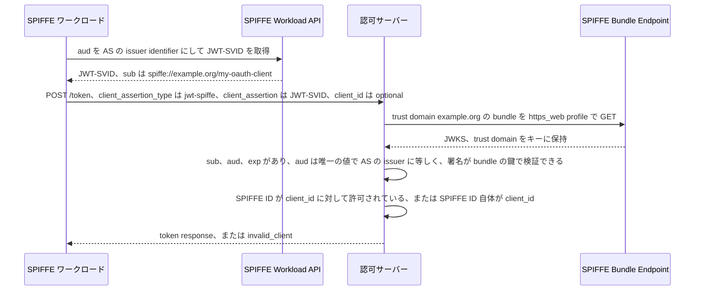

# OAuth SPIFFE Client Authentication

> 一言で言うと: SPIFFE ワークロードが、すでに持っている SVID で OAuth 認可サーバーに認証する仕様。JWT-SVID を `jwt-spiffe` の client assertion として、X509-SVID を mutual TLS で、WIT-SVID を attestation proof 付きで送り、client secret を一切配布しない。

## どういうときに使うか

- **ワークロードは SVID を持っているのに、OAuth クライアントごとに別の secret が要る**: client secret も `private_key_jwt` の鍵も out-of-band の配布が必要で、SPIFFE がすでにワークロードを attest しているなら二重になる。このプロファイルは SVID そのものをクライアントクレデンシャルにする (Section 1)。
- **SPIRE 管理の trust domain にいるサービスが社内 IdP から access token を取りたい**: ワークロードは JWT-SVID を新しい assertion type `jwt-spiffe` の `client_assertion` として送り、認可サーバーは trust domain の bundle で検証する (Section 3.2、Section 6)。
- **token endpoint を mutual TLS にして、登録情報を増やしたくない**: X509-SVID がクライアント証明書になり、唯一の URI SAN がクライアントを識別するので `client_id` は optional になる (Section 3.3)。
- **bearer の JWT-SVID は replay され得るので proof of possession が欲しい**: WIT-SVID は `cnf` で鍵を結び付け、クライアントは Client Attestation PoP JWT でその鍵の所持を証明する (Section 3.4、Section 8.1)。

## 解決する問題

従来の OAuth クライアント認証は client secret か `private_key_jwt` に頼り、どちらも秘密情報の out-of-band 配布が要る。SPIFFE がワークロードを attest して SVID を発行済みの環境では、それは必要のない 2 つ目のクレデンシャルを配ることになる (Section 1)。

より難しいのは信頼の問題だ。認可サーバーは正しい trust domain の鍵で SVID を検証しなければならない。X509-SVID をシステムの trust store で検証すれば、どの公開 CA でも任意の SPIFFE ID の証明書を発行できてしまうし、JWT の `iss` claim から鍵を発見する方式は token confusion を招く。そこでこのプロファイルは鍵の取得元と bundle のスコープを固定する (Section 6、Section 6.3.3、Section 8.3)。

## 仕組み

ワークロードは audience を認可サーバーの issuer identifier にした JWT-SVID を取得し、`client_assertion_type` を `urn:ietf:params:oauth:client-assertion-type:jwt-spiffe` にして `client_assertion` として POST する。認可サーバーは `sub`・`aud`・`exp` があること、期限切れでないこと、`aud` が issuer identifier を唯一の値として含むこと、署名が trust domain の鍵で検証できることを確認する (Section 3.2)。鍵は trust domain ごとに 1 つ out-of-band で設定された SPIFFE Bundle Endpoint から `https_web` profile で取得する (Section 6.2)。最後にクライアントを特定する。`client_id` があれば `sub` の SPIFFE ID がそのクライアントに許可されていること、なければ SPIFFE ID 自体がクライアント識別子になる (Section 3.1)。X509-SVID 方式では assertion の代わりにクライアント証明書を、その trust domain の anchor だけで検証する (Section 3.3)。WIT-SVID 方式では `typ` が `wit+jwt` の WIT を `OAuth-Client-Attestation` に、PoP JWT を `OAuth-Client-Attestation-PoP` に載せる (Section 3.4.1)。

## 仕様が求めること

- `client_id` はすべての方式で OPTIONAL。あれば AS は SVID の SPIFFE ID がそのクライアントに許可されていることを検証しなければならず (MUST)、なければ SPIFFE ID がクライアント識別子になる。Client ID Metadata Document で識別されるクライアントは `client_id` を含めなければならない (MUST)。それ以外は `invalid_client` で拒否する (Section 3.1)。
- JWT-SVID では `client_assertion_type` は `urn:ietf:params:oauth:client-assertion-type:jwt-spiffe`、`client_assertion` は単一の JWT-SVID でなければならない (MUST)。AS は `sub`・`aud`・`exp`、`aud` が AS の issuer identifier を唯一の値として持つこと、trust domain の鍵での署名検証を行わなければならない (MUST) (Section 3.2)。
- X509-SVID では path validation に URI SAN の trust domain の anchor だけを使わなければならず (MUST)、他の trust domain やシステムの trust store を使ってはならない (MUST NOT) (Section 3.3)。
- WIT-SVID では AS は `OAuth-Client-Attestation` ヘッダの `typ` として `wit+jwt` を受け付け、WIMSE workload credentials の規則で WIT を検証し、trust domain の鍵で署名を検証し、attestation-based client authentication の規則で PoP JWT を検証しなければならない (MUST) (Section 3.4.1)。
- AS は少なくとも 1 方式をサポートし (MUST)、`token_endpoint_auth_methods_supported` に `spiffe_jwt`・`spiffe_wit`・`spiffe_x509` として広告しなければならない (MUST)。クライアントも少なくとも 1 方式をサポートする (MUST) (Section 4)。
- クライアントメタデータとして `spiffe_id` (REQUIRED、末尾 `/*` で path segment 単位の prefix match) と `spiffe_bundle_endpoint` (OPTIONAL) を定義する (Section 5.1)。
- trust bundle は trust domain をキーにしなければならない (MUST)。AS は bundle endpoint の `https_web` profile を使い (MUST)、各 endpoint をちょうど 1 つの trust domain に対応付けなければならない (MUST) (Section 6、Section 6.2)。

## 注意点

- JWT-SVID には `jti` がないことがあり、SPIFFE 実装は同じトークンをキャッシュして複数回返すことがあるので、`jti` による replay 検出は一般には当てにできない。replay 耐性が必要なら、一意で再利用しない `jti` を使うか、X509-SVID か WIT-SVID に切り替えるべき (SHOULD) (Section 8.1)。
- クライアントの `spiffe_bundle_endpoint` から取った bundle はその `client_id` と trust domain の両方に結び付けなければならず (MUST)、trust domain の bundle に混ぜたり他のクライアントの検証に使ったりしてはならない (MUST NOT) (Section 6.1)。
- Client ID Metadata Document は作者が運用していない trust domain を名乗れる。bundle が事前設定の鍵配布から来たか、trust domain が `client_id` のホストに結び付いていない限り、AS はその SPIFFE ID をその trust domain が発行したものとしてポリシー・token claim・introspection で扱ってはならない (MUST NOT) (Section 8.2)。
- `iss` ベースの鍵発見は避けるべき (SHOULD)。使う場合でも `iss` の値はすでに信頼済みで設定された trust domain に結び付いていなければならず (MUST)、署名が検証でき `sub` が SPIFFE ID に見えるだけの JWT を SVID として受け入れてはならない (MUST NOT) (Section 6.3.4、Section 8.3)。
- X509-SVID クライアントに発行した certificate-bound access token は、短命な SVID がローテーションすると使えなくなるので、クライアントは新しい token を取り直す必要がある (Section 3.3)。

## 出典

- [draft-ietf-oauth-spiffe-client-auth, Section 1](https://datatracker.ietf.org/doc/html/draft-ietf-oauth-spiffe-client-auth#section-1)
- [draft-ietf-oauth-spiffe-client-auth, Section 3.1](https://datatracker.ietf.org/doc/html/draft-ietf-oauth-spiffe-client-auth#section-3.1)
- [draft-ietf-oauth-spiffe-client-auth, Section 3.2](https://datatracker.ietf.org/doc/html/draft-ietf-oauth-spiffe-client-auth#section-3.2)
- [draft-ietf-oauth-spiffe-client-auth, Section 3.3](https://datatracker.ietf.org/doc/html/draft-ietf-oauth-spiffe-client-auth#section-3.3)
- [draft-ietf-oauth-spiffe-client-auth, Section 3.4](https://datatracker.ietf.org/doc/html/draft-ietf-oauth-spiffe-client-auth#section-3.4)
- [draft-ietf-oauth-spiffe-client-auth, Section 3.4.1](https://datatracker.ietf.org/doc/html/draft-ietf-oauth-spiffe-client-auth#section-3.4.1)
- [draft-ietf-oauth-spiffe-client-auth, Section 4](https://datatracker.ietf.org/doc/html/draft-ietf-oauth-spiffe-client-auth#section-4)
- [draft-ietf-oauth-spiffe-client-auth, Section 5.1](https://datatracker.ietf.org/doc/html/draft-ietf-oauth-spiffe-client-auth#section-5.1)
- [draft-ietf-oauth-spiffe-client-auth, Section 6](https://datatracker.ietf.org/doc/html/draft-ietf-oauth-spiffe-client-auth#section-6)
- [draft-ietf-oauth-spiffe-client-auth, Section 6.1](https://datatracker.ietf.org/doc/html/draft-ietf-oauth-spiffe-client-auth#section-6.1)
- [draft-ietf-oauth-spiffe-client-auth, Section 6.2](https://datatracker.ietf.org/doc/html/draft-ietf-oauth-spiffe-client-auth#section-6.2)
- [draft-ietf-oauth-spiffe-client-auth, Section 6.3.3](https://datatracker.ietf.org/doc/html/draft-ietf-oauth-spiffe-client-auth#section-6.3.3)
- [draft-ietf-oauth-spiffe-client-auth, Section 6.3.4](https://datatracker.ietf.org/doc/html/draft-ietf-oauth-spiffe-client-auth#section-6.3.4)
- [draft-ietf-oauth-spiffe-client-auth, Section 8.1](https://datatracker.ietf.org/doc/html/draft-ietf-oauth-spiffe-client-auth#section-8.1)
- [draft-ietf-oauth-spiffe-client-auth, Section 8.2](https://datatracker.ietf.org/doc/html/draft-ietf-oauth-spiffe-client-auth#section-8.2)
- [draft-ietf-oauth-spiffe-client-auth, Section 8.3](https://datatracker.ietf.org/doc/html/draft-ietf-oauth-spiffe-client-auth#section-8.3)
