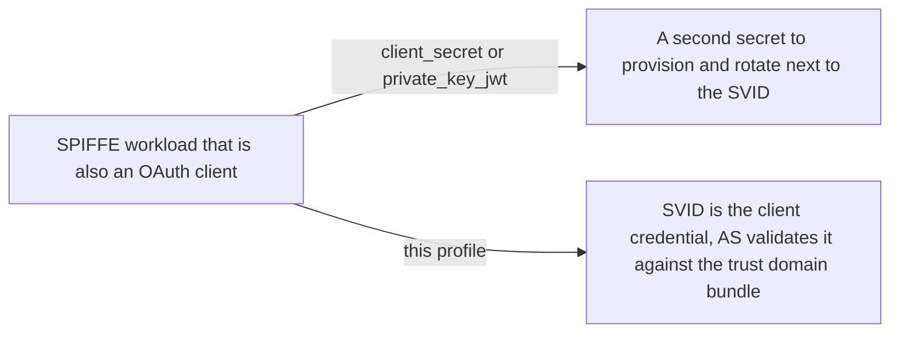
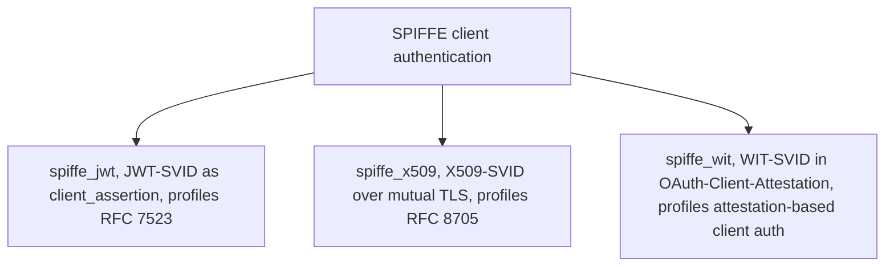
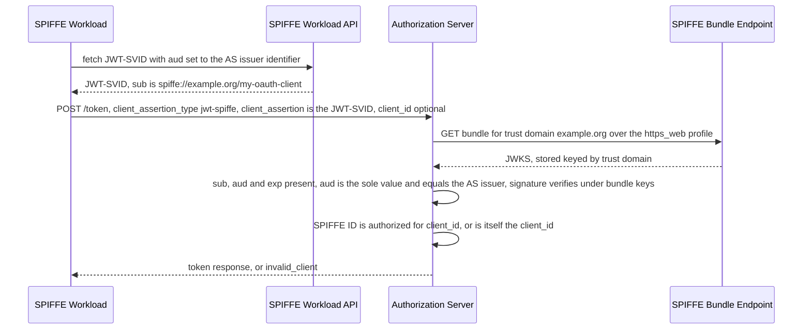

# OAuth SPIFFE Client Authentication

> In one line: a SPIFFE workload authenticates to an OAuth authorization server with the SVID it already has, a JWT-SVID as a `jwt-spiffe` client assertion, an X509-SVID over mutual TLS, or a WIT-SVID with an attestation proof, and no client secret is ever distributed.

## When you reach for it

- **Workloads already have SVIDs but every OAuth client still needs its own secret**: client secrets and `private_key_jwt` keys both need out-of-band distribution, which is redundant once SPIFFE attests the workload. This profile makes the SVID the client credential (Section 1).
- **A service in a SPIRE-managed trust domain needs an access token from a company IdP**: the workload sends its JWT-SVID as `client_assertion` with the new `jwt-spiffe` assertion type, and the authorization server validates it against the trust domain's bundle (Section 3.2, Section 6).
- **You want the token endpoint behind mutual TLS with no extra registration data**: the X509-SVID is the client certificate, its single URI SAN identifies the client, and `client_id` becomes optional (Section 3.3).
- **Bearer JWT-SVIDs can be replayed and you need proof of possession**: WIT-SVIDs bind a key through `cnf`, and the client proves it with a Client Attestation PoP JWT (Section 3.4, Section 8.1).

## The problem it solves

Traditional OAuth client authentication relies on client secrets or `private_key_jwt`, and both require out-of-band distribution of secret material. In an environment where SPIFFE already attests the workload and issues it an SVID, that means provisioning a second credential the workload does not need (Section 1).

The harder problem is trust. The authorization server must verify SVIDs with keys that belong to the right trust domain. Validating an X509-SVID against the system trust store would let any public CA mint a certificate for any SPIFFE ID, and discovering keys from a JWT's `iss` claim invites token confusion. The profile therefore pins down where keys come from and how bundles are scoped (Section 6, Section 6.3.3, Section 8.3).

## How it works

The workload obtains a JWT-SVID whose audience is the authorization server's issuer identifier and posts it as `client_assertion` with `client_assertion_type` set to `urn:ietf:params:oauth:client-assertion-type:jwt-spiffe`. The authorization server checks that `sub`, `aud` and `exp` are present, that the token is unexpired, that `aud` contains the issuer identifier as its sole value, and that the signature verifies under the trust domain's keys (Section 3.2). Keys come from a SPIFFE Bundle Endpoint configured out of band for exactly one trust domain, fetched with the `https_web` profile (Section 6.2). Finally the server identifies the client: if `client_id` is present, the SPIFFE ID in `sub` must be authorized for that client, and if it is absent, the SPIFFE ID is the client identifier (Section 3.1). The X509-SVID path replaces the assertion with a client certificate validated only against that trust domain's anchors (Section 3.3). The WIT-SVID path sends the WIT in `OAuth-Client-Attestation` with `typ` of `wit+jwt` and a PoP JWT in `OAuth-Client-Attestation-PoP` (Section 3.4.1).

## What the spec requires

- `client_id` is OPTIONAL for every method. If present, the AS MUST verify the SVID's SPIFFE ID is authorized for that client; if absent, the SPIFFE ID is the client identifier. Clients identified by a Client ID Metadata Document MUST include `client_id`. Anything else is rejected with `invalid_client` (Section 3.1).
- For JWT-SVIDs, `client_assertion_type` MUST be `urn:ietf:params:oauth:client-assertion-type:jwt-spiffe` and `client_assertion` MUST be a single JWT-SVID. The AS MUST verify `sub`, `aud` and `exp`, that `aud` holds the AS issuer identifier as its sole value, and the signature against the trust domain keys (Section 3.2).
- For X509-SVIDs, path validation MUST use only the trust anchors of the trust domain named in the URI SAN; other trust domains and the system trust store MUST NOT be used (Section 3.3).
- For WIT-SVIDs, the AS MUST accept `wit+jwt` as the `typ` of the `OAuth-Client-Attestation` header, validate the WIT per the WIMSE workload credentials rules, verify its signature with the trust domain keys, and validate the PoP JWT per attestation-based client authentication (Section 3.4.1).
- An AS MUST support at least one method and MUST advertise it in `token_endpoint_auth_methods_supported` as `spiffe_jwt`, `spiffe_wit` or `spiffe_x509`. Clients MUST support at least one (Section 4).
- Client metadata defines `spiffe_id` (REQUIRED, may end in `/*` for a path-segment prefix match) and `spiffe_bundle_endpoint` (OPTIONAL) (Section 5.1).
- Trust bundles MUST be keyed by trust domain. The AS MUST use the `https_web` profile of the bundle endpoint and MUST associate each endpoint with exactly one trust domain (Section 6, Section 6.2).

## Watch out

- JWT-SVIDs may lack `jti` and SPIFFE implementations may return the same cached token for several requests, so `jti` replay detection cannot be relied on in general. Deployments needing replay resistance SHOULD use unique, non-reused `jti` values or switch to X509-SVID or WIT-SVID (Section 8.1).
- A bundle fetched from a client's `spiffe_bundle_endpoint` MUST be bound to both that `client_id` and its trust domain, and MUST NOT be merged into the trust domain's bundle or used for any other client (Section 6.1).
- A Client ID Metadata Document can claim a trust domain its author does not operate. Unless the bundle came from preconfigured key distribution or the trust domain is bound to the `client_id` host, the AS MUST NOT treat that SPIFFE ID as issued by the trust domain in policy, token claims or introspection (Section 8.2).
- `iss`-based key discovery SHOULD be avoided. If used, the `iss` value MUST already be trusted and bound to the configured trust domain, and a JWT MUST NOT be accepted as an SVID just because its signature verifies and its `sub` looks like a SPIFFE ID (Section 6.3.4, Section 8.3).
- Certificate-bound access tokens issued to X509-SVID clients stop working when the short-lived SVID rotates, so the client must fetch a new token (Section 3.3).

## Sources

- [draft-ietf-oauth-spiffe-client-auth, Section 1](https://datatracker.ietf.org/doc/html/draft-ietf-oauth-spiffe-client-auth#section-1)
- [draft-ietf-oauth-spiffe-client-auth, Section 3.1](https://datatracker.ietf.org/doc/html/draft-ietf-oauth-spiffe-client-auth#section-3.1)
- [draft-ietf-oauth-spiffe-client-auth, Section 3.2](https://datatracker.ietf.org/doc/html/draft-ietf-oauth-spiffe-client-auth#section-3.2)
- [draft-ietf-oauth-spiffe-client-auth, Section 3.3](https://datatracker.ietf.org/doc/html/draft-ietf-oauth-spiffe-client-auth#section-3.3)
- [draft-ietf-oauth-spiffe-client-auth, Section 3.4](https://datatracker.ietf.org/doc/html/draft-ietf-oauth-spiffe-client-auth#section-3.4)
- [draft-ietf-oauth-spiffe-client-auth, Section 3.4.1](https://datatracker.ietf.org/doc/html/draft-ietf-oauth-spiffe-client-auth#section-3.4.1)
- [draft-ietf-oauth-spiffe-client-auth, Section 4](https://datatracker.ietf.org/doc/html/draft-ietf-oauth-spiffe-client-auth#section-4)
- [draft-ietf-oauth-spiffe-client-auth, Section 5.1](https://datatracker.ietf.org/doc/html/draft-ietf-oauth-spiffe-client-auth#section-5.1)
- [draft-ietf-oauth-spiffe-client-auth, Section 6](https://datatracker.ietf.org/doc/html/draft-ietf-oauth-spiffe-client-auth#section-6)
- [draft-ietf-oauth-spiffe-client-auth, Section 6.1](https://datatracker.ietf.org/doc/html/draft-ietf-oauth-spiffe-client-auth#section-6.1)
- [draft-ietf-oauth-spiffe-client-auth, Section 6.2](https://datatracker.ietf.org/doc/html/draft-ietf-oauth-spiffe-client-auth#section-6.2)
- [draft-ietf-oauth-spiffe-client-auth, Section 6.3.3](https://datatracker.ietf.org/doc/html/draft-ietf-oauth-spiffe-client-auth#section-6.3.3)
- [draft-ietf-oauth-spiffe-client-auth, Section 6.3.4](https://datatracker.ietf.org/doc/html/draft-ietf-oauth-spiffe-client-auth#section-6.3.4)
- [draft-ietf-oauth-spiffe-client-auth, Section 8.1](https://datatracker.ietf.org/doc/html/draft-ietf-oauth-spiffe-client-auth#section-8.1)
- [draft-ietf-oauth-spiffe-client-auth, Section 8.2](https://datatracker.ietf.org/doc/html/draft-ietf-oauth-spiffe-client-auth#section-8.2)
- [draft-ietf-oauth-spiffe-client-auth, Section 8.3](https://datatracker.ietf.org/doc/html/draft-ietf-oauth-spiffe-client-auth#section-8.3)
