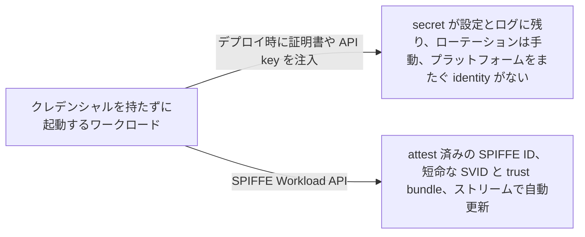
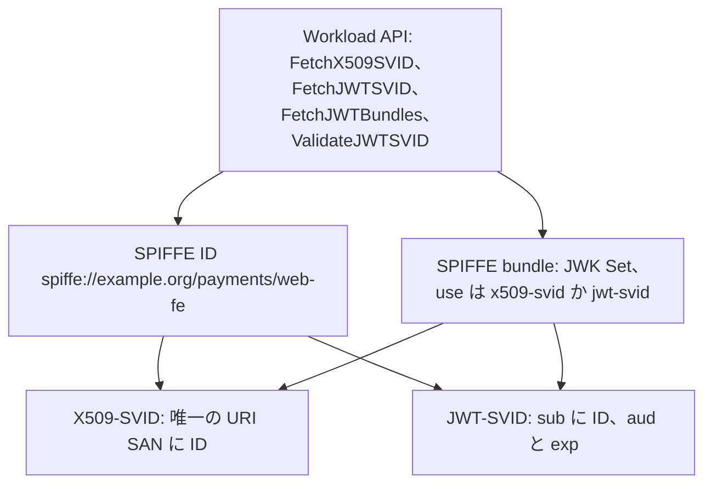
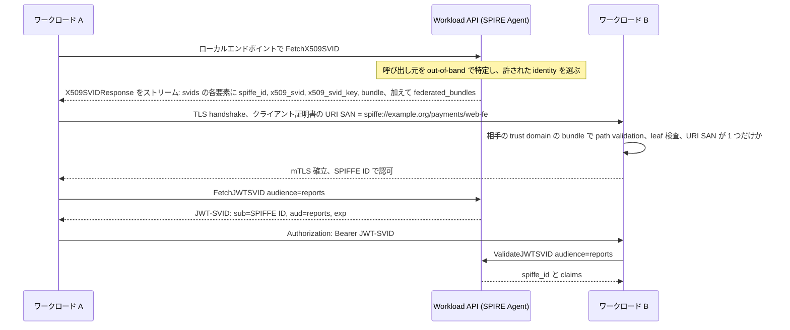

# SPIFFE

> 一言で言うと: SPIFFE はすべてのワークロードに URI の名前 (`spiffe://trust-domain/path`)、それを証明する署名付き文書 (X.509 か JWT の SVID)、そしてプロセスを attest してから両方を渡すローカルの Workload API を与える。デプロイ時に secret を埋め込む必要がなくなる。

## どういうときに使うか

- **クラスタ内のサービス同士が共有 secret なしで mTLS したい**: 各プロセスはローカルの Workload API を開く。API は呼び出し元を out-of-band で特定し、そのプロセスに許された X509-SVID、秘密鍵、trust bundle だけをストリームで返す (Workload API「Identifying the Caller」「FetchX509SVID」)。
- **ロードバランサなど Layer 7 のホップを越えると TLS のアイデンティティが消える**: JWT-SVID は SPIFFE ID を `sub` に載せ、1 つの `aud` と短い `exp` に絞る。受け手は自前の JWT 検証を書かずに `ValidateJWTSVID` に渡せる (JWT-SVID「Introduction」、Workload API「JWT-SVID Validation」)。
- **staging と production、あるいは 2 社のように、CA を共有せずに相互認証したい trust domain が 2 つある**: それぞれが鍵を SPIFFE bundle として公開し、Workload API が相手の bundle を federated bundle として配り、検証者は相手の trust domain に対応する bundle を選ぶ (Trust Domain and Bundle「SPIFFE Bundles」、Workload API「Federated Bundles」)。
- **ルート鍵を無停止でローテーションしたい**: bundle に新しい CA を旧 CA と並べて公開し、`spiffe_sequence` を増やし、旧ルートが切れる前に `spiffe_refresh_hint` の間隔で消費者に取りに来させる (Trust Domain and Bundle、Appendix A)。

## 解決する問題

ワークロードは他のクレデンシャルを取りに行く前に最初のクレデンシャルを必要とし、それはたいていイメージや環境変数に入った静的な secret として届く。SPIFFE はこれを、自身のクライアント認証を持たないローカル API に置き換える。実装側が呼び出し元プロセスを out-of-band で特定し、その呼び出し元に許された短命な文書だけを返す (Workload API「Identifying the Caller」)。

もう 1 つの問題は境界を越えた検証だ。共有ルートにチェーンする証明書を何でも受け入れる relying party は trust domain を区別できないので、SPIFFE はすべての ID を trust domain に結び付け、trust domain ごとに 1 つの bundle を配り、検証者には SVID に書かれた trust domain の bundle を選ぶことを求める (Workload API「Federated Bundles」)。

## 仕組み

ワークロード A は Workload API への接続を開いたまま、ストリームの応答をループで受け取る。各メッセージは SVID と bundle の全量を含み、消えた項目は redact されたとみなす (Workload API「Stream Responses」「Default Values and Redacted Information」)。TLS 側では、ワークロード B が A の trust domain の bundle に対して RFC 5280 の path validation を行い、続けて SPIFFE 固有の leaf 検査をする (X509-SVID「Path Validation」「Leaf Validation」)。JWT 側では、B は自分の agent に audience を指定して検証を頼み、SPIFFE ID と claims を受け取る。

## 仕様が求めること

- SPIFFE ID はスキームが `spiffe` の RFC 3986 URI で、trust domain 名が空でなく、query と fragment を持たない。trust domain は小文字で `[a-z0-9.-_]` のみ、port と userinfo を持たない。path のセグメントは `[a-zA-Z0-9.-_]` のみで、空セグメント、`.`、`..`、末尾の `/` を含まない (SPIFFE-ID「SPIFFE Identity」「Trust Domain」「Path」)。
- X509-SVID は URI SAN をちょうど 1 つ含まなければならず、複数あれば検証者は MUST で拒否する。leaf 証明書は `cA` を false、`digitalSignature` を設定し、`keyCertSign` と `cRLSign` は設定しない。key usage は必須かつ critical。Extended Key Usage を含めるなら `id-kp-serverAuth` と `id-kp-clientAuth` の両方を MUST で設定する (X509-SVID「SPIFFE ID」「Basic Constraints」「Key Usage」「Extended Key Usage」)。
- JWT-SVID は JWS Compact Serialization のみ、`alg` は RS、ES、PS 系に限定、`sub` は SPIFFE ID、`aud` は必須で検証者が照合し、`exp` は必須。HTTP では `Authorization: Bearer` で送るのが SHOULD (JWT-SVID「Algorithm」「Subject」「Audience」「Expiration Time」「HTTP」)。
- bundle は JWK Set で `keys` が MUST。各 JWK は `kty` と、`x509-svid`、`jwt-svid`、`wit-svid` のいずれかの `use` を持つ。X.509 CA のエントリは `x5c` に証明書 1 つ、`kid` なし。JWT-SVID のエントリは `kid` が MUST (Trust Domain and Bundle「Keys」「Key Type」「Public Key Use」、X509-SVID「Publishing SPIFFE Bundle Elements」、JWT-SVID「Publishing SPIFFE Bundle Elements」)。
- Workload API の X.509-SVID と JWT-SVID プロファイルは必須。WIT-SVID プロファイルは任意で、未対応なら `Unimplemented` を返す (Workload API「Introduction」「WIT-SVID Profile」)。
- 検証者は SVID の subject の trust domain に対応する bundle を選ぶ (JWT-SVID では MUST)。bundle がなければ相手を信頼しない (Workload API「Federated Bundles」「JWT-SVID Validation」)。

## 注意点

- trust domain 名は自己登録で中央のレジストリがない。同じ名前を選んだ 2 つの domain は独立に動き続けるが federation はできない。登録済み DNS 名のサフィックスかランダムな名前を使う (SPIFFE-ID「Trust Domain Name Collisions」)。
- JWT-SVID は bearer token なので replay できる。audience に Bob と Chuck を入れた token は、Chuck が Bob に対して送り手になりすませる。audience は 1 つ、`exp` は短く、すべてのホップで機密性を確保する。検証者に `jti` の追跡は求められていない (JWT-SVID「Replay Protection」「Audience」「Transport Security」)。
- ルート鍵を trust domain 間で共有しない。共有ルートへのチェーンを何でも信頼する検証者は、そのルートを使うすべての domain の identity を認証してしまい、認可層が trust domain を自分でふるい分ける羽目になる (Trust Domain and Bundle「Reusing Cryptographic Keys Across Trust Domains」)。
- SVID に SPIFFE ID 以外を入れた assertion は、`exp` より前に古くなりうるし、発行 trust domain にスコープされ (domain A の `admin` ロールは B では無意味)、発行者と消費者で意味が食い違いうる (SPIFFE-ID「SVID Assertions」)。
- `spiffe_refresh_hint` のない bundle は鍵の取り消しが遅れる。5 分程度の短い間隔をデフォルトにする (Trust Domain and Bundle「SPIFFE Bundle Refresh Hint」)。

## 出典

- [SPIFFE-ID「SPIFFE Identity」](https://github.com/spiffe/spiffe/blob/main/standards/SPIFFE-ID.md#2-spiffe-identity)
- [SPIFFE-ID「Trust Domain」](https://github.com/spiffe/spiffe/blob/main/standards/SPIFFE-ID.md#21-trust-domain)
- [SPIFFE-ID「Trust Domain Name Collisions」](https://github.com/spiffe/spiffe/blob/main/standards/SPIFFE-ID.md#211-trust-domain-name-collisions)
- [SPIFFE-ID「Path」](https://github.com/spiffe/spiffe/blob/main/standards/SPIFFE-ID.md#22-path)
- [SPIFFE-ID「SVID Assertions」](https://github.com/spiffe/spiffe/blob/main/standards/SPIFFE-ID.md#41-svid-assertions)
- [X509-SVID「SPIFFE ID」](https://github.com/spiffe/spiffe/blob/main/standards/X509-SVID.md#2-spiffe-id)
- [X509-SVID「Basic Constraints」](https://github.com/spiffe/spiffe/blob/main/standards/X509-SVID.md#41-basic-constraints)
- [X509-SVID「Key Usage」](https://github.com/spiffe/spiffe/blob/main/standards/X509-SVID.md#43-key-usage)
- [X509-SVID「Extended Key Usage」](https://github.com/spiffe/spiffe/blob/main/standards/X509-SVID.md#44-extended-key-usage)
- [X509-SVID「Path Validation」](https://github.com/spiffe/spiffe/blob/main/standards/X509-SVID.md#51-path-validation)
- [X509-SVID「Leaf Validation」](https://github.com/spiffe/spiffe/blob/main/standards/X509-SVID.md#52-leaf-validation)
- [X509-SVID「Publishing SPIFFE Bundle Elements」](https://github.com/spiffe/spiffe/blob/main/standards/X509-SVID.md#61-publishing-spiffe-bundle-elements)
- [JWT-SVID「Introduction」](https://github.com/spiffe/spiffe/blob/main/standards/JWT-SVID.md#1-introduction)
- [JWT-SVID「Algorithm」](https://github.com/spiffe/spiffe/blob/main/standards/JWT-SVID.md#21-algorithm)
- [JWT-SVID「Subject」](https://github.com/spiffe/spiffe/blob/main/standards/JWT-SVID.md#31-subject)
- [JWT-SVID「Audience」](https://github.com/spiffe/spiffe/blob/main/standards/JWT-SVID.md#32-audience)
- [JWT-SVID「Expiration Time」](https://github.com/spiffe/spiffe/blob/main/standards/JWT-SVID.md#33-expiration-time)
- [JWT-SVID「HTTP」](https://github.com/spiffe/spiffe/blob/main/standards/JWT-SVID.md#52-http)
- [JWT-SVID「Publishing SPIFFE Bundle Elements」](https://github.com/spiffe/spiffe/blob/main/standards/JWT-SVID.md#61-publishing-spiffe-bundle-elements)
- [JWT-SVID「Replay Protection」](https://github.com/spiffe/spiffe/blob/main/standards/JWT-SVID.md#71-replay-protection)
- [JWT-SVID「Audience」(security considerations)](https://github.com/spiffe/spiffe/blob/main/standards/JWT-SVID.md#72-audience)
- [JWT-SVID「Transport Security」](https://github.com/spiffe/spiffe/blob/main/standards/JWT-SVID.md#73-transport-security)
- [Workload API「Introduction」](https://github.com/spiffe/spiffe/blob/main/standards/SPIFFE_Workload_API.md#1-introduction)
- [Workload API「Identifying the Caller」](https://github.com/spiffe/spiffe/blob/main/standards/SPIFFE_Workload_API.md#41-identifying-the-caller)
- [Workload API「Stream Responses」](https://github.com/spiffe/spiffe/blob/main/standards/SPIFFE_Workload_API.md#43-stream-responses)
- [Workload API「Default Values and Redacted Information」](https://github.com/spiffe/spiffe/blob/main/standards/SPIFFE_Workload_API.md#44-default-values-and-redacted-information)
- [Workload API「Federated Bundles」](https://github.com/spiffe/spiffe/blob/main/standards/SPIFFE_Workload_API.md#46-federated-bundles)
- [Workload API「FetchX509SVID」](https://github.com/spiffe/spiffe/blob/main/standards/SPIFFE_Workload_API.md#521-fetchx509svid)
- [Workload API「JWT-SVID Validation」](https://github.com/spiffe/spiffe/blob/main/standards/SPIFFE_Workload_API.md#63-jwt-svid-validation)
- [Workload API「WIT-SVID Profile」](https://github.com/spiffe/spiffe/blob/main/standards/SPIFFE_Workload_API.md#7-wit-svid-profile)
- [Trust Domain and Bundle「SPIFFE Bundles」](https://github.com/spiffe/spiffe/blob/main/standards/SPIFFE_Trust_Domain_and_Bundle.md#3-spiffe-bundles)
- [Trust Domain and Bundle「Keys」](https://github.com/spiffe/spiffe/blob/main/standards/SPIFFE_Trust_Domain_and_Bundle.md#413-keys)
- [Trust Domain and Bundle「Key Type」](https://github.com/spiffe/spiffe/blob/main/standards/SPIFFE_Trust_Domain_and_Bundle.md#421-key-type)
- [Trust Domain and Bundle「Public Key Use」](https://github.com/spiffe/spiffe/blob/main/standards/SPIFFE_Trust_Domain_and_Bundle.md#422-public-key-use)
- [Trust Domain and Bundle「SPIFFE Bundle Refresh Hint」](https://github.com/spiffe/spiffe/blob/main/standards/SPIFFE_Trust_Domain_and_Bundle.md#61-spiffe-bundle-refresh-hint)
- [Trust Domain and Bundle「Reusing Cryptographic Keys Across Trust Domains」](https://github.com/spiffe/spiffe/blob/main/standards/SPIFFE_Trust_Domain_and_Bundle.md#62-reusing-cryptographic-keys-across-trust-domains)
- [Trust Domain and Bundle、Appendix A「SPIFFE Bundle Example」](https://github.com/spiffe/spiffe/blob/main/standards/SPIFFE_Trust_Domain_and_Bundle.md#appendix-a-spiffe-bundle-example)
