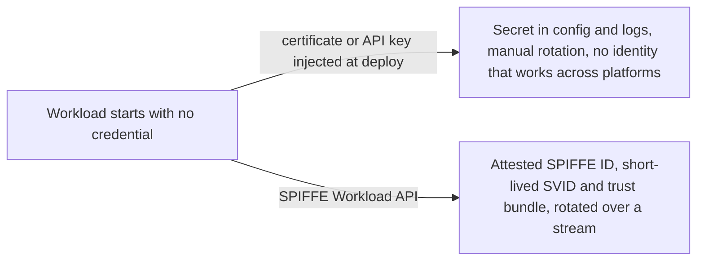
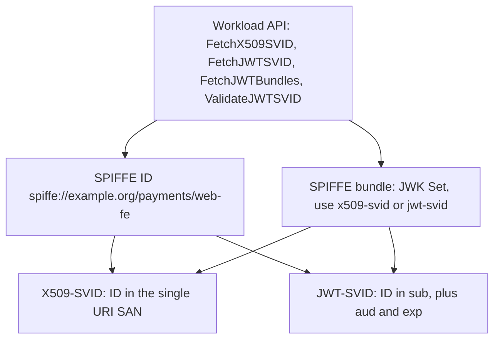
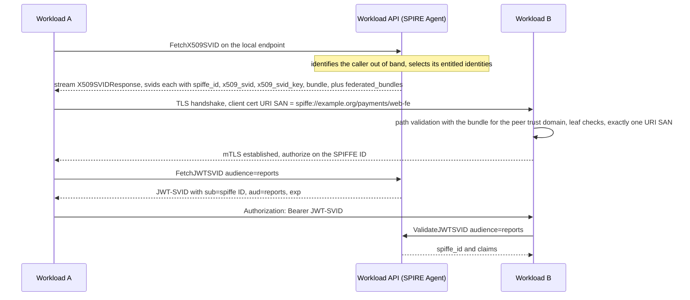

# SPIFFE

> In one line: SPIFFE gives every workload a URI name (`spiffe://trust-domain/path`), a signed document that proves it (an X.509 or JWT SVID), and a local Workload API that hands both out after attesting the process, so no secret has to be baked in at deploy time.

## When you reach for it

- **Services in a cluster that must do mTLS to each other with no shared secret**: each process opens the local Workload API, which identifies the caller out of band and streams back only the X509-SVIDs, keys and bundles that process is entitled to (Workload API, "Identifying the Caller" and "FetchX509SVID").
- **A call that crosses a Layer 7 hop, such as a load balancer, where the TLS identity is lost**: a JWT-SVID carries the SPIFFE ID in `sub`, scoped to one `aud` and a short `exp`, and the receiver can hand it to `ValidateJWTSVID` instead of validating JWTs itself (JWT-SVID, "Introduction"; Workload API, "JWT-SVID Validation").
- **Two trust domains, say staging and production, that must authenticate each other without sharing a CA**: each publishes its keys as a SPIFFE bundle, the Workload API delivers the foreign ones as federated bundles, and a validator picks the bundle for the peer's trust domain (Trust Domain and Bundle, "SPIFFE Bundles"; Workload API, "Federated Bundles").
- **Rotating a root key without downtime**: publish the replacement CA next to the old one in the bundle, increment `spiffe_sequence`, and let consumers refresh on `spiffe_refresh_hint` before the old root expires (Trust Domain and Bundle, Appendix A).

## The problem it solves

A workload needs a credential before it can fetch any other credential, and that first credential usually arrives as a static secret in an image or an environment variable. SPIFFE replaces it with a local API that has no client authentication of its own: the implementation identifies the calling process out of band and serves only the short-lived documents that caller may have (Workload API, "Identifying the Caller").

The second problem is validation across boundaries. A relying party that accepts any certificate chaining to a shared root cannot tell trust domains apart, so SPIFFE ties every ID to a trust domain, ships one bundle per trust domain, and requires the validator to pick the bundle for the trust domain named in the SVID (Workload API, "Federated Bundles").

## How it works

Workload A keeps a connection open to the Workload API and loops over stream responses; every message carries the complete set of SVIDs and bundles, and an absent item means it was redacted (Workload API, "Stream Responses" and "Default Values and Redacted Information"). For the TLS path, Workload B runs RFC 5280 path validation against the bundle for A's trust domain, then the SPIFFE leaf checks (X509-SVID, "Path Validation" and "Leaf Validation"). For the JWT path, B asks its own agent to validate the token for its audience and gets back the SPIFFE ID and claims.

## What the spec requires

- A SPIFFE ID is an RFC 3986 URI with scheme `spiffe`, a non-empty trust domain name and no query or fragment. The trust domain is lowercase, uses only `[a-z0-9.-_]`, and has no port or userinfo; path segments use `[a-zA-Z0-9.-_]`, with no empty, `.` or `..` segments and no trailing slash (SPIFFE-ID, "SPIFFE Identity", "Trust Domain", "Path").
- An X509-SVID MUST contain exactly one URI SAN, and a validator MUST reject one with more. Leaf certificates set `cA` false and `digitalSignature`, never `keyCertSign` or `cRLSign`; key usage is present and critical; if Extended Key Usage is included it MUST set both `id-kp-serverAuth` and `id-kp-clientAuth` (X509-SVID, "SPIFFE ID", "Basic Constraints", "Key Usage", "Extended Key Usage").
- A JWT-SVID uses JWS Compact Serialization only, `alg` restricted to the RS, ES and PS families, `sub` set to the SPIFFE ID, `aud` present and matched by the validator, and `exp` set. Over HTTP it SHOULD travel as `Authorization: Bearer` (JWT-SVID, "Algorithm", "Subject", "Audience", "Expiration Time", "HTTP").
- A bundle is a JWK Set whose `keys` MUST be present; each JWK sets `kty` and a `use` of `x509-svid`, `jwt-svid` or `wit-svid`. X.509 CA entries carry one certificate in `x5c` and no `kid`; JWT-SVID entries MUST carry `kid` (Trust Domain and Bundle, "Keys", "Key Type", "Public Key Use"; X509-SVID, "Publishing SPIFFE Bundle Elements"; JWT-SVID, "Publishing SPIFFE Bundle Elements").
- The X.509-SVID and JWT-SVID profiles of the Workload API are mandatory; the WIT-SVID profile is optional and returns `Unimplemented` when absent (Workload API, "Introduction", "WIT-SVID Profile").
- A validator picks the bundle for the trust domain of the SVID's subject (a MUST for JWT-SVIDs); if none is present the peer is untrusted (Workload API, "Federated Bundles", "JWT-SVID Validation").

## Watch out

- Trust domain names are self-registered with no central registry. Two domains that pick the same name keep working but cannot federate; use a registered DNS suffix or a random name (SPIFFE-ID, "Trust Domain Name Collisions").
- JWT-SVIDs are bearer tokens and replayable. A token minted for audiences Bob and Chuck lets Chuck impersonate the sender to Bob, so keep a single audience, a short `exp`, and confidentiality on every hop. Validators are not required to track `jti` (JWT-SVID, "Replay Protection", "Audience", "Transport Security").
- Do not share a root key across trust domains. A validator that trusts any chain to a shared root will authenticate identities from every domain that uses it, and the authorization layer then has to filter trust domains itself (Trust Domain and Bundle, "Reusing Cryptographic Keys Across Trust Domains").
- Anything in an SVID beyond the SPIFFE ID is an assertion that may go stale before `exp`, is scoped to the issuing trust domain (an `admin` role in domain A means nothing in B), and may be read differently by issuer and consumer (SPIFFE-ID, "SVID Assertions").
- A bundle without `spiffe_refresh_hint` slows key redaction; default to a low interval such as five minutes (Trust Domain and Bundle, "SPIFFE Bundle Refresh Hint").

## Sources

- [SPIFFE-ID, "SPIFFE Identity"](https://github.com/spiffe/spiffe/blob/main/standards/SPIFFE-ID.md#2-spiffe-identity)
- [SPIFFE-ID, "Trust Domain"](https://github.com/spiffe/spiffe/blob/main/standards/SPIFFE-ID.md#21-trust-domain)
- [SPIFFE-ID, "Trust Domain Name Collisions"](https://github.com/spiffe/spiffe/blob/main/standards/SPIFFE-ID.md#211-trust-domain-name-collisions)
- [SPIFFE-ID, "Path"](https://github.com/spiffe/spiffe/blob/main/standards/SPIFFE-ID.md#22-path)
- [SPIFFE-ID, "SVID Assertions"](https://github.com/spiffe/spiffe/blob/main/standards/SPIFFE-ID.md#41-svid-assertions)
- [X509-SVID, "SPIFFE ID"](https://github.com/spiffe/spiffe/blob/main/standards/X509-SVID.md#2-spiffe-id)
- [X509-SVID, "Basic Constraints"](https://github.com/spiffe/spiffe/blob/main/standards/X509-SVID.md#41-basic-constraints)
- [X509-SVID, "Key Usage"](https://github.com/spiffe/spiffe/blob/main/standards/X509-SVID.md#43-key-usage)
- [X509-SVID, "Extended Key Usage"](https://github.com/spiffe/spiffe/blob/main/standards/X509-SVID.md#44-extended-key-usage)
- [X509-SVID, "Path Validation"](https://github.com/spiffe/spiffe/blob/main/standards/X509-SVID.md#51-path-validation)
- [X509-SVID, "Leaf Validation"](https://github.com/spiffe/spiffe/blob/main/standards/X509-SVID.md#52-leaf-validation)
- [X509-SVID, "Publishing SPIFFE Bundle Elements"](https://github.com/spiffe/spiffe/blob/main/standards/X509-SVID.md#61-publishing-spiffe-bundle-elements)
- [JWT-SVID, "Introduction"](https://github.com/spiffe/spiffe/blob/main/standards/JWT-SVID.md#1-introduction)
- [JWT-SVID, "Algorithm"](https://github.com/spiffe/spiffe/blob/main/standards/JWT-SVID.md#21-algorithm)
- [JWT-SVID, "Subject"](https://github.com/spiffe/spiffe/blob/main/standards/JWT-SVID.md#31-subject)
- [JWT-SVID, "Audience"](https://github.com/spiffe/spiffe/blob/main/standards/JWT-SVID.md#32-audience)
- [JWT-SVID, "Expiration Time"](https://github.com/spiffe/spiffe/blob/main/standards/JWT-SVID.md#33-expiration-time)
- [JWT-SVID, "HTTP"](https://github.com/spiffe/spiffe/blob/main/standards/JWT-SVID.md#52-http)
- [JWT-SVID, "Publishing SPIFFE Bundle Elements"](https://github.com/spiffe/spiffe/blob/main/standards/JWT-SVID.md#61-publishing-spiffe-bundle-elements)
- [JWT-SVID, "Replay Protection"](https://github.com/spiffe/spiffe/blob/main/standards/JWT-SVID.md#71-replay-protection)
- [JWT-SVID, "Audience" (security considerations)](https://github.com/spiffe/spiffe/blob/main/standards/JWT-SVID.md#72-audience)
- [JWT-SVID, "Transport Security"](https://github.com/spiffe/spiffe/blob/main/standards/JWT-SVID.md#73-transport-security)
- [Workload API, "Introduction"](https://github.com/spiffe/spiffe/blob/main/standards/SPIFFE_Workload_API.md#1-introduction)
- [Workload API, "Identifying the Caller"](https://github.com/spiffe/spiffe/blob/main/standards/SPIFFE_Workload_API.md#41-identifying-the-caller)
- [Workload API, "Stream Responses"](https://github.com/spiffe/spiffe/blob/main/standards/SPIFFE_Workload_API.md#43-stream-responses)
- [Workload API, "Default Values and Redacted Information"](https://github.com/spiffe/spiffe/blob/main/standards/SPIFFE_Workload_API.md#44-default-values-and-redacted-information)
- [Workload API, "Federated Bundles"](https://github.com/spiffe/spiffe/blob/main/standards/SPIFFE_Workload_API.md#46-federated-bundles)
- [Workload API, "FetchX509SVID"](https://github.com/spiffe/spiffe/blob/main/standards/SPIFFE_Workload_API.md#521-fetchx509svid)
- [Workload API, "JWT-SVID Validation"](https://github.com/spiffe/spiffe/blob/main/standards/SPIFFE_Workload_API.md#63-jwt-svid-validation)
- [Workload API, "WIT-SVID Profile"](https://github.com/spiffe/spiffe/blob/main/standards/SPIFFE_Workload_API.md#7-wit-svid-profile)
- [Trust Domain and Bundle, "SPIFFE Bundles"](https://github.com/spiffe/spiffe/blob/main/standards/SPIFFE_Trust_Domain_and_Bundle.md#3-spiffe-bundles)
- [Trust Domain and Bundle, "Keys"](https://github.com/spiffe/spiffe/blob/main/standards/SPIFFE_Trust_Domain_and_Bundle.md#413-keys)
- [Trust Domain and Bundle, "Key Type"](https://github.com/spiffe/spiffe/blob/main/standards/SPIFFE_Trust_Domain_and_Bundle.md#421-key-type)
- [Trust Domain and Bundle, "Public Key Use"](https://github.com/spiffe/spiffe/blob/main/standards/SPIFFE_Trust_Domain_and_Bundle.md#422-public-key-use)
- [Trust Domain and Bundle, "SPIFFE Bundle Refresh Hint"](https://github.com/spiffe/spiffe/blob/main/standards/SPIFFE_Trust_Domain_and_Bundle.md#61-spiffe-bundle-refresh-hint)
- [Trust Domain and Bundle, "Reusing Cryptographic Keys Across Trust Domains"](https://github.com/spiffe/spiffe/blob/main/standards/SPIFFE_Trust_Domain_and_Bundle.md#62-reusing-cryptographic-keys-across-trust-domains)
- [Trust Domain and Bundle, Appendix A "SPIFFE Bundle Example"](https://github.com/spiffe/spiffe/blob/main/standards/SPIFFE_Trust_Domain_and_Bundle.md#appendix-a-spiffe-bundle-example)
