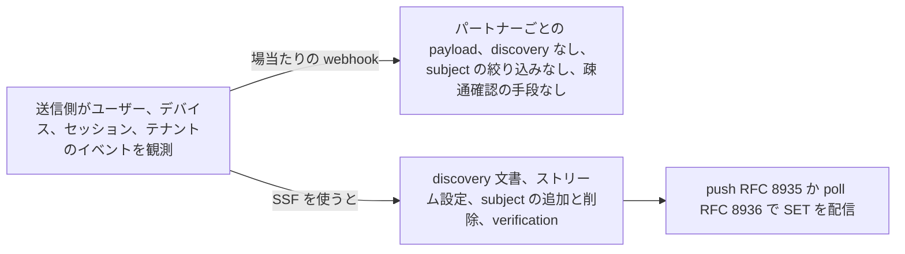
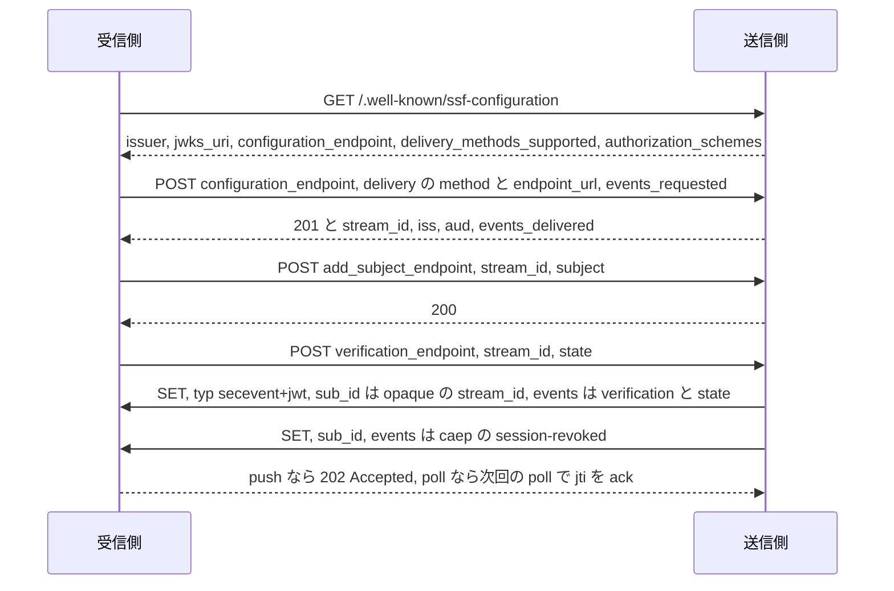

# Shared Signals Framework (SSF)

> 一言で言うと: SSF は Security Event Token の周りの配管で、受信側が送信側を発見し、イベントストリームを開き、欲しい subject とイベント型を伝え、パイプが通っていることを確かめ、push か poll で SET を受け取るまでを定める。

## どういうときに使うか

- **IdP と SaaS アプリが多数のパートナーと CAEP や RISC のイベントを交換したい**: 送信側は `/.well-known/ssf-configuration` に 1 つの discovery 文書と 1 つのストリーム管理 API を公開するだけで、新しい受信側は個別の webhook 契約なしに接続できる (Section 7.2, 8)。
- **受信側が送信側の一部のユーザー・デバイス・テナントにしか興味がない**: 受信側は自分のストリームに subject を追加・削除でき、送信側の `default_subjects` が `ALL` か `NONE` かで、新しいストリームが最初に何を運ぶかが決まる (Section 7.1, 8.1.3)。
- **イベントがめったに流れないストリームで、沈黙の意味が分からない**: 受信側は自分の `state` 値を添えて Verification Event を要求し、署名・暗号化・配信が end to end で動いていることを確かめる (Section 8.1.4)。
- **1 つの送信側が 1 ホストで複数の issuer を持つ**: issuer URL にパスを含められ、discovery のパスは `/.well-known/ssf-configuration/issuer1` になる (Section 7.2.1)。

## 解決する問題

RFC 8417 はトークンを定義するが、関係は定義しない。受信側が送信側の署名鍵をどう知るか、どのイベントを流すかをどう合意するか、受信側が自分の管理する subject にストリームをどう絞るか、どちらかがストリームをどう止めるか、静かなストリームと壊れたストリームをどう見分けるかは何も言っていない。

SSF がその隙間を埋める。イベント向けに SET をプロファイルし (明示的な型付け、トップレベルの `sub_id`、`sub` なし、`exp` なし)、RFC 9493 の subject identifier に新しい 3 形式 (`jwt_id`、`saml_assertion_id`、`ip-addresses`) を加えて simple / complex の subject member を定義し、Transmitter Configuration Metadata とその discovery を定め、イベントストリームの管理 API を定義する (Abstract, Section 3〜8)。CAEP と RISC はその上にイベント型を定義するプロファイルだ。

## 仕組み

受信側は issuer の well-known パスから Transmitter Configuration Metadata を取得し、`jwks_uri`、管理用エンドポイント、対応する配信方式を知る (Section 7.1, 7.2)。次に `configuration_endpoint` に POST してストリームを作る。配信方式 (`urn:ietf:rfc:8935` の push なら受信側の `endpoint_url` を添え、`urn:ietf:rfc:8936` の poll なら送信側が URL を返す) と `events_requested` を送ると、送信側は `stream_id`・`iss`・`aud`・`events_delivered` を返す (Section 6.1, 8.1.1.1)。その後、受信側は subject を追加し、Verification Event を要求できる (Section 8.1.3.2, 8.1.4.2)。各イベントは SET で、`sub_id` は simple な subject identifier か、`user`・`device`・`session`・`tenant` などのメンバーを持つ complex subject になる (Section 3.2, 3.3)。署名鍵は送信側の `jwks_uri` で解決する (Section 4.1.4)。

## 仕様が求めること

- トップレベルの `sub_id` claim で主たる subject を表さなければならない。JWT の `sub` claim を含めてはならず、`exp` も含めてはならない。SSF イベントは `typ` を `secevent+jwt` にした明示的な型付けを使わなければならない (Section 3.1, 4.1.1, 4.1.2, 4.1.7)。
- `iss` claim はストリーム設定の `iss` と、受信側がメタデータを取得した issuer に一致しなければならず、メタデータの `issuer` は取得に使った URL と同一でなければならない (Section 4.1.6, 7.2.4)。
- `events` claim にはイベントを 1 つだけ入れるべきで、受信側は理解できないフィールドを無視しなければならない (Section 4.2.1, 4.2.3)。
- discovery に対応する送信側は、host と path の間に `/.well-known/ssf-configuration` を挿入したパスで、メタデータを `application/json` として返さなければならない。署名付き JWT を発行するなら `jwks_uri` が必須 (Section 7.1, 7.2)。
- イベントが流れる前に受信側はストリームを作らなければならない。リクエストに `delivery` がなければ送信側は poll とみなさなければならない。他の方法で信頼関係を確立していない限り、ストリーム管理のエンドポイントは標準の HTTP 認証・認可を使い、受信側をその stream ID と `aud` 値に結び付けなければならない (Section 8, 8.1.1.1)。
- ストリームの状態は `enabled`・`paused`・`disabled` のいずれかで、送信側が自ら状態を変えるときは `stream-updated` イベントを送らなければならない。pause や disable のときは止める前に送る (Section 8.1.2, 8.1.5)。
- Verification Event の `sub_id` は `opaque` 形式で `id` が `stream_id` でなければならず、受信側は `state` を確認し、一致しなければ `invalid_state` を返すべき (Section 8.1.4.1)。

## 注意点

- **subject の探り当て**: add-subject への 404 はその subject の存在を明かす。送信側はイベントを送るつもりがなくても成功を返してよく、受信側は成功応答をイベントが来る保証と見なしてはならない (Section 9.1)。
- **情報の収穫**: subject の追加は関心の表明であって権利ではない。送信側は追加されたすべての subject についてイベントを送る義務はなく、共有してよいかを検証すべき (Section 9.2)。
- **悪意ある subject の削除**: 送信側は削除された subject のイベントをしばらく送り続けてよく、受信側はそれをエラーとして報告せずに許容しなければならない (Section 9.3)。
- **複数値の `aud`**: 送信側がそれらの受信側を同一の主体だと知っている場合に限る。そうでなければ別々の SET を発行する。共有サービスが SET を各受信側に振り分ける構成では、複数値の `aud` が意図しないデータ開示につながるからだ (Section 4.1.8)。
- **critical な subject member**: メタデータに `critical_subject_members` があれば、受信側は処理できない critical member を subject に含むイベントを捨てなければならない (Section 3.6)。
- **旧来の RISC 送信側**は `/.well-known/risc-configuration` にメタデータを置いたままでよいが、新しいサービスはそこを使うべきでない (Section 7.2.2)。

## 出典

- [OpenID SSF 1.0, Abstract](https://openid.net/specs/openid-sharedsignals-framework-1_0-final.html#abstract)
- [OpenID SSF 1.0, Section 3.1](https://openid.net/specs/openid-sharedsignals-framework-1_0-final.html#section-3.1)
- [OpenID SSF 1.0, Section 3.2](https://openid.net/specs/openid-sharedsignals-framework-1_0-final.html#section-3.2)
- [OpenID SSF 1.0, Section 3.3](https://openid.net/specs/openid-sharedsignals-framework-1_0-final.html#section-3.3)
- [OpenID SSF 1.0, Section 3.6](https://openid.net/specs/openid-sharedsignals-framework-1_0-final.html#section-3.6)
- [OpenID SSF 1.0, Section 4.1.1](https://openid.net/specs/openid-sharedsignals-framework-1_0-final.html#section-4.1.1)
- [OpenID SSF 1.0, Section 4.1.2](https://openid.net/specs/openid-sharedsignals-framework-1_0-final.html#section-4.1.2)
- [OpenID SSF 1.0, Section 4.1.4](https://openid.net/specs/openid-sharedsignals-framework-1_0-final.html#section-4.1.4)
- [OpenID SSF 1.0, Section 4.1.6](https://openid.net/specs/openid-sharedsignals-framework-1_0-final.html#section-4.1.6)
- [OpenID SSF 1.0, Section 4.1.7](https://openid.net/specs/openid-sharedsignals-framework-1_0-final.html#section-4.1.7)
- [OpenID SSF 1.0, Section 4.1.8](https://openid.net/specs/openid-sharedsignals-framework-1_0-final.html#section-4.1.8)
- [OpenID SSF 1.0, Section 4.2.1](https://openid.net/specs/openid-sharedsignals-framework-1_0-final.html#section-4.2.1)
- [OpenID SSF 1.0, Section 4.2.3](https://openid.net/specs/openid-sharedsignals-framework-1_0-final.html#section-4.2.3)
- [OpenID SSF 1.0, Section 6.1](https://openid.net/specs/openid-sharedsignals-framework-1_0-final.html#section-6.1)
- [OpenID SSF 1.0, Section 7.1](https://openid.net/specs/openid-sharedsignals-framework-1_0-final.html#section-7.1)
- [OpenID SSF 1.0, Section 7.2](https://openid.net/specs/openid-sharedsignals-framework-1_0-final.html#section-7.2)
- [OpenID SSF 1.0, Section 7.2.1](https://openid.net/specs/openid-sharedsignals-framework-1_0-final.html#section-7.2.1)
- [OpenID SSF 1.0, Section 7.2.2](https://openid.net/specs/openid-sharedsignals-framework-1_0-final.html#section-7.2.2)
- [OpenID SSF 1.0, Section 7.2.4](https://openid.net/specs/openid-sharedsignals-framework-1_0-final.html#section-7.2.4)
- [OpenID SSF 1.0, Section 8](https://openid.net/specs/openid-sharedsignals-framework-1_0-final.html#section-8)
- [OpenID SSF 1.0, Section 8.1.1.1](https://openid.net/specs/openid-sharedsignals-framework-1_0-final.html#section-8.1.1.1)
- [OpenID SSF 1.0, Section 8.1.2](https://openid.net/specs/openid-sharedsignals-framework-1_0-final.html#section-8.1.2)
- [OpenID SSF 1.0, Section 8.1.3](https://openid.net/specs/openid-sharedsignals-framework-1_0-final.html#section-8.1.3)
- [OpenID SSF 1.0, Section 8.1.3.2](https://openid.net/specs/openid-sharedsignals-framework-1_0-final.html#section-8.1.3.2)
- [OpenID SSF 1.0, Section 8.1.4](https://openid.net/specs/openid-sharedsignals-framework-1_0-final.html#section-8.1.4)
- [OpenID SSF 1.0, Section 8.1.4.1](https://openid.net/specs/openid-sharedsignals-framework-1_0-final.html#section-8.1.4.1)
- [OpenID SSF 1.0, Section 8.1.4.2](https://openid.net/specs/openid-sharedsignals-framework-1_0-final.html#section-8.1.4.2)
- [OpenID SSF 1.0, Section 8.1.5](https://openid.net/specs/openid-sharedsignals-framework-1_0-final.html#section-8.1.5)
- [OpenID SSF 1.0, Section 9.1](https://openid.net/specs/openid-sharedsignals-framework-1_0-final.html#section-9.1)
- [OpenID SSF 1.0, Section 9.2](https://openid.net/specs/openid-sharedsignals-framework-1_0-final.html#section-9.2)
- [OpenID SSF 1.0, Section 9.3](https://openid.net/specs/openid-sharedsignals-framework-1_0-final.html#section-9.3)
