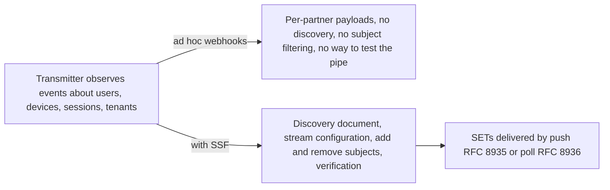
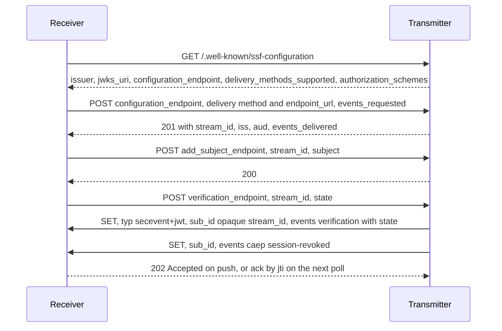

# Shared Signals Framework (SSF)

> In one line: SSF is the plumbing around Security Event Tokens, so a receiver can discover a transmitter, open an event stream, say which subjects and event types it wants, prove the pipe works, and then get SETs by push or poll.

## When you reach for it

- **An identity provider and a SaaS application need to exchange CAEP or RISC events with many partners**: each transmitter publishes one discovery document at `/.well-known/ssf-configuration` and one stream management API, so a new receiver onboards without a bespoke webhook contract (Sections 7.2 and 8).
- **A receiver only cares about some of the transmitter's users, devices or tenants**: the receiver adds and removes subjects on its stream, and the transmitter's `default_subjects` of `ALL` or `NONE` says what a fresh stream carries (Sections 7.1 and 8.1.3).
- **A stream that carries events only rarely, so silence is ambiguous**: the receiver asks for a Verification Event with its own `state` value and confirms that signing, encryption and delivery work end to end (Section 8.1.4).
- **One transmitter hosts many issuers on a single host**: the issuer URL may carry a path component, and the discovery path becomes `/.well-known/ssf-configuration/issuer1` (Section 7.2.1).

## The problem it solves

RFC 8417 defines the token but not the relationship. It says nothing about how a receiver learns the transmitter's signing keys, how the two agree on which events flow, how the receiver restricts the stream to the subjects it manages, how either side pauses the stream, or how a receiver can tell a quiet stream from a broken one.

SSF fills that gap. It profiles SET for its events (explicit typing, a top-level `sub_id`, no `sub`, no `exp`), defines simple and complex subject members built on RFC 9493 subject identifiers plus three new formats (`jwt_id`, `saml_assertion_id`, `ip-addresses`), specifies Transmitter Configuration Metadata and its discovery, and defines a management API for event streams (Abstract, Sections 3 to 8). CAEP and RISC are profiles that define event types on top of it.

## How it works

The receiver fetches the Transmitter Configuration Metadata from the issuer's well-known path and learns `jwks_uri`, the management endpoints and the supported delivery methods (Sections 7.1 and 7.2). It creates a stream with a POST to the `configuration_endpoint`, naming its delivery method (`urn:ietf:rfc:8935` for push with the receiver's `endpoint_url`, or `urn:ietf:rfc:8936` for poll, where the transmitter supplies the URL) and the `events_requested`; the transmitter answers with `stream_id`, `iss`, `aud` and `events_delivered` (Sections 6.1 and 8.1.1.1). The receiver then adds subjects and can trigger a Verification Event (Sections 8.1.3.2 and 8.1.4.2). Every event is a SET whose `sub_id` is a simple subject identifier or a complex one with `user`, `device`, `session`, `tenant` and similar members (Sections 3.2 and 3.3). The transmitter's `jwks_uri` resolves the signing key (Section 4.1.4).

## What the spec requires

- A top-level `sub_id` claim MUST describe the primary subject; the JWT `sub` claim MUST NOT be present; `exp` MUST NOT be present; SSF events MUST use explicit typing with `typ` `secevent+jwt` (Sections 3.1, 4.1.1, 4.1.2, 4.1.7).
- The `iss` claim MUST match the `iss` in the stream configuration and the issuer from which the receiver fetched the metadata, and the metadata's `issuer` MUST be identical to the URL used to retrieve it (Sections 4.1.6 and 7.2.4).
- The `events` claim SHOULD contain only one event; receivers MUST ignore fields they do not understand (Sections 4.2.1 and 4.2.3).
- Transmitters supporting discovery MUST serve the metadata as `application/json` at the path formed by inserting `/.well-known/ssf-configuration` between host and path; `jwks_uri` MUST be present if the transmitter issues signed JWTs (Sections 7.1 and 7.2).
- A receiver MUST create a stream before events flow; if the request omits `delivery`, the transmitter MUST assume poll; unless trust is established some other way, stream management endpoints MUST use standard HTTP authentication and authorization that ties a receiver to its stream IDs and `aud` values (Sections 8 and 8.1.1.1).
- A stream is `enabled`, `paused` or `disabled`; when the transmitter changes the status on its own it MUST send a `stream-updated` event, before stopping when pausing or disabling (Sections 8.1.2 and 8.1.5).
- In a Verification Event `sub_id` MUST be an `opaque` identifier whose `id` is the `stream_id`; the receiver SHALL check `state` and SHOULD answer `invalid_state` if it does not match (Section 8.1.4.1).

## Watch out

- **Subject probing**: a 404 on an add-subject request reveals whether the subject exists; transmitters MAY return success without ever sending events, and receivers MUST NOT assume a success response means events will follow (Section 9.1).
- **Information harvesting**: adding a subject is a statement of interest, not an entitlement; the transmitter is not obligated to transmit events for every added subject and SHOULD validate that it may share them (Section 9.2).
- **Malicious subject removal**: a transmitter MAY keep sending events for a removed subject for a while, and receivers MUST tolerate them without reporting errors (Section 9.3).
- **Multi-valued `aud`**: only when the transmitter knows the receivers are the same entity; otherwise issue distinct SETs, because when a shared service reroutes SETs to their receivers, a multi-valued `aud` leads to unintended data disclosure (Section 4.1.8).
- **Critical subject members**: if the metadata lists `critical_subject_members`, a receiver MUST discard any event whose subject carries a critical member it cannot process (Section 3.6).
- **Legacy RISC transmitters** may still publish metadata at `/.well-known/risc-configuration`; new services SHOULD NOT (Section 7.2.2).

## Sources

- [OpenID SSF 1.0, Abstract](https://openid.net/specs/openid-sharedsignals-framework-1_0-final.html#abstract)
- [OpenID SSF 1.0, Section 3.1](https://openid.net/specs/openid-sharedsignals-framework-1_0-final.html#section-3.1)
- [OpenID SSF 1.0, Section 3.2](https://openid.net/specs/openid-sharedsignals-framework-1_0-final.html#section-3.2)
- [OpenID SSF 1.0, Section 3.3](https://openid.net/specs/openid-sharedsignals-framework-1_0-final.html#section-3.3)
- [OpenID SSF 1.0, Section 3.6](https://openid.net/specs/openid-sharedsignals-framework-1_0-final.html#section-3.6)
- [OpenID SSF 1.0, Section 4.1.1](https://openid.net/specs/openid-sharedsignals-framework-1_0-final.html#section-4.1.1)
- [OpenID SSF 1.0, Section 4.1.2](https://openid.net/specs/openid-sharedsignals-framework-1_0-final.html#section-4.1.2)
- [OpenID SSF 1.0, Section 4.1.4](https://openid.net/specs/openid-sharedsignals-framework-1_0-final.html#section-4.1.4)
- [OpenID SSF 1.0, Section 4.1.6](https://openid.net/specs/openid-sharedsignals-framework-1_0-final.html#section-4.1.6)
- [OpenID SSF 1.0, Section 4.1.7](https://openid.net/specs/openid-sharedsignals-framework-1_0-final.html#section-4.1.7)
- [OpenID SSF 1.0, Section 4.1.8](https://openid.net/specs/openid-sharedsignals-framework-1_0-final.html#section-4.1.8)
- [OpenID SSF 1.0, Section 4.2.1](https://openid.net/specs/openid-sharedsignals-framework-1_0-final.html#section-4.2.1)
- [OpenID SSF 1.0, Section 4.2.3](https://openid.net/specs/openid-sharedsignals-framework-1_0-final.html#section-4.2.3)
- [OpenID SSF 1.0, Section 6.1](https://openid.net/specs/openid-sharedsignals-framework-1_0-final.html#section-6.1)
- [OpenID SSF 1.0, Section 7.1](https://openid.net/specs/openid-sharedsignals-framework-1_0-final.html#section-7.1)
- [OpenID SSF 1.0, Section 7.2](https://openid.net/specs/openid-sharedsignals-framework-1_0-final.html#section-7.2)
- [OpenID SSF 1.0, Section 7.2.1](https://openid.net/specs/openid-sharedsignals-framework-1_0-final.html#section-7.2.1)
- [OpenID SSF 1.0, Section 7.2.2](https://openid.net/specs/openid-sharedsignals-framework-1_0-final.html#section-7.2.2)
- [OpenID SSF 1.0, Section 7.2.4](https://openid.net/specs/openid-sharedsignals-framework-1_0-final.html#section-7.2.4)
- [OpenID SSF 1.0, Section 8](https://openid.net/specs/openid-sharedsignals-framework-1_0-final.html#section-8)
- [OpenID SSF 1.0, Section 8.1.1.1](https://openid.net/specs/openid-sharedsignals-framework-1_0-final.html#section-8.1.1.1)
- [OpenID SSF 1.0, Section 8.1.2](https://openid.net/specs/openid-sharedsignals-framework-1_0-final.html#section-8.1.2)
- [OpenID SSF 1.0, Section 8.1.3](https://openid.net/specs/openid-sharedsignals-framework-1_0-final.html#section-8.1.3)
- [OpenID SSF 1.0, Section 8.1.3.2](https://openid.net/specs/openid-sharedsignals-framework-1_0-final.html#section-8.1.3.2)
- [OpenID SSF 1.0, Section 8.1.4](https://openid.net/specs/openid-sharedsignals-framework-1_0-final.html#section-8.1.4)
- [OpenID SSF 1.0, Section 8.1.4.1](https://openid.net/specs/openid-sharedsignals-framework-1_0-final.html#section-8.1.4.1)
- [OpenID SSF 1.0, Section 8.1.4.2](https://openid.net/specs/openid-sharedsignals-framework-1_0-final.html#section-8.1.4.2)
- [OpenID SSF 1.0, Section 8.1.5](https://openid.net/specs/openid-sharedsignals-framework-1_0-final.html#section-8.1.5)
- [OpenID SSF 1.0, Section 9.1](https://openid.net/specs/openid-sharedsignals-framework-1_0-final.html#section-9.1)
- [OpenID SSF 1.0, Section 9.2](https://openid.net/specs/openid-sharedsignals-framework-1_0-final.html#section-9.2)
- [OpenID SSF 1.0, Section 9.3](https://openid.net/specs/openid-sharedsignals-framework-1_0-final.html#section-9.3)
