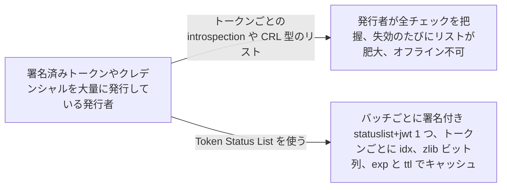
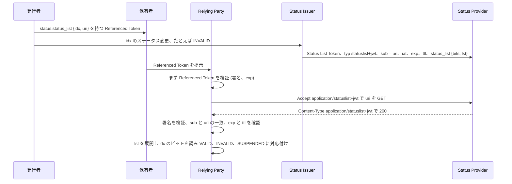

# Token Status List

> 一言で言うと: 発行者が数千のトークン分をまとめた、署名付きで zlib 圧縮されたビット列を 1 つ公開する。各トークンは `status.status_list.{uri, idx}` を持ち、検証者はそのリストを取ってきて自分のビットを読む。

## どういうときに使うか

- **誰が確認したかを発行者に知らせずに失効させたいウォレットのクレデンシャル**: SD-JWT VC や mdoc が他の多数のトークンと共有するリストを指すので、発行者に見えるのはリストの取得だけで、どのクレデンシャルが検証されたかは分からない (herd privacy) (Section 1、Section 12.1)。
- **大規模にチェックされる access token**: token introspection (RFC 7662) ではリソースサーバーがトークンごとに発行者へ問い合わせるが、status list なら 1 回の取得で多数のトークンに答えられ、問い合わせを大幅に減らせる (Section 1.1)。
- **政府や企業の数百万件規模の発行**: トークンあたり 1〜8 ビットに詰めて DEFLATE 圧縮するのでリストは小さく保たれ、キャッシュとオフライン利用という設計要件を `exp` と `ttl` が満たす (Section 1.2、Section 1.3、Section 13.7)。
- **発行者ではない CDN でステータスを配信する**: リストは署名付きの JWT か CWT なので、内容について信頼されていない別の Status Provider が配信でき、relying party が発行者から隠れることにもなる (Section 12.6、Section 13.6)。

## 解決する問題

署名済みの JWT、SD-JWT、mdoc は `exp` まで有効だ。発行者がそれより前に失効や停止をしたければ、relying party がそれを知る手段が要る。トークンごとに発行者へ問い合わせる (introspection) 方式はスケールしないうえ、発行者がトークンの利用場所と時刻のプロファイルを作れてしまう (Section 1.1、Section 12.1)。

Token Status List は各 Referenced Token にビット列へのインデックスを与える。Status Issuer がビットを設定し、配列を圧縮し、Status List Token として署名して Status Provider に渡す。relying party は Referenced Token を検証し、その `status` claim の `uri` からリストを取得し、署名を検証して `idx` のビットを読む (Section 1、Section 8.3)。

## 仕組み

Status Issuer は `bits` (1、2、4、8 のいずれか) を決め、各トークンのステータスを最下位ビットから連続したビットブロックに詰め、バイト列を ZLIB 形式の DEFLATE で圧縮する (Section 4.1)。JSON 形式は `{"bits": n, "lst": "<圧縮バイト列の base64url>"}` で (Section 4.2)、`typ: statuslist+jwt`、リストの URI と等しい `sub`、`iat`、できれば `exp` と `ttl` を持つ JWT の `status_list` claim として運ばれる (Section 5.1)。各 Referenced Token は `status.status_list.idx` と `uri` を持つ (Section 6.2)。relying party は `Accept: application/statuslist+jwt` でトークンを取得し、検証して `idx` の値を読む (Section 8.1、Section 8.3)。

## 仕様が求めること

- `bits` は 1、2、4、8 のいずれかでなければならない。インデックスは各バイトの最下位ビットから最上位ビットへ詰め、配列は ZLIB 形式の DEFLATE で圧縮する (Section 4.1)。
- JWT 形式の Status List Token は `typ: statuslist+jwt`、Referenced Token の `uri` と等しい `sub`、`iat`、`status_list` を持たなければならない。`exp` と `ttl` は推奨。JWT は署名か MAC で保護しなければならず、relying party は署名が無効な JWT を拒否しなければならない (Section 5.1)。
- Referenced Token は `status` claim を持ち、その中の `status_list` に `idx` (非負整数) と `uri` (RFC 3986 の URI) を含まなければならない (Section 6.2)。
- Status Type の値は 0x00 VALID、0x01 INVALID、0x02 SUSPENDED。0x03 と 0x0C〜0x0F はアプリケーション固有。`bits` が 1 より大きい場合、値全体で 1 つのステータスを表す (Section 7、Section 7.1)。
- Referenced Token の検証はステータス評価より先でなければならず、ビットが VALID でも期限切れのトークンは期限切れ。relying party は `sub` と `uri` の一致を確認し、`exp` があれば確認し、`idx` が範囲外ならトークンを拒否しなければならない。その他のチェックに失敗した場合はトークンを拒否すべきである (Section 8.3)。
- Status Provider は `uri` への HTTP GET に対して `Content-Type: application/statuslist+jwt` か `application/statuslist+cwt` でトークンを返さなければならず、relying party は HTTP のキャッシュヘッダより `exp` と `ttl` を優先しなければならない (Section 8.1、Section 8.2)。
- 過去時点の照会は `time=<unix timestamp>` クエリを使う。クライアントは `iat` と `exp` が要求した時刻を含まない応答を拒否しなければならない (Section 8.4)。

## 注意点

- **ビット順**: バイト内ではビットを最下位から最上位へ、バイトは自然な順で数える。ここでの off-by-one は黙って別のトークンのステータスを返す。Appendix C のテストベクタで確認すること (Section 11.1)。
- **`exp` と `ttl` が DDoS の梃子になる**: 悪意あるか不具合のある Status Issuer が極端に短い寿命を設定すると、全クライアントが Status Provider を叩き続ける。クライアントは新しいリストを取りに行く前に、両方の値が妥当な範囲にあるか確認すべきである (Section 11.5)。
- **MAC**: リスクを十分理解している場合に限って使う。迷ったらデジタル署名を既定にすべきである (Section 11.6)。
- **プライバシーはリストのサイズと発行者の誠実さに依存する**: トークンごとのリストやトークンごとに固有のクエリ文字列は herd privacy を壊し、`uri` と `idx` の組は追跡可能だ。発行者は使い捨てトークンのバッチ発行を推奨され、Status Issuer はランダムなインデックスとダミーエントリを使うとよい。再発行したトークンには新しいエントリを割り当てなければならない (Section 12.2、Section 12.5、Section 12.5.1、Section 13.2)。
- **過去照会と追加のステータス種別は情報を漏らす**: 実装者は必要がない限り `time=` 照会をサポートしないことを推奨され、VALID と INVALID 以外のステータスは外部者が読み取れる情報になる (Section 12.7、Section 12.8)。

## 出典

- [draft-ietf-oauth-status-list, Section 1](https://datatracker.ietf.org/doc/html/draft-ietf-oauth-status-list#section-1)
- [draft-ietf-oauth-status-list, Section 1.1](https://datatracker.ietf.org/doc/html/draft-ietf-oauth-status-list#section-1.1)
- [draft-ietf-oauth-status-list, Section 1.2](https://datatracker.ietf.org/doc/html/draft-ietf-oauth-status-list#section-1.2)
- [draft-ietf-oauth-status-list, Section 1.3](https://datatracker.ietf.org/doc/html/draft-ietf-oauth-status-list#section-1.3)
- [draft-ietf-oauth-status-list, Section 4.1](https://datatracker.ietf.org/doc/html/draft-ietf-oauth-status-list#section-4.1)
- [draft-ietf-oauth-status-list, Section 4.2](https://datatracker.ietf.org/doc/html/draft-ietf-oauth-status-list#section-4.2)
- [draft-ietf-oauth-status-list, Section 5.1](https://datatracker.ietf.org/doc/html/draft-ietf-oauth-status-list#section-5.1)
- [draft-ietf-oauth-status-list, Section 6.2](https://datatracker.ietf.org/doc/html/draft-ietf-oauth-status-list#section-6.2)
- [draft-ietf-oauth-status-list, Section 7](https://datatracker.ietf.org/doc/html/draft-ietf-oauth-status-list#section-7)
- [draft-ietf-oauth-status-list, Section 7.1](https://datatracker.ietf.org/doc/html/draft-ietf-oauth-status-list#section-7.1)
- [draft-ietf-oauth-status-list, Section 8.1](https://datatracker.ietf.org/doc/html/draft-ietf-oauth-status-list#section-8.1)
- [draft-ietf-oauth-status-list, Section 8.2](https://datatracker.ietf.org/doc/html/draft-ietf-oauth-status-list#section-8.2)
- [draft-ietf-oauth-status-list, Section 8.3](https://datatracker.ietf.org/doc/html/draft-ietf-oauth-status-list#section-8.3)
- [draft-ietf-oauth-status-list, Section 8.4](https://datatracker.ietf.org/doc/html/draft-ietf-oauth-status-list#section-8.4)
- [draft-ietf-oauth-status-list, Section 11.1](https://datatracker.ietf.org/doc/html/draft-ietf-oauth-status-list#section-11.1)
- [draft-ietf-oauth-status-list, Section 11.5](https://datatracker.ietf.org/doc/html/draft-ietf-oauth-status-list#section-11.5)
- [draft-ietf-oauth-status-list, Section 11.6](https://datatracker.ietf.org/doc/html/draft-ietf-oauth-status-list#section-11.6)
- [draft-ietf-oauth-status-list, Section 12.1](https://datatracker.ietf.org/doc/html/draft-ietf-oauth-status-list#section-12.1)
- [draft-ietf-oauth-status-list, Section 12.2](https://datatracker.ietf.org/doc/html/draft-ietf-oauth-status-list#section-12.2)
- [draft-ietf-oauth-status-list, Section 12.5](https://datatracker.ietf.org/doc/html/draft-ietf-oauth-status-list#section-12.5)
- [draft-ietf-oauth-status-list, Section 12.5.1](https://datatracker.ietf.org/doc/html/draft-ietf-oauth-status-list#section-12.5.1)
- [draft-ietf-oauth-status-list, Section 12.6](https://datatracker.ietf.org/doc/html/draft-ietf-oauth-status-list#section-12.6)
- [draft-ietf-oauth-status-list, Section 12.7](https://datatracker.ietf.org/doc/html/draft-ietf-oauth-status-list#section-12.7)
- [draft-ietf-oauth-status-list, Section 12.8](https://datatracker.ietf.org/doc/html/draft-ietf-oauth-status-list#section-12.8)
- [draft-ietf-oauth-status-list, Section 13.2](https://datatracker.ietf.org/doc/html/draft-ietf-oauth-status-list#section-13.2)
- [draft-ietf-oauth-status-list, Section 13.6](https://datatracker.ietf.org/doc/html/draft-ietf-oauth-status-list#section-13.6)
- [draft-ietf-oauth-status-list, Section 13.7](https://datatracker.ietf.org/doc/html/draft-ietf-oauth-status-list#section-13.7)
- [draft-ietf-oauth-status-list, Appendix C](https://datatracker.ietf.org/doc/html/draft-ietf-oauth-status-list#appendix-C)
