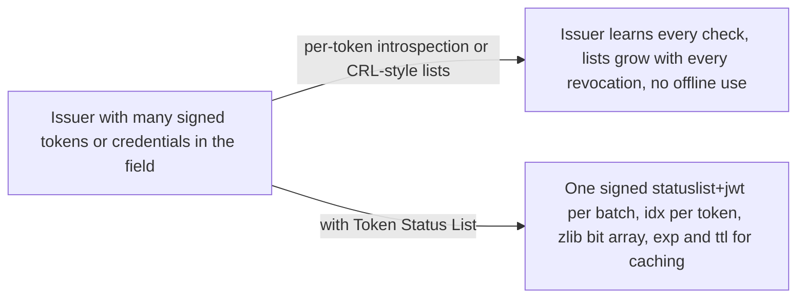
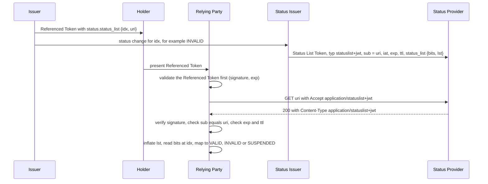

# Token Status List

> In one line: The issuer publishes one signed, zlib-compressed bit array covering thousands of tokens; each token carries `status.status_list.{uri, idx}`, and the verifier fetches the list and reads its own bits.

## When you reach for it

- **A wallet credential that must be revocable without telling the issuer who checked it**: an SD-JWT VC or mdoc points at a list shared with many other tokens, so the issuer only sees a fetch of the list, not which credential was verified (herd privacy) (Section 1, Section 12.1).
- **Access tokens checked at scale**: token introspection (RFC 7662) forces the resource server to call the issuer for every token; one status list answers for many tokens and cuts those calls (Section 1.1).
- **Government or enterprise issuance in the millions**: bits packed one to eight per token and DEFLATE compression keep the list small, and the design calls for caching and offline support, which `exp` and `ttl` provide (Section 1.2, Section 1.3, Section 13.7).
- **Hosting status on a CDN that is not the issuer**: the list is a signed JWT or CWT, so a separate Status Provider can serve it without being trusted for content, which also hides the relying party from the issuer (Section 12.6, Section 13.6).

## The problem it solves

A signed JWT, SD-JWT or mdoc is valid until `exp`. To revoke or suspend it earlier, the issuer needs a way to tell relying parties. Per-token introspection scales badly and lets the issuer profile where and when the token was used (Section 1.1, Section 12.1).

Token Status List gives each Referenced Token an index into a bit array. The Status Issuer sets the bits, compresses and signs the array as a Status List Token, and hands it to a Status Provider. The relying party validates the Referenced Token, fetches the list at the `uri` in its `status` claim, verifies the signature, and reads the bits at `idx` (Section 1, Section 8.3).

## How it works

The Status Issuer picks `bits` (1, 2, 4 or 8), packs each token's status into a contiguous block of bits starting from the least significant bit, and compresses the byte array with DEFLATE in ZLIB format (Section 4.1). The JSON form is `{"bits": n, "lst": "<base64url of the compressed bytes>"}` (Section 4.2), carried as the `status_list` claim of a JWT with `typ: statuslist+jwt`, `sub` equal to the list URI, `iat`, and ideally `exp` and `ttl` (Section 5.1). Each Referenced Token carries `status.status_list.idx` and `uri` (Section 6.2). The relying party fetches the token with `Accept: application/statuslist+jwt`, validates it, and reads the value at `idx` (Section 8.1, Section 8.3).

## What the spec requires

- `bits` MUST be 1, 2, 4 or 8; indices are packed into bytes from the least significant bit to the most significant bit; the array is compressed with DEFLATE in ZLIB format (Section 4.1).
- The Status List Token in JWT form MUST have `typ: statuslist+jwt`, `sub` equal to the `uri` in the Referenced Token, `iat`, and `status_list`; `exp` and `ttl` are RECOMMENDED; the JWT MUST be signed or MAC'd and relying parties MUST reject an invalid signature (Section 5.1).
- A Referenced Token MUST carry a `status` claim containing `status_list` with `idx` (a non-negative integer) and `uri` (an RFC 3986 URI) (Section 6.2).
- Status Type values are 0x00 VALID, 0x01 INVALID and 0x02 SUSPENDED; 0x03 and 0x0C through 0x0F are application specific; when `bits` is larger than 1 the whole value describes one status (Section 7, Section 7.1).
- Validation of the Referenced Token MUST precede status evaluation, so an expired token is expired even if its bit says VALID. The relying party MUST check that `sub` equals `uri`, MUST check `exp` if present, and MUST reject the token if `idx` is out of bounds; any other failed check means the token SHOULD be rejected (Section 8.3).
- The Status Provider MUST serve the token on an HTTP GET to `uri` with `Content-Type: application/statuslist+jwt` or `application/statuslist+cwt`, and relying parties MUST prioritize `exp` and `ttl` over HTTP caching headers (Section 8.1, Section 8.2).
- Historical lookups use a `time=<unix timestamp>` query; the client MUST reject a response whose `iat` and `exp` do not cover the requested time (Section 8.4).

## Watch out

- **Bit order**: bits are indexed from least significant to most significant within a byte while bytes run in natural order; off-by-one here silently reports the wrong token's status. Verify against the test vectors in Appendix C (Section 11.1).
- **`exp` and `ttl` as a DDoS lever**: a malicious or buggy Status Issuer can set tiny lifetimes so every client hammers the Status Provider; clients SHOULD check that both values are within reasonable ranges before fetching a new list (Section 11.5).
- **MACs**: use a MAC only if you fully understand the risks; implementers SHOULD default to digital signatures if unsure (Section 11.6).
- **Privacy depends on list size and honest issuers**: a per-token list or a unique query string per token destroys herd privacy, and the `uri` plus `idx` pair is traceable. Issuers are RECOMMENDED to offer batches of one-time-use tokens, Status Issuers should use random indices and decoy entries, and re-issued tokens MUST get fresh entries (Section 12.2, Section 12.5, Section 12.5.1, Section 13.2).
- **Historical resolution and extra status types leak**: implementers are RECOMMENDED not to support `time=` queries unless they must, and any status beyond VALID and INVALID conveys information outsiders can mine (Section 12.7, Section 12.8).

## Sources

- [draft-ietf-oauth-status-list, Section 1](https://datatracker.ietf.org/doc/html/draft-ietf-oauth-status-list#section-1)
- [draft-ietf-oauth-status-list, Section 1.1](https://datatracker.ietf.org/doc/html/draft-ietf-oauth-status-list#section-1.1)
- [draft-ietf-oauth-status-list, Section 1.2](https://datatracker.ietf.org/doc/html/draft-ietf-oauth-status-list#section-1.2)
- [draft-ietf-oauth-status-list, Section 1.3](https://datatracker.ietf.org/doc/html/draft-ietf-oauth-status-list#section-1.3)
- [draft-ietf-oauth-status-list, Section 4.1](https://datatracker.ietf.org/doc/html/draft-ietf-oauth-status-list#section-4.1)
- [draft-ietf-oauth-status-list, Section 4.2](https://datatracker.ietf.org/doc/html/draft-ietf-oauth-status-list#section-4.2)
- [draft-ietf-oauth-status-list, Section 5.1](https://datatracker.ietf.org/doc/html/draft-ietf-oauth-status-list#section-5.1)
- [draft-ietf-oauth-status-list, Section 6.2](https://datatracker.ietf.org/doc/html/draft-ietf-oauth-status-list#section-6.2)
- [draft-ietf-oauth-status-list, Section 7](https://datatracker.ietf.org/doc/html/draft-ietf-oauth-status-list#section-7)
- [draft-ietf-oauth-status-list, Section 7.1](https://datatracker.ietf.org/doc/html/draft-ietf-oauth-status-list#section-7.1)
- [draft-ietf-oauth-status-list, Section 8.1](https://datatracker.ietf.org/doc/html/draft-ietf-oauth-status-list#section-8.1)
- [draft-ietf-oauth-status-list, Section 8.2](https://datatracker.ietf.org/doc/html/draft-ietf-oauth-status-list#section-8.2)
- [draft-ietf-oauth-status-list, Section 8.3](https://datatracker.ietf.org/doc/html/draft-ietf-oauth-status-list#section-8.3)
- [draft-ietf-oauth-status-list, Section 8.4](https://datatracker.ietf.org/doc/html/draft-ietf-oauth-status-list#section-8.4)
- [draft-ietf-oauth-status-list, Section 11.1](https://datatracker.ietf.org/doc/html/draft-ietf-oauth-status-list#section-11.1)
- [draft-ietf-oauth-status-list, Section 11.5](https://datatracker.ietf.org/doc/html/draft-ietf-oauth-status-list#section-11.5)
- [draft-ietf-oauth-status-list, Section 11.6](https://datatracker.ietf.org/doc/html/draft-ietf-oauth-status-list#section-11.6)
- [draft-ietf-oauth-status-list, Section 12.1](https://datatracker.ietf.org/doc/html/draft-ietf-oauth-status-list#section-12.1)
- [draft-ietf-oauth-status-list, Section 12.2](https://datatracker.ietf.org/doc/html/draft-ietf-oauth-status-list#section-12.2)
- [draft-ietf-oauth-status-list, Section 12.5](https://datatracker.ietf.org/doc/html/draft-ietf-oauth-status-list#section-12.5)
- [draft-ietf-oauth-status-list, Section 12.5.1](https://datatracker.ietf.org/doc/html/draft-ietf-oauth-status-list#section-12.5.1)
- [draft-ietf-oauth-status-list, Section 12.6](https://datatracker.ietf.org/doc/html/draft-ietf-oauth-status-list#section-12.6)
- [draft-ietf-oauth-status-list, Section 12.7](https://datatracker.ietf.org/doc/html/draft-ietf-oauth-status-list#section-12.7)
- [draft-ietf-oauth-status-list, Section 12.8](https://datatracker.ietf.org/doc/html/draft-ietf-oauth-status-list#section-12.8)
- [draft-ietf-oauth-status-list, Section 13.2](https://datatracker.ietf.org/doc/html/draft-ietf-oauth-status-list#section-13.2)
- [draft-ietf-oauth-status-list, Section 13.6](https://datatracker.ietf.org/doc/html/draft-ietf-oauth-status-list#section-13.6)
- [draft-ietf-oauth-status-list, Section 13.7](https://datatracker.ietf.org/doc/html/draft-ietf-oauth-status-list#section-13.7)
- [draft-ietf-oauth-status-list, Appendix C](https://datatracker.ietf.org/doc/html/draft-ietf-oauth-status-list#appendix-C)
